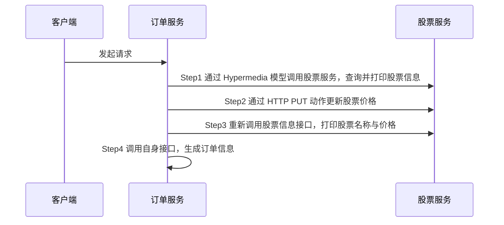

# Restful 规范精讲与 HATEOAS 入门：Richardson 成熟模型、URI 规范、链接类型与服务设计

智牛股第三章"技术基础二"从 Restful 与 HATEOAS 讲起。这一篇覆盖单元的上半部分：先把 Restful 的定义、Richardson 成熟模型、常用 HTTP 状态码和 URI 编写规范讲透，再进入 Level 3 的超媒体控制 HATEOAS——概念、常用链接类型与 CRUD 用法，最后给出订单服务与股票服务的整体设计，并把父级工程和依赖配置搭好。工程实现与两个服务的启动验证，放在下一篇展开。

## 先给结论

- REST 是一种软件架构与设计风格，并非一套标准：标准与规范必须遵照执行，风格只提供基本原则与约定条件，尽量遵循即可。它提供的一组架构约束强调组件交互的可伸缩性、接口的通用性、组件的独立部署，并能减少交互延迟、增强安全性、封装遗留系统的中间组件——满足这些约束和原则的应用设计就是 Restful。
- Richardson 成熟模型（Leonard Richardson 提出）分四级：Level 0 The Swamp of POX → Level 1 Resources → Level 2 HTTP Verbs → Level 3 Hypermedia Controls。Level 2 的核心是用标准 HTTP 方法操作资源，Level 3 就是 HATEOAS，是最高阶、最成熟的 REST 模型。
- REST 风格用 HTTP 状态码表达处理结果，而不是像传统接口那样统一返回一个 JSON 里的 success 标志：创建成功看 201，服务端已接受请求看 202，修改、删除成功看 200；401 未认证、404 未找到、500 服务端错误必须熟悉。
- URI 编写规范四条：路径用斜杠 `/` 表示资源层次关系；逗号 `,` 与分号 `;` 表示非层次元素；查询部分用 `&` 分割参数；避免出现 `.jsp`、`.json`、`.xml` 这类文件扩展名。
- HATEOAS（Hypermedia as the Engine of Application State）是 REST 架构风格中最复杂的约束，也是构建成熟 REST 服务的核心：服务端在响应里嵌入 link 链接，客户端按链接发现并调用下一步接口，直观到甚至可以省略 API 接口文档。
- 工程侧采用 Spring Data REST 实现 Hypermedia 规范，设计订单服务与股票服务两个遵循 HATEOAS 风格的服务；数据层用 Spring Data JPA 省去实现类，数据库选 H2 内存库（重启数据即失，够演示用）。

## Restful 是什么：定义、成熟模型与状态码

### 风格与标准的区别

REST 的定义一句话：**一种软件架构与设计风格，并非一套标准，只提供了一些原则与约定条件。**这里的措辞值得抠一下——标准与规范要求所有人必须遵照执行（比如 JSR 规范、SPI 机制这类），而风格没有强制约束力。REST 从设计层面提供一组约束条件和原则，遵循它去做设计，产出的应用就属于 Restful。

把 REST 当作一个整体服务来应用时，这些架构约束指向几个明确的目标：组件交互的可伸缩性、接口的通用性、组件的独立部署，以及减少交互延迟、增强安全性、用中间组件封装遗留系统。

### Richardson 成熟模型：四个层级

Leonard Richardson 发明的 REST 成熟模型，把服务实现的成熟度分成四级，从下往上逐级演进：

| 层级 | 名称 | 含义 |
| :--- | :--- | :--- |
| Level 0 | The Swamp of POX | POX 泥潭，最原始的形态 |
| Level 1 | Resources | 面向资源 |
| Level 2 | HTTP Verbs | 加入 HTTP 动作类型（GET、POST 等） |
| Level 3 | Hypermedia Controls | 超媒体控制，即 HATEOAS |

Level 1 先把接口按资源组织；到 Level 2，同一个资源路径配合不同 HTTP 方法表达不同操作，以订单为例：

| URI | HTTP 方法 | 说明 |
| :--- | :--- | :--- |
| /order/ | GET | 获取所有订单信息 |
| /order/ | POST | 增加新的订单信息 |
| /order/{id} | GET | 获取指定的订单信息 |
| /order/{id} | DELETE | 删除指定的订单信息 |
| /order/{id} | PUT | 修改指定的订单信息 |

Level 3 加入超媒体控制后，服务器返回的不只是数据，还有资源链接。课程用医生预约系统演示了这套交互：

```http
GET /doctors/mjones/slots?date=20100104&status=open

HTTP/1.1 200 OK
<openSlotList>
  <link rel="linkrels/slot/book" uri="/slots/1234"/>
</openSlotList>

POST /slots/1234
<appointmentRequest/>

HTTP/1.1 201 Created
Location: http://royalhope.nhs.uk/slots/1234/appointment
```

客户端先查医生的可预约时段，响应里带一个 link 指向具体时段资源；客户端再按这个链接发起 POST 完成预约，服务器返回 201 Created 和新资源的地址。客户端不需要预先知道"预约"这个动作的地址——响应里的 link 已经指明了下一步去哪，这正是 HATEOAS 要做的事。

### 用状态码表达处理结果

传统写法里，新增一条数据通常统一返回 200，再在 JSON 里带一个 success 字段告知操作结果；REST 风格则直接靠 HTTP 状态码传达处理结果，所以常用状态码必须熟：

| 状态码 | 描述 | 状态码 | 描述 |
| :--- | :--- | :--- | :--- |
| 200 | OK | 400 | Bad Request |
| 201 | Created | 401 | Unauthorized |
| 202 | Accepted | 403 | Forbidden |
| 301 | Moved Permanently | 404 | Not Found |
| 303 | See Other | 410 | Gone |
| 304 | Not Modified | 500 | Internal Server Error |
| 307 | Temporary Redirect | 503 | Service Unavailable |

对应到操作层面：创建对象是否成功看 201；服务端是否接受请求看 202；删除、修改是否成功看 200。404 资源未找到、401 未认证、500 服务端出错这几类错误码，是日常排查的必修课。

## 良好的 URI 编写规范

用 Restful 风格，URI 编写必须跟着变，最容易踩坑的是第一条。以前写接口习惯把动作写进路径，比如订单服务里加资金的接口写成 `order/addBalance`——这是动作式思维。Restful 要求 URI 只表达资源的层次关系：服务名在前，下面的资源模块逐级往下排（如 order-management、balance-management 这类层次），操作语义全部交给 HTTP 方法承载——GET 查询、POST 新增、PUT 修改、DELETE 删除。以前一个 POST 通吃增删改查的写法，在这里要改掉。

四条规范整理如下：

| 规范 | 说明 |
| :--- | :--- |
| 路径采用斜杠 `/` 分隔 | 表示资源之间的层次关系 |
| 路径使用逗号 `,` 与分号 `;` | 表示非层次的元素，比如分页场景里的页码参数 |
| 查询部分使用 `&` 分割参数 | `?page=0&size=3` 这种最常见的形式 |
| 避免出现文件扩展名 | 不要出现 `.jsp`、`.json`、`.xml`、`.html` 后缀，精确到资源层级即可 |

第四条值得单独强调：扩展名是内容格式的残留表达，REST 里内容由请求头协商决定，URI 只保留资源定位。这些规范不是可选项——要用 Restful 风格，就必须形成良好的 URI 编写习惯，后面的 HATEOAS 集成也建立在这套约定之上。

## HATEOAS：概念、链接类型与 CRUD 实操

### 概念与交互示例

HATEOAS 全称 Hypermedia as the Engine of Application State（超媒体作为应用状态的引擎），是 REST 架构风格中最复杂的约束，也是构建成熟 REST 服务的核心，对应成熟模型的 Level 3。

它怎么交互，看一个银行账户的例子就明白了。先发起请求，告诉主机地址和接收的数据类型：

```http
GET /accounts/12345 HTTP/1.1
Host: bank.example.com
Accept: application/xml
```

服务端返回 200 OK，`Content-Type` 为 `application/xml`，响应体里除了账户数据，还有一组 link：

```xml
<?xml version="1.0"?>
<account>
  <account_number>12345</account_number>
  <balance currency="usd">100.00</balance>
  <link rel="deposit" href="https://bank.example.com/accounts/12345/deposit" />
  <link rel="withdraw" href="https://bank.example.com/accounts/12345/withdraw" />
  <link rel="transfer" href="https://bank.example.com/accounts/12345/transfer" />
  <link rel="close" href="https://bank.example.com/accounts/12345/status" />
</account>
```

这笔账户允许的操作——存款、取款、转账、销户——连同调用地址一起返回给了客户端。客户端拿到链接后再次请求服务端，就能获取想要的接口数据。服务把"有哪些接口、地址是什么、怎么调用"全部自描述出来，客户端按需请求即可。

### 常用链接类型

链接里的 `rel` 属性标识链接语义，常用的有这几类：

| REL | 说明 |
| :--- | :--- |
| self | 指向当前资源本身的链接 |
| edit | 指向一个可以编辑当前资源的链接 |
| collection | 当前资源包含在某个集合中时，指向该集合的链接 |
| search | 指向一个可以搜索当前资源与其相关资源的链接 |
| related | 指向一个与当前资源相关的链接 |
| first / last / previous / next | 集合遍历相关：第一个、最后一个、上一个、下一个 |

一个抓包拿到的设备列表响应，能同时看到 `self` 和 `next` 的用法：

```xml
<list>
  <device>
    <link rel="self" href="http://host:port/res/device/11"/>
  </device>
  <link rel="next" href="http://host:port/res/device?start=10&size=10"/>
</list>
```

当前页每条设备的自身地址由 `self` 给出，要取下一页就按 `next` 的地址继续请求——分页信息直接由响应驱动。接口行为全靠链接引导，直观且可发现，这也是 HATEOAS 这么设计的优势与作用。

### CRUD 实操：账户预警通知模板

课程以账户预警通知模板资源做了一轮完整的增删改查演示，工具是 Postman，直连演示环境 `http://39.98.152.160:10680/admin/accountWarnNotifyTemplate`。四个操作各有要点。

**查：search 发现接口。**不清楚某个资源开放了哪些接口时，向 `/search` 发 GET 请求，它会列出该资源提供的接口、链接与参数名：

```json
{
  "_links": {
    "self": {
      "href": "http://172.16.8.125:10680/admin/accountWarnNotifyTemplate/12"
    },
    "getById": {
      "href": "http://172.16.8.125:10680/admin/accountWarnNotifyTemplate/search/getById?id=12",
      "templated": true
    },
    "getDistinctByWarnType": {
      "href": "http://172.16.8.125:10680/admin/accountWarnNotifyTemplate/search/getDistinctByWarnType",
      "templated": true
    }
  },
  "_embedded": {
    "accountWarnTemplates": [
      {
        "warnType": 1,
        "notifyType": "EMAIL",
        "content": "尊敬的客户，您所持有的产品${stockCode}$，当前价格${stockPrice}$元，已达到止损比例${stopProfitRate}$，请及时处理。",
        "title": "止损通知",
        "status": 0,
        "lastUpdateBy": 10429,
        "lastUpdateTime": "2019-08-30T06:36:30.000+0000",
        "_links": {
          "self": {
            "href": "http://172.16.8.125:10680/admin/accountWarnNotifyTemplate/12"
          }
        }
      }
    ]
  }
}
```

`getById` 按主键查、`getDistinctByWarnType` 按预警类型查，地址和参数都给全了，不查 API 文档也能直接调用。集合数据放在 `_embedded` 里，每条数据还内嵌了自己的 `self` 链接。

**分页与排序。**分页查询接收三个参数：`page`（查询第几页）、`size`（每页返回的数据量）、`sort`（分页排序字段）。三个参数都不是必填，可以只传一个或两个，按实际需要选择。比如 `?page=0&size=3&sort=lastUpdateUser.desc` 表示从起始第 0 页取 3 条，并按最后修改用户名倒序排——sort 的取值是"属性名.排序方向"，`.desc` 倒序、`.asc` 升序。参数拼装方式与普通请求一致，返回结果同样落在 `_embedded` 的 accountWarnTemplates 数组里。

**增：POST + JSON。**新增数据用 POST 提交，请求体必须是符合 JSON 规范的数据——XML 或普通文本都不支持。把预警类型、通知类型、预警内容、预警标题这些必要属性填进 JSON 发出去即可。

**改：PUT + ID 放路径。**更新与新增略有差别：一是动作类型换成 PUT；二是要明确更新哪一条数据，数据 ID 跟在请求路径后面——注意是路径，不是参数。以前写 Spring Boot 接口往往喜欢把 ID 作为参数传递，这里不行。另外 PUT 提交的 JSON 会整体覆盖对象：如果模板属性只提交了一部分，未提交的属性会默认为空，更新时要格外注意。

**删：DELETE + 只看状态码。**删除用 DELETE 方法（不是 PUT），ID 同样附在 URL 后面，比如删除第 15 条就是 `/accountWarnNotifyTemplate/15` 加 DELETE 提交。删除操作不返回任何结果，操作是否成功只能看 HTTP 状态码，返回 200 就代表成功——前面反复强调状态码的重要性，在这里正好用上。

## 服务设计与父级工程搭建

### 两个服务的整体设计

工程侧采用 Spring Data REST 实现 Hypermedia 规范，也就是 HATEOAS 的高阶形态。设计两个服务：订单服务和股票服务，都遵循 HATEOAS 风格。整体流转分四步：



Step 3 再查一次股票信息并打印，是为了和 Step 1 的输出比对，验证价格确实发生了修改；前几步都成功之后，订单服务才调用自身接口生成订单信息。这条流程会在下一篇的工程实现里逐行落地。

### 父级工程与依赖

工程结构分三层：先创建 hateoas-demo 父级模块，下面挂两个子模块——订单服务模块（hateoas-order）和股票服务模块（hateoas-stocks）。创建模块时保持完整命名，后续代码都挂在这棵树上。两个技术选型提前说明：

- **数据层用 Spring Data JPA**：它提供了一套简化 JPA 开发的框架，只需按约定好的方法命名规则编写 DAO 数据层接口，不用写接口实现就能访问和操作数据库。相比 MyBatis 每个接口还要写对应的 SQL 做映射，JPA 还内置了分页、排序、复杂查询等 CRUD 之外的能力，功能丰富，能极大减少开发工作量。
- **数据库用 H2 内存库**：本工程侧重对 HATEOAS 的理解和运用，数据不追求持久化，重启服务后数据会消失，演示足够。

父级工程搭好后先不急着写代码，第一步是把 HATEOAS 的组件依赖配齐，pom 里直接引入以下依赖：

- Spring Boot 标准依赖（starter-web）
- Spring Data JPA 依赖，支撑数据层增删改查
- Spring Boot Starter Data REST，Spring 对 RESTful 风格的实现组件，HATEOAS 能力的来源
- Jackson 相关支持，HATEOAS 响应的序列化靠它
- commons 常用工具包
- H2 内存数据库依赖
- Lombok 插件依赖

依赖就位，HATEOAS 的组件集成配置即告完成。接下来就是创建两个服务工程、实现功能代码并启动验证——这部分在下一篇展开。

## 小结

这一篇把 Restful 的"规范层"和 HATEOAS 的"概念层"打通了。REST 是风格不是标准，Richardson 成熟模型给出衡量成熟度的四把尺子：Level 2 靠 HTTP 方法表达操作语义，Level 3 靠超媒体链接驱动客户端行为；状态码取代 JSON 里的 success 标志成为处理结果的载体；URI 收敛为纯资源层次表达，扩展名、动作词都不要出现。HATEOAS 部分记住三样东西：响应里的 link、rel 的语义（self/edit/collection/search/first/next 等），以及 CRUD 各自的方法与约束——search 发现接口、分页三参数 page/size/sort、POST 必须交 JSON、PUT 的 ID 放路径且未传属性会置空、DELETE 无响应体只看状态码。下一篇文章进入工程实现：股票服务与订单服务的搭建、启动与验证。
