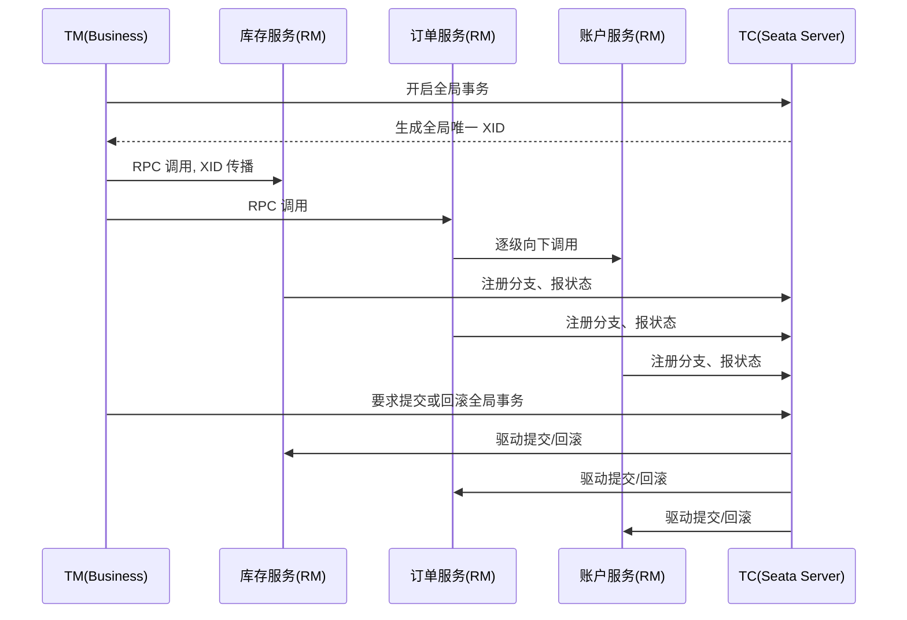

# gRPC 服务设计收尾与 SEATA 理论体系：2PC/TCC/异步消息、CAP/BASE 取舍、AT 机制与案例工程验证

智牛股第三章"技术基础二"在本单元完成两段收束：前一段敲定 gRPC 的服务设计与工程结构——对外 HTTP、对内 gRPC + Protobuf；后一段进入 SEATA 介绍与使用，从传统分布式事务方案（2PC、TCC、异步消息）讲到 CAP/BASE 理论，拆解 Seata 的 TC/TM/RM 机制与默认 AT 模式，最后把官方 Spring Boot 示例改造成案例工程，从配置跑到启动验证，用一次真实回滚确认 Seata 生效。

## 先给结论

- gRPC 服务设计口径：客户端经 HTTP 访问客户端服务，服务之间用 gRPC + Protobuf 传输；grpc-demo 父工程管理依赖，下挂 grpc-client、grpc-lib、grpc-server 三个子模块。实测性能提升约 32%、资源占用降低约 30%。
- 传统方案三条路各有代价：2PC 锁定时间长、单节点故障拖垮全局；TCC 侵入性强、补偿代码量大；异步消息最终一致但流程繁琐、维护成本高。
- CAP 三选二：一致性、可用性、分区容错性最多同时满足两个，一般牺牲强一致性换取后两者。
- BASE 是 CAP 的延伸：基本可用、柔性状态、最终一致性。
- Seata 三大组件：TC 维护全局与分支事务状态并驱动提交/回滚，TM 定义全局事务范围，RM 管理分支事务资源、向 TC 注册并报告状态；全局事务靠 XID 串起全部分支。
- AT 模式（默认）一阶段把业务数据与回滚日志放进同一个本地事务提交并释放本地锁，二阶段提交异步化、回滚反向补偿；应用侧只需在入口方法加 @GlobalTransactional。

## gRPC 服务设计收尾：对外 HTTP，对内 gRPC + Protobuf

服务交互只有两级跳：客户端经 HTTP 请求客户端服务，内部由客户端服务与股票服务之间用 gRPC 加 Protobuf 传输调用，股票服务提供访问股票价格的接口，处理完沿原路返回。对外 HTTP、对内 gRPC + PB。

工程结构是 Maven 多模块工程：

```markdown
grpc-demo
├── grpc-client
├── grpc-lib
└── grpc-server
```

三个子模块分别承载客户端、共享库与服务端。文档顶部还有实测注脚：gRPC 相比 REST 性能提升 32%、资源占用降低约 30%。

## 传统分布式事务方案：2PC、TCC 与异步消息

没有 Seata 之前，分布式事务靠三类传统方案处理。

两阶段提交（2PC）：第一阶段，A 用户服务、B 订单服务各向协调器报到"要提交事务"，进入预备就绪状态（并没有真正提交）；第二阶段，协调器统一下发提交指令，各本地资源管理器提交后回传结果，协调器据此决定是否回滚。缺点集中：预备到全部提交之间锁定时间长；节点多时耗时可观、性能影响大，可靠性达不到百分之百；任一节点故障，哪怕其余 999 个都成功也必须全部回滚——单点故障影响全局，可用性差，不适合微服务。

补偿事务（TCC）分 Try、Confirm、Cancel：业务应用启动事务并通知协调器，协调器调用服务 A、B 的 Confirm 接口做最终提交，出现故障或宕机则改调 Cancel 回滚。Try 做检测、校验与预处理；Confirm 做确认提交，Try 成功后 Confirm 一般也会成功；Cancel 在业务出错、甚至 Confirm 出错时补偿，例如转账没到账就把钱退回转账方账户——要么全对，要么全部撤回初始状态。缺点是侵入性强：每个节点都要预备 Cancel 接口，改金额就得有增有减两套逻辑，开发量大、不易维护。

异步消息一致性把分布式事务拆成本地事务，MQ 充当协调器：订单服务先改订单库，结果发给 MQ（Kafka、RocketMQ 等均可），MQ 下发给库存服务等下游节点，下游改库后回写消息状态，成功则全局一致，失败则上游回滚并记录未成功消息，确保其他节点都能回滚。A 系统先发 prepared 消息到 MQ，发送失败直接取消操作；消息成功后执行本地事务，成功发确认消息、失败发回滚消息——先写消息确认通讯 OK，再写本地事务；B 系统收到确认消息后执行本地事务；MQ 定时轮询所有发过 prepared 但未发确认消息的服务，按数据库状态决定重试还是回滚（先查库确认本地事务是否已执行）；B 事务失败则不断重试，仍失败时对资金类重要业务做全局回滚（通知 A 一并回滚），或报警人工处理。

## 理论与机制：CAP/BASE 取舍，Seata 的 TC/TM/RM 与 AT 模式

### CAP 与 BASE

先看面试常客 CAP。C（Consistency）一致性、A（Availability）可用性、P（Partition tolerance）分区容错性，经典三圆图标出 CA、CP、AP 三个交集，结论：分布式系统中三个条件最多同时满足两个。想三点兼顾只能折中——牺牲强一致性换取可用性与分区容错性，一致性落到弱一致，这条折中路就是 BASE 理论。

所谓"牺牲一致性"不是完全放弃一致性，而是牺牲强一致性换取弱一致性，换来兼顾全局的可能。BASE 三要素：

| 要素 | 含义 | 课程示例 |
| :--- | :--- | :--- |
| BA（Basically Available）基本可用 | 不可抗力下仍能返回明确结果 | 大促时响应时间适当延长，给部分用户返回降级页面——降级页面仍是明确结果，不是系统崩溃 |
| S（Soft State）柔性状态 | 同一数据的不同副本不需实时一致 | 主节点接收写入，从节点只是备份，异步线程做主从同步 |
| E（Eventual Consistency）最终一致性 | 一定时间之后必须一致 | 10:00 提交允许 10:05 不一致，10:10 必须全对或全错（如下单扣库存、改账户资金，靠检查或补偿机制保证最终一致） |

### Seata：从 Fescar 到三大组件

Seata 前身叫 Fescar（Fast Easy Commit And Rollback），2019 年 1 月由阿里巴巴中间件团队发起开源，愿景是让分布式事务像本地事务一样简单高效；蚂蚁金服随后共建，在 0.4.0 版本贡献了 TCC 模式。为打造更中立、开放、生态更丰富的社区，经核心成员投票，品牌升级为 Seata——Simple Extensible Autonomous Transaction Architecture，简单的、可扩展的、自治的事务架构，一站式分布式事务整体解决方案。

三大核心组件，面试必须能讲出定义与作用：

| 组件 | 全称 | 职责 |
| :--- | :--- | :--- |
| TC | Transaction Coordinator 事务协调者 | 维护全局和分支事务的状态，驱动全局事务提交或回滚 |
| TM | Transaction Manager 事务管理器 | 定义全局事务的范围：开启全局事务，提交或回滚全局事务 |
| RM | Resource Manager 资源管理器 | 管理分支事务处理的资源，向 TC 注册分支事务、报告状态，驱动分支事务提交或回滚 |

微服务都以本地事务方式处理、作为分支事务存在，服务之间走 RPC 通信，全部分支事务由全局 TC 协调管理；一个 Seata 分布式事务 = 一个全局事务（Global Transaction）+ 一批分支事务（Branch Transaction），分支事务即各微服务的本地事务：



串起全部分支的钥匙是 XID——全局唯一的事务标记 ID，类似链路监控的 TraceId：TC 生成后经调用链传播，RM 拿到 XID 把本地事务注册为对应全局事务的分支；节点故障要回滚时，回滚哪些事务就靠 XID 标识管理。最终决定权在 TC：驱动 XID 下所有分支提交或回滚。

### AT 模式：默认的落地方案

模式细节参考官方文档的 AT、MT、XA，默认采用 AT。前提：基于支持本地 ACID 事务的关系型数据库，Java 应用通过 JDBC 访问数据库。整体机制两句话：一阶段，业务数据和回滚日志在同一本地事务中提交，随后释放本地锁和连接资源；二阶段，提交异步化、非常快，回滚通过一阶段的回滚日志做反向补偿。

并发控制上，写隔离要求拿到全局锁才能写；两阶段全局提交后释放全局锁，下一个 Connection 拿到锁即可提交本地事务，保证写操作完全一致。读隔离上，AT 默认全局隔离级别是读未提交；要求全局读已提交时用 select for update 加行级锁，其他事务会被阻塞。

回滚靠镜像记录：业务表配套一张 undo_log，两个镜像——Before Image 前镜像记录提交前的数据初始状态，After Image 后镜像记录提交后的最终结果；回滚按 Before Image 全部恢复，提交成功则 After Image 保证数据是最终修改结果。以 `update product set name = 'GTS' where name = 'TXC';` 为例，undo log 记下 tableName、sqlType、xid、branchId 与前后镜像字段值，回滚时按 XID 和 Branch ID 找到对应 undo log 反向补偿；若出现脏读、幻读或数据被其他事务改动，回滚前还会做检查校验。

## 案例工程：改造、配置与启动验证

### 服务设计与版本选择

案例引用官方与 Spring Boot 结合的示例 seata-samples-springboot，集成后做调整。设计两个接口：一个修改状态（assetAssign），一个修改数量（increase）并抛出异常；两个接口不受内部事务控制，集成在同一工程。验证目标：增加数量接口抛异常后，修改状态接口的数据是否会回滚。单工程还是双工程不重要，没有事务控制就会产生数据不一致。

官方 Demo 存在 bug、依赖混乱（集成了 Dubbo），去掉 Dubbo 简化依赖，便于学习演示。版本硬建议：讲义编写时用 0.4.0，官方更新频繁且带 bug；最新 1.1.0 还不是正式版，正式版是 GA 版本，稳定性可靠，生产最好用 GA；学习演示用 0.9.0 就够，不要 0.8、0.7 及以下——实测会出现假死等不可预知错误。另外 1.0.0 GA 以上可无缝接入阿里 GTS 商业组件，补上 Seata 本身的高可用——Seata 挂了，所有节点的事务提交都会出问题。

### 代码与配置

启动入口 SeataDemoApplication 按 Spring Boot 方式启动，扫描包调整为 com.idcast。核心业务方法同时挂本地事务与全局事务注解，并打印 XID——看到 XID 就知道分布式事务有没有生效：

```java
@Override
@Transactional
@GlobalTransactional
public AssetAssign increaseAmount(String id) {
    LOGGER.info("Assign Service Begin ... xid: " + RootContext.getXID() + ", id: " + id);
    AssetAssign assetAssign = assignRepository.findById(id).get();
    assetAssign.setStatus("2");
    assignRepository.save(assetAssign);
    // remote call asset service：模拟远程调用，内部抛出 RuntimeException
    assetService.increase();
    return assetAssign;
}
```

上层调用加了 @Transactional 但没配置 rollbackFor 属性，即便抛出异常本地事务也不会回滚；真正的回滚由 @GlobalTransactional 完成。这个注解加在调用方法入口即可，侵入性非常低，符合 Seata 简单易用的设计原则；还能配置超时时间、针对哪些异常回滚（rollbackFor）、不需要回滚的异常等属性。

资源目录下两个关键文件管 Seata 的注册与配置。registry.conf 决定配置信息存放在哪个组件，支持 Nacos、Eureka、ZooKeeper、Redis 等注册中心，示例为简化默认走 file 模式指向本地文件，注册与配置分两部分管理。file.conf 里 transport 是基于 Netty 的配置策略，可按性能调整；store 是存储设置；service 是重点——事务分组是虚拟 group，默认 my_test_tx_group 映射到 default，默认值不要改，实际项目多组件集成时才配不同模块名；服务地址指向本地 8091 端口：

```properties
service {
  vgroup_mapping.my_test_tx_group = "default"
  default.grouplist = "127.0.0.1:8091"
}
```

客户端事务日志也记录信息，存储支持 db 与 file，默认 file，选 db 就补连接信息。SeataConfiguration 创建 GlobalTransactionScanner 扫描器加入 Spring 容器：

```java
@Bean
public GlobalTransactionScanner globalTransactionScanner() {
    // applicationId 对应服务名称，事务分组名必须与 file.conf 保持一致，改一处另一处跟着改
    return new GlobalTransactionScanner("my_test_tx_group");
}
```

application.yml：访问前缀 demo、服务名 seata-springboot-app，数据源指向本地虚拟机的 seata 库，init_db 的表结构也初始化进这个库：

```yaml
server:
  port: 9999
  servlet:
    context-path: /demo
spring:
  application:
    name: seata-springboot-app
  datasource:
    driverClassName: com.mysql.jdbc.Driver
    url: jdbc:mysql://192.168.19.150:3306/seata?useSSL=false&serverTimezone=UTC
    username: root
    password: 654321
```

JPA 按常规配置；未用到的 Dubbo 可不配。

### 启动验证

启动应用之前先启动 Seata Server：下载运行包，bin 目录执行 bat 脚本，日志末尾输出 Server start 即成功。Server 端 config 目录下同样有 file.conf 与 registry.conf，要调整的就两三处：default.grouplist 改成对外暴露的 IP 与端口；存储模式建议由 file 切到 db——Server 端走 db 才能更好管理控制，db 块配数据源实现、类型与连接信息，MySQL 支持较好，其他数据源不建议。

首次搭建要初始化数据库：安装包 config 目录下的脚本建 Server 三张表——global_table 全局事务表、branch_table 分支事务表、lock_table 锁控制表；业务侧再把案例下的 init_db.sql 执行一遍（表存在则删除重建），得到两张业务数据表和一张 undo_log——undo_log 是 Seata 做事务控制的表，一定要初始化：

```sql
DROP TABLE IF EXISTS `undo_log`;
CREATE TABLE `undo_log` (
  `id` bigint(20) NOT NULL AUTO_INCREMENT,
  `branch_id` bigint(20) NOT NULL,
  `xid` varchar(100) NOT NULL,
  `rollback_info` longblob NOT NULL,
  `log_status` int(11) NOT NULL,
  `log_created` datetime NOT NULL,
  PRIMARY KEY (`id`)
) ENGINE=InnoDB DEFAULT CHARSET=utf8;
```

启动 seata-demo，日志显示已连入 Seata Server 的 8091 端口、按事务组别连接。浏览器访问 `http://127.0.0.1:9999/demo/asset/assign`：接口抛出 RuntimeException，日志出现 rollback status: Rollbacked，资产信息做了数据还原。到数据库对照：asset_assign 的 status 仍为 4——代码明明要改成 2，初始化值就是 4，说明修改被回滚了；数量、金额记录仍为 1，没有累加。本地事务没回滚，是因为本地回滚必须开启事务并配置 rollbackFor 这类属性，示例里没配；真正的回滚正是通过 @GlobalTransactional 的全局分布式事务完成的。

日志同样验证：控制台打印出 XID，内容是 Seata Server 的 IP、端口加全局唯一标识，同一链路里 begin 的各条日志 XID 完全一致——数据与日志双重确认，Seata Server 基本运转没有问题。

## 小结

这一单元把第三章技术基础二收了尾。gRPC 侧：对外 HTTP、对内 gRPC + Protobuf，父工程挂 client/lib/server 三模块，实测性能 +32%、资源 -30%。理论侧：2PC 锁定长、TCC 侵入强、异步消息最终一致但流程繁琐；CAP 三选二，BASE 用弱一致性换全局兼顾。Seata 侧：TC 协调、TM 定范围、RM 管分支，XID 沿调用链传播串起全局事务；默认 AT，一阶段业务数据与回滚日志同事务提交并释放锁，二阶段异步提交、反向补偿，写隔离靠全局锁、读默认读未提交；落地只需 @GlobalTransactional 一个注解，业务库 undo_log 初始化后，一次带异常的调用就能在数据库与日志里同时看到回滚生效。
