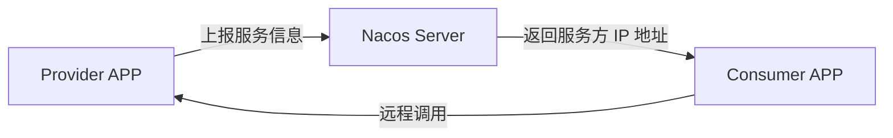

# Nacos 全解：特性、架构与服务发现工程落地 + Ceph 背景开篇

智牛股第四章「技术基础三」分两大块：前半部分把 Nacos 从简介特性、横纵对比、功能地图讲到架构设计与领域模型，再用一套 discovery 工程把服务注册发现和动态配置验证一遍；后半部分以 Ceph 的背景与特点开篇，为后续的架构深讲和集群搭建做铺垫。

## 先给结论

- Nacos 是服务注册发现与配置管理的开源组件，2018 年 7 月对外开源，支持注册、发现、配置的统一管理，可快速实现动态服务发现、配置、元数据与流量管理。
- 四大特性：服务发现与健康监测（DNS/RPC 发现加多种健康检查）、动态配置服务（版本跟踪、灰度发布、一键回滚）、动态 DNS 服务（权重路由、流量控制）、服务及元数据管理。
- 横纵对比里 Nacos 最突出的三点：一致性协议同时支持 CP+AP、健康检查方式最丰富、负载均衡支持权重/DSL/metadata/CMDB 多种策略；雪崩保护、多数据中心、三大生态集成也都齐。
- 架构上记几组概念：Nacos Server 由 Config Service 和 Naming Service 构成；数据模型 Key 由 Namespace、Group、Service/Data ID 三元组唯一确定；服务领域模型分服务、集群、实例三个层级。
- 工程落地用 nacos-discovery-demo 两个子模块验证：客户端 RestTemplate 加 @LoadBalanced 后直接用服务名调用，不写 IP；控制台改 stockName 后服务不重启即生效。
- Ceph 开篇：去中心化的分布式存储系统，起源于 Sage 博士期间的研究成果（2004 年发表），卖点是高性能（CRUSH 算法）、高可用（无单点故障、至少三节点组集群）、高扩展性（随节点线性增长），支持块、文件、对象存储接口。

## Nacos 是什么：四大特性与横纵对比

Nacos 的定位一句话就能说清：服务注册发现、配置和管理的开源组件，2018 年 7 月对外开源，提供一组简单易用的特性集，可快速实现动态服务发现、配置、元数据与流量管理。

四个特性逐个看：

| 特性 | 关键点 |
| --- | --- |
| 服务发现和服务健康监测 | 支持基于 DNS 和 RPC 的服务发现；实时健康检查，阻止向不健康的实例发请求；检查覆盖传输层（PING/TCP）与应用层（HTTP、MySQL、自定义），VPC 边缘网络等复杂环境也能覆盖；有 agent 上报与主动检测两种模式 |
| 动态配置服务 | 简洁易用的 UI 管理所有服务与应用配置；支持多环境、多版本统一配置；配置版本跟踪、灰度（金丝雀）发布、一键回滚、客户端配置更新状态跟踪，开箱即用 |
| 动态 DNS 服务 | 支持权重路由、灵活的路由策略与流量控制，以及数据中心内网的简单 DNS 解析；提供 DNS API 管理服务的关联域名与可用 IP:port 列表 |
| 服务及其元数据管理 | 可视化管理服务及元数据：服务描述、生命周期、静态依赖分析、健康状态、流量管理、路由及安全策略、SLA，以及最重要的 metrics 统计。这些特性是生产环境反复实践沉淀出来的 |

选型不能只看自己，还要横向比。Nacos 常拿来与 Eureka、Consul、CoreDNS、ZooKeeper 对比，先看两个硬指标：

| 对比项 | Nacos | Eureka | Consul | CoreDNS | ZooKeeper |
| --- | --- | --- | --- | --- | --- |
| 一致性协议 | CP+AP | AP | CP | / | CP |
| 健康检查 | TCP/HTTP/MySQL/Client Beat | Client Beat | HTTP/TCP/gRPC/Cmd | / | Client Beat |

CAP 里 C 是一致性、A 是可用性、P 是分区容错性。Nacos 可在 CP 与 AP 之间组合运用，比固定单一模式的组件灵活，应用场景也更丰富。

再看功能支持面：负载均衡上，Nacos 支持权重、DSL、metadata、CMDB 多种模式；Eureka 通过 Ribbon 实现（Feign 基于 Ribbon，Ribbon 又基于 RestTemplate），Consul 走 Fabio，ZooKeeper 没有原生提供。雪崩保护上，Nacos 和 Eureka 支持，Consul、ZooKeeper 不支持。自动注销实例 Nacos 支持；访问协议覆盖 HTTP、DNS、UDP 等；多数据中心、跨注册中心也支持。集成方面，Spring Cloud、Dubbo、K8s 生态都有良好支持，与同出阿里的 Dubbo 集成更有天然优势。综合这些维度，Nacos 被选作本项目的注册与配置中心方案。

功能地图从宏观认识即可：优势大图——简单易用、特性丰富（十年经验沉淀）、超高性能、超大容量、高可用（经过双11检验）；生态大图覆盖 Spring Cloud、Dubbo、K8s、Node.js；特性大图是服务发现、配置管理、DNS 服务，日常用得最多的是前两个；架构大图是逻辑架构、领域模型、部署架构、类图；业务大图里配置管理策略丰富，含路由规则、限流规则（结合 Sentinel）、动态数据源、预热、预案与开关。

## 架构设计：基本架构、逻辑架构与领域模型

先看基本架构。Provider APP 把服务信息上报给 Nacos 服务中心，Consumer APP 从 Nacos 获取服务提供方的 IP 与地址信息，拿到地址后发起远程调用。



Nacos Server 内部：最上层是 OpenAPI，支持 HTTP、DNS、UDP、TLS 等传输方式；中间是两大核心服务模块——Config Service 负责统一配置管理（提供动态配置、元数据及配置管理服务），Naming Service 负责服务的注册与发现（提供对象名称与关联元数据之间的映射管理，服务发现和 DNS 服务是它的主要应用场景：一个 Service Name 对应一份 Endpoint Info，含 DNS Domain Name 与 IP 连接信息）；往下是 Consistency Protocol 一致性协议，支持 Raft、Sync Renew、RDBMS Based 等方式。Nacos Console 管理后台由 User Console、Admin Console、自定义 Console 组成，可动态修改配置，也可停止、屏蔽服务。

元数据的定义值得单独记：包括服务端点 Endpoints、服务标签、版本号、负载均衡的实例权重、路由规则、安全策略等描述服务的数据，合起来组成完整的服务元数据。

逻辑架构层面，Nacos 采用领域模型、模块化设计、可插拔式管理，易于扩展和维护。OpenAPI 是标准 REST 风格的 HTTP 接口，统一对接 Client、SDK、Agent、CLI。核心模块分三类：服务管理（服务 CRUD、负载策略、健康检查）、配置管理（配置 CRUD、版本管理、灰度管理、监听管理、推送、数据聚合）、元数据管理（CRUD）。可插拔体现在插件机制：功能插件有名称服务、CMDB、Monitor/Metrics、通知系统；管理插件有接入管理、用户管理、角色管理、权限管理、审计系统。另外支持统一存储——集群搭建时把数据放到 MySQL 等统一存储中心，实现高可用，保障一致性和分区容错，即 CP、AP 两种模式的落地。

领域模型是这套设计的方法论：业务领域内的人员用共同语言交流，不断发现并抽象出概念，形成领域模型后驱动软件设计、用代码实现（如 VO、BO）。金融领域的股票、期货、期权就是领域专有的抽象概念。落到 Nacos 上有三组模型：

- 数据模型：Key 由三元组唯一确定——Namespace、Group、Service/Data ID。Namespace 默认空串，即公共命名空间 public；Group 默认 DEFAULT_GROUP。把三元组当三个维度理解：最外层 Namespace 标识开发、测试、生产环境；中间 Group 把业务分门别类（交易、用户、资金服务）；最内层是具体的服务节点信息。
- 服务领域模型：三个层级。服务包含健康检查、元数据、路由机制与阈值保护；集群包含健康检查、元数据和同步机制；实例包含 IP、端口、权重、运行状态与响应时间。
- 配置领域模型：两个实体，配置变更历史和服务标签 TAG，通过 ID 关联。变更历史记录修改内容、时间、IP 与修改人，便于追溯；TAG 可自定义业务标签。

类图再看实现套路：最上层 NacosFactory 采用工厂方法设计模式，向下派生 ConfigFactory（负责配置的管理和实现）与 NamingFactory（负责服务的注册、发现管理）；往下是 OpenAPI 调用层，Client Worker 提供主要接口，ServerHttpAgent 涉及 Access Key、Secret Key 的权限访问控制；再往下 ServerListManager 提供 Cluster ID、Tag、Namespace 等属性；最底层 HttpSimpleClient 完成 HTTP 调用。

## 工程落地：discovery 双模块搭建与启动验证

版本口径先定住：安装建议采用 1.0.1——官方已迭代到 1.2.1（讲义编写时还是 0.8/0.9），早期版本有稳定性、兼容性问题。安装目录不用修改，配好免密后执行 startup.cmd 启动，注意观察启动日志：服务运行时间长、注册信息多时可能出现假死，以日志出现启动成功提示为准。之后访问 127.0.0.1:8848 控制台。

配置中心验证用 nacos-config-demo。应用里用 @Value 注入配置：

```java
@SpringBootApplication
@RestController
public class NacosConfigDemoApplication {

    @Value(value = "${stockName:中国平安}")
    private String stockName;

    @RequestMapping("/getStockName")
    public String getStockName() {
        return "股票名称：" + stockName;
    }
}
```

控制台「配置列表」点加号新建配置：Namespace 默认 public（保留空间，多环境建议按环境创建不同命名空间），Group 默认 DEFAULT_GROUP（业务节点多时按业务归类分组），Data ID 填 nacos-config-demo.properties（与工程引用一致），格式选 properties，内容写 stockName=工商银行，发布。启动应用（端口 8080）访问 getStockName 接口，返回「股票名称：工商银行」——默认值是中国平安，说明读的是配置中心的值，配置读取链路正常。

动态配置验证：控制台把工商银行改成招商银行再发布。发布时 Nacos 会提示修改差异，防止线上重要配置改错造成不可预知的损失。发布后后台日志打印 loading nacos data——客户端检测到 nacos-config-demo 数据标识的内容变化并重新加载；刷新接口，服务没有重启，返回值已变成招商银行，动态刷新验证通过。

服务注册发现验证用 nacos-discovery-demo 父模块，下挂两个子模块：nacos-discovery-client（消费端）和 nacos-discovery-server（提供端）。注册发现的依赖已在父工程统一引入，子模块无需额外加依赖。

客户端实现：

```java
@SpringBootApplication
@EnableDiscoveryClient
@RestController
public class NacosDiscoveryClientApplication {

    @Autowired
    private RestTemplate restTemplate;

    @Bean
    @LoadBalanced
    public RestTemplate restTemplate() {
        return new RestTemplate();
    }

    // 提供客户端获取股票价格接口
    @RequestMapping("/clientGetStockPrice")
    public String clientGetStockPrice(String name) {
        String result = restTemplate.getForObject(
                "http://nacos-discovery-server/getStockPrice?name=" + name,
                String.class);
        return result;
    }
}
```

要点是 @LoadBalanced：让 RestTemplate 具备负载均衡调用能力，URL 直接写服务名 nacos-discovery-server，不指定 IP，由 Nacos 解析出实际节点。客户端配置：

```properties
server.port=8092
spring.application.name=nacos-discovery-client
spring.cloud.nacos.discovery.server-addr=127.0.0.1:8848
```

服务端实现：

```java
@SpringBootApplication
@EnableDiscoveryClient
@RestController
public class NacosDiscoveryServerApplication {

    // 提供查询股票价格的接口
    @RequestMapping("/getStockPrice")
    public String getStockPrice(
            @RequestParam(defaultValue = "中国平安") String name) {
        return "股票名称：" + name + "，股票价格："
                + (new Random().nextInt(10000));
    }
}
```

返回值用随机数，保证每次访问结果不一样，便于直观验证调用链路。服务端配置：

```properties
server.port=8091
spring.application.name=nacos-discovery-server
spring.cloud.nacos.discovery.server-addr=127.0.0.1:8848
```

验证流程：Nacos 启动成功后，先启动 client 和 server 两个应用。打开控制台「服务列表」，能看到 nacos-discovery-client 已成功注册，刷新后 nacos-discovery-server 也在列表里。浏览器访问 127.0.0.1:8092 的 clientGetStockPrice 接口，传 name=中国平安，能正常返回股票名称与价格，多次刷新价格随随机数变化。client 调用 server 全链路走通，服务节点间的互访正是依赖 Nacos 的注册发现完成的。至此配置读取、动态配置修改、服务注册发现三项全部符合预期。

## Ceph 开篇：去中心化的分布式存储

同一章后半程进入第 2 章 Ceph 介绍。本章目标两点：了解 Ceph 的基本概念、功能与作用；了解它的逻辑架构与基本工作机制。分析路线：背景与特点 → 与主流存储系统对比（FastDFS 等组件的差异与适用场景）→ 整体设计 → 核心组件与概念 → 逻辑架构 → IO 工作流程图 → RBD IO 流程图 → 心跳机制 → 通信机制（Swift、S3 等接口）。技术组件必须全面考虑后再选，才能发挥技术价值。

背景：Ceph 是一个去中心化的分布式存储系统。选去中心化的原因在容错性——中心化系统里中心节点一旦出问题，整个服务可能崩溃或不可用；去中心化后集群可扩到成百上千个节点，某个节点出问题不影响整体运转。Ceph 起源于 Sage 就读博士期间的工作成果，2004 年发表并贡献给开源社区，现已得到众多云计算厂商支持并被广泛应用，亚马逊等云平台也采用它作为分布式存储实现方案。

特点四条：

| 特点 | 表现 |
| --- | --- |
| 高性能 | 采用 CRUSH 算法实现数据分布均衡，数据平衡存储到各节点，不会出现单节点压力过大阻塞系统；并行度高，可支持上千节点并持续扩充；支持 TB 级、PB 级数据 |
| 高可用 | 支持故障域分隔、数据强一致性、无单点故障、自动管理；集群至少需要三个机器节点，只要存活节点数仍大于基数，服务就能继续正常运行 |
| 高扩展性 | 去中心化、灵活性高，容量与吞吐随节点增加线性增长，扩容没有明显性能损耗 |
| 场景丰富 | 支持块存储、文件存储、对象存储及自定义接口；C++ 底层实现，兼容 Java、C 等多语言调用，API 丰富便于快速接入 |

三种存储类型的适用场景要分清：

- 块存储：把磁盘空间映射给主机使用，适用于 Docker 容器、虚拟机磁盘分配、日志存储等场景。
- 文件存储：解决块存储无法共享的问题——块存储方案对文件共享支持不好；在服务器间架设 FTP、NFS 服务器，适用目录结构存储，局域网内有协作需求时选它。
- 对象存储：在大容量硬盘上安装存储管理软件，对外提供读写访问能力；兼具块存储的高速读写和文件存储的共享特性，适合图片、视频存储。

## 小结

Nacos 这一章的脉络是「是什么—为什么选它—怎么设计的—怎么用起来」：四大特性覆盖服务发现、配置管理、动态 DNS 和元数据管理；横纵对比从一致性协议、健康检查、负载均衡等维度说明选型理由；架构上从基本架构、逻辑架构到数据模型三元组与服务领域模型三层级，理解它领域驱动、可插拔的设计；工程上以两个案例验证了配置读取、动态刷新与注册发现全链路。Ceph 部分完成开篇：明确了去中心化动机、四大特点与三种存储类型的边界，后续将展开存储系统对比、核心组件、CRUSH 与 IO 流程、心跳与通信机制，直至集群搭建。
