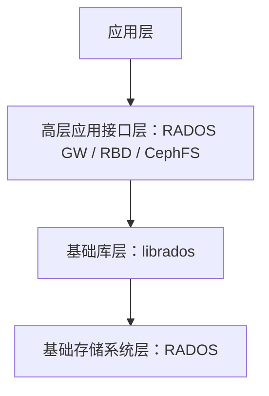

# Ceph 架构深讲（MON/OSD/MDS、CRUSH、IO 流程）与集群搭建实录

智牛股第四章 Ceph 部分的后半程分两条线：先讲原理——把 Ceph 放进分布式存储横纵对比里，拆开四层整体设计、核心组件、IO 流程、心跳检测与通信机制；再落实操——用三台 CentOS 7.6 虚拟机按 ceph-deploy 流程搭出一个 HEALTH_OK 的三节点集群。

## 先给结论

- 与 TFS、FastDFS、MooseFS、GlusterFS 相比，Ceph 的差异化在：开发语言 C++、同时支持对象/文件/块三种存储方式、支持在线扩容、无单点故障，且基于 CRUSH 算法，大中小文件都有良好性能表现。
- 整体设计四层：应用层 → 高层应用接口（RADOS GW/RBD/CephFS）→ 基础库 librados → 基础存储系统 RADOS。RADOS 是理解 Ceph 的基础与关键，Ceph 的高可靠、高可扩展、高性能、高自动化本质上都由这一层提供。
- 组件记忆线：Monitor 组小集群、Paxos 同步、保存 OSD 元数据；OSD 响应客户端请求；PG 是包含多个 OSD 的逻辑组，负责数据分配与定位；CRUSH 类似一致性哈希；RBD/RGW/CephFS 分别对应块、对象、文件服务，都经 librados 访问 RADOS。
- IO 主线一句话：Client 先连 Monitor 拿集群 map，读写直接打主 OSD，主 OSD 同步写两个副本，三份写成功才返回——强一致性；RBD 场景多一步 pool→rbd→pg 逐层映射。
- 心跳检测：OSD 监听 public/cluster/front/back 四个端口；同 PG 内 OSD 互发 PING/PONG，每 6 秒一次并加随机时间错峰，20 秒收不到进 failure 队列观察。
- 集群搭建：三台 10.10.20.11/12/13，CENTOS7-1 兼任管理节点；配 hostname/hosts/清华 yum 源/NTP/免密 SSH/关防火墙与 SELinux，然后 ceph-deploy new → install → mon → admin → mgr → osd create，ceph -s 看到 HEALTH_OK 即成功。

## 存储系统对比与整体设计：RADOS 是理解 Ceph 的关键

先把 Ceph 放进分布式存储的对比里，比较对象是 TFS、FastDFS、MooseFS、GlusterFS 这几个知名开源系统：

| 维度 | Ceph 的表现 |
| --- | --- |
| 开发语言 | C++（几个系统基本都是 C 系列，差异不大） |
| 数据存储方式 | 对象、文件、块三种都支持（其余多为单一方式，如 TFS 是块存储、FastDFS 是文件/Trunk 方式） |
| 在线扩容 | 支持动态节点扩充 |
| 冗余备份 | 支持（文件存储系统必须做好冗余备份） |
| 单点故障 | 无，集群模式架构（TFS、MooseFS 存在单点故障） |
| 易用性 | 安装比较简单，官方文档专业化、操作说明详细 |
| 适用场景 | 大中小文件通吃（其他集群只适合小文件、中小文件或大中型文件之一），跨集群云存储 |

通吃的底气来自底层设计：Ceph 基于 CRUSH 算法做分布式均衡存储，不管文件大小都有良好性能表现，整体优势比较明显。

再看整体设计，四层结构：



- RADOS：Reliable Autonomic Distributed Object Store，可靠的、自动化的、分布式的对象存储系统，自组织、可自动修复、自我管理。所有存储在 Ceph 中的用户数据最终都由这一层存储，Ceph 的高可靠、高可扩展、高性能、高自动化本质上也是由它提供。它由大量存储设备节点组成，每个节点拥有 CPU、内存、硬盘等硬件，运行操作系统和文件系统。
- librados：对 RADOS 的抽象和封装，向上层提供 API 以便直接调用访问操作 RADOS——注意是 RADOS 而不是整个 Ceph 集群。RADOS 是对象存储系统，librados 的 API 只针对对象存储功能，不负责集群管控、节点状态的控制修改。RADOS 用 C++ 开发，原生 API 提供 C 和 C++ 两种；librados 与基于它开发的应用位于同一台机器，所以也叫本地 API——应用调用本地 librados API，再由它通过 Socket 与集群节点通信完成操作。
- 高层应用接口三个：RADOS GW 提供与 Amazon S3、Swift 兼容的 RESTful API 网关，抽象层次更高但功能不如 librados 强大——越底层接口越灵活、功能越强，越高层封装越完善但接口不丰富，按需求选择；RBD 提供标准块设备接口，常用于虚拟化场景为虚拟机创建 Volume 磁盘卷，Red Hat 已把 RBD 驱动集成进 KVM/QEMU 提升访问性能；CephFS 是 POSIX 兼容的分布式文件系统（POSIX 定义操作系统与应用交互的接口标准，Linux/Windows 都实现基本 POSIX 标准，程序源码级可移植），但还处于开发状态，官网不推荐用于生产环境。

一个容易困惑的问题：RADOS 自身已是对象存储系统，为何还要单独开发 RADOS GW？librados 提供本地 API，RADOS GW 提供 RESTful API，编程模型和性能不同（RESTful 比不过底层直接调用），根源是抽象层次与目标应用场景的差异。打个比方，RADOS 相当于 JDK，RADOS GW 相当于 Spring Framework——在 JDK 之上做了进一步封装，提供很多现成工具，不用再造轮子，操作接口更丰富。Swift 的 API 包括用户管理（用户认证等）、容器管理（创建/读取容器）、对象管理（写入/读取/复制/更新）；这里的容器不是 Docker 容器，是桶的概念——Ceph 的存储结构不按路径划分，而是按用户、桶来组织文件。

## 核心组件、逻辑架构与 IO 流程

核心组件与概念一张表收齐：

| 组件 | 说明 |
| --- | --- |
| Monitor | 集群的监控组件；多个 Monitor 组成小集群，通过 Paxos 协议同步数据，保存 OSD 的元数据——OSD 元数据正常，整个集群才高可用 |
| OSD | Object Storage Device，负责响应客户端请求、返回具体数据的进程；集群一般由很多个 OSD 组成 |
| MDS | Ceph Metadata Server，CephFS 服务依赖的元数据服务 |
| Object | 最底层的存储单元（并非 Java 的 Object），包含元数据和原始数据 |
| PG | Placement Groups，逻辑概念，包含多个 OSD，相当于 OSD 的组别；引入它是为了更好地分配与定位数据 |
| RADOS | 集群的核心与精华，负责实现数据分配、Fail Over 等集群操作 |
| librados | RADOS 的开发库；RADOS 从协议上很难直接访问，上层 RBD、RGW、CephFS 都通过它访问；支持 PHP、Ruby、Java、Python、C、C++ |
| CRUSH | 数据分布算法，实现数据均衡分配，类似一致性哈希，让数据平均散落到各节点 |
| RBD | RADOS Block Device，Ceph 对外提供的块设备服务 |
| RGW | RADOS Gateway，对外提供的对象存储服务，接口与 S3、Swift 兼容，原有应用可无缝迁移 |
| CephFS | Ceph File System，对外提供的文件系统服务，可配合 NFS 做文件共享 |

逻辑架构（CephFS 视角）四个角色：Ceph Client 是 Ceph 文件系统的用户，位于用户空间与 Linux 内核，通过 POSIX 协议访问操作集群；CMDS（Ceph Metadata Daemon）是负责元数据处理的后台进程，带 DRAM Cache 提升访问性能；OSD（Ceph Object Storage Daemon）提供实际存储——数据就是文件，元数据是管理信息、协调信息、头部数据等；Monitor 提供集群管理。

文件系统 IO 流程是面试高频，八步记牢：

1. Client 连接 Monitor，获取集群 map 信息（集群有哪些节点、连接信息如何）；
2. 新主 OSD1 由于没有 PG 数据，主动上报 Monitor，告知让 OSD2 临时接管为主（PG Temp [2,3,1]）；
3. 临时主 OSD2 将数据全量同步给新主 OSD1（backfill 过程）；
4. Client IO 读写直接连临时主 OSD2——同步需要时间，不能让 Client 干等；
5. OSD2 收到读写 IO 请求后，同时写入另外两个副本节点；
6. 等待 OSD2 与两个副本都写入成功——保证强一致性，而不是单节点写完就返回；
7. 三份数据全部写入成功后才返回 Client，IO 线程读写完毕；
8. OSD1 同步完毕后，临时主 OSD2 才交出主角色（做事有始有终），OSD1 成为新主，OSD2 变回副本。

RBD 块存储的 IO 更底层一层：Client 通过 LibRBD 或 Kernel RBD 操作 librados，用 LibRBD 创建块设备并向其写数据；客户端本地调用 librados 接口后，经 Pool、RBD Object、PG 逐层一一映射，在 PG 层确定数据保存在哪三个 OSD；随后客户端与 Primary 主 OSD 建立 Socket 通讯传入数据，由 Primary OSD 转发给其他副本 OSD 节点——不管多少个副本都要发送，确保整体数据一致。Ceph 无单点故障，某个节点出问题其余节点立刻接管为主，因此必须强一致，否则容易出现文件不一致。

## 心跳检测与通信机制

心跳的核心矛盾是权衡：故障检测时间和心跳报文带来的负载怎么平衡——频率太高影响整体性能，太低又延长发现故障节点的时间、影响可用性。微服务节点间的心跳（比如 Nacos）面临同样的两难。

故障检测策略四个目标：及时性——节点宕机或网络中断时，集群在可接受时间范围内感知；适当的压力——对节点和对网络的压力都要适度；容忍网络抖动——高峰期偶尔延迟不能直接判定节点故障，要有容错策略；扩散机制——节点存活状态变化引起的元信息变化，要能扩散到整个集群（节点上百个时如何快速扩散也是课题）。

OSD 节点监听四个端口：

| 端口 | 作用 |
| --- | --- |
| public | 监听来自 Monitor 和 Client 的连接 |
| cluster | 监听来自 OSD 节点的通讯信息 |
| front | 客户端连接集群使用的网卡，基于它发心跳做存活检测 |
| back | 集群内部使用的网卡，负责内部之间的心跳 |

hbclient 是发送 ping 心跳 message 的送信者，只发 ping，用于 OSD 内部之间检测彼此存活状态。同一个 PG 内的 OSD 互相心跳：PG 是 OSD 的组别，组内节点互发 PING/PONG（信息量非常小），每 6 秒一次，实际会再加一个随机时间避免峰值——固定频率可能刚好撞上请求峰值产生冲突；20 秒没检测到心跳就加入 failure 队列观察，区分是网络波动造成的假死还是节点真正宕机。

通信机制上，Ceph 网络通信框架有三种实现方式：

| 方式 | 特点 |
| --- | --- |
| Simple 线程模式 | 每个网络链接创建两个线程（一个接收一个发送）；大量链接产生大量线程，很快耗尽 CPU 等硬件资源。简单但负荷大 |
| Async 事件 I/O 多路复用 | 加入异步处理概念，当前网络通信广泛采用的方式，新版 Ceph 默认采用 |
| XIO 方式 | 使用开源库 Accelio 实现，依赖第三方库稳定性；目前处于实验阶段，学习测试可以，生产环境不要用实验版本 |

消息内容主要分三部分：header 头部（头部标识、请求业务类型、传输包大小、CRC 校验等，类似自定义传输包的包头）；user data 实际发送的数据（其中 payload 是操作保存的元数据，middle 是预留字段——为未来版本扩展新功能留空间，data 用于读写请求与响应数据）；footer 结束标记，据此判断消息是否传输完成。

消息发送处理流程（Simple 模式，C++ 底层实现，有初步认识即可）：Acceptor 监听 peer 请求，调用 SimpleMessenger::add_accept_pipe() 创建新的 Pipe；Pipe 负责消息读取和发送，包含 Pipe::Reader 与 Pipe::Writer 两个组件；Messenger 是消息发布者，OSD、Monitor、MDS 等守护进程是消息订阅者（Dispatcher 是订阅者基类），类似 Netty NIO 的分发处理机制；Messenger 收到消息后经 Pipe 读取，转给 Dispatcher 处理——先派发给对应线程做逻辑处理，提升吞吐、减少瓶颈；具体订阅后端继承 Dispatcher，初始化时通过 Messenger::add_dispatcher_tail/head 注册，收到消息即被通知处理；DispatchQueue 缓存收到的消息（峰值请求量大时先入队），再唤醒 DispatchQueue::dispatch_thread 分发线程找到后端 Dispatcher 处理——类似 Struts2/MVC 的 dispatch，收到 HTTP 请求后分发给具体 Controller 做逻辑处理。

## 集群搭建实录：三节点从系统配置到 HEALTH_OK

先明确本章定位：Ceph 必须集群模式使用，配置复杂，课程明确不要求掌握集群安装，侧重与项目的集成运用——但流程值得走一遍。部署结构：三台 CentOS 7.6 虚拟机，网段 10.10.20，IP 为 10.10.20.11/12/13，主机名 CENTOS7-1/2/3；第一台是主节点，兼任 admin 管理节点、mon、OSD、MDS，另外两台跑 node、OSD、mon、MDS。

系统配置三台都要做：

```bash
# 1. 修改主机名，规范统一（后续节点按名称通讯）
vi /etc/hostname        # 分别改为 CENTOS7-1 / CENTOS7-2 / CENTOS7-3

# 2. 编辑 hosts，加 IP 与主机名映射（配好才能按名称 ping 通）
vi /etc/hosts
# 10.10.20.11 CENTOS7-1
# 10.10.20.12 CENTOS7-2
# 10.10.20.13 CENTOS7-3
```

这里有个坑：主机名必须和 Ceph 节点名称保持一致——主机叫 CENTOS7-1，节点就不能另起 ceph-1，安装时要检查主机名，不一致会出问题。

```bash
# 3. yum 源换清华镜像，避免网速过慢（/etc/yum.repos.d/ceph.repo）
# baseurl=https://mirrors.tuna.tsinghua.edu.cn/ceph/rpm-mimic/el7/x86_64/

# 4. 安装 ceph 与 ceph-deploy（后者是主节点与其他节点通讯管理的组件）
yum update && yum -y install ceph ceph-deploy

# 5. NTP 时间同步：虚拟机重启后时间停留在旧状态，
#    时间不一致整个集群无法做正常的健康检查
yum install ntp ntpdate ntp-doc -y
systemctl enable ntpd
# /etc/rc.local 追加开机同步；crontab 每小时同步一次
/usr/sbin/ntpdate ntp1.aliyun.com > /dev/null 2>&1; /sbin/hwclock -w
# crontab 表达式：0 */1 * * * ntpdate ntp1.aliyun.com > /dev/null 2>&1; /sbin/hwclock -w
```

免密 SSH：官方建议不用系统内置用户（如 root），三台机器都要创建专用用户并配置 sudo：

```bash
useradd -d /home/ceph_user -m ceph_user
passwd ceph_user        # 密码同样设为 ceph_user
# sudo 免密，文件权限 0440（只读）
echo "ceph_user ALL = (root) NOPASSWD:ALL" | sudo tee /etc/sudoers.d/ceph_user
sudo chmod 0440 /etc/sudoers.d/ceph_user
```

主节点上：su 切换到 ceph_user，ssh-keygen 生成 RSA 密钥（一路回车确认，不要手动输入其他信息），再把密钥分发至各节点（在主节点执行）。切回 root 修改 ~/.ssh/config，简化远程连接的输入信息——SSH 默认以当前用户身份登录，root 身份连接时还需输密码：

```bash
# ~/.ssh/config，指定主机与远程登录用户 ceph_user
Host CENTOS7-1
  Hostname CENTOS7-1
  User ceph_user
# CENTOS7-2 / CENTOS7-3 同理
chmod 600 ~/.ssh/config   # 不要 777：权限太大系统校验会认为不合法
```

注意 host 主机名区分大小写，要与主机名保持一致；密钥是 ceph_user 生成的，免密连接也必须用 ceph_user 身份。环境收尾：非生产环境直接关防火墙 systemctl stop firewalld.service（永久关闭用 disable）；SELinux 临时禁用 setenforce 0，永久生效改 /etc/selinux/config 的 SELINUX=disabled——SELinux 开启会限制服务进程可访问的文件数、IO 资源、连接数等。

集群搭建配置在管理节点进行：

```bash
mkdir /usr/local/ceph-cluster && cd /usr/local/ceph-cluster
# 此目录作为 ceph 操作命令的基准目录，存储集群配置信息

# 初始化集群，生成配置文件
ceph-deploy new CENTOS7-1 CENTOS7-2 CENTOS7-3

# 配置出问题要回滚重装时：清除配置、数据、密钥、mon 信息
ceph-deploy purge CENTOS7-1 CENTOS7-2 CENTOS7-3
ceph-deploy purgedata CENTOS7-1 CENTOS7-2 CENTOS7-3
ceph-deploy forgetkeys
rm -rf /var/run/ceph/
```

修改集群目录下的 ceph.conf 全局配置：

```ini
[global]
public network = 10.10.20.0/24   # 访问网络配置，采用内网网卡对应网段
osd pool default size = 2        # pool 池默认分配数量
# 容忍更多的时钟误差（非生产环境；这也是前面装 NTP 防时间漂移的原因）
# 允许删除 pool：后面创建 CephFS 做相关操作时打开，获得操作权限
# mgr 开启 dashboard 模块（web 仪表盘监控管理台）
```

继续安装与初始化：

```bash
ceph-deploy install CENTOS7-1 CENTOS7-2 CENTOS7-3
# 若报错导致节点上没有 ceph 命令，在各节点 yum -y install ceph 逐台安装

ceph-deploy mon create-initial    # 初始化 monitor，生成 *.keyring 文件
ceph-deploy admin CENTOS7-1 CENTOS7-2 CENTOS7-3   # 同步管理信息至各节点
ceph-deploy mgr create CENTOS7-1 CENTOS7-2 CENTOS7-3  # 12.x 以上版本需要
```

创建 OSD：每台节点新增一块硬盘作为 OSD 存储设备（VMware 里加一块 20G 虚拟磁盘，不需要格式化），重启后 fdisk -l 查看新磁盘名称（如 /dev/sdb），设备名称不能搞错。注意新版本 OSD 没有 prepare 和 activate 命令，与 12.x 之前的版本有明显差别：

```bash
ceph-deploy osd create --data /dev/sdb CENTOS7-1
# 三台节点分别执行，每个节点都作为 OSD 接入集群
```

最后验证：ceph -s 查看集群概要，cluster 状态 health ok（HEALTH_OK）即搭建成功且运行正常——mon 三个节点（有选举处理机制）、mgr 一个主节点加两个 standby 副本、mds 激活、osd 三个全部激活运行、rgw 三个节点正常运行。如果警告检测到时间存在差异，在三台节点手工执行 ntpdate 同步（提示 NTP 已在运行则无需重复执行），date 确认时间已同步到最新。

## 小结

Ceph 这一单元从原理到实操是一条完整链路：横纵对比确立选型理由（三种存储方式、无单点故障、CRUSH 均衡）；四层设计把 RADOS 定为根基，librados 与 RADOS GW 的分工类比 JDK 与 Spring；组件表理清 Monitor/OSD/MDS/PG/CRUSH 的职责边界；文件系统 IO 与 RBD IO 两条流程解释了强一致性如何落地——三副本写成功才返回；心跳检测与通信机制补上高可用与消息框架的底层认知。集群搭建实录按部署结构、系统配置、免密 SSH、ceph-deploy 全流程走通，最终以 ceph -s 的 HEALTH_OK 收尾，为后续创建 CephFS、客户端连接验证与项目集成做好准备。
