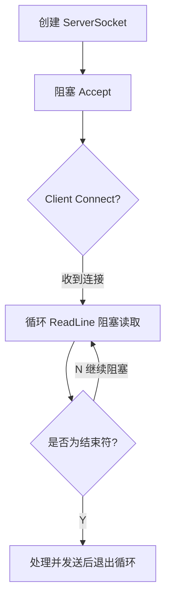
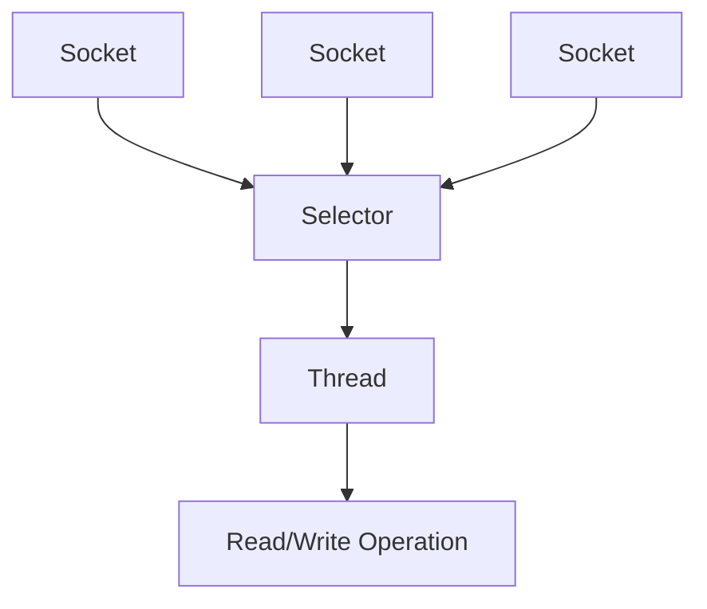

# Ceph 收官：管理后台、CephFS 与项目集成验证，Netty 开篇

三节点集群 HEALTH_OK 之后，Ceph 离"项目里能用"还差四步：装管理后台（Dashboard 模块）、创建并挂载 CephFS 文件系统、用 RADOS Java 客户端做连接验证、在智牛股工程里新建 ceph-demo 模块跑通文件上传下载。本篇走完这四步给 Ceph 收官，随后进入 Netty 介绍章，把框架定位、TCP/IP 五层模型与 NIO 模型三块地基先打好。

## 先给结论

- Dashboard 是 mgr 的一个模块而非独立服务：`ceph mgr module enable dashboard` 开启（disable 即关闭），自签名证书加 openssl 密钥对解决 HTTPS 的密钥认证；`ceph config set mgr` 配监听地址 10.10.20.11 与端口，内网测试可 `ssl false` 关掉 HTTPS；`ceph mgr services` 查看访问地址，登录账号默认 admin/admin。
- CephFS：集群创建完默认没有文件系统，没法做文件存取，必须先建数据池与元数据池，再 `ceph fs new` 关联成文件系统；`ceph mds stat` 看到 active 才算正常运行；客户端用 ceph-fuse 挂载，演示挂到 /usr/local/cephfs_directory，df -h 可见 27G 可用空间。
- pg_num 按集群规模取值：OSD 少于 5 个设 128，5~10 个设 512，10~50 个设 4096，大于 50 个需要按公式计算。删除文件系统或存储池前，要在 ceph.conf 开 `mon allow pool delete = true`，删除命令必须带 `--yes-i-really-mean-it` 级别的确认参数。
- RADOS Java 连接验证三步：new Rados("admin") 创建集群句柄 → confReadFile 读 /etc/ceph/ceph.conf → connect()；rados-0.6.0 与 JNA 两个 jar 都要软链到 JRE 的 lib/ext 扩展目录，JNA 负责本地库接口调用。
- 项目集成核心是 CephOperator 封装 CephMount：mon host 多节点用分号隔开、节点内冒号连 IP 与端口；上传按 1024 字节缓冲流式写入，文件已存在时从 stat.size 位置续写——多次上传就是追加写入，也是断点续传的基础。
- Netty 是 JBoss 出品、基于 NIO 的客户端/服务端编程框架；NIO 的关键是 Selector 事件通知 API，一个线程监听一组非阻塞套接字的就绪状态，就能处理多个并发连接；功能设计四块：传输服务（BIO/NIO）、容器集成、协议支持、Core 核心（可扩展事件模型、通用通信 API、零拷贝 ByteBuf）。

## 管理后台与 CephFS：让集群可视、可用

管理后台 Dashboard 在 Ceph 里以 mgr 模块的方式安装，开启与关闭都是模块化的命令操作：

```bash
# 1. 开启 dashboard 模块（已开启会提示 module dashboard is already enabled）
ceph mgr module enable dashboard

# 2. 生成自签名证书：HTTPS 访问需要对应的密钥认证信息
ceph dashboard create-self-signed-cert

# 3. 创建 mgr-dashboard 专用目录，用 openssl 生成密钥对（dashboard.key / dashboard.crt）
mkdir /usr/local/ceph-cluster/mgr-dashboard
cd /usr/local/ceph-cluster/mgr-dashboard
openssl req -new -nodes -x509 -subj "/O=IT/CN=ceph-mgr-dashboard" \
  -days 3650 -keyout dashboard.key -out dashboard.crt -extensions v3_ca
```

走 HTTPS 时密钥对必须生成；内网测试不想折腾证书，可以直接关掉 SSL 用 HTTP 访问，然后配置监听地址、端口并查看服务信息：

```bash
# 设置 Dashboard 的 IP 与端口
ceph config set mgr mgr/dashboard/server_addr 10.10.20.11
ceph config set mgr mgr/dashboard/server_port 18843
# 内网建议关闭 HTTPS，避免出现不必要的访问连接安全校验问题
ceph config set mgr mgr/dashboard/ssl false

# 查看服务信息，输出 Dashboard 的访问 IP、端口等具体信息
ceph mgr services
# 设置管理用户与密码（默认按 admin 访问）
ceph dashboard set-login-credentials admin admin
```

课程演示在浏览器打开的是 https://10.10.20.11:8443/，实际访问地址以 `ceph mgr services` 的输出为准。登录后就是集群仪表盘：健康状态、monitor 监控节点信息、OSD 信息、整体使用情况、对象存储信息、Pool 管理，下面还有 CephFS 文件系统管理与 RGW 用户管理——这些都能直观方便地辅助集群管理。

有了可视化的台子，还得让集群真正能存文件。Ceph 集群搭建完毕后默认没有文件系统，没有文件系统就无法进行文件操作和存储，所以要手动创建 CephFS。先建两个存储池，一个放数据、一个放元数据，再把两个池关联成文件系统：

```bash
# 1. 创建数据池与元数据池（数字为 PG 数量 pg_num）
ceph osd pool create cephfs_data 128
ceph osd pool create cephfs_metadata 64

# 2. 新建文件系统 fs_test，关联上面两个池
ceph fs new fs_test cephfs_metadata cephfs_data

# 3. 查看：名称、元数据池、数据池
ceph fs ls
# name: fs_test, metadata pool: cephfs_metadata, data pools: [cephfs_data]

# 4. MDS 状态：up 且 active 才说明文件系统正常运行
ceph mds stat
# fs_test-1/1 up {0=centos7-1=up:active}
```

pg_num 不是拍脑袋定的，按集群规模来：

| OSD 数量 | pg_num 建议值 |
| --- | --- |
| 少于 5 个 | 128 |
| 5 ~ 10 个 | 512 |
| 10 ~ 50 个 | 4096 |
| 大于 50 个 | 需要计算具体值 |

建错了要删，注意两个前置条件：ceph.conf 里先开启允许删除存储池的配置，删除命令必须带上"确认真的要删"的参数：

```ini
[mon]
mon allow pool delete = true
```

```bash
ceph fs rm fs_test --yes-i-really-mean-it
ceph osd pool delete cephfs_data cephfs_data --yes-i-really-really-mean-it
```

最后安装 ceph-fuse，把文件系统挂载到客户端目录：

```bash
yum -y install ceph-fuse
mkdir -p /usr/local/cephfs_directory
# -k 指定密钥信息，-m 指定 monitor 连接地址与端口，最后是挂载目标目录
ceph-fuse -k /etc/ceph/ceph.client.admin.keyring -m 10.10.20.11:6789 /usr/local/cephfs_directory
df -h
# /usr/local/cephfs_directory 挂载成功，可用空间 27G
```

挂载完成后就能像访问本地磁盘一样访问 CephFS，为后面的文件上传下载铺路。

## RADOS 客户端与项目集成：从连接验证到上传下载

RADOS Java 客户端走的是"应用直接访问 RADOS 对象存储"这条路，后面章节还会讲经 RADOS GW 网关访问的 Swift API 方式。环境要求：JDK 1.8 以上、Git、Maven 3.0 以上；课程直接把主节点 10.10.20.11 当客户端做连接测试。

先拉源码、编译安装，再把两个 jar 软链进 JRE 扩展目录——运行时 rados 要进 classpath，JNA 负责本地接口调用：

```bash
git clone https://github.com/ceph/rados-java.git
cd rados-java
mvn install -Dmaven.test.skip=true
# target/ 下生成 rados-0.6.0-SNAPSHOT.jar

# 创建软链接：rados jar 与 jna jar 都指向 $JAVA_HOME/jre/lib/ext
ln -s .../rados-0.6.0-SNAPSHOT.jar $JAVA_HOME/jre/lib/ext/
ln -s .../jna.jar $JAVA_HOME/jre/lib/ext/
```

测试类的流程就三步——创建集群句柄、读取配置、尝试连接，配置文件里有 mon 主机地址与网段等全局信息：

```java
import com.ceph.rados.Rados;
import com.ceph.rados.exceptions.*;
import java.io.File;

public class CephClient {
    public static void main(String args[]) {
        try {
            Rados cluster = new Rados("admin");
            System.out.println("Created cluster handle.");
            File f = new File("/etc/ceph/ceph.conf");
            cluster.confReadFile(f);
            System.out.println("Read the configuration file.");
            cluster.connect();
            System.out.println("Connected to the cluster.");
        } catch (RadosException e) {
            System.out.println(e.getMessage() + ":" + e.getReturnValue());
        }
    }
}
```

```bash
javac CephClient.java
java CephClient
# 依次输出三条日志：创建集群句柄 → 读取配置文件 → 连接成功
# 前提是集群 health ok；连接成功即说明集群能正常提供服务、客户端操作没问题
```

集群验证通过后，回到智牛股工程做正式集成。新建 ceph-demo 模块，pom 里三个依赖：Spring Boot Web 是基础，rados 是 RADOS Java API，cephfs 是文件系统的 Java 封装：

```xml
<dependency>
    <groupId>org.springframework.boot</groupId>
    <artifactId>spring-boot-starter-web</artifactId>
</dependency>
<dependency>
    <groupId>com.ceph</groupId>
    <artifactId>rados</artifactId>
    <version>0.6.0</version>
</dependency>
<dependency>
    <groupId>com.ceph</groupId>
    <artifactId>cephfs</artifactId>
    <version>0.6.0</version>
</dependency>
```

启动类是标准 Spring Boot 写法（@SpringBootApplication 扫描基础包 com.itcast）；真正干活的是 CephOperator——一个正常的文件操作要覆盖目录的增删改查与文件的上传下载，所有 API 都通过 CephMount 对象实现：

| 能力 | 关键调用 | 说明 |
| --- | --- | --- |
| 查看目录 | mount.listdir | 查询某个 path 下有哪些文件 |
| 新建目录 | mount.mkdirs(path, mode) | mode 为权限模式 |
| 删除目录 / 目录改名 | mount.rmdir / mount.rename | 目录级操作 |
| 删除文件 | mount.unlink | 文件级操作 |
| 上传 | mount.open + mount.write | 1024 字节缓冲流式写入 |
| 下载 | mount.open + mount.read | 按指定路径从集群下载到本地 |

构造方法里完成初始化：new CephMount(username) 加载用户信息，confSet("mon host", monIp) 设置连接节点。mon host 支持多节点，节点之间分号隔开，节点内 IP 与端口用冒号连接——10.10.20.11:6789;10.10.20.12:6789;10.10.20.13:6789；userKey 是 user 用户的连接密钥，同样在构造时初始化；mountPath 为挂载路径（演示用根路径 /）。

上传的逻辑值得细看：先判断 mount 是否初始化成功，没成功直接返回；FileInputStream 读本地文件转成文件流，目录不存在就 mkdir（O_CREAT），然后 open 打开文件拿到 fd，用 1024 字节缓冲区循环 write，每轮累加已传长度并输出百分比进度（进度条让交互更直观，不输出也不影响功能）；传完按需要 chmod 权限——只读、只写还是读写都行；最后 close fd 与 fis 释放资源。文件操作不释放资源，文件描述符会被占用，进而占用更多系统资源。文件已存在时走另一条分支：stat 拿到已传文件大小（position），从该位置继续写。总共 100 字节、之前传到 60，就从 60 开始续传——这就是追加写入，也是断点续传的基础。

存储结构上，Ceph 不是 Linux 那种路径式组织（/usr/local/xxx/file），而是按 用户 → bucket（桶/容器）→ fileId 的层级来存：一个用户下面可以挂多个桶，文件落在具体桶里，由文件唯一标识定位。下载接口的参数就是 filePath 与 fileName 的组合拼接，从集群把文件拉回本地，同样支持断点续传。

启动类的 main 方法用命令行参数驱动：args[0] 是操作指令（upload / download），args[1] 是文件名；上传写死到 /temp_upload_fs，下载写死到 /temp_download_fs，想灵活可以再抽一个参数。验证流程：mvn clean package 打出可执行 jar（pom 里配了 spring-boot-maven-plugin），上传到主节点，建测试文件后跑两条命令：

```bash
echo "test itcast 123" > /temp_upload_fs/upload1.txt

java -jar ceph-demo.jar upload upload1.txt     # 提示文件传输成功
java -jar ceph-demo.jar download upload1.txt   # 进度 100%，下载成功
cat /temp_download_fs/upload1.txt              # 内容与上传时一致

# 再次 upload：提示"追加文件传输成功"——已存在文件走续写分支
# 再 download 后 cat，内容变成两行，追加生效
```

注意上传与下载的文件名必须一致：上传叫 upload.txt，下载时改成了别的名字，集群里就找不到这个文件，下载必然失败。

实践中还有两个坑（官方依赖没覆盖到的环境问题）：

```bash
# 坑 1：JNA 找不到动态库 —— 安装 libcephfs 相关组件并补软链接
yum -y install libcephfs2 libcephfs_jni-devel
ln -s /usr/lib/libcephfs_jni.so.2 /usr/lib64/libcephfs_jni.so.2

# 坑 2：rados 0.6.0 依赖在远程仓库找不到 —— 手工 deploy 到自己的 Maven 仓库
mvn deploy:deploy-file -DgroupId=com.ceph -DartifactId=rados \
  -Dversion=0.6.0 -Dpackaging=jar -Dfile=rados-0.6.0-SNAPSHOT.jar \
  -Durl=http://<nexus地址>/repository/maven-releases/ -DrepositoryId=nexus-releases
# Maven 配置文件里记得加上仓库的用户名和密码
```

## Netty 开篇：框架定位、五层模型与 NIO

Ceph 收官后进入第四章 Netty。本章目标：了解 Netty 基本概念与 NIO 模型的作用，理解 Netty 的工作机制、核心工作流程与 Reactor 线程模型，并弄清 Netty 底层为什么高效；讲解路径是 简介 → TCP/IP 五层模型 → NIO → 特点 → 功能设计 → I/O 复用模型与 Buffer → 事件驱动模型 → Reactor 线程模型，本篇覆盖前半段，后半段见下篇。

先看定位：Netty 是 JBoss 提供的 Java 开源框架（知名开源容器 JBoss 也出自这家），是一个基于 NIO 的客户端、服务端编程框架，用来快速开发高性能、高可靠性的网络服务和客户端程序，广泛应用于通讯领域，性能与可靠性表现优异。

聊 Netty 之前先回到网络地基。OSI 参考模型七层，TCP/IP 模型把应用、表示、会话三层整合为应用层，变成五层，各层代表协议如下：

| 层 | 代表协议 |
| --- | --- |
| 应用层 | HTTP、Telnet、FTP、TFTP、DNS、SMTP |
| 传输层 | TCP、UDP |
| 网络层 | IP、ICMP、RIP、IGMP |
| 数据链路层 | ARP、RARP、IEEE802.3、PPP、CSMA/CD |
| 物理层 | FE 自协商、Manchester、MLT-3、4A PAM5 |

Socket 套接字编程接口的定义：TCP/IP 协议族中，应用层进入传输层的接口；用套接字可以编写使用 TCP 或 UDP 的网络应用程序。Netty 的通讯本质也是 Socket 通讯，只是实现了 NIO 的异步通讯模式。

NIO 要解决的是阻塞问题。先看单线程阻塞模式的流程：



客户端发一个请求、服务端接收并处理，一来一回就是阻塞式调用。单线程会产生严重的阻塞：一个连接占住线程做读取与处理，大量客户端要连接时，只能全部在外面排队。

NIO 模型换了个思路——多个 Socket 汇聚到一个 Selector：



Selector 是 Java 非阻塞 IO 实现的关键：它使用事件通知 API，确定一组非阻塞套接字中哪些已经就绪、能够进行 IO 相关操作。因为可以在任何时间检查任意的读操作或写操作的完成状态，一个单一的线程便可以处理多个并发的连接。打个比方：Select 像总包工头，只负责监听就绪状态，具体的读写任务派给下面的线程去做，整体吞吐量自然就提升了。

最后看 Netty 为什么值得用。JDK 原生也有一套网络应用程序 API，也能实现 Socket 通讯，但使用繁杂、要写很多代码、不够完善，需要消耗开发者较多精力去完善 NIO 场景。Netty 对 JDK API 做了封装，特点有三：

- 设计优雅：统一的 API 支持阻塞与非阻塞等各种传输类型的 Socket；基于灵活且可扩展的事件模型，清晰分离关注点；高度可定制的线程模型（单线程、一个或多个线程池）；真正的无连接数据包套接字支持。看一眼 Netty 的源码就能感受到，代码组织非常清晰直观。
- 高性能、高吞吐、使用方便：相比 JDK 实现，延迟更低、资源消耗更少、最小化不必要的内存复制；详尽的 Javadoc、用户指南与示例，便于清晰使用相关 API；没有多余的过渡依赖，接入项目不会引入不必要的依赖冲突。
- 安全、社区活跃、不断更新：社区活跃度决定框架的生命力，Netty 版本迭代周期短，发现 bug 能及时修复，新功能持续加入——对公司和产品的开发来说，出问题能第一时间响应处理。

功能设计一张表收齐：

| 模块 | 内容 |
| --- | --- |
| 传输服务 | BIO、NIO |
| 容器集成 | OSGi（开放服务网关协议）、JBoss、JBossMC、Spring、Guice |
| 协议支持 | HTTP、Protobuf、WebSocket、文本等常见协议，以及 SSL 安全传输；支持通过自定义编码解码逻辑实现自定义协议 |
| Core 核心 | 可扩展事件模型、通用通信 API、支持零拷贝的 ByteBuf 字节缓冲对象——高性能、高吞吐的底座 |

## 小结

Ceph 这条线至此收官：Dashboard 用模块化命令装出可视化仪表盘；CephFS 用"数据池 + 元数据池 + fs new"补上集群缺省的文件系统能力，ceph-fuse 挂载后即可像本地目录一样读写；RADOS Java 客户端三步验证集群服务正常；ceph-demo 把 CephMount 封装成 CephOperator，跑通了上传、下载与追加写，也顺手排掉了动态库缺失与依赖仓库找不到两个环境坑。本章定位要记牢：集群安装配置复杂，不要求掌握，重点是 Ceph 的基本用法与项目集成；后续章节会换成 RADOS GW 的 Swift API，把 Ceph 融入智牛股的具体业务功能。Netty 篇从五层模型与 Socket 定义切入，用"单线程阻塞排队"对比"Selector 事件通知"讲清了 NIO 的价值，再以特点与功能设计给出框架全貌——下一篇进入 I/O 复用模型与 Buffer、事件驱动模型和 Reactor 线程模型。
