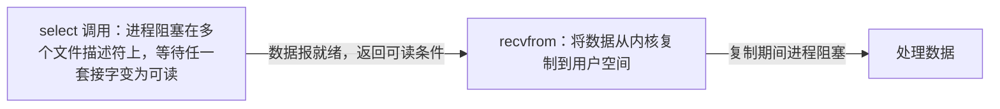
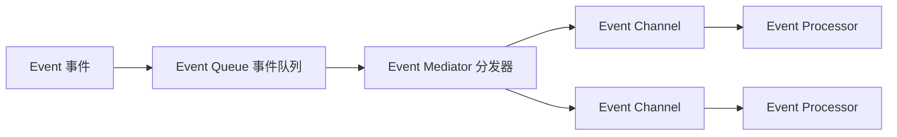
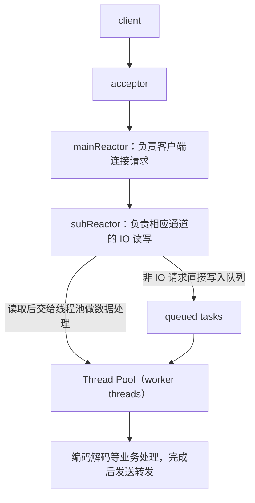

# Netty 核心模型：I/O 复用与 Buffer、事件驱动、Reactor 线程模型

上一篇交代了 Netty 的定位与 NIO 的价值，这一篇深入它的三个核心模型：I/O 复用模型解释"非阻塞靠什么实现"，Buffer 解释"数据怎么读"，事件驱动模型与 Reactor 线程模型解释"事件怎么流转、线程怎么分工"——最后落到 Netty 采用的主从 Reactor 多线程模型上。

## 先给结论

- Netty 非阻塞 IO 的实现关键是 I/O 复用模型：select 调用使进程阻塞在多个文件描述符上，等待任一套接字变为可读；数据报就绪后由 recvfrom 把数据从内核复制到用户空间，复制期间进程仍然阻塞。
- select 与阻塞 IO 的关键不同：它可以同时对多个 IO 操作，同时检测多个读操作与多个写操作，直到有数据可读或可写时，才真正调用 IO 操作函数——并发处理能力由此提升。
- 传统 IO 面向字节流或字符流，流式顺序读取、不能改变读指针位置；NIO 抛弃传统 IO 流，引入 Channel 与 Buffer：数据只能在 Channel 与 Buffer 之间进出，基于 Buffer 可以随意读取任意位置的数据——包没接收完整先存 Buffer，需要重复读取直接从 Buffer 再取。
- 事件驱动模型四组件：Event Queue（接收事件入口，存储待处理事件）、Event Mediator（分发器，把事件分给不同业务逻辑单元）、Event Channel（分发器与处理器的联系渠道）、Event Processor（实现业务逻辑，处理完发出事件触发下一步）。
- Reactor 是执行 while (true) { selector.select(); ... } 循环的线程，源源不断产生新事件，类似反应堆，又叫 Dispatcher 分发模式；Reactor 只监听分发（电话接线员），Handlers 干实际活（真正谈业务的职员）。
- Netty 基于主从 Reactor 多线程模型做了改进：MainReactor 负责客户端连接请求并转交 SubReactor，SubReactor 负责对应通道的 IO 读写；非 IO 请求直接写入队列，等待 worker threads 处理——IO 协调与业务逻辑分离。

## I/O 复用模型与 Buffer：非阻塞的两个支点

I/O 复用模型的完整流程分两段，先等待、再复制：

应用程序的进程受阻于 select 调用，等待可能多个套接字中任何一个变为可读；系统调用进入内核后判断数据报文有没有准备好，没有就继续受阻于 select，等待可读的数据。数据就绪后进入第二段：对数据报做复制传递，把数据从内核复制到用户空间（每个进程都有独立的用户空间），用户空间收到数据后交给业务做具体处理。

与阻塞 IO 相比，关键差异在"等"的方式：select 这个函数也会使进程阻塞，但它可以同时对多个 IO 操作，而且可以同时对多个读操作、多个写操作的 IO 函数进行检测，直到有数据可读或可写时，才真正调用 IO 操作函数。打个比方：有一个专门的监听人员，发现有数据接收过来就报备给对应的负责人，负责人不必一直守在监听位上，可以去做其他事情——整体的并发吞吐由此提升。

Buffer 解决的是另一个问题：读的方式。传统 IO 面向字节流或字符流，以流的方式顺序地从一个 Stream 中读取一个或多个字节，因此不能随意改变读指针的位置——好比文件上传下载时，文件流只能顺着指针位置往下传，传完就是传完了，想重新调整读取位置就得加一个缓冲区。NIO 抛弃了传统的 IO 流，引入 Channel 和 Buffer 的概念，ByteBuffer 是除 Selector、Channel 之外的另一个重要核心组件；NIO 中只能从 Channel 中读取数据到 Buffer，或将数据从 Buffer 写入 Channel。基于 Buffer 的操作不像传统 IO 那样顺序操作，可以随意读取任意位置的数据，效率得到极大提升：数据包没有接收完整时，先放在 Buffer 里等接收成功；数据需要重复读取时，直接从 Buffer 里重新获取即可。

## 事件驱动模型：队列、分发器与处理器

什么时候创建连接、什么时候读取数据、什么时候对数据包做编码解码处理，这一系列问题在什么环节触发、什么时间去做、如何触发和调用业务处理逻辑，各环节之间又怎么协调——是采用轮询方式，还是事件驱动方式更为高效？事件驱动模型给出的答案是后者。

事件发送过来后先进入队列，再分发到不同的 Event Channel 里做具体处理：

四个组件各司其职：

| 组件 | 职责 |
| --- | --- |
| Event Queue 事件队列 | 接收事件的入口，存储待处理的事件；它不做具体的事件处理 |
| Event Mediator 分发器 | 将不同的事件分发到不同的业务逻辑单元 |
| Event Channel 事件通道 | 分发器与处理器之间的联系渠道，负责事件的流转 |
| Event Processor 事件处理器 | 实现业务逻辑，处理完成后发出事件，触发下一步操作 |

事件处理器可以挂很多个——比如封包的、解包的、校验的，分别挂接不同的业务逻辑做对应处理；处理器内部又由多个 module（最小业务单元）组成，实现业务逻辑的模块化。

事件驱动的设计带来两个直接优点：一是可扩展性好，在分布式的异步架构中，事件处理器之间高度解耦，可以方便地扩展事件处理逻辑；二是高性能，基于队列暂存事件，能方便地并行异步处理事件——整个处理速度由此得到极大提升。

## Reactor 线程模型与 Netty 的工作线程模型

Reactor 是一个执行 while (true) { selector.select(); ... } 循环的线程，会源源不断地产生新的事件，类似反应堆——像链式核变一样，一个接一个的反应最终产生很大的威力，通过事件不断提升整体的吞吐能力。

Reactor 模式的定义：通过一个或多个输入同时传递给服务处理器的服务请求，这样一种事件驱动的处理模式。服务端程序可以处理传入的多路请求，并将它们同步分派给请求对应的处理线程，因此 Reactor 模式也叫 Dispatcher 分发模式——一个 IO 通过多路复用统一监听事件，收到事件后再分发给处理线程，进而提升整体性能，是编写高性能网络服务器的必备技术之一。

架构上，多个 Client 发送请求，应用程序（服务程序）接收到之后先不着急做业务处理，通过 ServiceHandler 做事件派发（Event Dispatch），派发给不同的处理线程（EventHandler），再去处理对应的事件、数据和业务逻辑。

Reactor 模型有两个关键组成部分：

| 组件 | 职责 | 类比 |
| --- | --- | --- |
| Reactor | 在单独的线程中运行，负责监听和分发事件，分发给适当的处理程序来响应 IO 事件；只负责接线，不做具体内容的沟通 | 公司高峰期的电话接线员：接听客户电话，把线路转给适当的联系人 |
| Handlers | 处理程序，执行 IO 事件要完成的实际事件，执行非阻塞操作 | 公司里真正要谈业务、实际干活的职员 |

Reactor 通过调度适当的处理程序来响应 IO 事件，处理程序执行非阻塞的操作——一个负责协调，一个负责实际干活。

Netty 主要基于主从 Reactor 多线程模型做了改进。主从模型有多个 Reactor，运用起来更为高效：

分工明确：MainReactor 是主的线程模型，负责客户端连接请求，并将请求转交给 SubReactor（从线程模型）；SubReactor 负责相应通道的 IO 读写请求，读取后发送给线程池做具体的数据处理，线程池对数据包做编码、解码等业务处理，处理完成后进行发送和转发；非 IO 请求的具体处理逻辑任务则直接写入队列，等待 worker threads 处理。一句话概括：IO 交给 Reactor 协调分发，具体数据怎么解包、业务逻辑怎么处理，交给线程池去实现——IO 与业务处理分离，并发能力与响应速度同时受益。

课程在这里附了一篇掘金的参考资料（https://juejin.im/post/5be00763e51d453d4a5cf289），想深入可以按图索骥。

## 小结

三个模型串成一条线：I/O 复用解决"谁来等"——select 统一监听多个套接字，就绪才真正调用 IO 函数；Buffer 解决"怎么读"——Channel 与 Buffer 替代顺序流，支持任意位置读取与重复获取；事件驱动解决"怎么触发"——队列暂存、分发器派发、处理器解耦并行；Reactor 把这套机制落成线程模型，Netty 再以主从 Reactor 加线程池把 IO 读写与业务逻辑分开。这一章是 Netty 的介绍篇，原理性内容一时难以理解不用着急，先在功能与特点层面建立全貌即可；但 I/O 复用属于底层知识点，面试官问得深时会提到，能答出个一二很重要。还可以继续延伸了解 Select、Poll 和 Epoll 模型的差别——这三者在面试中经常被问及，尤其对通信或 NIO 应用较深的行业。理解了底层机制，实际运用 Netty、排查线上问题时至少知道该朝哪个方向摸索。
