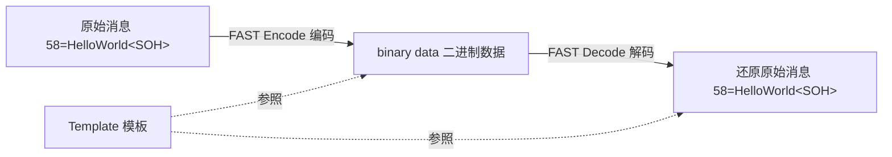

# 金融行情协议全家桶：FIX/FAST/STEP/Binary 与行情源、撮合交易开篇

股票K线知识收尾之后，智牛股项目进入两个重头章节：第三章讲金融信息交换协议（FIX、FAST、STEP、Binary）与行情源对接，回答「行情数据从哪来、怎么解析」；第四章开篇讲撮合交易机制与股票委托，回答「买卖双方的单子怎么成交」。两块内容一条管数据、一条管交易，是交易平台的核心底座。

## 先给结论

- K线由开盘价、收盘价、最高价、最低价四个价位组成，开盘价低于收盘价为阳线，反之为阴线；周期不同派生出分钟K、日K、周K、月K，分钟K线（半小时、一小时）用于短线，周K、月K用于中长线。
- 成交量是供需的表现：供不应求时成交量放大，供过于求时成交量萎缩，它是K线之外最重要的行情指标。
- FIX 是国际通用的金融信息交换协议，FIX 5.0 引入传输无关框架 TI，把会话层从应用层分离；FAST 是 FIX 的流式压缩版，收发双方参照同一套模板编解码，每秒可处理百万级消息。
- STEP 是我国基于 FIX 4.4 本地化制定的证券交易数据交换标准；Binary 是深交所自定义的二进制协议，报文由消息头（MsgType + BodyLen 共 8 字节）、消息体、消息尾（Checksum）三段组成。
- 行情源分梯队：交易所一手行情年费数十万起步，Level-2 更贵；教学项目用聚合数据平台（新浪源再封装）的免费 HTTP+JSON 接口，每天一千次额度足够学习验证。
- 撮合交易按价格优先、时间优先确定成交价；股票委托分市价与限价两种，限价不得高于涨停价、低于跌停价；日终未成交的委托系统自动撤单，次日需重新申报。

## K线收官：四个价格决定阴阳

K线图（Candlestick Charts）又称蜡烛图、日本线、阴阳线、棒线，起源于日本德川幕府时代（1603～1867年）的米市交易，如今股票、期货、外汇等交易产品普遍用它展示行情。

一根K线由开盘价、收盘价、最高价、最低价四个价位围出「实体」和上、下影线，开盘价低于收盘价为阳线，反之叫阴线。拿到这四个价格，就能完整画出股价波动。

按计算周期不同，K线分成不同类别，对应不同的交易风格：

| 分类 | 计算周期 | 典型用途 |
| --- | --- | --- |
| 分钟K线 | 半小时、一小时等 | 短线交易 |
| 日K线 | 一个交易日 | 日常看盘 |
| 周K线 / 月K线 | 一周 / 一月 | 中长线交易 |

短线交易活跃，一个月可交易数十次；中线三个月到半年交易几次；长线一年交易一两次。常见的上证指数日K线图，就是「K线走势 + 均线（MA5、MA10、MA30）+ 成交量柱状图」的组合，价格与量能放在一起看。

成交量是供需的表现，指一个时间单位内对某项交易成交的数量：供不应求时都要买进，成交量自然放大；供过于求时买气稀少，成交量势必萎缩。它为何放大、为何萎缩，要结合盘面理解主要因素。

这一章的要点：深入理解K线的组成与画法，能通过K线辨识行情变化，这是做专业金融交易平台的前提。

## 金融协议全家桶：FIX、FAST、STEP、Binary

### FIX：金融信息交换的国际标准

FIX 全称 Financial Information Exchange Protocol（金融信息交换协议），是适用于实时证券金融电子交易的数据通信标准。它把各类证券金融业务需求流程格式化成计算机可描述的功能流程，在每个业务功能接口上统一交换格式。

2006年10月，FPL 组织发布 FIX 5.0，引入 TI（The Transport Independence，传输无关框架）：FIX 会话层从应用层协议中分离出来，应用层消息可以通过任意合适的传输技术传送，FIX 会话层协议只是应用层消息的可选传输协议之一。版本标注也不同：FIX X.Y 是应用层协议版本，FIXT X.Y 是会话层协议版本。

分工上，会话层定义数据通信协议与通用规范（会话结构、存储规范，一般支持以 key/value 方式传递保存数据）；应用层定义金融活动相关的业务数据结构。FIX 协议内容远不止这些，深入资料可参考 FIX 官方标准网站（fixtrading.org/standards）。

### FAST：为行情压缩而生的流式协议

FIX 传输市场数据时冗余度较高，带宽需求大。为解决这个问题，芝加哥商品交易所（CME）在 2003 年向 FPL 组织提交技术方案；FPL 在 2004 年成立市场数据优化工作组（MDOWG），2005 年基于概念证明（PoC，Proof of Concept）开始制定标准，2006 年初完成 FAST 1.0，同年 12 月完成 FAST 1.1。

FAST 全称 FIX Adapted for Streaming（面向流的信息交换协议），优点是高压缩比、低资源消耗、算法简单高效、每秒百万级消息处理能力，可支撑高并发。核心是一套压缩算法：参照 FIX 规范把字段和对应的值压缩后再传输，降低收发双方带宽占用、节省网络资源。

发送与接收双方的处理流程如下：



发送方把按 FIX 规范定义的原始数据（如 `58=HelloWorld<SOH>`）经 FAST Encoder 编码成二进制数据；接收方用 FAST Decoder 解码还原出原始值。编解码都参照预定义模板（Template）中字段名与 ID 的压缩约定：

```xml
<string name="Text" id="58"/>
```

### STEP 与 Binary：本土化标准与交易所私有协议

FIX 是国际通用交易协议，交易所一般都支持，但会做本地化改造以适应本国交易制度。中国本地化的 FIX 就是 STEP 协议（Securities Trading Exchange Protocol，证券交易数据交换协议）：它在 FIX 4.4 版本技术基础上制定，是国家金融行业标准，已成为事实上的证券行业数据接口标准。特点有三：语法简单、定义灵活方便扩展、数据相对冗余。

Binary 是深圳证券交易所自定义的二进制格式通讯协议，详细定义了各种报文字段及编码解码规则。在深交所行情 Binary 协议中，所有消息都由三部分组成：

| 报文段 | 字段 | 说明 |
| --- | --- | --- |
| 消息头（8字节） | MsgType: uint32 | 标识消息类型，区分每条消息的用途 |
| 消息头（8字节） | BodyLen: uint32 | 表示消息体字节数，据此完整读出消息体 |
| 消息体 | Body | 实际数据内容 |
| 消息尾（4字节） | Checksum: uint32 | 校验和，对整个数据包做完整性校验（如 CRC） |

四种协议摆在一起看，定位一目了然：

| 协议 | 全称 | 制定方 | 定位 |
| --- | --- | --- | --- |
| FIX | Financial Information Exchange Protocol | FPL 组织 | 国际通用的实时证券电子交易数据通信标准 |
| FAST | FIX Adapted for Streaming | CME 提出，FPL MDOWG 制定 | FIX 的流式压缩版，专治行情冗余与带宽占用 |
| STEP | Securities Trading Exchange Protocol | 我国金融行业标准 | FIX 4.4 的中国本地化版本 |
| Binary | 二进制格式协议 | 深交所 | 交易所私有二进制协议 |

## 行情源怎么选：交易所专线、新浪源与聚合数据

行情源分梯队。商业项目要做专业产品，一般从交易所对接一手行情：上交所、深交所通过 STEP 与 Binary 协议对接，每年授权费数十万起步甚至上百万，订阅 Level-2 更贵，各券商可申请从两所拉专线。往下一层是大智慧、通达信、同花顺这类第三方信息商；再往下是第三方及第四方免费行情源，新浪、雅虎、Google 属于第四方。

教学项目重在掌握行情的订阅、加工和呈现，故选聚合数据平台对接。聚合平台的接口正是从新浪行情源抓取、加工后再提供的，先看源头。

新浪提供某只股票实时行情的访问地址格式是 `http://hq.sinajs.cn/list=sh601006`，返回一段给界面展示用的 JS 字符串：

```javascript
var hq_str_sh601006="大秦铁路,7.840,7.840,7.880,7.880,7.810,7.870,7.880,17766197,139547519.000,5500,7.870,48100,7.860,312323,7.850,323100,7.840,314700,7.830,574300,7.880,420700,7.890,433300,7.900,213500,7.910,162100,7.920,2019-07-17,15:00:00,00";
```

数据用逗号拼接，顺序从 0 开始编号，每个逗号一个栏位：

| 索引 | 含义 | 说明 |
| --- | --- | --- |
| 0 | 股票名称 | 大秦铁路 |
| 1 | 今日开盘价 | K线四价之一 |
| 2 | 昨日收盘价 | — |
| 3 | 当前价格 | 判断能否成交最关心它 |
| 4 | 今日最高价 | K线四价之一 |
| 5 | 今日最低价 | K线四价之一 |
| 6 | 竞买价 | 即「买一」报价 |
| 7 | 竞卖价 | 即「卖一」报价 |
| 8 | 成交的股票数 | 以 100 股为基本单位，先除以 100 得手数再展示 |
| 9 | 成交金额 | 单位元，通常换算成万元展示 |
| 10~19 | 买一至买五的申报股数与报价 | 依次排列 |
| 20~29 | 卖一至卖五的申报股数与报价 | 同上 |
| 30 | 日期 | — |
| 31 | 时间 | A股 3 点休市，显示最后一口报价时间 |

K线图可直接取新浪图片接口：`http://image.sina.cn/newchart/daily/n/sh601006` 是日K线，改路径里的K线类型可得分时线、周K线，图上同样是K线加成交量，只是周期不同。

这份数据既不属于 JSON 也不属于 XML 规范，就是一串拼接字符，解析费劲、扩充难维护。聚合数据平台把新浪行情源再加工，提供规范的 HTTP 接口和 JSON 格式。它是免费接口，每天上限 1000 次调用（后来调整为 100 次，不够用可多申请账号），还提供 API 测试工具模拟调用后台接口。

以沪深股市接口为例，请求参数 `gid` 是股票代码（如 `sh601388`），`type` 用于查指数：0 是上证综合指数、1 是深证成分指数，查个股留空。指数是加权平均数，没有盘口信息，不对散户开放交易，散户一般买 ETF 基金；股票才有完整的买卖盘口。返回 JSON 大致长这样：

```json
{
  "resultcode": "200",
  "reason": "SUCCEEDED!",
  "result": [
    {
      "data": {
        "gid": "sh601388",
        "name": "工商银行",
        "todayMax": "8.37",
        "todayMin": "8.25",
        "nowPri": "8.37",
        "yesTodayEndPri": "8.26",
        "competitivePri": "8.37",
        "traNumber": "34501453",
        "traAmount": "29089560",
        "buyOnePri": "8.37",
        "buyFivePri": "8.32",
        "sellOnePri": "8.38",
        "sellFivePri": "8.43"
      }
    }
  ]
}
```

`resultcode` 为 200 表示正常，`reason` 是状态描述，`result` 是数据报内容，含 `data`（大盘数据可通过 `type` 单独查询）和 `goPicture` 节点。实时行情字段与新浪那份基本一一对应：`gid` 股票编号、`nowPri` 当前价、`todayMax`/`todayMin` 今日最高最低、`competitivePri` 竞买价，买卖五档报价一应俱全，连涨跌百分比、涨跌额都提前算好，它不是单纯的搬运工。注意这里没有收盘价，收盘价要在收盘后自行加工计算。

`goPicture` 返回已生成好的分K、日K、月K等K线图片链接（如 `monthurl` 指向 `image.sinajs.cn` 的月K图），前端不方便加工时可直接呈现；但专业交易平台最好自己实现K线绘制。

## 撮合交易开篇：价格优先、时间优先与股票委托

撮合交易是交易服务的核心功能。定义：卖方在交易市场委托销售订单/应单，买方委托购买订单/应单，交易市场按价格优先、时间优先原则确定双方成交价格并生成电子交易合同，按交易订单指定的交割仓库实物交割。这个定义是抽象的，它不只用于股票金融市场；落到股票，就是买卖双方按各自指定条件达成交易。

盘口是理解撮合的前提。通常买卖只有一个价格，但股票市场可有多个买价和卖价：买卖方向各五个报价，买方价格由高到低、卖方由低到高排列，方向相反，这就是盘口上常见的五档行情；更高级的 Level-2 行情源可显示十个以上档位。当一个档位数量不足以交易时，由下一个档位继续匹配：挂 100 块的价位只有十手、数量不够，系统就往上寻找足够数量的订单撮合，形成深度成交。

按中国股票市场的规定，交易主要分为两类：集合竞价和连续竞价交易，后面会用模拟案例逐一推演。

股票委托指依据买卖双方各自提出的条件（股票代码、价格、成交量等），通过代理买卖股票的交易活动。代理是双方的中介经纪人，如同租赁、房屋买卖的中介机构，股票市场里的中介就是证券商。委托形式有两种：市价委托按市场价格买进或卖出；限价委托按委托人提出的价格条件买进或卖出，必须在指定价格才能成交。限价也不能任意报价：委托价格不得高于该股票当日涨停价或低于跌停价，这是A股涨跌幅规则下最基本的条件。

课程用中信证券（600030）的实时盘口演示限价委托的成交逻辑：该股当前价 25.06、涨幅 +7.42%，卖一 25.07，买一 25.06。买方以限价委托申报，价格 25.06、申报 10 手，卖一 25.07 高于买方限价，这笔申报暂时无法成交。不撤单的话，剩余委托留在撮合成交系统内等待，等其他人主动卖出时撮合成交，成交价为 25.06；实际成交数量由交易系统撮合数量决定，卖方可能只想卖五手，以当时行情为准，不是想成交多少手就能成交多少手。

当日交易结束仍有委托未成交，系统晚间结算时自动撤单，下一交易日需重新申报才会重新出现在盘口里；不重新委托，这十手就撤销了。

## 小结

这一篇把两章内容接起来。第三章讲清了行情数据的来路：FIX/FAST/STEP/Binary 四种协议覆盖从国际标准、流式压缩、本土化标准到交易所私有协议的谱系；行情源从交易所专线、第三方信息商到第四方免费源各有取舍，教学项目选聚合数据平台练手，重点是掌握行情的订阅、加工与呈现。第四章开篇立起了交易链路的主线：撮合交易的价格优先、时间优先原则，五档盘口与深度成交，市价/限价两种委托形式与日终自动撤单规则。下一站是集合竞价与连续竞价的模拟案例推演，以及撤单、止盈止损等业务功能。
