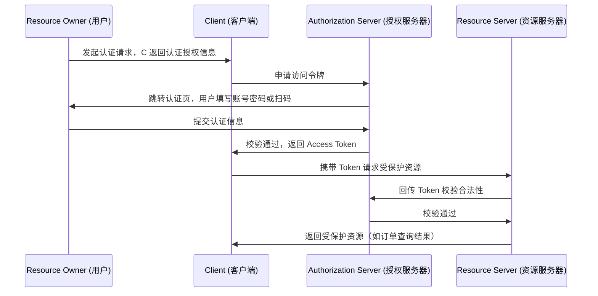

# 从传统认证到单点登录再到 OAuth2：四种授权模式（授权码/简化/密码/客户端）全解

单体时代，登录认证只是每个服务"自己管自己"的小事；服务一拆多，就变成了架构问题。本章沿着"传统登录认证、单点登录、OAuth2"的演进线，把协议流程与四种授权模式讲透，再落到 Spring Security OAuth 的整体设计，为集成统一认证打基础。

## 先给结论

- 传统登录认证在每个服务上独立进行：各自保存用户数据、独立实现认证逻辑。服务节点一多，用户数据难以集中统一，开发成本增加，用户交互极为不便。
- 单点登录只需一台统一认证授权服务加一个统一用户数据库，完成所有服务节点的登录授权，还能按用户分配接口权限、支持第三方应用接入，扩展性强，开发和运维成本低。
- OAuth2 是行业标准授权协议，实质是为第三方应用颁发有时效性的 token 令牌，凭令牌获取受保护资源；核心角色是资源所有者、资源服务器、客户端、授权服务器，另有用户代理 user-agent。
- 资源服务器校验 token 有两条路：回传授权服务器完整校验，或用 JWT 本地校验，省去回传但有解密开销，且附带信息有限。
- 四种授权模式按信任度与场景选型：授权码模式最安全，用户代理拿不到 token；简化模式少一个 code 环节，但 token 直接暴露且无 refresh_token；密码模式要求高度信任且不能暴露公网；客户端模式适合内部微服务调用，授权一次长期可用。

## 从传统认证到单点登录

传统登录方式是在每个服务进行登录认证：客户端要分别向服务 A、B、C、D 发起登录，每个服务各自连着一个用户数据库，独立实现认证逻辑。

这种模式有个绕不开的前提：用户想登录某个服务，必须先在那个服务里注册过。于是每扩充一个新服务，问题就暴露一次：新服务的用户数据源是空的，老用户没法直接登录，只有新用户可以注册，而老用户不可能重新注册一遍。维护成本不断增加，扩展性不好，整体体验存在严重问题。

单点登录换了一种思路：通过统一认证授权服务，完成所有服务节点的登录授权。因为只需要一台认证服务器，所以叫"单点"。流程上，客户端向服务 A 发起登录请求，服务 A 重定向到统一认证授权服务，认证成功返回令牌，客户端携带令牌访问服务 A 或服务 B 的资源。

它带来两样东西。其一是统一用户数据库：不管多少服务接入，用同一份通用用户数据统一完成认证授权。其二是资源访问控制：订单服务有订单查询、订单创建等不同权限的接口，可以给 A 用户只分配查询权限，给 B 用户分配订单创建权限。它还支持第三方应用接入，常见的微信登录、新浪微博登录就是这个思路：同一个账号就能对接所有接入的应用服务。

## OAuth2 的定位、角色与协议流程

OAuth 2.0 是一个行业标准授权协议，专注于简化客户端开发，为 Web、桌面、手机等各种设备接入提供特定的授权流程。它实质上是为第三方应用颁发一个具有时效性的 token 令牌，其他服务或第三方应用凭令牌获取相关资源：能不能调订单查询、订单创建接口，令牌说了算。

最常见的场景是第三方登录：进一个网站没有账号，注册又繁琐，直接用 QQ、微信、支付宝等厂商账号登录，走的就是 OAuth2 授权协议。对外 API 服务接口一般也采用 OAuth2 授权，比如微信 API、新浪 API。

OAuth2 有五个角色，重点掌握前四种：

- **resource owner**：资源所有者，具备访问该资源的实体；如果是一个人，就称为 end-user，即用户。
- **resource server**：资源服务器，受保护的服务器，具备提供资源的能力，如订单服务提供订单查询、商品服务提供商品查询，这些接口不允许外部随意调用。
- **client**：客户端，对资源服务器发起请求的应用程序。它不指用户：前后端分离项目里，前端服务就是 client，用户通过它访问后台接口。
- **authorization server**：授权服务器，给客户端颁发令牌，也就是前面的统一认证授权服务器；同时校验令牌是否合法，否则别人伪造一个令牌，应用服务无从判断。
- **user-agent**：用户代理，资源所有者与客户端沟通的工具，比如 App、浏览器。App 只是个壳子，抽掉后台接口什么事都做不了；浏览器也不提供业务功能，只负责解析后台数据并呈现给用户。

协议流程如下。



分步骤看：资源所有者向 client 发起认证请求，client 再向 authorization server 申请访问令牌；授权服务器跳转页面让用户填写账号密码，微信扫码、QQ 账号密码登录都发生在这一步，校验通过后返回 Access Token。client 拿到 token 去调用后台服务，例如订单查询接口。

资源服务器收到 token 后并不直接返回数据，还要检验合法性：把 token 发给统一认证服务校验，合法才允许 client 调用受保护资源，返回订单查询结果。这一步也可以用 JWT 在本地验证，省去回传；但 JWT 是加密的，解密有开销，附带信息有限，只装得下简要用户信息，要拿家庭地址、省份、年龄等完整资料，还得去统一认证服务调取。

## 四种授权模式：按场景选型，不是越简单越好

OAuth2 的授权类型分四种。有一点必须明确：并非用一套模式就能适用所有业务场景，要根据实际业务需要具体问题具体分析。四种模式对比如下。

| 模式 | 关键参数 | 特点与适用场景 |
|---|---|---|
| 授权码模式 Authorization Code | 授权请求 `response_type=code`，再以 `grant_type=authorization_code` 换令牌 | 先拿授权码再换 token，用户代理拿不到 token；适合第三方接入，如 CSDN 用 QQ 登录 |
| 简化模式 Implicit（隐式/隐私模式） | 授权请求 `response_type=token`，一步直接返回令牌 | 少一个授权码环节；但 token 直接暴露且不能获取 refresh_token；适合简单应用与高信赖环境 |
| 密码模式 Resource Owner Password Credentials | `grant_type=password` 加用户名密码 | 无用户代理参与，直接用账号密码换 token；要求高度信任，客户端不能暴露公网 |
| 客户端模式 Client Credentials | `grant_type=client_credentials` 加 client_id 和密钥 | 无用户参与，凭 id 和密钥直接取 token；授权一次长期可用；适合内部服务间调用，跨网段或对外不建议 |

### 授权码模式：先拿 code，再换 token

授权码模式流程最完整也最安全，依次是用户授权请求、用户授权应用、授权码授予、令牌请求、令牌授予五步。

以 CSDN 接入 QQ 账号认证服务为例。资源拥有者通过代理（Web 浏览器）访问客户端程序发起认证；客户端向认证服务器发起请求时携带两类信息：客户端标识 client_id，标识来源是 CSDN；重定向地址 redirect_uri，一般是 CSDN 当前登录地址，没有它，认证完成后页面不知道跳回哪里。

认证服务器返回认证页面，用户填写账号密码或扫码确认授权；校验通过后，授权服务器把授权码 code 返回给客户端。客户端拿到 code 后还不能调资源服务，要结合自身的 client_id 和 client_secret 请求令牌；授权服务器校验授权码是否合法，合法才返回 Access Token。

关键安全设计在这里：换令牌是客户端与认证服务器在后台完成的，后续步骤跟 user-agent 没有任何关系，用户代理拿不到、也窃取不了令牌和密钥。客户端拿到 token 后，才能向第三方资源服务器请求资源，比如获取 QQ 的基本资料、头像等信息。

```text
# 授权请求参数
response_type=code           # 必填，固定为 code，表示授权码模式
&client_id={客户端的ID}       # 必选项，标识客户端来源
&redirect_uri={重定向URI}     # 可选项，认证完成后跳回的地址
&scope={申请的权限范围}       # 可选项
&state={任意值}               # 可选项，需要传递记录的参数可放这里，但不能过长或过多冗余
```

```text
# 授权响应参数
code={授权码}                # 必填
&state={任意文字}             # 授权请求中包含 state 时必填
```

```text
# 令牌请求参数（用授权码换令牌）
grant_type=authorization_code   # 告诉认证服务器要通过授权码获取 token
&code={授权码}                   # 必填
&redirect_uri={重定向URI}        # 授权请求中包含 redirect_uri 时必填
&code_verifier={验证码}          # 授权请求中包含 code_challenge 时必填
```

令牌响应是完整的 token 信息：access_token、token_type、expires_in、refresh_token 以及 scope。刷新令牌是刷新时的校验凭证；scope 在请求和响应的授权范围不一致时必填。

### 简化模式：少一个 code 环节，token 直接暴露

简化模式也叫隐私模式（Implicit），与授权码模式的差别就一个：少了 code 验证环节。用户通过浏览器访问客户端，客户端携带 client_id 和重定向地址向认证服务器发起请求；用户填入身份信息校验通过后，认证服务器直接重定向回指定 URL 并附带 token；客户端拿到 Access Token，就能调用第三方资源服务的接口。

```text
# 简化模式授权请求参数
response_type=token          # 授权码模式这里是 code，简化模式直接要 token
&client_id={客户端的ID}
&redirect_uri={重定向URI}
&scope={申请的权限范围}
&state={任意值}
```

```text
# 简化模式授权响应参数
access_token={令牌信息}       # 必填
&expires_in={过期时间}
&state={任意文字}             # 授权请求包含 state 时必填
&scope={授权范围}             # 请求和响应的授权范围不一致时必填
```

响应参数里没有 refresh_token，这是简化模式有意为之：与主流流程无关的信息全部去掉，只留必要字段。refresh_token 的作用可类比浏览器 Session：Session 默认 15 分钟有效期，每调用一次接口后台就自动延长一次生命周期；token 不想频繁重新申请，就靠 refresh token 保持有效。

那为什么还要保留授权码模式的两步？差别就在 code 环节：授权码模式的令牌由客户端与认证服务器在后台请求获取，浏览器代理获取不到；简化模式直接返回 token，代理是能拿到的。缺了这个环节，token 相当于暴露给所有参与者，资源全部公开，存在严重的安全隐患。所以简化模式一般用于信赖度较高的环境，比如简单的问卷调查系统这类不涉及很多服务流转的应用：想快速实现可以选它，但简单也伴随缺陷。

### 密码模式：直接用账号密码换 token

密码模式（Resource Owner Password Credentials）只有三个参与者：资源所有者、客户端、认证服务。资源拥有者把 password 认证信息提供给客户端，客户端将用户名和密码直接发送给认证服务器，校验通过后返回 access token 和 refresh token；客户端拿到令牌，就能向第三方资源服务器请求资源。

```text
# 密码模式令牌请求参数
grant_type=password
&username={用户名}
&password={密码}
&scope={授权范围}
```

令牌响应同样是完整的 token 信息：access_token、token_type、expires_in、refresh_token、scope。

和其他模式对比：它比授权码模式简单，少了授权码环节；安全性反而比简化模式高一点，因为认证要通过用户名和密码校验，且环节中没有浏览器这类额外参与者，代理没法截获密码。使用密码模式有个前提：整个环境要具有较高的可靠性，客户端不能直接暴露在外网，公网报文随时可能被监听，直接传密码一旦被监听就是泄密。典型应用形态是：客户端是 gateway 网关，授权服务器对应订单服务这类业务服务，资源所有者是发起请求的 App。

### 客户端模式：只有 id 和密钥，没有用户

客户端模式（Client Credentials）是四种模式里最简单、最直接的，只有两个参与者：客户端和认证服务。客户端直接发起认证，传递 client_id 和密钥，认证服务直接返回 Access Token；只要 client_id 是预先分配好的、不是非法的，就能拿到正常有效的令牌。

顺带澄清一个名字误会：简化模式并不"最简化"，正式名称是隐式/隐私模式，因为它把 Access Token 做了隐藏转换调用；真正最简单直接的是客户端模式。也正因为过于简单，相当于服务端完全放权，只要核对请求方是分配过的可信 id 就发令牌，对信赖度要求非常高。

典型场景是内部服务之间调用。分布式微服务下，订单服务要访问用户、账户服务拿用户信息下单，还要调用资金服务检查资金是否充足。如果每次调用都要认证、传 token、查有效期会很麻烦，节点不可用时还要重新认证申请。用客户端模式就简单了：直接从认证服务拿到长期有效的 token，不用刷新，之后不管调用用户服务、资金服务还是新扩充的服务，都拿它直接访问，内部微服务之间不用再操心 token 流转的繁琐问题。

```text
# 客户端模式令牌请求参数
grant_type=client_credentials   # 必填
&client_id={客户端的ID}          # 必填
&client_secret={客户端的密钥}    # 必填
&scope={授权范围}                # 任意
```

令牌响应里没有 refresh_token，只有令牌信息、令牌类型和过期时间，过期时间可不设置，让令牌长期有效。要注意的是，这种模式必须保证服务与服务之间信赖度较高，一旦混入第三方或外部服务就存在安全隐患，毕竟 id 和密钥就能直接换到 token。

## 小结

认证方案的演进路径很清晰：传统认证把用户数据和认证逻辑散落在每个服务里，服务越多越难维护；单点登录用统一认证授权服务加统一用户数据库收拢认证与授权，顺带解决权限分配和第三方接入；OAuth2 把这套统一授权沉淀成行业标准协议，用有时效的 token 换取受保护资源。选型上：对外开放、安全优先选授权码模式；简单应用、环境可信可用简化模式；同公司自研、高度信任且不暴露公网可用密码模式；内部微服务调用用客户端模式。理解了四种模式的边界，再集成 Spring Security OAuth 统一认证组件时，就能对上每个配置项在流程里的位置。
