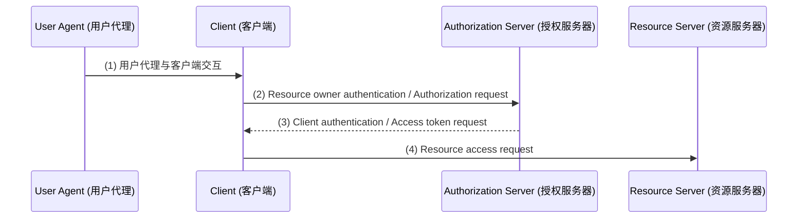
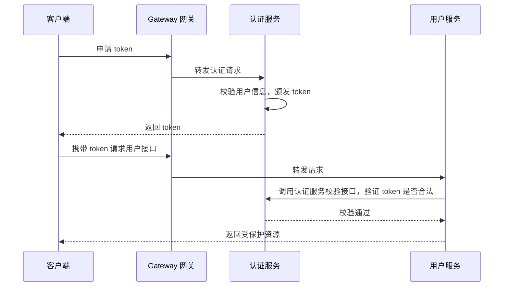

# Spring Security OAuth2 设计与认证服务生产实践：搭建、业务层、配置与测试

OAuth2 的协议流程与四种授权模式理清之后，就到了落地环节：先看 Spring Security OAuth2 如何划分客户端、授权服务器、资源服务器三大组件，再按"服务设计、环境准备、公用组件、认证服务、启动验证、Postman 测试"的步骤，搭出一个支持密码模式、Token 增强、Redis 缓存的认证服务。

## 先给结论

- 架构三角色各持一组组件：客户端有 OAuth2ClientContextFilter、Service、OAuth2RestTemplate；授权服务器有 TokenEndPoint、Authorization Endpoint、AuthorizationServerTokenServices；资源服务器靠 ResourceServerTokenServices 与 OAuth2AuthenticationManager 校验令牌。个性化需求实现对应接口即可扩展，不侵入原有设计。
- 演示系统是三个服务：Gateway 网关、认证服务、用户服务。申请 token 经网关转发到认证服务；携带 token 访问用户接口同样走网关；用户服务再回调认证服务的校验接口验证 token。
- 公用组件 stock-common 拆 dao/service/utils/web 四个模块，外加统一实体工程 stock-entity，工具类和实体集中维护，避免每个微服务复制一份，依赖更纯净。
- 认证服务 trade-auth 采用增强 Token 方案：TokenEnhancer 往令牌塞用户 ID、Name、Email，TokenStore 把令牌落到 Redis，客户端信息存 t_oauth_client_details 表并加缓存。
- 用户加载实现 UserDetailsService：先查缓存、未命中查库、封装 OAuthTradeUser、回写缓存；密码校验用自定义编码器，MD5 加密后再 Base64 编码比对。
- Postman 验证两步：Basic Auth 填 client 信息（app/app），form-data 填 grant_type=password、username=admin、password=admin、scope=server；刷新 token 换 grant_type=refresh_token，但 Basic Auth 不能漏，否则 401。

## Spring Security OAuth2 的整体设计

Spring Security OAuth2 的目标是在项目中集成 Spring Security 组件，实现 OAuth2 的统一授权认证。客户端一侧，用户经 OAuth2ClientContextFilter 过滤器进入 Service，再由 OAuth2RestTemplate 执行 HTTP 请求，取令牌和访问资源都走它；授权服务器一侧，TokenEndPoint 颁发访问令牌，Authorization Endpoint 处理用户授权，AuthorizationServerTokenServices 负责令牌的生成和管理；资源服务器一侧，ResourceServerTokenServices 验证传来的令牌，OAuth2AuthenticationManager 完成认证逻辑，Resource 是受保护资源。

四条编号箭头串起完整链路：



授权服务器返回的令牌响应格式固定：access_token 与 token_type 必填，expires_in 任意，scope 仅在请求和响应的授权范围不一致时必填。

```json
{
  "access_token": "{访问令牌}",
  "token_type": "{令牌类型}",
  "expires_in": "{过期时间}",
  "scope": "{授权范围}"
}
```

这套设计扩展性强：有个性化需求就实现对应的接口，不侵入原有整体设计，同时遵循 OAuth2 协议处理流程。

选型上本章用密码模式：面向的是 APP 用户，几十万上百万的用户量要做认证，每个用户都有自己的账号密码。授权码模式每次登录多一次额外交互，体验受影响；简化模式会暴露令牌；客户端模式没有用户维度。密码模式的前提是 client 与 authorization server 处于可靠安全的环境；客户端模式留给内部服务间调用，最好在同一网段或局域网内。

## 服务设计与准备工作

交互流程：客户端申请 token，请求经 Gateway 网关转发至认证服务，认证服务校验用户信息后颁发 token；拿到 token 访问受保护资源（用户服务的接口）同样经 Gateway 流转；用户服务对 token 做权限校验，做法是回调认证服务的校验接口验证 token 是否合法。



动手前先备齐环境和工具：

| 类别 | 内容 | 用途 |
|---|---|---|
| 开发工具 | IDEA + Lombok 插件 | 简化代码开发工作量 |
| 缓存 | Redis + Redis Desktop Manager | Token 存储与图形化管理 |
| 注册中心 | Nacos | 服务注册与发现 |
| 数据库 | MySQL（直接用虚拟机上的） | 业务与 client 数据存储 |
| 测试工具 | Postman | 模拟发送请求做功能验证 |

公用组件 stock-common 解决一个具体问题：StringUtils 这类工具不做统一封装，每个工程写一份就是大量重复劳动；统一封装后，改截取字符串的长度逻辑只需改一处，也便于统一组件管理。它分四个模块：

| 模块 | 定位 |
|---|---|
| stock-common-dao | 公用 DAO 数据层组件，管理数据层依赖与公用接口 |
| stock-common-service | 公用服务层组件 |
| stock-common-utils | 公用辅助工具：Stream、日期、加密解密、统一异常处理等 |
| stock-common-web | 公用 Web 层组件 |

另有统一实体工程 stock-entity，与 stock-common 同层级。实体集中放一个工程是为了便于微服务引用：否则每个模块一份实体，其他模块要操作它就得维护多份；直接引用其他服务的实体还会连带其自身依赖。

## 认证服务落地：工程搭建与业务层

认证服务 trade-auth 实现 OAuth2 认证功能，采用增强 Token 方式，流程包含 Token 扩展、缓存集成认证、密码模式、加密处理、自动化配置等。掌握这套流程就能用 Spring Security 处理大部分业务场景，包括 JWT 的实现。数据层用 JPA 实现，因为面向 APP 用户，所以结合密码模式做统一认证。

### 依赖与启动类

依赖里最核心的是 OAuth2 组件与 Spring Security，两个合起来实现统一认证；其余有 Redis 封装、JPA、Nacos 注册发现、Web 与 Tomcat：

```xml
<!-- OAuth2 核心组件 -->
<dependency>
    <groupId>org.springframework.cloud</groupId>
    <artifactId>spring-cloud-starter-oauth2</artifactId>
    <version>${spring-cloud-starter.version}</version>
</dependency>
<!-- Spring Security 依赖 -->
<dependency>
    <groupId>org.springframework.cloud</groupId>
    <artifactId>spring-cloud-starter-security</artifactId>
    <version>${spring-cloud-starter.version}</version>
</dependency>
<dependency>
    <groupId>org.springframework.boot</groupId>
    <artifactId>spring-boot-starter-web</artifactId>
</dependency>
<dependency>
    <groupId>org.springframework.boot</groupId>
    <artifactId>spring-boot-starter-tomcat</artifactId>
</dependency>
```

版本号统一放父工程 properties：spring-cloud-starter.version 2.1.1.RELEASE、druid.version 1.1.18、project.stock.version 1.0.0。

启动类 TradeAuthApplication 的注解读法：@EnableDiscoveryClient 开启 Nacos 服务注册发现；@ComponentScan 组件扫描；基于 JPA，@EntityScan 实体扫描与 @EnableJpaRepositories 数据层扫描必须指定路径；认证会集成缓存，加 @EnableCaching：

```java
@SpringBootApplication
@EnableDiscoveryClient
@ComponentScan(basePackages = {"com.itcast"})
@EntityScan(basePackages = {"com.itcast"})
@EnableJpaRepositories(basePackages = {"com.itcast"})
@EnableCaching
public class TradeAuthApplication {
    public static void main(String[] args) {
        SpringApplication.run(TradeAuthApplication.class, args);
    }
}
```

用户实体 TradeUser 承载用户编号、用户名称、密码等基础信息，开启 @Entity 与 @Table 表名映射；属性列用自动转换处理，不必逐个加 @Column 指定映射。

### 业务层实现

数据层 TradeUserRepository 是接口，继承 JpaRepository，只提供一个方法：根据用户编号获取用户对象，认证查询时使用。

OAuth2 认证要检查用户账号密码，必须按它的接口规范提供账号密码信息，所以先做 BO 对象 OAuthTradeUser：继承 Spring Security 的 User 对象（org.springframework 包下），构造方法传用户账号、密码和用户状态（是否锁定等状态与权限控制），没有明确权限接口就留空。

服务层核心 AuthStockUserDetailServiceImpl 实现 UserDetailsService，重写 loadUserByUsername（根据用户账号获取用户对象，用于登录认证鉴权），注入数据层与缓存管理接口，流程四步：

```java
@Service("authStockUserDetailService")
public class AuthStockUserDetailServiceImpl implements UserDetailsService {

    @Autowired
    private TradeUserRepository tradeUserRepository; // 用户数据层
    @Autowired
    private CacheManager cacheManager;               // 缓存管理

    @Override
    public UserDetails loadUserByUsername(String username) {
        // 1. 从缓存查找用户对象，命中直接返回
        Cache cache = cacheManager.getCache(GlobalConstants.AUTH_USERDETAILS);
        UserDetails cached = cache.get(username, UserDetails.class);
        if (cached != null) {
            return cached;
        }
        // 2. 缓存未找到，查数据库；查不到抛异常，带编号说明账号无效
        TradeUser tradeUser = tradeUserRepository.findByUserNo(username);
        if (tradeUser == null) {
            throw new UsernameNotFoundException("用户信息未找到: " + username);
        }
        // 3. 封装成 OAuth2 认证所需的对象
        UserDetails userDetails = new OAuthTradeUser(tradeUser);
        // 4. 写入缓存：userNo 为 key，UserDetails 为值
        cache.put(username, userDetails);
        return userDetails;
    }
}
```

客户端信息服务 AuthClientDetailService 处理另一个身份：调用认证服务时还有一个 Client 身份。OAuth2 内置的客户端信息放数据库，重写它是为了加缓存、减少数据库查询，提升 ClientID 的鉴权效率。

```java
@Override
@Cacheable(value = GlobalConstants.OAUTH_KEY_CLIENT_DETAILS, key = "#clientId", unless = "result == null")
public ClientDetails loadClientByClientId(String clientId) {
    return super.loadClientByClientId(clientId);
}
```

缓存 key 就是 clientId；unless 保证结果为空不缓存，空值放进缓存没有意义。对应表是 t_oauth_client_details，鉴权走 Redis 缓存，OAuth2 的其他内置表可以不加进来。

## 配置、启动与测试验证

配置类有三个，作用必须分清：

| 配置类 | 职责 |
|---|---|
| AuthorizationServerConfig | Server 端配置：客户端表 SQL 查询配置、Token 增强配置 |
| StockPasswordEncoder | 密码编码器：自定义密码编码或加密在这里实现 |
| WebSecurityConfigurer | Web 访问配置：哪些接口走 OAuth2 鉴权，哪些放行 |

### Web 层接口

Web 层与启动类放在一起。认证服务要提供登录页面（输入用户名密码、点登录按钮），所以要提供自定义接口。TradeStockTokenController（@RestController、@RequestMapping("/token")）注入 Redis 操作模板、TokenStore（增强 Token 处理）和 CacheManager，提供自定义登录接口——OAuth2 默认界面比较丑、交互不好，可以定制自己的 Logo 和样式——以及登录成功后的返回地址与提示信息、Token 注销接口。注销通过 TokenStore 实现：从请求头 Authorization 解析 token 值，replace 掉 BEARER 类型前缀后校验读取，无效返回"退出失败"，否则 removeAccessToken 清除。区别在于：logout 只清除 Token，注销把所有相关信息全部清除。

另一个接口 TradeUserController 的 /user 用户信息接口只做一件事：获取用户信息。它让认证服务既当认证服务又当资源服务，认证通过后验证资源接口能否正常调用：

```java
@RequestMapping("/user")
@ResponseBody
public UserDetails getUser(@RequestParam("username") String username) {
    UserDetails userDetails = authStockUserDetailService.loadUserByUsername(username);
    return userDetails;
}
```

### AuthorizationServerConfig

AuthorizationServerConfig 继承 OAuth2 提供的 AuthorizationServerConfigurerAdapter，注入数据源 DataSource、UserDetailsService、AuthenticationManager 和 Redis 缓存服务，注意加 @Configuration 和 @EnableAuthorizationServer，不开启认证服务，下面的配置不生效。

先配客户端查询 SQL，作用是查询所分配的 client_id 的信息；不想用这张表，改 SQL 甚至换表都行：

```java
String BASE_FIND_STATEMENT = "select " + CLIENT_FIELDS + " from t_oauth_client_details";
String DEFAULT_FIND_STATEMENT = BASE_FIND_STATEMENT + " order by client_id";
String DEFAULT_SELECT_STATEMENT = BASE_FIND_STATEMENT + " where client_id = ?";

AuthClientDetailService clientDetailsService = new AuthClientDetailService(dataSource);
clientDetailsService.setSelectClientDetailsSql(DEFAULT_SELECT_STATEMENT);
clientDetailsService.setFindClientDetailsSql(DEFAULT_FIND_STATEMENT);
clients.withClientDetails(clientDetailsService);
```

再配授权端点，同时支持 GET 和 POST，挂上 Token 存储、增强、用户服务与认证管理器：

```java
endpoints
    .allowedTokenEndpointRequestMethods(HttpMethod.GET, HttpMethod.POST)
    .tokenStore(tokenStore())
    .tokenEnhancer(tokenEnhancer())
    .userDetailsService(authStockUserDetailService)
    .authenticationManager(authenticationManager)
    .reuseRefreshTokens(false);
```

TokenStore 通过 Redis 存储 token 信息，key 带前缀和格式处理。配套缓存配置里 key 与 hashKey 序列化用 String，value 与 hashValue 用 JDK 序列化，并注入 RedisConnectionFactory 设置连接工厂。

### Token 增强：整个方案的核心

```java
@Bean
public TokenEnhancer tokenEnhancer() {
    return (accessToken, authentication) -> {
        try {
            // 客户端模式直接返回原令牌
            if (GlobalConstants.OAUTH_CLIENT_CREDENTIALS
                    .equals(authentication.getOAuth2Request().getGrantType())) {
                return accessToken;
            }
            // Map 存储附加信息：用户 ID、Name、Email 等
            final Map<String, Object> additionalInfo = new HashMap<>(16);
            OAuthTradeUser authUser = (OAuthTradeUser) authentication.getUserAuthentication().getPrincipal();
            if (null != authUser) {
                TradeUser traderUser = authUser.getUser();
                additionalInfo.put(GlobalConstants.OAUTH_DETAILS_USER_ID, traderUser.getId());
                additionalInfo.put(GlobalConstants.OAUTH_DETAILS_USERNAME, traderUser.getName());
            }
            // 附加信息保存进 access token，形成增强 Token
            return new DefaultOAuth2AccessToken(accessToken.getValue(), additionalInfo);
        } catch (Exception e) {
            log.error(e.getMessage(), e);
            return accessToken;
        }
    };
}
```

为什么叫增强？正是因为它有扩展能力，可以把用户更多信息存进令牌，不这样做令牌只能附带少量基本信息。流程是先判断认证类型，grant_type 为 client_credentials 直接返回；否则把需要扩充的用户附带信息放进 Map，保存到 access token 的附加信息里。

### Web 安全与密码编码

WebSecurityConfigurer 继承 WebSecurityConfigurerAdapter，加 @Configuration、@Primary 调高优先级，装配顺序有要求就用 @Order 指定；注入自定义用户服务接口与密码编码器（考虑安全可加 AES 等加密）。HttpSecurity 指定登录页面、登录表单地址、登录成功后的返回地址；/token/** 与 /actuator/** 放行（permitAll），其余请求都要认证；CSS、图片等静态资源不拦截；关闭 CSRF，防止申请 token 时出现 401 认证错误：

```java
@Configuration
@EnableWebSecurity
@Primary // 优先级调高，必要时配合 @Order 指定顺序
public class WebSecurityConfigurer extends WebSecurityConfigurerAdapter {

    @Override
    protected void configure(HttpSecurity http) throws Exception {
        http
            .formLogin()
                .loginPage("/token/login")
                .loginProcessingUrl("/token/form")
                .defaultSuccessUrl("/token/success")
                .and()
            .authorizeRequests()
                .antMatchers("/token/**", "/actuator/**").permitAll()
                .anyRequest().authenticated()
                .and()
            .csrf().disable();
    }

    @Override
    protected void configure(AuthenticationManagerBuilder auth) throws Exception {
        auth.userDetailsService(authStockUserDetailService)
            .passwordEncoder(stockPasswordEncoder);
    }
}
```

密码编码器 StockPasswordEncoder 实现 PasswordEncoder：encode 不做特殊编码，直接转字符串；核心是 matches 的校验：先判空，再经加密工具处理——先 MD5 加密、外层再 Base64 编码（封装在通用工具类 EncryptUtil 中），密码全程密文传输；最后与库里密文比对，匹配返回 true，不匹配认证不通过：

```java
@Component
public class StockPasswordEncoder implements PasswordEncoder {

    @Override
    public boolean matches(CharSequence rawPassword, String encodedPassword) {
        try {
            // 先 MD5 加密，外层再 Base64 编码
            String password = EncryptUtil.encryptSigned(rawPassword.toString());
            return encodedPassword.equals(password);
        } catch (Exception e) {
            log.error(e.getMessage(), e);
            return false;
        }
    }
}
```

### 工程配置文件

application.yml 几块内容：服务基本配置（端口 9999、服务名称）；Druid 监控数据源带连接池配置，开后台监控要指定 url-pattern 决定放行与禁止的访问，没特殊要求留空，另有后台登录用户名密码；Freemarker 模板引擎配置，自定义登录页面就是用它实现的，不需要的 MVC 错误配置做排除；JPA 配置关键是命名策略：实体与表都采用驼峰命名、没有下划线，配成直接映射不做转换，否则无法自动化映射。最关键的是 Redis 与 Security + OAuth2 集成：

```yaml
redis:
  host: 127.0.0.1
  password: 123456
  port: 6379

security:
  oauth2:
    resource:
      loadBalanced: true
      token-info-uri: http://trade-auth/oauth/check_token
    client:
      client-id: app
      client-secret: app
      scope: server
      ignore-urls: # 放行的 url，需要放行的模块加进来
```

resource 的含义：本服务同时作为资源服务，校验 token 要访问认证服务的 check_token 接口；认证服务因为加了用户接口，既能当资源服务又能当认证服务，所以指向自身，loadBalanced 支持负载均衡。client 配置必须与预置信息一致：client-id、client-secret 都是 app，scope 是 server，与数据库匹配正确才能申请到 token。

### 启动验证与 Postman 测试

#### 数据库初始化与启动

认证服务要预制 client 信息：新建 t_oauth_client_details 表并初始化两条数据，名称 app、密码也是 app，密钥是加密后的密文而非明文，保证密码信息安全；同时初始化业务库 trade_stock 的 t_trade_user 表，内置用户 admin，认证服务提供了资源接口，这份数据用于验证密码模式鉴权能否成功：

```sql
DROP TABLE IF EXISTS t_oauth_client_details;
-- client 表初始化两条数据（app/app，密文存储）
INSERT INTO trade_stock.t_trade_user (...) VALUES (1, 'admin', 'ISMVKKXp...AFw==', '123', 1, NULL, NULL, NULL, 0, NULL);
```

按顺序启动 Nacos、Redis、MySQL，再启动认证服务。编译期检查报错，注解不能漏，比如 StockPasswordEncoder 要加 @Service 注入 Spring 容器。启动后观察日志：端口 9999 启动完成，无报错。

验证用户接口：浏览器访问用户详情地址，传参 username=admin。第一次返回 404，后台日志也没有输出错误，排查控制层发现没加对应注解。这类细节遗漏很常见：报地址找不到，第一反应就是查 controller 的注解。补上重启后再访问，返回自定义登录页面；输入 admin/admin，登录成功后返回用户完整信息：用户密码、名称、ID、Email 等。

#### Postman：申请与刷新 Token

Postman 新建请求，地址填认证服务的 /oauth/token，一个字符都不能错，结尾千万不要多加斜杠，否则把自己坑了。

配置分两部分。第一步 Basic Auth 基础认证：填 client 信息，Username 与 Password 都填 app（预制 client 就是 app）；不填的话请求时会弹框要求输入账号密码。第二步密码模式的业务参数：Body 选 form-data 表单提交，填 grant_type=password（密码认证模式）、username=admin、password=admin（t_trade_user 里的账户）、scope=server（与服务端保持一致）。

发送后返回 access_token、refresh_token 和超时时间。因为采用增强 Token，增强信息也附带出来了：回看 TokenEnhancer，附带的是 ID、NAME、EMAIL 三个字段，返回结果里正好有这三项。GET 与 POST 都可以，结果分两部分：内置 token 信息加自定义增强的扩展信息。好处是不用再交互一次拿完整用户信息，需要哪些字段直接放进附加信息挂到 token 上。

刷新 token：地址不变，form-data 提交 grant_type=refresh_token（这次不是密码模式，要告诉服务端动作是 refresh），再加参数 token，值为之前返回的 refresh_token。第一次发送报 401 认证错误，原因是漏填了 Basic 基础认证；服务端要靠它识别客户端是否合法，刷新时同样不能省。补上再发送就正常了，返回结构与申请时一致，只是 token 值已经换了新的一串。

## 小结

本章把认证服务的生产落地走了一遍：先通过设计图理解 Spring Security OAuth2 的三大组件与四条交互流程；再按服务设计、环境准备、公用组件、认证服务、启动验证、Postman 测试六步推进。trade-auth 的关键是增强 Token：TokenEnhancer 把用户 ID、Name、Email 塞进令牌，TokenStore 落 Redis，客户端信息从 t_oauth_client_details 查询并加缓存。实现和配置环节多，重点是捋清脉络：不同包下的类各自的作用，service 与数据层接口在认证流程中的位置，核心依赖就是 spring-cloud-starter-security 加 spring-cloud-starter-oauth2。测试侧记两条：申请 token 是 Basic Auth 加密码模式参数两步；刷新换 grant_type 即可，但 Basic Auth 一步不能省。用户服务与网关服务在后续章节落地，届时做整条链路的完整验证。
