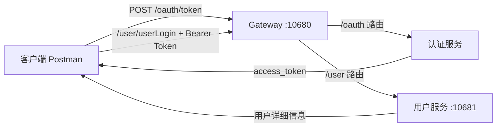

# 网关启动验证与权限网关章总结：统一入口打通 OAuth2 认证链路

前面几节已经把网关服务、认证服务和用户服务分别搭建完成，路由与全局过滤器也都配置到位。本节把三个服务一起拉起来，用 Postman 走完整条认证链路做验证，最后访问 Druid 监控后台确认数据源状态，并借章末总结把这一章的坑点梳理成一份 FAQ。

## 先给结论

- 网关定义了两条路由：`stock-user` 把 `/user` 开头的请求转发到用户服务，`trade-auth` 把 `/oauth` 开头的请求转发到认证服务；路由 predicates 里不要限定 `Method=GET,POST`，默认放行所有请求方式，认证环节会用到。
- 通过网关申请 Token：`POST http://127.0.0.1:10680/oauth/token`，Basic Auth 携带客户端信息，请求体仍是密码模式，能正常返回 `access_token`、`refresh_token`、`user_name` 等增强信息，说明网关到认证服务的转发链路正常。
- 拿到 Token 后改走网关访问 `http://127.0.0.1:10680/user/userLogin`（网关端口 10680，用户服务端口 10681），请求头带 `Authorization: Bearer <token>`，同样能取到用户详细信息。
- 网关在整个 OAuth2 认证环节里只负责转发，不参与实际认证和鉴权，这样既提高了转发处理效率，又保证微服务对外暴露的安全性。
- Druid 监控后台地址 `http://127.0.0.1:10681/druid/index.html`，登录名 `druid`、密码 `druid123`，配置在用户服务的工程配置文件里。
- 章末 FAQ 覆盖四类高频故障：认证 401、密码正确却拿不到 Token、资源服务调用超时、网关转发 POST 报 404。

## 三服务联调：先把链路跑起来

启动类 `StockGatewayApplication` 上标注了 `@SpringBootApplication` 和 `@EnableDiscoveryClient`，是一个标准的、注册到注册中心的微服务应用。验证前要确保认证服务、用户服务、网关服务三个节点全部启动成功、控制台没有报错——服务节点比较多，启动时别选错启动类。

网关的路由配置对应两条转发规则：

```yaml
spring:
  cloud:
    gateway:
      routes:
        - id: stock-user     # /user 开头，转发至用户服务
          predicates:
            - Path=/user/**
        - id: trade-auth     # /oauth 开头，转发至认证服务
          predicates:
            - Path=/oauth/**
```

这里有一个实现过程中踩过的细节：不要在 predicates 里开启 `Method=GET,POST` 这类限定，不配置该方法项时默认允许所有请求方式，而 OAuth2 认证恰恰会用到。此外网关还配了 `logging.level.root: info` 控制日志级别。

## 验证一：通过网关申请 Token

之前申请 Token 是直连认证服务，现在把请求地址换成网关端口。在 Postman 里新建 POST 请求，地址指向 `http://127.0.0.1:10680/oauth/token`，Authorization 选 Basic Auth 并填入客户端用户名密码，其余参数不变，请求体仍然是密码模式的认证参数。

发送后能正常返回 Token 的 JSON 数据，包含 `access_token`、`refresh_token` 和 `user_name` 等字段，Token 的增强信息同样可以抓取到。这证明网关到认证服务的请求转发能够正常调用，效果和直连认证服务完全一致——网关只是把请求按路径转发了过去。

## 验证二：带 Token 走网关访问用户服务

之前用户登录验证是直连用户服务的 10681 端口，这次把端口改成网关的 10680，路径不变。注意请求头里的 Token 参数要用最新申请到的有效 `access_token`——虽然之前的 Token 并未过期，但确保起见引用最新值。发送后成功返回用户登录后的详细信息，整个结果是成功的。

整条链路如下：



两次验证用的参数完全一致，差别只在端口和路径，这正体现了统一网关的价值：客户端只需要记住一个地址，靠路径就能分别访问认证服务和受保护的资源服务。Gateway 的能力也不止转发，后续还可以在它上面做限流、统一聚合文档等功能，随着项目深入学习会陆续接触到。

## 验证三：Druid 监控后台

复制 Druid 监控地址，浏览器访问 `http://127.0.0.1:10681/druid/index.html`，注意这是用户服务的数据源监控。首次访问需要登录，账号密码来自用户服务工程配置文件：登录名 `druid`，密码 `druid123`。

登录后可以看到完整的监控管理功能，主要页签包括：

| 页签 | 监控内容 |
| --- | --- |
| 数据源 | 数据源连接配置信息 |
| SQL 监控 | SQL 执行统计，刚才登录验证产生的 SQL 执行次数已有详细记录 |
| SQL 防火墙 | 保障 SQL 交互的安全性 |
| Web 应用 | 并发数、最大并发请求次数等详细统计 |
| URI 监控 / Session 监控 | URI 与会话维度统计 |
| Spring 监控 / JSON API | 框架层与接口监控 |

这些功能在生产环境中相当实用：当应用服务出现阻塞时，通过监控数据源就能排查到底是数据连接的问题，还是应用服务自身的问题。

## 章末复盘：全局过滤器与四类常见故障

回顾本章，学习目标有两点：完成网关服务认证转发配置及功能验证；实现监控数据源 Druid 的集成配置，掌握监控后台的访问与用户名密码的自定义设置。核心实现上，网关除了启动类之外增加了一个全局过滤器 `StockRequestGlobalFilter`，它的作用是把请求头中的认证信息转发到应用服务——如果不做这个设定，默认情况下部分头部信息会丢失，OAuth2 统一认证的完整性就无从谈起：

```java
@Component
@Log4j2
public class StockRequestGlobalFilter implements GlobalFilter, Ordered {

    @Override
    public Mono<Void> filter(ServerWebExchange exchange, GatewayFilterChain chain) {
        String authentication = exchange.getRequest().getHeaders().getFirst("Authorization");
        if (StringUtils.isEmpty(authentication)) {
            // 处理未认证请求
        }
        // 继续过滤链
        return chain.filter(exchange);
    }
}
```

实践过程中 OAuth2 配置复杂，最容易在四个点上踩坑：

| 现象 | 排查方向 |
| --- | --- |
| 认证报 401 | 先检查数据库脚本是否完整，`t_oauth_client_details` 表初始化数据是否正确，基础数据必须能正常执行生成；再 debug 启动用户服务，在密码编码器 `matches` 处打断点，比对传入的原始密码和加密后的值，注意编码或乱码问题导致加密结果不一致 |
| 用户名密码正确仍申请不到 Token | 检查认证服务 `AuthenticationServerConfig` 是否配置并开启了 `allowFormAuthenticationForClients`，允许 form 请求认证，防止申请 Token 时 401；仍不行可在 Redis 清除 client details 相关缓存，测试环境可以全部清空，影响不大 |
| 资源服务带 Token 调用超时 | 检查网络是否通畅；检查认证服务是否已在 Nacos 注册成功，没注册就不可能完成 Token 校验；检查资源服务 security 配置里 loadBalance 是否开启；检查安全配置是否定义并注入了 RestTemplate——RemoteTokenService 依赖它 |
| 网关调认证服务 GET 正常、POST 报 404 | 检查网关工程路由配置里的 Method 配置项，去掉该项后默认允许所有请求类型，问题即消失；有特殊要求再按需配置对应 Method |

另外两点值得记录：Redis 中 OAuth 客户端信息做了序列化处理，在客户端工具里只能看到键名和一堆序列化内容，需要通过程序反序列化才能读出具体值，测试出问题时可以右键 delete 清除这些键值。扩展资料方面，可深入阅读 OAuth2 授权流程文档、Spring Boot OAuth2 2.0 密码模式服务器的实现——本章正是结合工程做了密码模式的运用；Redis 客户端推荐 Redis Desktop Manager，有余力也可以拓展了解 RedisPlus。

## 小结

本章走完了「统一网关 + OAuth2 认证 + 资源服务」的完整闭环：Gateway 通过 `/oauth` 与 `/user` 两条路由代理认证服务和用户服务，对外提供统一地址；全局过滤器保障认证头信息不丢失；Druid 监控后台负责实时观测数据库连接状况，帮助快速定位线上故障。申请 Token、携带 Token 访问资源、查看数据源监控三个验证动作全部通过，说明整套微服务认证方案可以正常投入使用。后续遇到 401、超时、404 这类问题时，先对照上面的 FAQ 表逐项排查，大多数情况都能快速收敛。
