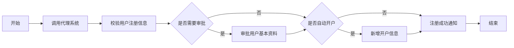

# Sentinel 生产最优配置与降级限流验证：Push 模式集成用户服务，注册流程开篇

网关与 OAuth2 认证链路打通之后，本章把 Sentinel 接入用户服务，做成生产级的熔断降级方案：规则统一放在 Nacos 配置中心维护，监控台只负责观测。Sentinel 的使用与原理之前课程已经讲过，这一章解决它在 Spring Cloud 微服务生产环境的落地。集成验证做完后，本章还开启了第二部分内容：用户注册功能，先从业界标准注册流程和注册即开户的业务设计说起。

## 先给结论

- Sentinel 规则推送有三种模式：原始模式规则存内存、重启即丢，只适合开发测试；Pull 模式客户端定期轮询拉取，可持久化但实时性与一致性没有保证；Push 模式借助配置中心监听推送，官方建议生产环境采用。
- 用户服务集成 Sentinel 只需三个依赖：`spring-cloud-starter-alibaba-sentinel`、`spring-cloud-alibaba-sentinel-datasource`、`sentinel-datasource-nacos`，业务方法上加 `@SentinelResource` 注解即可。
- blockHandler 与 fallback 同时配置时，抛 BlockException 只进 blockHandler，其他异常才进 fallback；两者都没定义则直接把 BlockException 抛出去。Sentinel 1.6.0 以下版本降级只支持 DegradeException。
- 降级规则放在 Nacos 的 `sentinel-user-degrade`：异常比例 0.2、时间窗 4 秒；限流规则放在 `sentinel-user-flow`：QPS 阈值 12、快速失败。修改 Nacos 配置后监控台即时同步，Push 模式动态生效得到验证。
- 降级触发后连正常请求也会返回系统繁忙提示，4 秒时间窗过后自动恢复；代码里模拟异常要抛 ComponentException，不能抛 DegradeException。
- 注册流程部分明确了业界流程（代理推广、信息校验、审批、开户）与注册即开户的开关设计：平台本身包含交易功能，注册完成即可自动生成交易账号。

## 三种推送模式：生产环境为什么选 Push

规则推送模式决定了规则的存储位置和更新方式，三种模式对比如下：

| 推送模式 | 说明 | 优点 | 缺点 |
| --- | --- | --- | --- |
| 原始模式 | API 将规则推送至客户端并直接更新到内存，可扩展写数据源（WritableDataSource） | 简单，无任何依赖 | 不保证一致性；规则存在内存，重启即消失，严重不建议用于生产 |
| Pull 模式 | 扩展写数据源（WritableDataSource），客户端主动向规则管理中心定期轮询拉取规则，规则中心可以是 RDBMS、文件等 | 无依赖，规则可持久化 | 不保证一致性；实时性不保证，轮询过于频繁还有性能问题 |
| Push 模式 | 扩展读数据源（ReadableDataSource），规则中心统一推送，客户端通过注册监听器时刻监听变化，如 Nacos、Zookeeper | 规则持久化，一致性好，速度快 | 引入第三方依赖 |

原始模式就是 Sentinel Dashboard 直连客户端：后台改完规则直接推给客户端存内存，服务一重启规则就丢。Pull 模式多做了一层持久化，客户端拿到规则后先更新内存缓存，再写一份到本地文件，重启后从文件恢复；代价是轮询间隔短了有性能压力，间隔长了变更生效就慢。

Push 模式把规则的存储与推送交给配置中心：Dashboard 不再直接对接客户端，而是把规则发布到 Nacos 这类配置中心，配置中心检测到修改后推送给监听中的客户端。客户端重启或故障后重新连接配置中心就能拿到最新配置，本地不需要再做持久化，只要网络连通就不存在一致性和实时性问题。官方建议生产环境采用 Push 模式，本章按这个方案落地。

落到部署结构上：客户端发起登录请求后，用户服务先做降级规则判断和限流规则判断再走业务逻辑，规则统一从 Nacos 配置中心拉取；监控台负责发布和修改规则；用户服务作为 Sentinel 客户端注册到监控台便于统一管理。生产环境峰值时段出现大量用户请求，或内部系统出问题时，这套机制能防止穿透、雪崩导致整个服务瘫痪。

## 用户服务改造：依赖、注解与降级处理

集成按官方文档走，官方本着简单易用的原则设计，第一步给 stock-user 工程加三个依赖：

```xml
<!-- Sentinel 限流组件 -->
<dependency>
    <groupId>com.alibaba.cloud</groupId>
    <artifactId>spring-cloud-starter-alibaba-sentinel</artifactId>
</dependency>
<dependency>
    <groupId>com.alibaba.cloud</groupId>
    <artifactId>spring-cloud-alibaba-sentinel-datasource</artifactId>
</dependency>
<dependency>
    <groupId>com.alibaba.csp</groupId>
    <artifactId>sentinel-datasource-nacos</artifactId>
</dependency>
```

第二个是 Spring Cloud Alibaba 对 Sentinel 数据源的封装，第三个是 Nacos 数据源实现，因为采用 Push 模式，数据源就是 Nacos 配置中心。

第二步在用户登录方法上加 `@SentinelResource` 注解。它的参数包括：value 资源名称、entryType 入口类型、blockHandler（BlockException 的处理函数名）、fallback（抛异常时的回调，针对所有类型异常）、defaultFallback（默认回调，通用性强时才配）、exceptionsToIgnore（指定哪些异常不触发熔断降级）。资源名称必须配置，Nacos 和监控台配规则全靠它关联匹配。

blockHandler 与 fallback 的分工要分清：两者同时配置时，触发限流或降级抛出 BlockException 只会进入 blockHandler，fallback 优先级次一级；没有抛 BlockException 而是其他异常，则进入 fallback 处理；如果两个都没定义，BlockException 会直接向外抛出。还有一处版本差异：Sentinel 1.6.0 以下版本降级只支持 DegradeException，之后抛 BlockException 也能触发降级。

改造后的登录方法：

```java
@Override
@SentinelResource(value = "userLogin", blockHandler = "userLoginHandler")
public TradeUser userLogin(String userNo, String userPwd) throws ComponentException {
    // 模拟降级异常
    if ("error".equals(userNo)) {
        throw new ComponentException(ApplicationErrorCodeEnum.FAILURE);
    }
    // 获取用户对象
    TradeUser tradeUser = stockUserDao.getByUserNo(userNo);
    if (null == tradeUser) {
        throw new ComponentException(ApplicationErrorCodeEnum.USER_NOT_FOUND);
    }
    // 用户密码加密判断
    String encryptPassword = EncryptUtil.encryptSigned(userPwd);
    boolean pwdMatch = tradeUser.getUserPwd().equals(encryptPassword);
    if (!pwdMatch) {
        log.error(ApplicationErrorCodeEnum.USER_PWD_ERROR);
        throw new ComponentException(ApplicationErrorCodeEnum.USER_PWD_ERROR);
    }
    return tradeUser;
}
```

userNo 等于 error 的分支是专门为验证加的模拟异常，不抛异常的话永远不会触发降级限流。注意这里抛的是 ComponentException 而不是 DegradeException：后者只要一出现就直接进入降级处理，不再按降级规则里的异常比例条件触发。

blockHandler 指向的处理方法按规则类型分流。AbstractRule 是抽象类，下面有 FlowRule（限流）、DegradeRule（降级）等多个实现，通过 `ex.getRule()` 拿到本次命中的规则再判断：

```java
/**
 * 用户登录限流降级处理逻辑
 */
public TradeUser userLoginHandler(String userNo, String userPwd, BlockException ex) {
    log.error("userLogin flow limit, call userLoginHandler: " + ex.getMessage());
    AbstractRule abstractRule = ex.getRule();
    if (abstractRule instanceof DegradeRule) {
        throw new ComponentException(ApplicationErrorCodeEnum.SYS_BUSY);
    } else if (abstractRule instanceof FlowRule) {
        throw new ComponentException(ApplicationErrorCodeEnum.SYS_FLOW);
    }
    // 默认情况，抛出系统异常
    throw new ComponentException(ApplicationErrorCodeEnum.SYS_ERROR);
}
```

方法名要与 blockHandler 的值一致，参数与原方法保持一致并额外带上 BlockException。降级返回系统繁忙、限流返回请稍后重试，正好对应功能设计的约定。配置正确的情况下都会进入前两个分支，只有配置异常等超出预期的情况才会落到默认的系统异常。

Service 层抛出的 ComponentException 还要在外层捕获，否则客户端收不到错误提示，交互不友好。Controller 里做了统一包装，ComponentException 按 `e.getErrorCodeEnum()` 返回错误码与描述，其余异常走系统错误：

```java
@RequestMapping("/userLogin")
public ApiRespResult userLogin(@RequestParam("userNo") String userNo, @RequestParam("userPwd") String userPwd) {
    ApiRespResult result = null;
    try {
        // 用户登录逻辑处理
        TradeUser tradeUser = stockUserService.userLogin(userNo, userPwd);
        result = ApiRespResult.success(tradeUser);
    } catch (ComponentException e) {
        log.error(e.getMessage(), e);
        result = ApiRespResult.error(e.getErrorCodeEnum());
    } catch (Exception e) {
        log.error(e.getMessage(), e);
        result = ApiRespResult.sysError(e.getMessage());
    }
    return result;
}
```

## 规则落位与验证：bootstrap.yml、Nacos 配置、监控台

工程配置文件 bootstrap.yml 里加入 Sentinel 接入配置。注意 transport 要放在 spring.cloud 下与 nacos 平级，位置写错时鼠标悬停不会有补全提示，出现提示说明拼写正确：

```yaml
spring:
  application:
    name: stock-user
  cloud:
    nacos:
      discovery:
        server-addr: 127.0.0.1:8848
      config:
        server-addr: 127.0.0.1:8848
    sentinel:
      transport:
        dashboard: 127.0.0.1:8090
      datasource:
        # 用户的降级规则配置
        user-degrade:
          nacos:
            server-addr: 127.0.0.1:8848
            dataId: sentinel-user-degrade
            groupId: DEFAULT_GROUP
            data-type: json
            rule-type: degrade
        # 用户限流的规则配置
        user-flow:
          nacos:
            server-addr: 127.0.0.1:8848
            dataId: sentinel-user-flow
            groupId: DEFAULT_GROUP
            data-type: json
            rule-type: flow
```

dashboard 指向监控台默认端口 8090；datasource 配了两个数据源，user-degrade、user-flow 这两个名称可以自定，但必须与 Nacos 后台创建的配置项名称完全一致。

启动 Nacos（本机 8848），在配置列表里新增这两个配置。降级规则内容：

```json
[
  {
    "resource": "userLogin",
    "count": 0.2,
    "grade": 1,
    "timeWindow": 4
  }
]
```

字段含义：resource 资源名称，对应 `@SentinelResource` 注解的 value；count 降级阈值，取值 0 到 1 的百分比，0.2 即异常比例 20%；grade 降级策略，0 按响应时间、1 按异常比例、2 按异常数量；timeWindow 时间窗，单位秒，经过 4 秒后尝试恢复。即业务方法处理时异常比例超过 20%（两次请求失败一次就是 50%）就触发降级策略。

限流规则内容：

```json
[
  {
    "resource": "userLogin",
    "controlBehavior": 0,
    "count": 12,
    "grade": 1,
    "limitApp": "default",
    "strategy": 0
  }
]
```

字段含义：controlBehavior 流量整形控制效果，支持快速失败和匀速排队两种模式，默认 0 即快速失败，超过阈值立即触发失败，匀速排队则把流量整合后按排队顺序有序调用；count 限流阈值，这里为 12；grade 限流策略，0 按线程数量、1 按 QPS 并发数，此处配置为 1；limitApp 限流针对的来源，填 default 即可；strategy 基于调用关系的流控策略，三种取值：

| strategy | 名称 | 含义 |
| --- | --- | --- |
| 0 | STRATEGY_DIRECT | 根据调用方限流，结合 limitApp 使用 |
| 1 | STRATEGY_RELATE | 关联流量限流，多个资源有竞争或关联关系时生效，比如同一数据的写操作频繁，读请求就会被限流 |
| 2 | STRATEGY_CHAIN | 调用链入口限流，配合 refResource 指定入口 Req1，则 Req1 受限流控制，Req2 放行 |

配置内容必须是合法 JSON，多一个逗号或格式拼错，Nacos 不会提示报错，但规则在使用时不会生效，这一点要特别注意。

接着启动 Sentinel 监控台：

```bash
java -Dserver.port=8090 -Dcsp.sentinel.dashboard.server=localhost:8090 -jar sentinel-dashboard-1.6.2.jar
```

浏览器访问 `http://127.0.0.1:8090/#/dashboard`，账号密码都是 sentinel。再启动用户服务（端口 10681）和认证服务 TradeAuthApplication，上一章已集成 OAuth2，登录前先申请 Token；Postman 申请时如果认证不通过，检查 Redis 是否启动，起来后重新请求即可拿到。

两个注意点：其一，Sentinel 监控台是懒加载设计，服务刚启动时列表里看不到，先调用一次服务接口再刷新就能显示 stock-user；其二，基于 Push 模式规则由 Nacos 统一维护和推送，监控台本身不用配置任何规则。带 Token 访问 `http://127.0.0.1:10681/user/userLogin?userNo=admin&userPwd=admin&access_token=...` 能正常返回用户登录信息，此时监控台里流控规则显示 QPS、阈值 12，降级规则显示比例 0.2、时间窗 4 秒，与 Nacos 配置一致，同步链路正常。

功能验证分两步。先验证限流：QPS 阈值 12 手动刷新很难触发，在 Nacos 里把 count 改成 2 并发布，监控台刷新即同步为 2，动态生效得到验证；加快刷新频率就返回 `系统峰值请稍后请求` 的限流提示。再验证降级：把 count 改回 12（设得太小会先撞上限流，影响降级验证），拿 userNo=error 的异常链接多刷几次，前几次返回的是业务自身抛出的异常，还没进入降级处理方法；异常比例超过 20% 后触发降级，返回 `系统繁忙，请稍后重试`，此时连正常链接也被降级拦下；等 4 秒时间窗过后再访问，恢复正常。

监控台的流控规则里还有关联、链路等控制模式，以及 Warm Up 预热和排队等待两种流控效果：预热让系统面对峰值先升温再放量，排队等待把峰值请求整形后有序处理，让系统更平滑地消化流量，可参考官方文档拓展。

## 注册开篇：业界注册流程与注册即开户

Sentinel 集成完成后，本章进入第二部分：用户注册功能。学习目标是三点：了解用户注册流程与数据库结构设计；掌握全局序列号生成方案，并用 Hibernate Validator 实现参数自动化校验，把更多精力集中在业务功能实现上；最后完成用户注册功能并做整体测试验证。实现路径自底向上：注册流程与库表设计、实体与公用系统层组件、数据层、服务层、全局序列号生成方案（基于数据库、保证全局有序）、接入层、自动化校验，最后启动服务做功能验证。

智牛股交易平台的注册流程采用业界标准设计。完整的业界流程一般还会包含代理系统推广信息与审计功能，教学场景做了简化，聚焦核心环节：



调用代理系统是为了判断用户是否经代理推荐注册，推荐注册会给代理一定奖励，代理体系的价值在于帮助平台在线上推广。校验用户注册信息做基础判断，比如检查用户是否已经注册。开启审批时还要审核用户基本资料，没有违规信息才允许在平台审核、开户、使用。

最关键的判断是是否自动开户。注册和开户是两件事：东方财富、同花顺这类交易 APP 登录后有各自的用户体系，但并不代表能交易，交易必须经过券商（中信证券、国泰君安等）开户，券商开户后才能接入交易所进行交易。用户注册产生的是用户账号，券商开户产生的才是交易账号。所以只有系统同时具备用户业务和交易处理能力时才能自动开户：智牛股交易平台本身包含交易功能，注册完成后可以立即开设交易账号，实现注册即开户；如果系统只做用户业务不参与交易，就不需要这个判断。

业务设计上先注册后开户，通过开关控制是否自动开户，本章保留该开关实现注册即开户，需求变更时不用再改代码。支撑注册功能的核心数据表是用户表和用户文件表，完整的库表设计下一节展开。面试中被问到注册功能时，要把代理、审批、开户这些周边环节一并讲清楚，只答注册和开户本身，面试官会觉得了解得不够深入。

## 小结

- 规则推送模式决定生产方案的形态：原始模式只适合开发测试，Pull 模式有持久化但实时性差，Push 模式借助 Nacos 等配置中心兼顾实时性、一致性与持久化，是官方推荐的生产首选。节点少或对一致性可靠性要求不高的场景可以用直连模式，开发环境用原始模式效率更高，毕竟 Push 方案还要额外启动 Nacos 做配套配置。
- 集成三步走：加 sentinel、datasource 封装、nacos 数据源三个依赖；业务方法标 `@SentinelResource` 并定义 blockHandler，按 DegradeRule、FlowRule 分流抛出业务异常；bootstrap.yml 配 transport 与两个 nacos 数据源。
- 规则全部落在 Nacos：降级按异常比例 0.2、时间窗 4 秒；限流按 QPS 12、快速失败、来源 default、策略 DIRECT；JSON 格式错误不会报错，但规则不生效。
- 验证确认了两件事：Nacos 修改规则后监控台即时同步，动态生效；限流与降级按预期触发和恢复，4 秒时间窗过后自动恢复。
- 注册功能以业界流程为蓝本，保留自动开户开关实现注册即开户，全局序列号与自动化校验将在后续小节展开。
