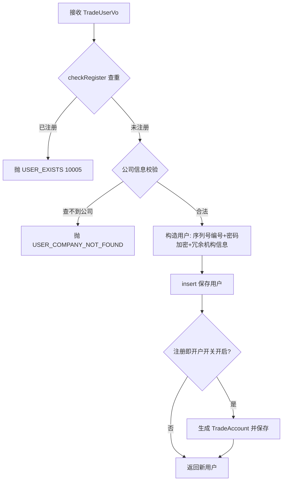

# 用户注册全栈落地：库表、四层实现、全局序列号方案与自动化校验

用户注册看起来是个不起眼的功能，但放到支持 SaaS 模式的证券交易系统里，要同时解决多公司接入、注册即开户、全局唯一账号编号、参数校验这一整串问题。这一篇按课程的实现路径，把智牛股项目的用户注册功能从库表设计到四层代码，再到自动化校验与启动验证完整过一遍，重点讲清楚基于 MySQL 的全局序列号生成方案为什么不用加锁也能防并发。

## 先给结论

- 新增四张表支撑注册：用户文件表 `t_trade_user_file`、公司表 `t_company`、系统全局配置表 `t_trade_global_config`、全局序列表 `t_seq`；公司与用户、用户与用户文件、用户与交易账户都是一对多关系。
- 全局序列号用 `update t_seq set nextId = last_insert_id(nextId + 1)` 配合 MyBatis `selectKey` 实现，靠 `last_insert_id` 的 connection 级原子性防并发，不需要加锁，也不会阻塞其他线程。
- 该方案适合并发量不大的场景（数十万在线用户、一两万并发问题不大）；高频交易要结合缓存做预分配，或者改用速度更快但不保证有序的雪花算法。
- 注册主流程：查重（用户编号/邮箱/手机号任一命中即算已注册，SQL 是 or 关系加 `limit 1` 兜底）→ 公司合法性校验 → 构造用户（序列号生成编号 + 密码加密 + 冗余机构信息）→ 保存用户 → 按全局配置开关决定是否同步开户。
- 参数校验用 hibernate-validator：`@Size`/`@Pattern` 这类带规则的触发 BindException，`@NotBlank` 这类直接约束的触发 ConstraintViolationException，两类异常都要在 `@ControllerAdvice` 里统一拦截并包装成接口格式。
- 开发顺序建议自下而上：业务流程 → 库表 → 实体 → 公用组件 → 数据层 → 服务层 → 接入层，避免上下层来回穿插、反复修改。

## 库表设计：四张新增表支撑 SaaS 注册开户

先看整体关系。交易核心表（成交记录、订单、持仓）此前已经讲解，注册功能不涉及；账户预警相关的表注册也用不到。重点是用户为主体的表：平台支持 SaaS 模式运作，很多公司接入，用户归属于不同公司，公司对用户是 1 比 N；用户上传身份证等文件资料，用户对用户文件表是 1 比 N；一个用户可以开多个交易账号——类比可以在不同券商开户，按现行交易规定一个用户最多能开三个账户，所以用户对用户账户表同样是 1 比 N。

用户文件表的结构值得细看：

```sql
drop table if exists t_trade_user_file;
create table t_trade_user_file (
    id bigint not null auto_increment comment '主键标识',
    userId bigint(16) not null comment '用户ID',
    fileType tinyint(3) not null comment '业务类型(0:身份证, 1:银行卡, 2:信用卡)',
    filename varchar(64) comment '文件名称',
    fileTyp varchar(32) comment '文件类型',
    filePath varchar(255) comment '文件路径',
    status tinyint(3) not null comment '状态(0:有效, 1:无效)',
    createTime datetime comment '创建时间',
    updateTime datetime not null default CURRENT_TIMESTAMP comment '更新时间',
    primary key (id)
);
create index idx_userId on t_trade_user_file (userId);
```

`fileType` 是业务类型字段，为不同文件类型预留扩展空间：将来要上传其他证明文件，只需扩充类型枚举，表结构不用再动。文件本身的唯一标识后续会配合分布式文件存储生成。

公司表 `t_company` 承载接入机构的基本资料：`companyName`、`institutionType`（机构类型）、`contactUser`、`contactPhone`，外加一个 `adminUser` 管理账号——每个公司必须有一个管理者，用来分配公司角色和各部门的操作管理人员，状态字段取值 0 有效、2 禁用，并对 `contactUser` 建了索引。

系统全局配置表 `t_trade_global_config` 用来做整体控制：`code` 配置项编号、`category` 分类编号（BASIC 基础配置、BUSINESS 业务配置、SYSTEM 系统配置）、`value` 配置值、`status` 状态。注册即开户就是一个开关型配置，初始化一条数据，将来调整只改参数值即可：

```sql
INSERT INTO trade_stock.t_trade_global_config (id, code, category, value, status)
VALUES (1, 'REG_OPEN_ACCOUNT', 'SYSTEM', 'N', 0);
```

最后是全局序列表 `t_seq`，结构非常简单：`code` 业务编号加一个序列值。生成用户编号和交易账号编号各占一条记录，具体用法在下一节展开。

## 全局序列号：靠 last_insert_id 而不是加锁

全局序列号会在多处复用，所以实现统一放在 `stock-common-system` 公用组件下，各微服务模块直接依赖使用，不必每个节点自己实现一套。数据层接口按业务类型区分序列：

```java
/**
 * 根据编号获取序列ID
 */
int getNextId(TradeSeq record);
```

编号（code）相当于业务类型：用户表传用户编号的 code，订单表传订单编号的 code，各自独立成序列、各自全局唯一。对应的 Mapper 是整个方案的核心：

```xml
<update id="getNextId" keyColumn="nextId" keyProperty="nextId"
        parameterType="com.icast.trade.stock.entity.system.TradeSeq">
    update t_seq set nextId = last_insert_id(nextId + 1) where code = #{code};
    <selectKey resultType="long" keyProperty="nextId" keyColumn="nextId">
        SELECT LAST_INSERT_ID()
    </selectKey>
</update>
```

为什么不能直接"先查 nextId，再 +1 更新回去"？两个线程同时操作会查到同一个值，产生脏读、数据不一致。加锁当然能保证正确，但所有线程排队等待、全部阻塞，性能大幅下降。`last_insert_id(expr)` 这个函数在更新时完成累加并把值记录在当前 connection 上，`selectKey` 随即取回，整个操作是原子的；而且 `last_insert_id` 只受当前 connection 影响，天然隔离了并发。这和 insert 数据后用 selectKey 回填自增主键是同一个套路。

Service 层就薄了：

```java
@Override
public Long getNextSeqId(String code) {
    TradeSeq seq = new TradeSeq();
    seq.setCode(code);
    tradeGlobalConfigDao.getNextId(seq);
    return seq.getNextId();
}
```

业务侧生成用户编号时再补一个格式化：

```java
private String generateUserNo() {
    Long nextUserNo = tradeGlobalConfigService.getNextSeqId(GlobalSeq.USER_NO);
    log.info("get the next userNo : " + nextUserNo);
    // 0 表示补零，后面的数字标识总长度
    return String.format("%08d", nextUserNo);
}
```

补零是因为用户编号要固定 8 位长度，不然有的 3 位、有的 5 位，整个编号看起来不规整；想生成 9 位就把格式改成 `%09d`。

方案缺陷也要说清楚：它基于数据库操作，存在 IO 瓶颈，适合并发量不大的业务场景。高频度交易场景直接拿来用不行，优化思路是预分配——每个微服务节点预先从数据库拿一批序列号放缓存里，用完再取，这样既保住整体有序性，又具备高效的处理性能。如果业务不需要保证序列号有序，直接用雪花算法，它基于内存计算，速度比数据库方案快得多。

## 四层代码：数据层、服务层与接入层

**实体与公用组件先行。** 实体不用手写：在 MyBatis Generator 工程的 `generatorConfig.xml` 里按 table 格式把 `t_trade_account`、`t_trade_global_config`、`t_trade_user_file`、`t_company`、`t_institution` 加进去，运行生成器拿到实体和 mapper 代码。生成结果不能照搬——把生成好的属性拷过去改个类名，resultMap 直接复用，复杂一点的查询要自己写 SQL，代码生成器的作用是省掉重复劳动。公用系统层组件（全局配置的数据层接口 `getByCode`、`getNextId` 与对应 Service）放在 common-system 模块的 dao、service 两个包下。

**数据层**在 bulls-stock-user 服务的 dao 包下实现两组接口。交易账号数据层：`insert`（新增交易账号）、`getByAccountNo`（按账号编号查交易账户）。用户文件数据层：`insert`、根据 userId 查所有文件。另外在已有的用户 dao 上扩展两个注册专用方法：

```java
Integer checkRegister(@Param("userNo") String userNo,
                      @Param("email") String email,
                      @Param("phone") String phone);

CompanyVo getCompanyVoById(@Param("id") Long id);
```

`checkRegister` 的 SQL 三个条件是 or 的关系而非 and——三者任一存在即视为已注册：

```xml
<select id="checkRegister" resultType="java.lang.Integer">
    select 1 from t_trade_user
    where userNo = #{userNo} or email = #{email} or phone = #{phone}
    limit 1
</select>
```

or 关系可能查出多条记录，加 `limit 1` 兜底，避免现场不可预知的脏数据把程序搞出未知异常。`getCompanyVoById` 则是 join 机构信息表（机构表的详细数据 ID 关联 company 的 id），同样建议加 `limit 1`。`CompanyVo` 用 Lombok `@Data` 生成 get/set，里面冗余了机构类型等信息——注册逻辑要做公司信息反显，将来查用户资料就不用再反查这些表，减少查询开销。

**服务层**实现 `userRegister` 接口，入参 `TradeUserVo`（放在 common-web 下，其他服务节点也可能用到用户信息），方法签名直接抛出业务异常和组件异常两种。整体流程如下：



关键代码：

```java
// 1. 判断用户是否已经注册
Integer checkResult = stockUserDao.checkRegister(
        tradeUserVo.getUserNo(), tradeUserVo.getEmail(), tradeUserVo.getMobile());
if (null != checkResult && checkResult > 0) {
    throw new BusinessException(ApplicationErrorCodeEnum.USER_EXISTS);
}

// 2. 校验公司信息：SaaS 模式下用户必须挂在一个合法公司下
CompanyVo companyVo = stockUserDao.getCompanyVoById(tradeUserVo.getCompanyId());
if (null == companyVo) {
    throw new BusinessException(ApplicationErrorCodeEnum.USER_COMPANY_NOT_FOUND);
}

// 3. 构造并完善用户信息
BeanUtils.copyProperties(tradeUserVo, newTradeUser);
newTradeUser.setUserId(generateUserNo());
newTradeUser.setTradePwd(EncryptUtil.encryptSigned(tradeUserVo.getTradePwd()));
newTradeUser.setInstitutionId(companyVo.getInstitutionId());
newTradeUser.setInstitutionTypeId(companyVo.getInstitutionTypeId());
newTradeUser.setCompanyName(companyVo.getCompanyName());
stockUserDao.insert(newTradeUser);
```

几个容易疏漏的点：`checkResult` 要同时判 null 和大于 0，空查询返回 0 时不能误判成已注册；密码必须以密文入库，用加密工具做签名加密；冗余机构 ID、机构类型 ID、公司名称时注意类型匹配（机构类型 ID 是 long，别用成 String）；用户表 insert 的主键 id 是数据库自增、由 selectKey 回填，而全局生成的用户编号是另一个业务字段，两者不是一回事。

**注册即开户**靠全局配置开关驱动：

```java
TradeGlobalConfig config = tradeGlobalConfigService
        .getTradeGlobalConfigByCode(GlobalConstants.TRADE_ACCOUNT_CONFIG_CODE);
if (null != config && GlobalConfig.VALUE_TRUE.equals(config.getValue())) {
    TradeAccount tradeAccount = new TradeAccount();
    tradeAccount.setAccountNo(generateAccountNo()); // 走 USER_ACCOUNT 序列
    tradeAccount.setUserId(newTradeUser.getId());
    tradeAccount.setTradeGroupId(1L);               // 系统默认组，预置一条数据
    tradeAccount.setStatus(GlobalConfig.STATUS_VALID);
    tradeAccount.setActiveTime(new Date());
    // 冗余机构、公司信息；可用余额初始化为 0（长整型）
    tradeAccountDao.insert(tradeAccount);
}
```

生成交易账号的规则与用户编号完全一样，只是传入的序列 code 不同——这也是序列方案按 code 区分业务的意义。邮件/短信通知在本章标记为 TODO，等后续对接阿里云通讯能力再补上。最后把新用户对象作为结果返回。

**接入层**新建 `StockUserOpenController`，挂在 `/open` 路径下区分开放接口：

```java
@RestController
@RequestMapping("/open")
public class StockUserOpenController {
    @Autowired
    private IStockUserService stockUserService;

    @RequestMapping(value = "/register", method = RequestMethod.POST)
    public ApiRespResult register(@Valid TradeUserVo tradeUserVo) {
        ApiRespResult result;
        try {
            TradeUser tradeUser = stockUserService.userRegister(tradeUserVo);
            result = ApiRespResult.success(tradeUser);
        } catch (BusinessException e) {
            log.error(e.getMessage(), e);
            result = ApiRespResult.error(e.getErrorCodeEnum());
        } catch (ComponentException e) {
            log.error(e.getMessage(), e);
            result = ApiRespResult.error(e.getErrorCodeEnum());
        } catch (Exception e) {
            log.error(e.getMessage(), e);
            result = ApiRespResult.sysError(e.getMessage()); // 未知异常兜底
        }
        return result;
    }
}
```

Service 方法通过 IDE 重构抽取到 `IStockUserService` 接口层；try-catch 必须三层兜底——业务异常、组件异常各取错误码包装返回，最外层再 catch Exception，数据库连接中断这类未知异常统一按系统异常返回。

## 自动化校验与启动验证

接口一多、参数各异，每个都手写校验不现实。引入 hibernate-validator：

```xml
<dependency>
    <groupId>org.hibernate</groupId>
    <artifactId>hibernate-validator</artifactId>
    <version>6.0.16.Final</version>
</dependency>
```

三步走。第一步，Controller 参数前加 `@Valid`，声明这个参数要做自动化校验。第二步，在 `TradeUserVo` 的字段上定义具体规则：

```java
@Size(min = 1, max = 32, message = "姓名长度必须为1到32")
private String name;

@Size(min = 1, max = 32, message = "密码长度必须为1到32")
private String userPwd;

@Pattern(regexp = "^(13[0-9]|15[4,\\d]|18[0,5-9])\\d{8}$", message = "手机号格式错误")
private String phone;
```

像手机号这种复杂规则用 `@Pattern` 正则匹配，比单纯限长度灵活得多；此外还有 `@NotNull`、`@DecimalMax`、`@DecimalMin` 等注解可按场景扩充。第三步，统一拦截校验异常并组装成接口格式，否则提示信息繁杂、不符合统一接口规范。注意自动化校验不会碰到第一个错误就停，它会把所有字段的校验错误都查出来一起抛，所以 handler 里要遍历拼接：

```java
@ExceptionHandler(BindException.class)
@ResponseStatus(HttpStatus.BAD_REQUEST)
@ResponseBody
public ApiRespResult handlerException(BindException ex) {
    StringBuffer stringBuffer = new StringBuffer();
    List<FieldError> errors = ex.getFieldErrors();
    for (FieldError fieldError : errors) {
        stringBuffer.append(fieldError.getField())
                .append(":").append(fieldError.getDefaultMessage());
    }
    return ApiRespResult.validError(stringBuffer.toString());
}
```

两类异常要分开拦：`@Size`、`@Pattern` 这类下面还能定义具体规则的属于校验性异常，抛 BindException；`@NotNull`、`@NotBlank` 这种直接限制结果、不能再自定义规则的属于约束性异常，抛 `ConstraintViolationException`（javax.validation 包），要另写一个 `@ExceptionHandler(ConstraintViolationException.class)` 方法，拦截配置同样是 400 响应状态码。FAQ 补充：如果 `@NotBlank` 不生效，检查使用它的类上有没有加 `@Validated` 注解。

启动验证前先明确两件事：认证服务可以不启动，因为注册接口是开放出来的，用户注册成功拥有账号之后才有登录认证这回事；同时检查 `ResourceSecurityConfig` 的配置——`antMatchers("/user/**").authenticated()` 只拦截 /user 前缀的请求，/open 前缀的注册接口不在认证范围，这正是接入层用 -open 开头路径的原因。用户服务启动后端口是 10681。

课程演示里现场踩了三个坑，都很典型：一是启动报 `CompanyVo` 的 mapper 路径错误，写 mapper 文件不能盲目 copy，要检查实体包路径；二是调用时报找不到 `TradeGlobalConfigDao`，这个接口在 system 模块下，而启动类的 `@MapperScan` 只扫了当前工程的 dao，把 system 模块的 dao 包加进扫描即可（多个包用逗号分隔）；三是 Postman 调 `/open/register` 返回 404，Controller 的 register 方法漏写了 `@RequestMapping("/register")`，补上并指定 method 为 POST。

用 Postman 模拟调用：POST + form-data，参数 `phone=1390013900`、`userPassword=123456`、`companyId=1`、`name=test`。注册成功返回完整用户信息——生成的 8 位用户编号、密文形式的密码、与入参一致的手机号。查库确认：`t_trade_user` 新增一条记录；把注册即开户的配置值改为开启后，`t_trade_account` 也生成了新账号并关联到新用户的 id，注册开户流程整体走通。

接着验证两类校验。逻辑校验：用同一手机号再次注册，返回"用户已存在"，重复判断生效。自动化校验：密码置空再发请求，返回"密码长度必须为1到32"；用户名和密码都置空，两段错误提示一起返回；手机号去掉一位，"姓名长度必须为1到32"与"手机号格式错误"同时抛出——所有字段校验结果的完整返回，让调用方能一次看清参数到底哪里出了问题。

## 小结

用户注册功能本身不复杂，但想做得完善、健壮，每一步都得下功夫。全局序列号保障分布式微服务环境下编号的唯一与有序；自动化校验挡住非法请求，避免不必要的异常和错误数据。基于 MySQL 的全局序列号方案实现简单可靠，代价是数据库 IO——数十万在线用户、一两万并发尚可，三百万级用户量就要结合缓存预分配来优化性能。方法论上，任何业务功能都别急着写代码：先了解业务流程和交互，做好底层数据库结构设计，然后自下而上实现——创建实体、封装公用组件、数据层、服务层、接入层，最后测试验证。自上而下地写会不停在 web 层和 service 层之间来回穿插、反复补代码，自下而上则层次清晰、思路连贯，功能实现自然水到渠成。
