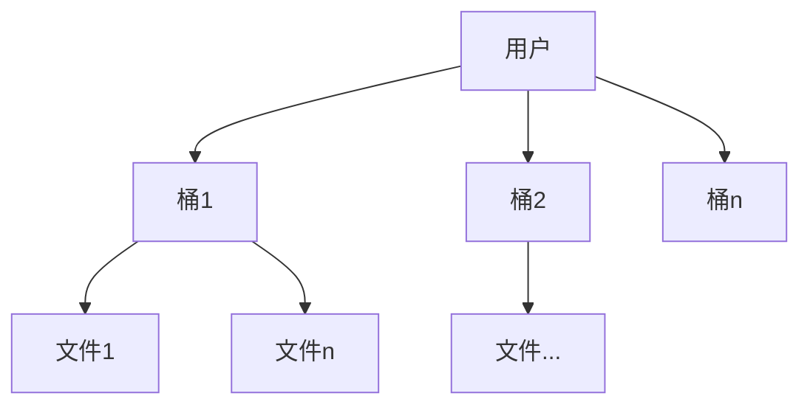
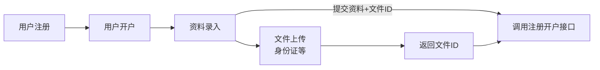

# Ceph RGW 与 Swift API 实践：服务端配置、Java 封装调用验证与用户上传下载功能开篇

上一章用户注册时上传的身份证、银行卡文件需要一个可靠的存储去处，这一章先把 Ceph Swift API 完整实践一遍：讲清楚 RGW 网关和桶式存储结构，完成服务端配置与用户创建，封装 SwiftOperator 实现 Java 侧文件上传下载并验证；随后进入第二章用户上传下载功能，把这套封装改造成 Spring Boot Starter 实现自动化装配。走完这条链路，微服务项目里就能直接集成 Ceph 对象存储。

## 先给结论

- Ceph 之前用 CephFS 做过上传下载演示，但互联网大规模文件场景下 FS 没有很好的连接方式、也不适合海量大规模调用，rados 本地化操作不便于服务接入——生产实现要走 RGW 网关的 Swift API。
- RGW 是对象存储的入口，本质是一个 HTTP 服务器（与 Nginx、Apache 无特殊差别），能适配兼容 AWS S3 和 OpenStack Swift 两套 API；Swift 本身是 Rackspace 开发的对象存储项目，最终一致性，与 Ceph 的强一致性形成对照。
- 存储结构是"用户 → 桶 → 对象"三层：桶好比文件夹，但桶不能嵌套桶，没有层级路径概念；桶要按业务分门别类创建，避免单个桶过度膨胀。
- 服务端配置主线：`ceph -s` 确认 HEALTH_OK → 验证 7480 端口网关 → `radosgw-admin` 创建 Swift 用户和管理用户 → 把 access/secret key 配进 Dashboard，否则管理后台看不到网关用户。
- Java 侧封装 SwiftOperator：构造时用 AccountConfig + BASIC 认证创建 Account，上传下载各只要两步核心调用；验证时跑一遍列容器、上传、下载，文件内容一致即通过。
- 项目化改造走 Spring Boot Starter：参数从配置文件读取、去掉 @Component，通过 @ConditionalOnProperty 加 META-INF/spring.factories（SPI 机制）实现自动化装配。

## 为什么走 RGW：Swift API 的定位与桶式存储结构

Ceph 是分布式文件存储系统，集群至少要准备三到四台虚拟机节点，安装配置有一定难度，没掌握也可以用虚拟机实现集群发现，重点是掌握怎么在项目里集成和使用。之前章节采用 CephFS 文件系统并编写了相应 API 实现文件上传下载，但在互联网大规模文件应用场景下 FS 满足不了生产要求：一是没有很好的连接方式，通过 API 不能很好地操作；二是对海量的大规模调用并不适合。同样，rados 本地化操作也不便于服务的接入和使用。所以生产上要采用 Ceph Swift API 来实现文件的存储和管理。

Swift 本身是由 Rackspace 开发的、为云计算提供可扩展存储的项目，专注于对象存储并提供一套 REST 风格的 API 访问，便于不同应用服务的接入。它与 Ceph 的明显差异在一致性模型：Ceph 是强一致性，Swift 是最终一致性。两者都是优秀的开源项目，没有明显优劣之分，按使用场景选择——专注对象存储，Swift 就能满足；如果还有块存储要求，对强一致性和大中小型文件都有要求，Ceph 更合适，它功能丰富、具备强一致性和较高的可用性。

这里选 Ceph 做具体实现的原因，是通过网关可以适配兼容 Swift API：之前接入 Swift API 的应用服务再接 Ceph 不需要做过多的改造，同时在数据访问上具备较强的扩展性。Ceph 的扩展性体现在一组组件上：

- Rados 网关：用兼容 S3 的 RESTful API 访问，对 AWS 云环境下的其他内容兼容性好，比如 OpenStack Swift 的对象存储访问接口；
- CephFS：POSIX 兼容的文件系统，可在任何 Linux 发行版上运行，操作系统可以直接访问 Ceph 存储；
- RBD：Linux 内核级块设备，允许像访问其他 Linux 块设备一样访问 Ceph；
- iSCSI 网关：SUSE 增加的功能，允许管理员在 Ceph 上运行 iSCSI 网关，把它转变为任何操作系统都可以访问的 SAN 文件管理器。

一些大型互联网公司也开始采用 Ceph Swift 接口处理海量文件，课程给出了携程 Ceph 实践之路的参考链接。RGW 的定位一句话说清：Ceph 可以提供块、文件、对象三种形态的存储，RGW 就是提供对象存储的网关，即对象存储的入口，本质上是一个 HTTP 服务器，通过这个网关入口，用户采用 HTTP 协议以 RESTful 方式访问 Ceph 对象存储。

存储结构方面，Swift API 调用前要先创建相应用户进行认证，确保数据安全。每个用户下面可以创建多个桶，桶里面存放对象——对象就是各种数据文件，包括文档、图片等。它和传统路径式存储的区别必须理解清楚：桶和对象的关系好比文件夹与文件，但桶不能再嵌套桶，没有层级路径的概念，文件都是平级存放。



实践上建议桶按业务分门别类：用户服务对应一个文件存储桶，报表服务对应数据报表文件桶，附件再单独设一个桶。这样一个桶不会放所有文件，避免过度膨胀，也便于查询和使用。

## 服务端配置：集群检查、Swift 用户与 Dashboard

配置按步骤走。第一步确保 Ceph 集群正常安装并启动，进入之前搭建的三台节点的主节点 10.10.20.11 查看运行状态：

```bash
[root@CENTOS7-1 ceph-cluster]# ceph -s
```

健康状态必须是 HEALTH_OK，同时能看到 mon、mgr、mds、osd、rgw 各服务的运行情况。

第二步验证网关能否正常访问。Ceph Swift API 要通过 RGW 做对应实现，所以必须确保 RGW 组件正常运行：浏览器访问 `http://10.10.20.11:7480`，返回 XML 响应说明网关正常且有响应内容。

第三步创建 Swift 用户，用于接口的请求和认证：

```bash
sudo radosgw-admin user create --subuser='cephtester:subtester' \
  --uid='cephtester' --display-name='cephtester' \
  --key-type=swift --secret='654321' --access=full
```

命令参数逐个看：subuser 指定子用户，uid 是用户名称，display-name 是显示名称，key-type 配置为 swift，secret 是密钥，access 是 full 全权限。创建成功返回 JSON 结构：user_id、display_name、subusers（cephtester:subtester，permissions 为 full-control）、secret_key，还有 op_mask（read, write, delete）、bucket_quota 和 user_quota 等信息。最关键的是记住 Swift key 下面的 user 及 secretKey——在应用服务中调用访问都要传递对应的密钥，代码中会用到。

第四步创建管理用户并激活管理后台的对象存储模块：

```bash
radosgw-admin user create --uid=mgruser --display-name=mgruser --system
ceph dashboard set-rgw-api-access-key XZDC4YOAORE01NMYU3VV
ceph dashboard set-rgw-api-secret-key meO280HLvctkzzBs74ufXS0wi947NBe6wpj3MxKP
```

管理用户类型是 system，创建后记住返回的 Access Key 和 Secret Key，它们要设置到 Ceph Dashboard 里：不配置这两个 key，管理后台就没有权限查看网关相关的用户账号。配置完成后访问 `http://10.10.20.11:18843` 进入管理界面，在 Object Gateway 下的 Users 模块就能看到 cephtester 和 mgruser 两个用户统一管理——cephtester 是后面 API 调用的用户，mgruser 是管理用户。

## Java 封装与调用验证：SwiftOperator

封装在 ceph-demo 工程的 service 包下，新建 SwiftOperator 类，加 @Component 和 @Log4j2 注解：

```java
@Component
@Log4j2
public class SwiftOperator {
    /** 用户连接名称：主用户名:子用户名 */
    private String username = "cephtester:subtester";
    /** 用户连接密码 */
    private String password = "654321";
    /** 接口的访问地址，认证采用 1.0 协议 */
    private String authUrl = "http://10.10.20.11:7480/auth/1.0";
    /** 默认存储的容器名称，专门存用户相关资料文件 */
    private String defaultContainerName = "user_datainfo";

    private Account account = null;
    private Container container;

    public SwiftOperator() {
        // 设置 Ceph 的账户配置信息
        AccountConfig config = new AccountConfig();
        config.setUsername(username);
        config.setPassword(password);
        config.setAuthUrl(authUrl);
        config.setAuthenticationMethod(AuthenticationMethod.BASIC);
        account = new AccountFactory(config).createAccount();
        // 获取容器信息
        Container newContainer = account.getContainer(defaultContainerName);
        if (!newContainer.exists()) {
            container = newContainer.create();
            log.info("container create === " + defaultContainerName);
        } else {
            container = newContainer;
        }
    }
}
```

构造方法完成连接初始化：账户配置设置用户名、密码、认证地址，认证方法采用 BASIC 基础认证方式，由工厂创建账户操作对象；容器不存在就用 create() 新建并打印日志便于跟踪排查，已存在则直接赋给容器操作对象。上传和下载的核心各只有两步：

```java
/** 文件上传的处理接口 */
public void createObject(String remoteName, String filePath) {
    StoredObject object = container.getObject(remoteName);
    object.uploadObject(new File(filePath));
}

/** 文件的下载处理接口 */
public void retrieveObject(String objectName, String outPath) {
    StoredObject object = container.getObject(objectName);
    object.downloadObject(new File(outPath));
}

/** 获取用户下面的所有容器信息 */
public List<Container> listContainers() {
    List<Container> containers = account.listContainers();
    for (Container item : containers) {
        log.info("container name : " + item.getName());
    }
    return containers;
}
```

Swift API 已经做了很好的封装：第一步从容器获取远程存储对象并指定唯一文件标识，第二步直接调 uploadObject/downloadObject，整个过程非常简单。获取用户下面所有容器信息则通过 account.listContainers() 遍历取容器名称，打印并返回。

调用验证修改 ceph-demo 启动类，main 方法调用 swiftApi()，流程三步：列出打印用户所有容器信息 → 上传指定文件验证上传接口 → 从 Ceph 下载刚上传的文件保存到指定路径：

```java
public static void swiftApi() throws Exception {
    ConfigurableApplicationContext appContext =
            SpringApplication.run(CephDemoApplication.class);
    SwiftOperator swiftOperator = appContext.getBean(SwiftOperator.class);
    swiftOperator.listContainer();

    // 上传指定的文件
    String objName = "test_ceph";
    swiftOperator.createObject(objName, "d:/test_swift_ceph.txt");

    // 从 Ceph 下载文件到指定的路径下面
    swiftOperator.retrieveObject(objName, "e:/test.txt");
    System.out.println("complete");
}
```

测试思路：先在 D 盘创建 test_swift_ceph.txt 写入内容（123 test、abc test 两行），启动服务执行上传，再从 Ceph 下载到目标路径，最后输出 complete。执行到 complete 且无异常说明整条链路正常；打开下载文件，内容与上传文件一模一样，上传下载功能验证通过。两个细节要注意：上传下载使用的文件名称标识要保持一致，容器也保持一致；连接信息不要填错。

## 项目开篇与 Starter 化：Ceph 自动化装配

第二章进入用户资料的上传与下载功能，三个学习目标：掌握 Ceph 的封装与自动化装配，采用 Spring Boot Starter 的方式实现，便于在微服务中集成和运用；掌握基于 Snowflake 雪花算法的全局分布式 ID；在项目中完成上传和下载功能。实现步骤从功能流程开始，依次是 Ceph 封装与自动化装配、文件上传功能、Snowflake 全局分布式 ID、利用增强 token 技术获取上传用户信息（统一鉴权方案的运用）、上传功能使用验证、文件下载功能实现与验证。

功能流程上，用户通过注册接口实现开户（上一章已实现），开户时需要录入身份证、银行卡等资料信息，会用到文件上传与下载接口。业务上步骤是分离处理的：先把文件上传成功、拿到返回的文件 ID 存入页面应用，最后点击提交时再把用户基本资料和文件 ID 统一上传到注册开户接口：



系统需要提供独立的用户文件上传与下载接口，资料录入和文件上传通过文件 ID 关联。

接下来把 SwiftOperator 改造成 Starter。新建自定义服务管理工程 bulls-stock-starter，专门用于自定义封装组件；再建子模块 bulls-stock-starter-ceph 专门做 Ceph 的封装。pom 里引入三类依赖：rados（com.ceph 0.6.0）、libcephfs（com.ceph 0.80.5）和前面章节封装 swift API 用到的组件。把 ceph-demo 的 SwiftOperator 拷贝过来改名 CephSwiftOperator，与 demo 版有三处关键差别：

- 去掉 @Component 注解——Starter 会自动扫描和加载，Bean 交给配置类管理；
- 属性值不能写死——username、password、authUrl、defaultContainerName 全部清空默认值，从配置文件当中读取；
- 初始化连接配置从构造逻辑封装成 init() 方法统一调用。

顺带处理了两个工程问题：Lombok 插件在这个模块没有生效（只添加了 ceph 依赖），改用 static 方式直接定义 log 对象；初始化加 try-catch，异常只打印"ceph 连接初始化异常"的主要提示，不输出整个异常栈信息。功能上做了两个重载和一个新增接口：上传支持直接传 InputStream 的流式形式，不需要 File；下载改为返回 InputStream 的文件流形式；另外新增删除指定文件对象的接口，避免 Ceph 集群当中存在过多的垃圾文件：

```java
public boolean deleteObject(String objectName) {
    try {
        StoredObject object = container.getObject(objectName);
        object.delete();
        return object.exists();
    } catch (Exception e) {
        log.error("删除文件失败", e.getMessage());
        return false;
    }
}
```

封装设计要点：CephSwiftOperator 纳入 Spring 容器管理，以单例的方式工作。构造函数初始化 Swift 认证连接信息，init 方法放在构造方法中调用；username、password、认证地址、默认容器名称通过构造参数赋给成员变量；Account 与 Container 设为成员变量便于复用、减少开销。单例只会初始化一个操作对象，初始化时会默认一个容器名称——一般每个服务设置一个容器名称，用户服务对应自己的容器、订单服务对应订单服务的容器；业务部分庞大的话，可以每个业务模块设置一个容器，按不同业务定义不同的容器名称。Swift API 内部封装已经很完善，使用简单，还有很多接口可以再扩展研究。

自动化装配分三件套。第一，配置类：

```java
@Configuration
@EnableAutoConfiguration
@ConditionalOnProperty(name = "ceph.authUrl")
public class AutoCephSwiftConfiguration {

    @Value("${ceph.username}")
    private String username;
    @Value("${ceph.password}")
    private String password;
    @Value("${ceph.authUrl}")
    private String authUrl;
    @Value("${ceph.defaultContainerName}")
    private String defaultContainerName;

    @Bean
    public CephSwiftOperator cephSwiftOperator() {
        return new CephSwiftOperator(username, password, authUrl, defaultContainerName);
    }
}
```

引入自动化配置的依赖后编译报错消除。@ConditionalOnProperty 根据 ceph.authUrl 的属性决定是否加载这个配置：如果工程配置当中没有找到 ceph.authUrl 的属性定义，就不会激活 Ceph 的配置，工程配置管理更灵活。第二，META-INF/spring.factories 文件——其他模块引入 Starter 后即使没有指定包扫描路径，配置也能被加载，靠的就是 SPI 机制：

```properties
org.springframework.boot.autoconfigure.EnableAutoConfiguration=\
com.icast.bulls.stock.starter.ceph.AutoCephSwiftConfiguration
```

如果有多个配置类可以换行追加，key 指向 org.springframework.boot.autoconfigure.EnableAutoConfiguration。第三，工程配置文件：Ceph 连接配置属性要从配置文件读取并注入，所以要写在各服务自己的 Resource 目录下（注意不是 Starter 组件的 Resource 目录，因为每个服务都有自己的连接属性），层级以 ceph 开头：

```yaml
ceph:
  authUrl: http://10.10.20.11:7480/auth/1.0
  username: cephtester:subtester
  password: 654321
  defaultContainerName: user_datainfo
```

地址、默认的容器名称、用户名和密码都要配置正确。到这里 Ceph 的封装与自动化装配完成，任何引入该 Starter 且配置了 ceph.authUrl 的服务都能直接注入 CephSwiftOperator，后续上传下载功能就建立在这个组件之上。

## 小结

这一章的主线是把文件存储从演示级推向生产级：FS 和 rados 本地化操作不便于服务接入，改走 RGW 网关的 Swift API；RGW 本质是 HTTP 服务器，兼容 S3 与 Swift 两套 API，扩展性和功能都更丰富。存储模型要记住"用户 → 桶 → 对象"三层结构和"桶不嵌套、无层级路径"这两个与传统路径式存储的关键差异。服务端配置的顺序是集群健康检查、网关验证、Swift 用户与管理用户创建、Dashboard 密钥注入，缺一步后面就调不通。Java 侧 SwiftOperator 把连接初始化、上传、下载、容器列表收敛成一个组件，验证时以上传下载文件内容一致作为通过标准。最后用 Spring Boot Starter 把这套封装产品化：参数外置到各服务配置、@ConditionalOnProperty 条件加载、spring.factories 声明自动配置，为用户资料上传下载功能的落地打好了地基。
