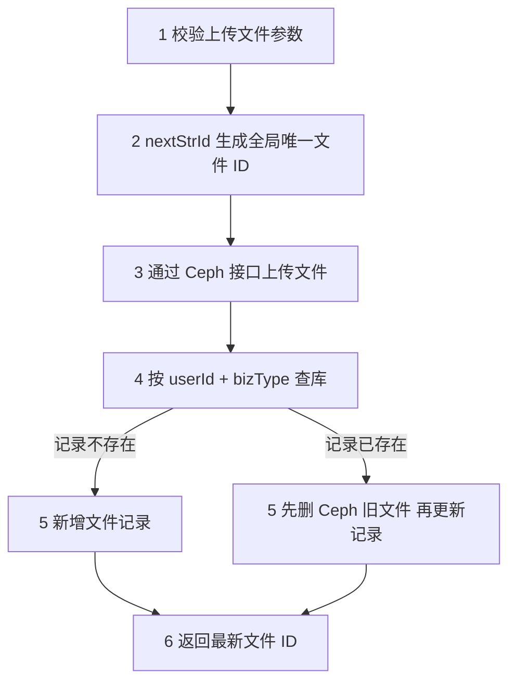
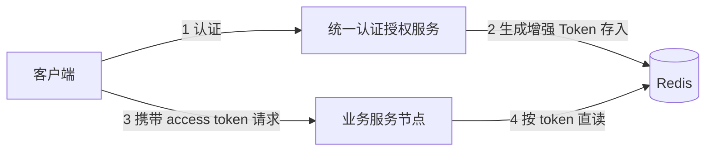

# 智牛股用户上传与下载（上）：自研雪花 ID 与 Ceph 文件上传下载全链路

智牛股项目的用户上传与下载章节，把三块技术串成一条完整链路：自研 snowflake 雪花算法负责生成全局唯一的文件 ID，Ceph 对象存储负责文件的物理存取，增强 Token 负责让业务服务不绕认证服务就能拿到用户身份。本篇按课程顺序覆盖十个视频：从雪花算法原理与 Java 实现，到上传功能的四层代码、增强 Token 的方案对比与集成配置，最后以 Postman 上传、浏览器下载的实测收尾。

## 先给结论

- snowflake 是 Twitter 开源的分布式 ID 生成算法，结果是一个 long 型 ID（8 字节 64 位），划分为 1bit 符号位、41bit 毫秒时间戳、10bit 工作机器 ID、12bit 序列号；单毫秒产能 2^10 × 2^12 = 4194304 个 ID，课程实测单节点每秒约 26 万。
- 算法在 common-utils 工程落成 `GlobalIDGenerator` 工具类，`nextId()` 加 synchronized 防并发，但纯 CPU 位运算无磁盘 IO，不会成为瓶颈；用户服务用 `GlobalSystemConfiguration` 通过 @Value 注入 workerId 与 datacenterId，两者各占 5bit，取值 0~31，集群内必须唯一。
- 文件上传四层落地：`TradeUserFile` 实体 + DAO 五个接口（多参数必须加 org.apache.ibatis 的 @Param）→ `StockUserFileServiceImpl.uploadUserIdCard` 做校验、生成 ID、传 Ceph、查库分支 → `StockUserController` 用 multipart/form-data 接 `MultipartFile`。
- 上传顺序有讲究：先传 Ceph 再写库，每个用户每种业务类型只留一条记录，覆盖更新前先删旧物理文件，防止存储里堆垃圾文件。
- 增强 Token：认证时把用户 ID 等主要信息挂进 token 存入 Redis，业务服务通过 `BaseController.getUserId()` 直读 Redis 拿用户 ID，省掉认证服务远程调用与加解密开销；选型前提是认证服务与所有业务节点都能直连 Redis。
- 验证环节两个典型坑：Mapper xml 里 `getByUserId` 映射重复导致服务启动失败；Redis 里残留的旧用户缓存导致 token 申请报错，删掉对应 key 后恢复。

## snowflake：64 位里排下时间、机器与序列

snowflake 的核心思想是：41bit 存毫秒时间戳，10bit 存机器 ID，12bit 存毫秒内流水号。它生成的序列 ID 整体按时间递增，分布式系统内不会重复，效率也高。整个 64 位空间的切分如下表。

| 区段 | 位数 | 作用 |
| --- | --- | --- |
| 符号位 | 1bit | 不参与业务，值始终为 0 |
| 时间戳 | 41bit | 精确到毫秒，可容纳约 140 年，足够系统长期使用 |
| 工作机器 ID | 10bit | 高 5bit 数据中心 ID，低 5bit 工作节点 ID，最多 1024 个节点 |
| 序列号 | 12bit | 同一毫秒内从 0 累加，最多到 4095，保证单节点有序 |

数据中心的划分对应真实的业务结构：交易数据中心下可以挂行情、仓位、资金等服务，用户数据中心下挂用户信息、用户认证等服务，每个节点分配唯一编号互不撞号。单毫秒的全局产能按公式算就是机器数乘序列数：2^10 × 2^12 = 1024 × 4096 = 4194304，约 419 万，高并发长期使用没有压力。

课程把算法实现放在 common-utils 工程的 generator 包下，类名 `GlobalIDGenerator`，核心方法 `nextId()`：

```java
public synchronized long nextId() {
    long timestamp = timeGen();
    // 时钟回拨直接拒绝，防止产生重复 ID
    if (timestamp < lastTimestamp) throw new RuntimeException("Clock moved backwards. Refusing to generate id.");
    if (lastTimestamp == timestamp) {
        // 同一毫秒内序列号累加，归零则等待下一毫秒
        sequence = (sequence + 1) & sequenceMask;
        if (sequence == 0) {
            timestamp = tilNextMillis(lastTimestamp);
        }
    } else {
        sequence = 0L;
    }
    lastTimestamp = timestamp;
    return ((timestamp - timestampLeftShift) | (datacenterId << datacenterIdShift) | (workerId << workerIdShift) | sequence);
}
```

方法上用 synchronized 防并发产生重复，但整个过程是纯 CPU 运算、不涉及磁盘 IO，不会严重阻塞，类似 Redis 单线程处理命令：单次处理足够快就能扛住高并发。课程在 main 里循环生成一万个 ID，瞬间完成且无重复；实测单节点每秒约 26 万个，机器好一些还有提升空间。

集成到用户服务工程时，在 config 包下新建 `GlobalSystemConfiguration`，把工作节点 ID 和数据中心 ID 从配置文件读进来：

```java
@Configuration
public class GlobalSystemConfiguration {
    @Value("${snowflake.workerId}")
    private Long workerId;

    @Value("${snowflake.datacenterId}")
    private Long datacenterId;

    // 定义全局 ID 生成器：未配置时走默认创建，否则按配置值构造
    public GlobalIDGenerator globalIDGenerator() {
        if (null == workerId || null == datacenterId) {
            return new GlobalIDGenerator();
        }
        return new GlobalIDGenerator(workerId, datacenterId);
    }
}
```

对应的 bootstrap.yml 里除了雪花标识，还有后面上传要用的 Ceph 认证信息：

```yaml
# 全局唯一ID分布式标识配置
snowflake:
  workerId: 1
  datacenterId: 1

# ceph swift 认证信息配置
ceph:
  username: cephtester:subtester
  password: 654321
  authUrl: http://10.10.20.11:7480/auth/1.0
  defaultContainerName: user_datainfo
```

集群部署时这两个值不能随便配：每个节点必须有全局唯一编号，各服务配置不能重复；且长度不能超过 32，workerId 与 datacenterId 各只预留 5bit，最大 2^5 = 32，超过不生效。

## 文件上传：实体、DAO、Service、Controller 四层铺下来

上传下载的文件信息统一存在用户文件实体里，课程通过 MyBatis Generator 工程生成 `TradeUserFile`：包含用户 ID、业务类型、文件 ID、文件名称、文件类型、路径、状态等属性。文件 ID 要保持全局唯一，正好交给 snowflake 生成；业务类型目前支持身份证、银行卡，将来要支持护照等新类型，扩展类型即可。

DAO 层五个接口，覆盖新增、更新、查询：

```java
int insert(TradeUserFile record);
int update(TradeUserFile record);
List<TradeUserFile> getByUserId(Long userId);
TradeUserFile getByUserIdAndBizType(@Param("userId") Long userId, @Param("bizType") Integer bizType);
TradeUserFile getByFileId(@Param("fileId") Long fileId);
```

两个细节：多参数方法必须加 @Param 注解，单参数不加也没关系，默认按属性名识别；@Param 的全路径在 org.apache.ibatis 包下，工程里还有别的同名注解，不要引错。insert 采用 selectKey 方式获取主键，插入完成后 ID 回填到参数对象的 id 属性。

Service 层 `StockUserFileServiceImpl` 注入三个依赖：Ceph 操作封装 `cephSwiftOperator`、全局序列生成器 `globalIDGenerator`、用户文件数据层 `tradeUserFileDao`。上传身份证文件的完整流程如下：



文件为空直接抛 `BusinessException(ApplicationErrorCodeEnum.USER_FILE_NOT_FOUND)`，即用户上传的临时文件没有找到；随后 `String remoteFileId = globalIDGenerator.nextStrId()` 拿全局唯一标识，调 Ceph 接口把文件字节传上去。查库后的分支代码：

```java
TradeUserFile dbTradeUserFile = tradeUserFileDao.getByUserIdAndBizType(userId, bizType);
if (dbTradeUserFile == null) {
    // 首次上传：组装实体（业务类型、文件 ID、原始文件名等属性）并新增
    tradeUserFileDao.insert(tradeUserFile);
} else {
    // 已存在：先删除 Ceph 上的旧物理文件，再更新记录指向新文件
    cephSwiftOperator.deleteObject(dbTradeUserFile.getFileId());
    dbTradeUserFile.setFileId(remoteFileId);
    dbTradeUserFile.setFileName(file.getOriginalFilename());
    tradeUserFileDao.update(dbTradeUserFile);
}
return remoteFileId;
```

Ceph 封装接口同时支持文件流和字节数组两种传递方式：文件不大直接用字节数组；文件较大用文件流，避免整块内容占内存。每个用户的每种业务类型只存一条数据，覆盖更新前必须先删旧物理文件，防止 Ceph 里积攒垃圾文件。

整体实现顺序有考究：容易出问题的文件上传放前面，SQL 放最后。上传依赖第三方 Ceph 服务且持续时间长，先写库再传文件的话，上传失败就会出现库里有记录却没文件的不一致；反过来数据库保存失败只是多了一个临时文件，可以接受，业务数据一致性更重要，后面还能用补偿机制清理无效临时文件。

Controller 层在 `StockUserController` 里新增上传接口：

```java
@PostMapping("/uploadIdCard")
public ApiRespResult uploadIdCard(@RequestParam("file") MultipartFile file) {
    ApiRespResult result;
    try {
        Long userId = getUserId();
        String userFileId = stockUserFileService.uploadUserIdCard(userId, file);
        result = ApiRespResult.success(userFileId);
    } catch (ComponentException e) {
        log.error(e.getMessage(), e);
        result = ApiRespResult.error(e.getErrorCodeEnum());
    } catch (Exception e) {
        log.error(e.getMessage(), e);
        result = ApiRespResult.sysError(e.getMessage());
    }
    return result;
}
```

Spring Boot 文件上传以表单提交，类型 multipart/form-data，参数名 file，不是直接的数据流方式，类型不对就识别不到文件。接口不设用户 ID 参数：用户必须先登录才能上传，ID 从 token 里取，减少参数传递。getUserId() 先做空实现返回默认值，等增强 Token 封装完成后补齐。

## 增强 Token：用户 ID 从 Redis 直读

微服务里 OAuth2 的 token 处理常见三种方案，各有缺陷，课程先做对比再引出自己的方案。

| 方案 | 思路 | 缺陷 |
| --- | --- | --- |
| 统一网关加工 | 网关统一解析 token 传递用户信息，其他微服务不参与 | 网关不再单一，变成有状态服务，其他服务安全性也薄弱 |
| JWT | 各服务直接从 JWT 里解出用户信息 | 附带信息有限（有长度限制），加解密占计算成本，token 长度比原来增加数倍，传递开销大 |
| 远程调用认证服务 | 微服务拿 token 请求认证中心换用户信息 | 远程连接开销高，还会加大认证服务压力 |

增强 Token 的做法：用户认证完成后，生成增强 token（增加用户 ID、账号等主要信息），经统一认证授权服务器处理后存进 Redis；后续接口请求时，服务节点直接拿请求头里的 token 去 Redis 读增强信息，用户 ID 就到手了。



相比以上方案，它减少交互次数（不再请求统一认证服务）、减少加解密计算成本、减少数据传递（只要最基本的 token）；认证不通过时 Redis 里也没有对应信息，判空即可兜底。但它并非完美：认证服务与各服务节点必须都能直接访问 Redis。跨项目、跨区域部署时，比如认证服务与 Redis 在独立机房、Redis 只提供内部访问，外部节点就读不到，这时建议用 JWT：加解密耗费的只是 CPU 计算，比远程 HTTP 调用快得多。

项目集成分三步。先在用户服务工程新建 `BaseController` 封装统一接口方法，注入 tokenStore（token 的存取管理接口）。取当前 token 的逻辑：从 RequestContextHolder 获取 request，读请求头 Authorization，把 Bearer 前缀替换掉只留 token 值。getUserId() 的实现：

```java
protected Long getUserId() throws ComponentException {
    // 1. 根据当前 token 从 tokenStore 读取 access token 信息
    OAuth2AccessToken authAccessToken = tokenStore.readAccessToken(getCurrentToken());
    if (null == authAccessToken) {
        throw new ComponentException(ApplicationErrorCodeEnum.SYS_NOT_VALID_TOKEN);
    }
    // 2. 获取 token 的增强信息
    Map<String, Object> additionalInfos = authAccessToken.getAdditionalInformation();
    if (null == additionalInfos) {
        throw new ComponentException(ApplicationErrorCodeEnum.SYS_NOT_ACCESS_USER);
    }
    // 3. 从增强信息里取用户 ID
    Long userId = (Long) additionalInfos.get(GlobalConstants.OAUTH_DETAILS_USER_ID);
    if (null == userId) {
        throw new ComponentException(ApplicationErrorCodeEnum.SYS_NOT_ACCESS_USER);
    }
    return userId;
}
```

一路判空抛异常是为了健壮性：可能的异常事先处理，后面专注业务逻辑；用户 ID 拿不到直接抛给外层决定，因为缺了它后续逻辑都无法进行。

再补 tokenStore 的配置：pom 中加入 spring-boot-starter-data-redis 依赖，在 `GlobalSystemConfiguration` 里注入 RedisConnectionFactory，创建 RedisTokenStore 并设置 key 前缀：

```java
@Bean
public TokenStore tokenStore() {
    RedisTokenStore tokenStore = new RedisTokenStore(redisConnectionFactory);
    // key 前缀必须与认证服务的 tokenStore 保持一致，否则读不到 token 缓存数据
    tokenStore.setPrefix(GlobalConstants.OAUTH_PREFIX_KEY);
    return tokenStore;
}
```

```yaml
spring:
  # Redis 缓存配置（演示环境指向本机）
  redis:
    host: 127.0.0.1
    port: 6379
```

前缀用的是全局常量 OAUTH_PREFIX_KEY，认证服务里的 tokenStore 配置也是同一个前缀，其余保持默认即可。最后让上传接口的 Controller 继承 BaseController，getUserId() 就能拿到真实用户 ID，增强 Token 的集成配置与运用到此闭环。

## 验证：Postman 上传，浏览器下载

先按顺序把环境拉起来：虚拟机执行 ceph -s 确认 HEALTH_OK；先启动 Redis 与 Nacos，再启动认证服务（端口 9999）和用户服务。用户服务第一次启动报错：TradeUserFileMapper.xml 里拷贝进来的接口与原有 getByUserId 映射重名，MyBatis 启动时报 Mapped Statements collection already contains value。删掉重复那条，检查其余映射无重复后重启正常。教训直接：拷代码不要盲目，拷之前先确认代码无误，出问题按报错排查。

申请 token 用 Postman 请求 `http://127.0.0.1:9999/oauth/token`（参数 grant_type、username、password）。第一次申请报用户对象转换错误，原因是 Redis 里留有之前的用户缓存记录：用 Redis 连接工具找到以 os_ 开头、包含 stock_user_details 的缓存 key 清掉，再请求就正常拿到 token。

上传测试：Postman 新建请求，POST 方式指向用户服务（演示环境 127.0.0.1:10681）的上传接口，Body 用 form-data 表单，参数名 file、类型选 File 选一张图片，Headers 里加上刚才申请的 bearer token。发送后返回成功并带出文件 ID；查数据库 t_trade_user_file 表已有一条记录，文件 ID 与接口返回一致，上传链路符合预期。

下载功能按数据层、服务层、接入层补齐。DAO 的 getByFileId 已有；Service 加 getTradeUserFile，查不到文件直接抛异常：

```java
@Override
public TradeUserFile getTradeUserFile(String fileId) {
    TradeUserFile tradeUserFile = tradeUserFileDao.getByFileId(Long.valueOf(fileId));
    if (null == tradeUserFile) {
        // 文件信息都没找到，后续下载无从处理，直接抛给外层
        throw new ComponentException(ApplicationErrorCodeEnum.USER_FILE_NOT_FOUND);
    }
    return tradeUserFile;
}
```

Controller 的 downloadFile 接口为了便于浏览器演示，用 @RequestMapping 同时支持 GET 和 POST（上传只支持 POST）；参数加 @NotBlank 约束校验，类上必须配 @Validated 注解约束校验才生效，约束性异常的全局处理之前已经实现。核心逻辑：

```java
// 1. 获取文件对象
TradeUserFile tradeUserFile = stockUserFileService.getTradeUserFile(fileId);
// 2. 文件类型为空视为未知类型，用固定标识强制下载，防止浏览器直接打开
if (StringUtils.isEmpty(tradeUserFile.getFileType())) {
    response.setContentType("application/force-download");
} else {
    response.setContentType(tradeUserFile.getFileType());
}
// 3. 设置文件下载名称，便于浏览器和客户端正确识别
response.addHeader("Content-Disposition", "attachment;filename=" + tradeUserFile.getFileName());
// 4. 从 Ceph 获取文件流，经缓冲流写回客户端，不落临时文件
BufferedInputStream bis = new BufferedInputStream(inputStream);
OutputStream os = response.getOutputStream();
byte[] buffer = new byte[1024];
int i = bis.read(buffer);
while (i != -1) {
    os.write(buffer, 0, i);
    i = bis.read(buffer);
}
os.flush();
```

response 对象从 RequestContextHolder 获取，inputStream 通过 Ceph 封装接口按文件 ID 取得。流式缓冲下载把 Ceph 里的文件直接输出给客户端，省掉临时文件中转，处理效率更高，上百兆的大文件不要采用这种方式。缓冲区课程里设的 1024，带宽和内存配置高可以适当调大，一般 4K 左右即可，并非越大越好。

流的使用有个收尾纪律：finally 里判断非空后逐个关闭。不关闭流不会导致内存泄露，但会产生系统资源泄露，也就是文件描述符 FD 泄露。finalize 方法确实会调用 close 释放 FD，但执行时间点不确定；高并发下一瞬间大量请求涌进来，FD 可能耗尽，整个服务资源吃紧甚至崩溃。

实测下载：重启用户服务后，浏览器访问 `http://127.0.0.1:10681/user/downloadFile?fileId=...&access_token=...`。先用旧 token 试了一下，提示 token 无效，换成新申请的；再随便填一个 fileId，返回用户文件未找到（与上传生成的 ID 并不一致）；从数据库 t_trade_user_file 取出刚才上传的真实文件 ID 替换进去，文件成功下载并正常显示，内容与上传时一致。到这里，用户资料的上传与下载全链路就都实现并验证完了，章节总结与多环境配置管理放进下一篇。

## 小结

- snowflake 用 64 位排下符号位、41bit 毫秒时间戳、10bit 机器 ID、12bit 序列号，单毫秒 419 万产能、单节点每秒 26 万实测，作为文件 ID 生成器足够。
- 集成的关键是配置驱动：workerId/datacenterId 走配置文件注入，取值 0~31，集群内唯一，超范围不生效。
- 上传链路四层分工明确：DAO 管元数据增删改查，Service 编排校验、ID 生成、Ceph 上传与数据库分支，Controller 只做 multipart 接收与异常封装。
- 先传文件后写库的顺序保证一致性：宁可留临时文件等补偿清理，也不让库里出现无文件的记录。
- 增强 Token 用 Redis 换掉了认证服务远程调用与 JWT 加解密，BaseController.getUserId() 一处封装处处可用；代价是所有节点必须能直连 Redis，跨机房外网场景退回 JWT。
- 下载是上传的镜像验证：按文件 ID 查库、从 Ceph 取流直出客户端，强制下载兜底未知类型，流用完必关防 FD 泄露。
