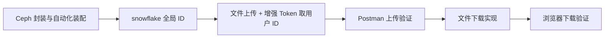

# 用户上传与下载（下）：章节总结与 Spring Boot 多环境配置、Maven 打包发布

本篇先给用户上传与下载章节做收尾复盘，再进入新章：Spring Boot 多环境配置与打包发布。前半段是方法论回顾，后半段是可落地的实践：profile 命名规则、本地 dev/uat 双环境运行验证、Maven 多环境打包，以及多人协作下的 deploy 发布。

## 先给结论

- 上传下载章三个学习目标：掌握 Ceph 的封装与自动化装配、掌握基于 snowflake 的全局 ID 使用、完成文件上传与下载功能。
- 增强 Token 的选型口径：同一内网、各节点可直连 Redis 时采用，效率与复用性最优；跨区域跨项目、缓存不能支撑外网访问时换 JWT，数据安全优先。
- Spring Boot 多环境配置命名规则：application-{profile}.properties/yml，profile 是自定义环境标识，常用 dev、uat、prd。
- 激活环境两条路：默认配置文件里写 spring.profiles.active（推荐，易读易维护）；或启动参数 -Dspring.profiles.active 动态指定。
- stock-user 实践：bootstrap-dev.yml 与 bootstrap-uat.yml 两套隔离配置，默认文件里 active 指向 Maven 变量 ${package.environment}。
- Maven 打包：pom 的 profiles 定义 dev（activeByDefault）与 uat，clean install -P uat 产出 stock-user-uat.jar；多人协作追加 deploy 发布到中央仓库。

## 上传下载章复盘：一条链路上的三件套

本章要掌握三点：Ceph 的封装与自动化装配（CephSwiftConfiguration 配置类加 CephSwiftOperator 操作类，注解装配后其他服务直接注入使用）；基于 snowflake 的全局分布式唯一 ID（重点是底层工作机制、区域划分、各区段的功能与作用）；上传与下载功能的完整实现。课程回看的顺序就是实现顺序：



整体流程四个要点：先做好 Ceph 封装与自动化装配，便于项目集成运用；文件上传要记录用户信息，用增强 Token 高效获取；用 snowflake 全局分布式 ID，支持分布式微服务使用且性能好；最后实现文件下载并结合上传生成的文件 ID 完成整链路验证。上传接口返回的文件 ID 形如 1155121848879550464，一长串数字就是 64 位 long 的十进制形态。实体 TradeUserFile 的业务类型口径也值得记：0 身份证、1 银行卡、2 信用卡，新文件类型靠扩展业务类型实现。

增强 Token 的回顾要把优点与弊端一起记：相比其他方案不需要请求统一认证服务，省掉加密解密等计算成本，具备较高性能；弊端是跨区域跨项目、Redis 不能支撑外网访问时就不推荐，毕竟要保障数据安全性。服务都在同一内网时可以放心采用，整体效率相比其他方案更优，复用性也更好。

## 多环境配置：为什么做与规则是什么

项目开发中存在多个环境：开发环境 dev、集成测试环境 uat、生产环境 prd，每个环境的服务器地址都不一样，比如 Redis、各类数据库这些中间件与底层存储。敏捷迭代式交付下又要频繁更新打包，开发周期快到每周或每两周发一个版本，要快速完成新需求与版本缺陷修复。这就需要按环境编写不同配置：先打一个 uat 集成测试环境的包给测试验收，通过后再打 prd 生产环境的包。Spring Boot 多环境配置配合 Maven，就能生成支持各种环境的运行包，不用反复手改配置。

大型互联网微服务项目一般会用统一配置中心解决此问题（比如 Nacos、ZooKeeper 这类注册配置服务中心），把多个微服务节点的配置统一收拢到配置中心，支持 dev/uat/prd 多环境，还支持配置动态刷新，好处是只需在配置中心上统一维护，不用对每个应用服务走 Maven 打包管理配置。课程的处理是循序渐进：先掌握 Spring Boot 本地化多环境配置，为后续配置中心的生产级统一配置方案做铺垫。

配置规则方面，Spring Boot 项目支持的配置文件多种多样：application.yml、application.properties，以及优先级更高的 bootstrap.yml、bootstrap.properties。多环境配置文件的命名格式是 application-{profile}.properties，{profile} 是环境标识，可自定义。常用三件套：

| 配置文件 | 环境 |
| --- | --- |
| application-dev.properties | 开发环境 |
| application-uat.properties | 测试集成环境 |
| application-prd.properties | 生产环境 |

定义了多份配置文件后，还要告诉 Spring Boot 读哪一份：需要一份默认配置文件（application.properties 或 yml，不同后缀只是加载优先级的区别），里面用 spring.profiles.active 属性指定环境；也可以启动时加 -D 参数给属性赋值，值等于 dev 就加载开发环境配置，等于 prd 就加载生产环境配置。从易读与维护性考虑，建议采用默认配置文件方式；有动态指定环境的特殊需求再用参数形式。

## 本地双环境跑通：dev 与 uat

在 stock-user 用户服务工程上实践。本地建两套配置：一套本地 dev 开发环境，另一套 uat 集成测试环境，两份文件都从原配置复制改名而来。

dev 沿用本地中间件连接（Redis 本机 6379、security 的 token 校验地址等）：

```yaml
# Redis 缓存配置
redis:
  host: 127.0.0.1
  password:
  port: 6379
# spring security 配置
security:
  resource:
    loadBalanced: true
    token-uri: http://trade-auth/oauth/check_token
    client:
      client-id: app
      client-secret: app
      scope: server
```

uat 故意改坏，把 Nacos 地址指向一个不存在的 IP（192.168.11.1:8848），用来验证不同环境的启动能否正确读取各自的配置：

```yaml
server:
  port: 10681
spring:
  application:
    name: stock-user
  cloud:
    discovery:
      server-addr: 192.168.11.1:8848
    config:
      server-addr: 192.168.11.1:8848
    sentinel:
      transport:
        dashboard: 127.0.0.1:8090
```

默认配置文件不需要具体属性，只保留环境版本指向，且这个值不写死，指向 Maven 变量：

```yaml
spring:
  profiles:
    active: ${package.environment}
```

最新版 IDEA 能识别 Maven 变量（对应 pom 里的属性定义），老版本不支持，解决办法是编辑启动配置：Run 菜单下 Edit Configurations，在 Active profiles 里指定环境。

验证跑了两轮：

| 轮次 | Active profiles | 结果 |
| --- | --- | --- |
| 第一轮 | dev | 启动成功，启动日志打印激活的配置文件版本指向 dev；Ceph 集群没启动导致 Ceph 连接失败属正常，无其他连接异常 |
| 第二轮 | uat | 启动报连接异常，按 uat 配置去连了一个根本不存在的 Nacos 服务，说明 uat 配置被正确读取 |

整个验证过程没有修改任何配置文件内容，只切了启动配置里的环境变量。每个环境的配置文件相互隔离：dev 有 dev 的连接配置，uat 有 uat 的，不会交错导致连接配置出错，多环境配置管理由此变得可控。

## Maven 多环境打包与发布

打包要回答的问题是：Maven 怎么识别不同环境的配置，会不会与本地多环境版本配置冲突。做法是用同一个变量把 pom 与配置文件串起来。

pom 里加入多环境 profiles（放在 dependencies 标签之后，注意顺序），dev 默认激活，每个 profile 的 properties 定义 package.environment，与配置文件里的占位符对应；Maven 打包时按激活的 profile 决定读取哪个环境版本：

```xml
<profiles>
    <profile>
        <id>dev</id>
        <activation>
            <activeByDefault>true</activeByDefault>
        </activation>
        <properties>
            <package.environment>dev</package.environment>
        </properties>
    </profile>
    <profile>
        <id>uat</id>
        <properties>
            <package.environment>uat</package.environment>
        </properties>
    </profile>
</profiles>
```

build 构建配置里，finalName 决定打包产物名称，maven-resources-plugin 开启 filtering 后打包时会替换资源文件里的占位符，spring-boot-maven-plugin 让工程能打出 Spring Boot 可执行 jar：

```xml
<build>
    <finalName>stock-user-${package.environment}</finalName>
    <plugins>
        <plugin>
            <groupId>org.apache.maven.plugins</groupId>
            <artifactId>maven-resources-plugin</artifactId>
            <configuration>
                <encoding>UTF-8</encoding>
                <useDefaultDelimiters>true</useDefaultDelimiters>
                <filtering>true</filtering>
            </configuration>
        </plugin>
        <plugin>
            <groupId>org.springframework.boot</groupId>
            <artifactId>spring-boot-maven-plugin</artifactId>
            <executions>
                <execution>
                    <goals>
                        <goal>repackage</goal>
                    </goals>
                </execution>
            </executions>
        </plugin>
    </plugins>
</build>
```

打包在 IDEA 的 Maven 视窗操作：Lifecycle 下右键 Create，Command line 输入 clean install -P uat（-P 指定 profile 版本）。运行后 target 目录生成 stock-user-uat.jar。环境有没有真被打进去可以查验：打开 jar 的 BOOT-INF 目录找到默认配置文件，里面 active 指向 uat，与打包命令一致。换 clean install -P dev 再来一遍，生成 stock-user-dev.jar，jar 内配置指向 dev，两个环境全面验证通过。

打包失败的排查口径：根据 Maven 错误提示，检查所有依赖组件是否已执行 clean install，确保依赖是最新的；打包前最好在顶级工程下选中 clean 与 install，把所有模块先编译打包一遍，避免编译过程中出现组件依赖或冲突问题。

两个扩展方向：要打生产环境运行包，按同样方式再建一个名为 prd 的 Profile 和对应 bootstrap-prd.yml 配置文件，Maven 执行命令即可，开发完成后不再需要反复修改配置文件，每个环境独立维护一套，不会因交叉修改产生冲突或配错；多人协作时打包要加 deploy 命令，即 clean install deploy -P uat。实际项目里每人负责不同模块、本地代码未必最新，项目通常有统一的中央 Maven 仓库，只跑 clean install 只会装进本地仓库，别人打包时拿到的可能还是旧版本；加 deploy 会把生成后的 jar 发布到远程中央仓库，保证每个人集成的都是最新版本功能。

## 小结

- 上传下载章的收尾口径：Ceph 封装装配、snowflake 全局 ID、增强 Token 取用户 ID、上传下载双验证，四个环节串成完整链路。
- 多环境配置的命名规则一条就够：application-{profile}.properties/yml，profile 自定义，dev/uat/prd 是常用标识。
- 激活方式推荐默认配置文件里的 spring.profiles.active，动态需求用 -D 参数；stock-user 里 active 指向 Maven 变量 ${package.environment}。
- 本地验证方法：故意把 uat 配错指向不存在的 Nacos，启动报连接异常反而证明配置读取正确，加上 dev 正常启动，两轮完成闭环。
- Maven 打包用 profiles、package.environment、finalName、filtering 打通配置与产物，clean install -P uat 产出带环境标识的 jar，解包查 BOOT-INF 配置可验证。
- 团队协作记住 clean install deploy -P uat：包进中央仓库，避免同事拿到旧版本。
