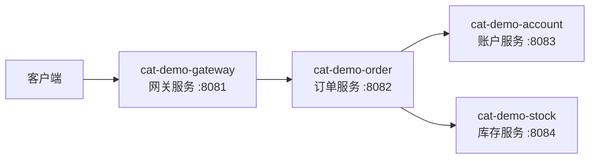

# CAT 四服务接入实战：网关/订单/账户/库存埋点与链路验证，兼读 Sentinel 流控与熔断

上一篇把 CAT 服务端部署进了 Linux 虚拟机，这一篇进入使用环节：设计一条三层调用链，把网关、订单、账户、库存四个服务逐个接入 CAT，再打包部署到虚拟机上，在 CAT 控制台里看真实的调用链与异常定位。文章后半段切入第三章 Sentinel：从 2012 年诞生到 2018 年开源的经历、流量控制为什么要把随机请求「整形」，以及熔断降级上它与 Hystrix 的路线差异。CAT 的集群部署不在本篇展开，官方文档有链接可查，重点放在「如何使用」。

## 先给结论

- 服务设计四个角色：网关、订单、账户、库存，构成 Gateway → Order → (Account、Stock) 的三层调用关系，专门用来验证 CAT 对多级链路的监控能力。
- 工程是 cat-demo 父工程挂四个子模块，依赖统一收在父级：Spring Boot 启动依赖、Nacos 服务注册发现、Spring Boot 监控端点（不加 CAT 拿不到部分信息）、com.dianping.cat:cat-client:3.0.0（只需 client 模块）。
- CAT 集成四件套：CatContext 承载 root/parent/child 三个消息 ID，CatHttpConstants 定义 X-CAT-* 请求头常量，CatServletFilter 在请求入口创建事务，CatRestInterceptor 在调用出口把上下文传给下游。
- 拦截器按位置取舍：Gateway 与 Order 既要接请求又要调下游，必须挂 CatRestInterceptor；Account、Stock 是链路末端，只保留过滤器。
- 端口规划 8081-8084 依次对应 Gateway、Order、Account、Stock，注册中心 Nacos 在宿主机 10.10.20.1:8848；每个服务靠 META-INF/app.properties 里的 app.name 向 CAT 报应用名。
- 验证两条线：/gateway 正常请求在控制台看到完整三层链路与逐段耗时（Account 150ms 业务耗时加约 5ms 开销，报表显示 155ms）；/timeout 返回 500，LogView 直接定位到 localhost:8765 的 read timeout 与完整异常栈。

## 服务设计与工程结构：一条三层调用链

验证 CAT 的链路监控能力，先得有一条长链。课程设计了四个服务：客户端请求先进 Gateway 网关，网关把请求下发到 Order 订单服务，订单服务再分头调用 Account 账户服务与 Stock 库存服务。这样 Gateway → Order 是一层，Order → Account/Stock 又是一层，加上入口共三层调用关系，每一段都会被 CAT 记录：



工程结构是一个专门的演示父工程 cat-demo，下面挂四个子模块，模块划分与服务一一对应：

```text
cat-demo                  父级工程
├── cat-demo-gateway      网关服务工程
├── cat-demo-order        订单服务工程
├── cat-demo-account      账户服务工程
└── cat-demo-stock        库存服务工程
```

四个子模块的 parent 指向 cat-demo（groupId 为 com.itcast.trade，版本 1.0.0），cat-demo 的上级才是 bulls-stock 父工程——子模块不要挂错到 bulls-stock 下面，否则工程结构会乱。公共依赖全部声明在 cat-demo 的 pom 里，子模块按需继承，网关等子模块本身不用再写依赖。

## 网关服务：CAT 集成的完整样板

**父工程依赖。** 微服务要用 Spring Boot 做启动；节点统一注册到 Nacos，加入 Nacos 服务注册发现依赖；Spring Boot 的监控端点依赖必须加，否则 CAT 有些信息拿不到；CAT 的核心依赖只有一个 client 模块：

```xml
<dependency>
    <groupId>com.dianping.cat</groupId>
    <artifactId>cat-client</artifactId>
    <version>3.0.0</version>
</dependency>
```

**启动类。** 网关子模块里建 startup 与 cat-utils 两个包，启动类把注解配齐：

```java
@SpringBootApplication
@EnableDiscoveryClient
@ComponentScan(basePackages = {"com.itcast"})
public class CatDemoGatewayApplication {

    @Autowired
    private RestTemplate restTemplate;

    @Value("${service2.address:localhost:8082}")
    private String service2Address;

    public static void main(String[] args) {
        SpringApplication.run(CatDemoGatewayApplication.class, args);
    }
}
```

@ComponentScan 要显式指定 com.itcast 基础包：启动类没放在默认能扫到的层级下，不指定就扫不到 CAT 工具类；它支持多个包路径，生产环境也建议明确写出扫描包。

**两个探针接口。** 网关提供一个正常请求和一个异常请求，方便对照 CAT 的跟踪结果：

```java
/** 模拟正常请求：休眠 100ms 后转发订单服务 */
@RequestMapping("/gateway")
public String gateway() throws Exception {
    Thread.sleep(100);
    String response = restTemplate.getForObject(
            "http://" + service2Address + "/order", String.class);
    return "gateway response --> " + response;
}

/** 模拟请求异常 */
@RequestMapping("/timeout")
public String timeout() throws Exception {
    Transaction t = Cat.newTransaction(CatConstants.TYPE_URL, "timeout");
    try {
        Thread.sleep(100);
        return restTemplate.getForObject(
                "http://" + service2Address + "/readtimeout", String.class);
    } catch (Exception e) {
        Cat.getProducer().logError(e);  // 异常记入 CAT
        t.setStatus(e);                 // 事务标记失败
        throw e;
    } finally {
        t.complete();                   // 结束事务
    }
}
```

/timeout 里的事务三步不能少：Cat.newTransaction 创建 TYPE_URL 类型、名为 timeout 的事务；异常时 logError 记录并 setStatus；最后 complete 收尾——事务只有正常结束，CAT 才能算出这段调用的耗时与状态。

**CAT 四件套。** 真正把链路串起来的是四个类。先是 CatContext，实现 CAT 提供的 Cat.Context 接口，内部一个 Map<String, String> 负责存取链路监控的关键属性；然后是 CatHttpConstants，定义三个请求头常量：

```java
public class CatHttpConstants {
    static final String CAT_HTTP_HEADER_ROOT_MESSAGE_ID   = "X-CAT-ROOT-ID";
    static final String CAT_HTTP_HEADER_PARENT_MESSAGE_ID = "X-CAT-PARENT-ID";
    static final String CAT_HTTP_HEADER_CHILD_MESSAGE_ID  = "X-CAT-CHILD-ID";
}
```

三个常量对应链路上的根消息 ID、父消息 ID 与 Span ID，是跨服务传递的关键标识。

过滤器侧，CatFilterConfigure 用 FilterRegistrationBean 把 CatServletFilter 注册成全局过滤器：拦截所有 URL、命名为 cat-filter、顺序 1；init 阶段加载初始化参数，urlPattern 不配置也不影响运行。CatServletFilter 的 doFilter 是过滤器核心逻辑：

```java
public void doFilter(ServletRequest request, ServletResponse response,
                     FilterChain chain) throws IOException, ServletException {
    String url = request.getRequestURL().toString();
    // 从请求头取上游传来的三个消息 ID，装入 CatContext
    CatContext catContext = new CatContext();
    catContext.addProperty(CatConstants.CAT_HTTP_HEADER_ROOT_MESSAGE_ID,
            request.getHeader(CatHttpConstants.CAT_HTTP_HEADER_ROOT_MESSAGE_ID));
    catContext.addProperty(CatConstants.CAT_HTTP_HEADER_PARENT_MESSAGE_ID,
            request.getHeader(CatHttpConstants.CAT_HTTP_HEADER_PARENT_MESSAGE_ID));
    catContext.addProperty(CatConstants.CAT_HTTP_HEADER_CHILD_MESSAGE_ID,
            request.getHeader(CatHttpConstants.CAT_HTTP_HEADER_CHILD_MESSAGE_ID));
    // 创建 URL 事务
    Transaction t = Cat.newTransaction(CatConstants.TYPE_URL, url);
    try {
        Cat.logEvent(CatConstants.TYPE_SERVICE, "Service.method",
                request.getMethod(), request.getRemoteHost());
        chain.doFilter(request, response);   // 进入业务逻辑
        t.setStatus(Transaction.SUCCESS);
    } catch (Exception e) {
        t.setStatus(e);
        Cat.getProducer().logError(e);
        throw e;
    } finally {
        t.complete();
    }
}
```

进入业务逻辑前，过滤器通过 logEvent 把调用方法、URL 请求信息、客户端远程地址记录下来；业务正常走完标记成功，抛了异常则标记失败，最终连同上下文一起发送给 CAT 服务端。

拦截器侧，CatRestInterceptor 实现 ClientHttpRequestInterceptor：调用下游前创建 TYPE_CALL 类型的事务，把 root id、parent id、child id 这三个调用链上下文保存并写入请求头，然后继续执行请求——它不干扰业务逻辑，只是打个标记，下一个节点收到请求就知道来源链路。最后把拦截器挂到 RestTemplate 上，所有出站调用自动带上链路上下文：

```java
@Bean
RestTemplate restTemplate() {
    RestTemplate restTemplate = new RestTemplate();
    restTemplate.setInterceptors(Collections.singletonList(new CatRestInterceptor()));
    return restTemplate;
}
```

分工总结成一句话：过滤器管入口，拦截本节点的业务处理；拦截器管出口，把 TID、PID、Span ID 传给下一个节点。一进一出配合，链路才串得起来。

**配置文件。** 网关的 application.properties 与 META-INF/app.properties：

```properties
server.port=8081
spring.application.name=cat-demo-gateway
spring.cloud.nacos.discovery.server-addr=10.10.20.1:8848
management.endpoints.web.exposure.include=*
```

META-INF/app.properties 里写 app.name=cat-demo-gateway。四个服务跑在虚拟机 10.10.20.10 上，Nacos 装在宿主机 10.10.20.1，注册中心地址因此指向宿主机；management 全量暴露端点配合监控；app.name 与模块名保持一致，它是 CAT 后台展示的应用名。client.xml 沿用上一篇口径：服务端 10.10.20.10，TCP 上报端口 2280，控制台 8080；运行环境保持 Linux，Windows 下路径识别有坑。

## 订单、账户、库存与链路验证

**订单服务：既要收也要发。** cat-demo-order 挂在 cat-demo 下，四件套整体复制——它比网关还多一个职责：既接收网关下发，又要转发账户与库存服务，所以过滤器与拦截器一个都不能少，拦截器要记录并传递 child id、parent id、span id。注入 RestTemplate，声明两个下游地址，默认值分别指向 8083 与 8084，配置文件里不配也能跑：

```java
/** 账户服务地址 */
@Value("${service3.address:localhost:8083}")
private String service3Address;

/** 库存服务地址 */
@Value("${service4.address:localhost:8084}")
private String service4Address;
```

接口同样两个：/order 是下单接口，先 sleep 200ms 表示自身业务处理，然后同层调用账户与库存两个远程服务，最后把 "Calling Customer Service" 的参数与返回结果打印出来；/readtimeout 是模拟超时接口，先开一个名为 connection timeout 的事务（便于在 CAT 管理后台检索），sleep 500ms 后打印日志，再用 RestTemplate 去调一个不存在的服务——端口写死为 8765，调用必然抛异常，异常被 CAT 统计并沿调用链抛回网关。日志直接用 Lombok 加注解完成。

**账户与库存：末端服务。** 账户与库存处在整条链的最末端，区别就在拦截器：下面没有其他要调用的服务，CatRestInterceptor 整个去掉；过滤器必须保留，它负责接收上游传来的 TID、PID 等链路信息。工程创建、包结构（startup + cat-utils）、启动类注解与配置文件都照账户服务的写法复制即可。两个服务各提供一个探针接口：

```java
@RequestMapping("/account")
public String serviceMethodInController() throws Exception {
    Thread.sleep(150);          // 模拟业务处理耗时
    return "account success";
}
```

stock 接口同理，sleep 200ms 后返回 "stock success"。sleep 不是为了让接口变慢，而是让调用在 CAT 报表上有个可观测的时间段——真实接口一两毫秒就返回，报表里小得看不见。

模块建好后如果 IDEA 里连 new package 都点不出来，多半是 Maven 把这个模块 ignore 掉了（之前测试时手动忽略过），reimport 一下就恢复——碰到类似问题先查 Maven 忽略列表。

**端口与应用名规划。** 四个服务的端口依次错开，配置与拦截器取舍汇总如下：

| 服务 | 模块 | 端口 | app.name | CatRestInterceptor |
| --- | --- | --- | --- | --- |
| 网关 | cat-demo-gateway | 8081 | cat-demo-gateway | 需要 |
| 订单 | cat-demo-order | 8082 | cat-demo-order | 需要 |
| 账户 | cat-demo-account | 8083 | cat-demo-account | 不需要 |
| 库存 | cat-demo-stock | 8084 | cat-demo-stock | 不需要 |

**本地启动与打包上传。** 四个服务逐个 Run 起来，端口对应 8081-8084。Stock 启动时提示 8084 被占用——开发环境服务多、进程残留很常见，按端口找到进程杀掉再重启即可：

```bash
netstat -ano | findstr "8084"   # 根据端口查到进程 PID
taskkill /pid 3012              # 结束占用端口的进程
```

Account 中途被误停也重新拉起，确保 Nacos 服务列表里四个服务一个不少。接着在 cat-demo 下整体打包：

```bash
mvn clean package
```

target 目录下生成可运行 jar；如果不能用 java -jar 直接运行，检查是否加了 spring-boot-maven-plugin 插件——父工程 pluginManagement 已统一管理版本。然后用 rz 把 jar 上传到 Linux 的 /usr/local 下 cat-example 目录（CAT 服务已在运行），逐个启动应用：

```bash
nohup java -jar <应用 jar 包> &
```

虚拟机内存有限，启动时要显式把 JVM 堆内存调小，四个服务加 CAT 才塞得下。最后检查一遍进程，确认四个应用就位。

**CAT 控制台验证。** 浏览器登录 CAT 控制台（8080），Applications 里选择「全部」，能看到 account、gateway、order、stock 四个应用，说明全部正常接入。访问网关接口 http://10.10.20.10:8081/gateway，多刷几次，回到 Transaction 界面点开 gateway 应用 → URL → gateway 接口 → LogView → Show，树形层级报表完整展开：最上面是入口 URL，来源记录了客户端地址 10.10.20.1；下一层是 order，order 在同一层级下发出两个调用——account 与 stock；account 下面再无调用，是链路最末节点。耗时一目了然：account 睡眠 150ms，加上网络开销与调用逻辑处理约 5ms，报表显示 155ms；stock 的耗时同样列在对应位置。文本列表之外还有图形化视图，点 Show 按时间轴逐层展开。

**异常链路定位。** 再访问 /timeout，页面返回 500 错误。CAT 里同样记录了这条 timeout 事务，点进 LogView → Show，整条调用链直接摊开：read timeout 这一环调用的是 localhost:8765 这个不存在的服务，错误线程栈被完整打印出来。线上环境一个请求出了问题却不知道哪个环节挂了，就顺着 CAT 后台逐层定位到出问题的微服务节点，再沿异常栈找到具体错误代码行——这正是链路监控的价值所在。

## Sentinel 预热：背景、流量控制与熔断降级

CAT 解决「看得见」，Sentinel 解决「扛得住」。本章两个学习目标：一是了解 Sentinel 的组件、作用、功能与使用场景，知道它通过哪些组件完成熔断功能；二是了解它的工作原理、功能特性与处理机制，不能只停在认识层面。学习路径依次是：背景介绍、Sentinel 历史、流量控制、熔断降级、主要特性、开源生态、工作原理。

**三段历史。** Sentinel 的履历很清晰：2012 年诞生，最初定位就是流量控制组件；2013 到 2017 年在阿里巴巴集团内部迅速推广，成为基础技术模块，覆盖所有核心场景——阿里体量的应用流量巨大、场景复杂，Sentinel 因此积累了大量流量规整场景与生产实践；2018 年正式开源，就是今天熟悉的这个限流熔断组件。

**流量控制：把随机请求整成合适形状。** 流量控制本是网络传输中的常用概念，用于调整网络包的发送数据；放到系统稳定性视角，请求任意时间到来、随机不可控，而系统处理能力有限，必须根据处理能力对流量做控制，做到可伸缩。Sentinel 扮演的就是一个调配器：大量用户的请求随机到来、不分先后，经过它调整之后变得有序、规整；像无效的 ping 请求、没有具体参数的不合规请求，直接丢弃。整条流量经过这样平滑的处理，系统资源得到有效保护。

**熔断降级：与 Hystrix 的路线差异。** 熔断降级理念与 Hystrix 一致——控制调用链中不稳定的资源，针对不同场景做不同限制，避免不稳定因素扩散导致雪崩，给整个服务带来灾难性后果。但实现上两者差异不小：

| 维度 | Hystrix | Sentinel |
| --- | --- | --- |
| 隔离手段 | 线程池隔离 | 前置处理，限制请求并发数量 |
| 开销 | 增加线程切换开销 | 避免线程切换开销 |
| 侵入性 | 强 | 相对较低 |
| 调用方式 | 异步方式，不便主线程控制处理 | 前置拦截 |

降级触发后，两者的恢复机制也不同。Sentinel 可以针对响应时间对资源降级：某资源响应时间过长，就拒绝所有对它的访问——响应过长必然存在异常，要么 IO 瓶颈要么网络延迟阻塞，继续发请求没有意义，反而让问题更严重；直到配置指定的时间窗口过后，才重新恢复访问。Hystrix 则是试探式：先试探，达到一定比例之后再恢复。

**主要特性全景。** 特性视图分三层看。顶层是 Sentinel 控制台，提供实时监控、机器发现、规则配置——这是相比 Hystrix 很大的一项改进，Hystrix 想动态修改配置策略基本做不到，Sentinel 可以在控制台上可视化交互完成。中间绿色区域是核心功能：流量控制、线程数隔离、慢调用降级、调用链路、速率控制、集群限流、异常熔断、系统自适应保护、调用关系限流、热点流、削峰填谷、来源访问控制，覆盖大部分业务场景。底层是动态规则配置，支持对接 ZooKeeper、Nacos、Apollo 等配置注册发现组件，微服务的规则管控因此方便很多。右侧是生态圈：Spring Cloud、Dubbo、gRPC、Service Mesh 都能接入支持。

## 小结

本篇把 CAT 从「部署好」推进到「用起来」：四个服务、三层调用链的设计让监控有了用武之地；网关样板工程给出了依赖、启动类、两个探针接口与 CAT 四件套的完整写法，过滤器管入口、拦截器管出口的分工是理解跨服务传 ID 的关键；订单、账户、库存按「有无下游」决定拦截器取舍，端口 8081-8084 与 app.name 一一登记；打包上传 Linux 之后，CAT 控制台的 Transaction 与 LogView 既展示了正常链路的完整拓扑与逐段耗时（150ms 业务加 5ms 开销等于 155ms），也在 /timeout 的 500 错误里直接甩出 localhost:8765 的异常栈——接入不难，价值在排查。Sentinel 部分完成了开场铺垫：2012 年生、2018 年开源，流量控制是按系统处理能力把随机请求整形成合适形状的调配器；熔断降级用前置限并发替代 Hystrix 的线程池隔离，用时间窗口恢复替代试探式恢复；控制台加配置中心的动态规则能力，则是它相对前辈最大的体验差异。下一篇接着拆 Sentinel 的开源生态与工作原理，再把 Dashboard 控制台拉起来做降级限流实操。
