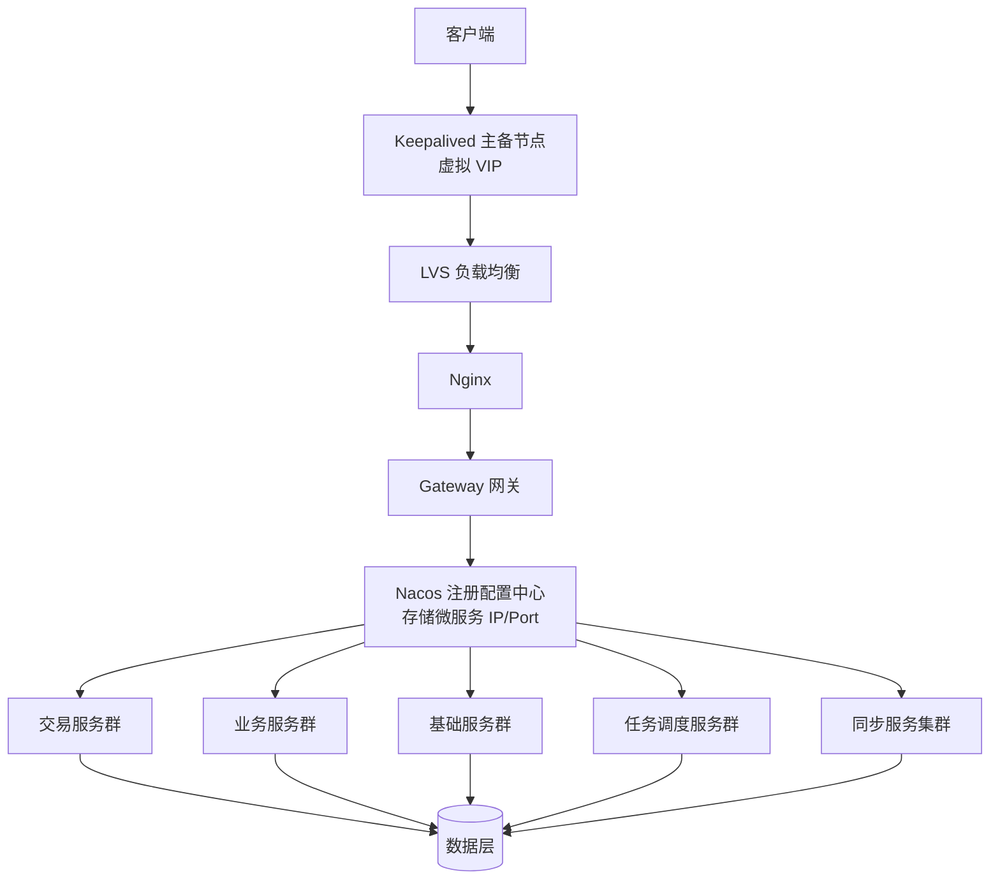

# 智牛股项目全景：产品形态、股票与 K 线、交易规则、需求与架构设计

智牛股是 M4 阶段六大进阶项目中的金融交易平台，服务于外汇、贵金属、期货、股票等衍生产品。第一章不写代码，却决定了后面功能实现的理解成本：项目对标什么、有哪些功能、金融业务有哪些规则，需求与架构如何推导。本篇压缩成四块：产品形态、股票与 K 线及交易规则、需求与业务结构、三视角的架构设计。

## 先给结论

- 智牛股对标 MT4、MT5 等专业金融交易平台，遵循 FIX 金融市场通用协议；功能覆盖用户注册、交易开户、行情订阅与呈现、下单委托与撤单、撮合交易。
- 它与一般金融系统的分水岭在交易核心：实现撮合交易与深度成交，并具备高性能、完整交易业务链、广泛兼容性与高扩展性。
- A 股规则四件套：交易时间上午 9:30-11:30、下午 13:00-15:00；涨跌幅不超过上一交易日收市价的 10%；100 股 = 1 手且买入须为 100 股整数倍；撮合按价格优先、时间优先。
- 交易五步闭环：开设账户 → 传递买卖指令 → 成交撮合 → 交割 → 过户（收手续费）。
- 需求侧是顶层集团、运营中心、B 端交易商三层级加 C 端用户/代理，既支持 B2C 也支持 SaaS 化运作；学习重点在 B 端交易商与 C 端用户。
- 架构三视角：服务架构（Keepalived + LVS + Nginx → Gateway → Nacos → 五大服务群）、功能架构（四大平台加同步服务）、技术架构（gRPC 对内、REST 对外、Canal + Kafka 同步）。

## 项目是什么：一个对标 MT4/MT5 的金融交易平台

智牛股服务的是金融衍生产品——外汇、贵金属、期货、股票，它们属性不同、交易规则也不同，例如外汇和股票的交易时间就不一样。项目对标 MT4、MT5 这类专业金融交易平台（MT4 是俄罗斯开发的全球最大外汇平台），并遵循 FIX 协议——全球最广泛的金融市场通用协议，约定平台间接口的传输交互规范。

功能上有个容易混淆的点：证券用户注册与交易开户是两回事——注册是登录系统的必要账号，交易开户才是具备交易资格的账号。加上行情订阅与呈现、市价下单、委托挂单、撤单、撮合交易，构成平台主干。

设计层面，项目前后分离并遵循 RESTful 规范；向下是微服务分布式架构、领域驱动设计，以 Spring Cloud 为生态核心；授权遵循 OAuth2 标准，实现统一认证鉴权。服务无状态化，支持集群部署与无缝水平扩展；治理上支持全链路监控、统一日志管理。

产品形态分两端看。APP 端分行情订阅和呈现、交易实现两大块：首页有导航菜单和资讯，行情板块里有涨幅榜与跌幅榜。点进中国平安可以看到实时价格曲线、买卖五档数据和最高价、最低价等概要信息；点击下单按钮输入指定价格即可提交撮合成交；浏览器开发者工具里能看到 userLogin、getAllValidStocks 这类接口调用。

运营后台首页概要有待办信息、用户管理信息、订单信息、统计信息与公司运营信息。功能模块有：机构权限管理（菜单管理、机构角色管理）；操作员用户管理；产品管理（产品列表就是股票数据，产品分类按交易市场划分为上交所、深交所、美股）；公司管理（支持 SaaS 化运作、接入多个交易商）；客户管理（投资客户账户、账户列表、客户组列表）；客户消息管理与模板配置（给股票设预警线，价格到达即通知）。交易核心是三大数据：订单列表、成交记录列表、仓位列表——买卖的股票最终按交易账号和股票代码生成持仓记录。

## 金融基础：股票、K 线与 A 股交易规则

股票是股份制有限公司签发、用以证明股东所持股份的凭证，表明持有者对股份公司部分资本拥有所有权。它包含经济利益且可上市流通、转让——这两个特征决定了它是有价证券。我国上市公司的股票在上交所和深交所发行与交易，交易所不直接受理个人开户，必须通过券商开户才能进行股票交易。

K 线是股票行情的重要部分。K 线图的画法包含四个数据：开盘价、最高价、最低价、收盘价，所有 K 线都围绕这四个数据展开，反映大市状况和价格信息；每日 K 线连起来就是日 K 线图，同理还有周 K、月 K。看图要点：A 股红涨绿跌，美股相反。上涨 K 线开盘价在实体下沿、收盘价在实体上沿，最高价、最低价是竖线的两端；下跌 K 线开盘价与收盘价互换，最高价与最低价不变。

A 股基本交易规则汇总如下，这些数字与约束会在后续撮合、结算功能里反复出现：

| 规则 | 内容 | 备注 |
| --- | --- | --- |
| 交易时间 | 上午 9:30-11:30，下午 13:00-15:00 | 全天 4 小时；港股、美股各有各的时间 |
| 涨跌幅限制 | 相对上一交易日收市价，涨跌幅不得超过 10% | 涨跌双向都算；美股无此限制 |
| 交易单位 | 以股为单位，100 股 = 1 手 | 委托买入须为 100 股或其整数倍 |
| 成交机制 | 价格优先、时间优先 | 类似 Java 中的先进先出（FIFO）原则 |

价格优先：较高买进申报优先于较低买进申报，较低卖出申报优先于较高卖出申报。时间优先：买卖方向和价格相同时，先申报者优于后申报者——九点下的单比十点下的单先成交。

一次完整的股票买卖分五步：开设账户（在券商注册建立交易账号）；传递买卖指令（早期靠口头、手工报价，现在一般通过交易软件下达指令、由券商传递给交易所，特殊情况可用电话委托）；成交撮合处理；交割（买方付现金取得股票，卖方交出股票取得现金）；过户（在发行公司股东名册登记姓名、持股数量等信息，过户收取手续费）。

撮合的排序规则：所有买委托按限价由高到低排列，所有卖委托按限价由低到高排列，限价相同者按进入系统时间先后排序；然后依序逐笔将排在前面的买卖委托配对成交，直至成交条件不满足为止，所有成交以同一成交价成交。例如卖一挂 101 元、500 手，买一挂 100 元、600 手，此时来一笔 102 元的买报价——卖方 101 元就愿意卖，两笔立即撮合匹配。

## 需求与业务结构：三层级运作与核心功能

平台支持三个层级运作：B 端交易商、运营中心、顶层集团。本项目侧重 B2C 业务，也支持 SaaS 化运作——顶层集团下接 N 个 B 端交易商。运营中心换汤不换药，最主要的作用是帮助项目从业务上更快速地拓展用户群体；作为教学项目，学习重点放在 B 端交易商和 C 端用户的功能实现上。

| 角色 | 主要功能 |
| --- | --- |
| 顶层集团 | 开设公司、交易产品配置、风控配置、营运分成、报表 |
| 运营中心 | 公司管理（logo、属性、访问地址）、支付管理、实时监控、交易分成、报表 |
| B 端交易商 | 公司信息配置、支付信息配置、用户管理、资金管理、实时监控、报表 |
| 用户/代理 | 注册开户、行情订阅与呈现、交易、出入金、代理推荐 |

核心功能包括：行情订阅、K 线呈现、撮合交易、深度成交、市价成交、限价委托、手动撤单、仓位总览、资金总览。服务概要设计里，行情接入后向 App、H5、PC、iOS、安卓下发；K 线覆盖分时、分K、日K、周K、月K；交易下单包含撮合交易、深度成交、市价成交、限价委托、手动撤单——撤单分手动与自动，结算时未撤回的订单由系统自动撤回；再加上监控、仓位、资金服务构成交易平台骨架。

## 架构设计：服务架构、功能架构与技术架构

### 服务架构：从接入层到数据层

服务架构自顶向下是一条清晰的链路：

Nginx 原生不支持集群运行，上层借助 LVS 做负载均衡，Keepalived 主备节点实现高可用。Gateway 接收 Nginx 转来的请求，Nacos 存储所有微服务的连接信息（IP、Port），据此把请求流转到不同服务群。划分服务群的依据是功能性质相同：交易服务群实现以交易为主的服务；业务服务群实现用户相关业务功能（活动、用户分红、强平）；基础服务群实现核心基础功能；任务调度服务群处理异步调度（登记派息、报表统计、活动调度）；同步服务集群同步订单、配置、用户三类数据。

治理层面：多节点部署时用轮询、权重做负载均衡；日志采集汇总到统一日志平台；链路监控定位一笔下单请求（流转代理、交易、挂单、资金服务）中哪个环节出了问题；熔断降级限流由 Sentinel 实现；灰度发布用金丝雀方案。

数据层是完整的分库分表体系：Redis 用 cluster 集群模式（另有单节点、哨兵两种模式）扛热点数据，提升吞吐、保证高可用；交易数据库 PostgreSQL、业务数据库 MariaDB，行情与交易数据持久化量大再分表，并做主从读写分离；MongoDB 存用户支付数据（出入金、订单支付）；ES 存用户行为日志，做收集、分析、统计，提升搜索吞吐性能。

### 功能架构：四大平台与周边服务

| 平台 | 包含服务 | 职责要点 |
| --- | --- | --- |
| 交易服务平台 | 代理、行情、资金、仓位、交易、挂单 | 代理服务负责行情、交易、委托挂单的转发，按请求类型路由到交易服务或挂单服务；行情服务做接入、订阅、分发、K 线生成与持久化；资金服务做资金查询、总览、额度调整、交割单查询；仓位服务管持仓、强平、浮动盈亏、止盈止损；交易服务做市价下单、订单详情、成交查询、深度成交、撮合处理；限价委托不能立即成交，放挂单服务队列撮合、条件满足才成交 |
| 业务服务平台 | 管理平台、报表、活动、统一支付、分红强平 | 报表含运营、账户、成交报表；活动服务支撑注册送金、推荐奖励；统一支付做订单支付、回调与掉单自动补偿；分红强平做分红返还、自动强平 |
| 基础服务平台 | 统一鉴权服务、用户中心服务 | 大量服务都要使用；平台级架构要尽量服务独立、职责单一 |
| 任务调度服务平台 | 交易调度、报表统计调度、活动调度 | 按业务维度做调度处理 |
| 周边服务 | 管理运营后台、同步服务 | 后台覆盖交易管理、业务管理、支付管理、报表管理、基础数据管理、系统权限管理；同步服务同步交易数据、配置数据、用户数据、射单数据（第三方对接） |

### 技术架构：每个服务群用什么通讯

接入层用 Keepalived 加 LVS 四层负载加 Nginx 七层负载实现高可用与负载均衡。网关层有两个入口：Gateway 服务网关（Spring Cloud 提供，对接业务服务）和 Proxy 代理服务网关（自定义实现，处理交易服务），两者无状态、支持水平扩展与负载分发。

微服务通讯按服务群分方案。交易服务群压力最大，采用 Spring Boot + gRPC + Protobuf + Netty 并实现 WebSocket 对接；业务服务群以运营管理为主、并发量不高，采用 REST 风格、HATEOAS 高阶形态快速实现增删改查，基于 HTTP、JSON 传输。同步服务群方案是 MariaDB + Canal + Kafka：Canal 是阿里开源的数据推送同步组件，支持 MySQL 同步但不支持 PostgreSQL。

服务治理清单：注册中心与统一配置 Nacos；负载均衡 Ribbon 加 gRPC；统一日志 ELK + Filebeat；链路监控 CAT；熔断降级限流 Sentinel；服务路由 Spring Cloud Gateway；编排 Docker + K8S。中间件有 Redis 集群、MongoDB 集群、Ceph 分布式文件存储、ES 集群搜索、Seata（前身 FESCAR）分布式事务、XXL-JOB 任务调度、RocketMQ 异步消息队列，以及 Spring Integration 与分布式锁（资金管控）。数据层落位：PostgreSQL 主从交易数据，MariaDB 集群业务数据，Redis 集群热点缓存，分布式文件存储放图片、附件等资料。

## 小结

第一章把"做一个什么项目、为什么这么设计"讲透了。产品上，智牛股是对标 MT4/MT5、遵循 FIX 协议、实现撮合交易与深度成交的金融交易平台；业务上，K 线四价与 A 股交易规则是后续功能的需求输入；架构上，服务、功能、技术三个视角分别给出部署拓扑、服务职责与通讯选型。带着两个问题往下走：限价委托为什么单独一个挂单服务、同步服务群为什么要求高实时性——后面的章节会一一落地。
