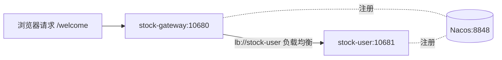

# 智牛股环境搭建收官：Nacos 无密码启动、父工程 POM、网关路由与端到端测试

智牛股项目第一章到这篇收尾。项目概述把业务与技术底图画完之后，工程规范与环境搭建这一章用七个视频把开发底座逐个立起来：准备清单、Nacos 配置与启动、父级工程 POM、网关服务、用户服务、路由转发测试，最后小结回顾。当网关把 `/welcome` 请求成功转发给用户服务、返回预期结果的那一刻，意味着 Spring Cloud Alibaba 微服务体系正式集成进项目，后面所有功能开发都跑在这套底座上。

## 先给结论

- 版本按讲义对齐：IDEA + JDK 1.8+、Maven 3.5+、Nacos 1.0.1；Spring Boot 2.1.6.RELEASE、Spring Cloud Alibaba 2.1.1.RELEASE、Spring Cloud Gateway 2.1.2.RELEASE。IDEA 里装 Maven Helper（查依赖冲突）和 Lombok（`@Data`、日志注解）两个插件。
- Nacos 1.0.1 采用无密码登录：`conf/application.properties` 四个安全配置全改 false、`nacos.security.ignore.urls=/**`；`bin` 目录下 `startup.cmd` 启动，必须等日志打出 `Tomcat started on port(s): 8848` 才算真正起来；起不来就清 data、logs 目录还原初始状态。
- 父级工程 bulls-stock 不写业务、删掉 src，只管 POM：properties 统一管版本，dependencies 放公用依赖由子服务自动继承，dependencyManagement 与 pluginManagement 只声明不加载，子模块用到时才引入。
- 网关 stock-gateway 端口 10680，三个核心依赖是 gateway、actuator、nacos-discovery；启动类放在独立 startup 包里，要补 `@ComponentScan` 把扫描基准指回 com.itcast 根包。
- 用户服务 stock-user 端口 10681，启动类直接挂 `@RestController` 提供 `/welcome` 接口；两个服务注册进 Nacos 后要盯健康实例数，为 0 说明服务假死或崩溃。
- 网关路由三件套：`routes[0].id=stock-user`、`uri=lb://stock-user`（lb 即负载均衡）、`predicates=Path=/**`；从网关 10680 访问与直连用户服务 10681 结果一致，端到端链路打通，第一章收官。

## 环境准备：版本清单与两个 IDEA 插件

开工前先对齐版本。版本号本身也有讲究：主版本号代表产品方向改变，次版本号代表功能或技术调整，修订号代表修复 BUG。Nacos 选 1.0.1 是因为讲义编写时它是最新应用版本，后来可能有更新，但学习阶段建议照讲义版本来，避免出现不可一致的错误。

| 组件 | 版本要求 | 说明 |
|---|---|---|
| IDEA | 本地安装可正常运行 | 开发工具 |
| JDK | 1.8 以上 | — |
| Maven | 3.5 以上 | 构建工具 |
| Nacos | 1.0.1 | 注册中心 + 配置中心 |

命名规范同步立好：类名与方法名用驼峰命名法，接口以 `I` 开头、实现类以 `Impl` 结尾，例如用户接口 `IUserService`、对应实现类 `UserServiceImpl`。更详细的规范直接查《阿里巴巴Java开发手册》。

然后装两个 IDEA 插件，入口都在 File → Settings → Plugins，面板上三个标签：Marketplace 是插件市场（国外网站，搜索会慢），Installed 列已安装插件，Update 列可更新的插件。

- **Maven Helper**：分析整个工程的依赖情况。比如搜 spring-boot，哪些组件引用了它、各自的版本号全部列出来，依赖树一目了然。出现 Maven 依赖冲突时，它能极大简化排查工作量。
- **Lombok**：快速生成代码。实体类属性多，`@Data` 一个注解就能生成全部 getter/setter，省去每次追加的麻烦；日志同理，手写 `private static final Logger logger = LoggerFactory.getLogger(...)` 这种样板代码很啰嗦，Lombok 的 `@Log4j2` 注解直接给类注入可用的 log 对象。

另外工程模板里已经带了 `stock-starter-swagger`、`stock-starter-validator` 这类 starter 模块，接口文档的配置也做成了标准姿势——`SwaggerProperties` 配置类里用 `@Value("${swagger.enabled}")`、`@Value("${swagger.title}")` 把开关、标题从配置文件注入，`basePackage`、`basePath`、`excludePath` 定义扫描与排除路径，类上挂 `@Data` 和 `@NoArgsConstructor`。这属于后面会反复用到的工程惯例。

## Nacos 配置与启动：无密码登录与假死排障

Nacos 启动前先改配置文件，采用无密码登录。理由很实际：项目开发阶段要频繁连接调试，每次都做密码认证没有太多意义，反而浪费开发时间，去掉认证能极大方便操作。

进 Nacos 安装目录，到 conf 下改 `application.properties`，四项按下面的值来：

```properties
spring.security.enabled=false
management.security=false
security.basic.enabled=false
nacos.security.ignore.urls=/**
```

前三项全部关闭安全验证，第四项把忽略地址设为 `/**`，即所有路径都放行。

改完启动：进 bin 目录，Windows 跑 `startup.cmd`，Linux 跑 `startup.sh`。启动时要盯着运行日志——没启动完成就去访问是访问不通的。正常起来的标志是日志打出这几行：

```text
INFO Tomcat initialized with port(s): 8848 (http)
INFO Root WebApplicationContext: initialization completed in 3599 ms
INFO Tomcat started on port(s): 8848 (http)
INFO Nacos log files: D:\TestCode\nacos1.0.1\logs
INFO Nacos Conf files: D:\TestCode\nacos1.0.1\conf
```

一个常见的坑：Nacos 有时会停在中间某一行日志、后面不再输出，此时服务其实没起来，访问不了。原因通常是 Nacos 内部缓存或数据加载出了问题，处理办法也简单：把 data 目录清掉，logs 日志目录也清掉，还原成初始状态再启动。

启动成功的验证方式：浏览器访问 `http://127.0.0.1:8848/nacos`，不再弹登录框直接进后台，能看到「配置管理 → 配置列表」（初始为空）和「服务管理」菜单，Nacos 这块就绪。

## 父级工程 bulls-stock：POM 的四段式依赖管理

父级工程的定位要想清楚：它管理子服务之间的依赖，不做具体业务实现，核心作用是集成 Spring Cloud Alibaba 的开发环境，把相关组件和构建配置统一收进来。

IDEA 里 New Project 创建：groupId 用 com.itcast，artifactId 叫 bulls-stock，版本按项目自身规范定 1.0.0。目录不存在没关系，IDEA 会自动创建。创建完的第一件事是把 src 目录删掉——它不负责业务实现，最核心的就是 pom.xml 的依赖管理。

第一次搭这套环境有个捷径：建议直接用配套提供的 Maven 仓库（课程虚拟机里已经下载好 Spring Cloud Alibaba 的全部相关依赖），自己从中央仓库构建会比较慢，甚至下载不成功；要用的话把 Maven 指向对应的仓库地址即可。

父工程 POM 分四段看：

第一段 properties，自定义属性，统一做版本管理：

```xml
<properties>
    <spring.cloud.alibaba.version>2.1.1.RELEASE</spring.cloud.alibaba.version>
    <spring-cloud-gateway.version>2.1.2.RELEASE</spring-cloud-gateway.version>
    <spring-boot.version>2.1.6.RELEASE</spring-boot.version>
    <maven.compiler.source>1.8</maven.compiler.source>
    <maven.compiler.target>1.8</maven.compiler.target>
    <maven.compiler.plugin.version>3.8.0</maven.compiler.plugin.version>
    <maven-jar-plugin.version>3.1.0</maven-jar-plugin.version>
</properties>
```

第二段 dependencies，公用依赖。这里配置的依赖子服务不需要再引用，会自动继承。目前只有 Lombok 一个：

```xml
<dependencies>
    <dependency>
        <groupId>org.projectlombok</groupId>
        <artifactId>lombok</artifactId>
        <optional>true</optional>
    </dependency>
</dependencies>
```

第三段 dependencyManagement，Maven 的依赖管理。它和 dependencies 的区别要分清：dependencies 会立刻把依赖加载进工程，dependencyManagement 只是先做一个声明，并不先加载；子模块需要使用时，按 groupId、artifactId、version 去加载对应版本。Spring Boot、Spring Cloud Alibaba、Spring Cloud 三套 BOM 都放在这里：

```xml
<dependencyManagement>
    <dependencies>
        <!-- Spring Boot 组件 -->
        <dependency>
            <groupId>org.springframework.boot</groupId>
            <artifactId>spring-boot-dependencies</artifactId>
            <version>${spring-boot.version}</version>
            <type>pom</type>
            <scope>import</scope>
        </dependency>
        <!-- Spring Cloud Alibaba 依赖组件 -->
        <dependency>
            <groupId>com.alibaba.cloud</groupId>
            <artifactId>spring-cloud-alibaba-dependencies</artifactId>
            <version>${spring.cloud.alibaba.version}</version>
            <type>pom</type>
            <scope>import</scope>
        </dependency>
        <!-- Spring Cloud 普通依赖组件 -->
        <dependency>
            <groupId>org.springframework.cloud</groupId>
            <artifactId>spring-cloud-commons-dependencies</artifactId>
            <version>${spring.cloud.alibaba.version}</version>
            <type>pom</type>
            <scope>import</scope>
        </dependency>
    </dependencies>
</dependencyManagement>
```

第四段 build 与 pluginManagement。build 管整个工程怎么构建：`finalName` 取 `${project.name}` 决定打包后的名称；resources 里把 `src/main/resources` 开启 filtering 过滤，`src/main/java` 也纳入资源目录。pluginManagement 和 dependencyManagement 同理——插件先声明不加载，子模块自己声明了同名插件时，按父级声明的版本查找加载。至此父工程配置完成，接下来创建网关和用户服务两个子工程。

## 网关与用户服务：搭建、注册与路由转发测试

### 网关 stock-gateway

在 bulls-stock 下 New Module 创建 stock-gateway，先配依赖。网关服务有三个核心依赖组件：

```xml
<dependency>
    <groupId>org.springframework.cloud</groupId>
    <artifactId>spring-cloud-starter-gateway</artifactId>
</dependency>
<dependency>
    <groupId>org.springframework.boot</groupId>
    <artifactId>spring-boot-starter-actuator</artifactId>
</dependency>
<dependency>
    <groupId>com.alibaba.cloud</groupId>
    <artifactId>spring-cloud-starter-alibaba-nacos-discovery</artifactId>
</dependency>
```

分别是网关路由本体、Spring Boot 监控端点、Nacos 服务注册发现。

包结构按规范来：`com.itcast` 下建模块包，实际生产建议再单建一个 startup 包专门放启动类。启动类三个注解缺一不可：

```java
@SpringBootApplication
@EnableDiscoveryClient
@ComponentScan(basePackages = "com.itcast")
public class StockGatewayApplication {

    public static void main(String[] args) {
        SpringApplication.run(StockGatewayApplication.class, args);
    }
}
```

`@SpringBootApplication` 标识这是一个 Spring Boot 服务；`@EnableDiscoveryClient` 开启 Nacos 注册发现（加了 nacos-discovery 依赖就必须加它）；`@ComponentScan` 是因为启动类放在 startup 子包里，有多层包结构时默认扫描扫不到，必须把基准包显式指回 com.itcast 根目录。开发中建议养成习惯，不依赖默认扫描行为，明确指定基准路径。

配置文件新建 `application.properties`，有个小技巧：文件名拼错时 IDEA 里绿色小图标不会显示，发现图标不对先检查文件名。网关的基础配置：

```properties
server.port=10680
spring.application.name=stock-gateway
spring.cloud.nacos.discovery.server-addr=127.0.0.1:8848
spring.cloud.nacos.discovery.service=stock-gateway
```

端口 10680，服务名 stock-gateway，注册地址指向本地 Nacos。`discovery.service` 给 Nacos 告知注册名称——对网关来说可配可不配，因为不会有业务服务反过来调用网关；但应用服务、业务服务一定要指定，否则 Nacos 会给它生成默认的服务名称。

启动后监听 10680，到 Nacos 后台刷新服务列表，stock-gateway 已注册进去，分组默认 DEFAULT_GROUP，实例数量和健康实例数都是 1。这里有个排障要点：如果服务列表里有实例但健康实例数为 0，说明服务不可用，可能假死或崩溃了，开发期要多留意这个指标。

### 用户服务 stock-user

网关建完建用户服务，供网关调用、做集成验证。New Module 创建 stock-user，依赖比网关少一个 starter，只要 web 和 Nacos 注册发现两个：

```xml
<dependency>
    <groupId>org.springframework.boot</groupId>
    <artifactId>spring-boot-starter-web</artifactId>
</dependency>
<dependency>
    <groupId>com.alibaba.cloud</groupId>
    <artifactId>spring-cloud-starter-alibaba-nacos-discovery</artifactId>
</dependency>
```

启动类 StockUserApplication，名称与模块名后缀保持一致。因为要提供测试接口，直接在启动类上加 `@RestController`：

```java
@SpringBootApplication
@EnableDiscoveryClient
@RestController
@ComponentScan(basePackages = "com.itcast")
public class StockUserApplication {

    /**
     * 测试访问接口
     */
    @RequestMapping("/welcome")
    public String welcome() {
        return "welcome bulls stock platform!";
    }

    public static void main(String[] args) {
        SpringApplication.run(StockUserApplication.class, args);
    }
}
```

`/welcome` 就是后面验证整条链路用的接口，请求路径与方法名保持一致，返回欢迎语。

配置文件同样三件套，端口换成 10681：

```properties
server.port=10681
spring.application.name=stock-user
spring.cloud.nacos.discovery.server-addr=127.0.0.1:8848
spring.cloud.nacos.discovery.service=${spring.application.name}
```

`discovery.service` 这次用 `${spring.application.name}` 变量引用，以后要改服务名只改一处即可。`management.endpoints.web.exposure.include=*` 是暴露 actuator 监控端点用的，本节只做 Spring Cloud Alibaba 集成测试，可以不加，要开监控再加上也行。

启动后同样去 Nacos 服务列表确认 stock-user 注册成功，再直连 `http://127.0.0.1:10681/welcome`，返回 `welcome bulls stock platform!`，用户服务就绪。

### 路由转发与端到端测试

两个服务各自正常后，给网关追加路由转发配置，重新启动网关：

```properties
# 转发配置
spring.cloud.gateway.routes[0].id=stock-user
spring.cloud.gateway.routes[0].uri=lb://stock-user
spring.cloud.gateway.routes[0].predicates[0]=Path=/**
```

三行的含义：

| 配置项 | 值 | 含义 |
|---|---|---|
| routes[0].id | stock-user | 标识转发到哪个服务，最好与服务模块名保持一致 |
| routes[0].uri | lb://stock-user | URI 相对入口地址（注意 URI 不等于 URL），lb 是 load balance，走负载均衡调用 |
| routes[0].predicates[0] | Path=/** | 断言：哪些路径触发转发，`/**` 表示所有路径都转发 |

routes 是个数组，网关后面通常不止挂一个业务——还会有资金服务、交易服务等，那就继续配 routes[1]、routes[2]。演示阶段只有一个服务节点，`Path=/**` 全转发没问题；生产环境多个微服务节点时，路由要按模块分类配置，比如用户服务走 `/user/**`、订单服务走 `/order/**`，再做各自路径下的转发。

整体链路是这样的：



测试方法很直接：先确认直连用户服务 `10681/welcome` 正常，然后访问网关 `http://127.0.0.1:10680/welcome`——网关自己并没有写这个接口，但返回结果与用户服务完全一致，多刷新几次都稳定，说明网关正常启动、路由配置生效。到这里，开发环境搭建完成，Spring Cloud Alibaba 微服务成功集成进项目，微服务之间的流转验证通过。

## 小结

回看整个第二章，两件事：一是工程规范，二是环境搭建。

规范侧要掌握工程结构规范——应用分层怎么做（终端展示层、业务逻辑层、数据持久层各管一段）、分层领域模型的约束与对象间关系、Maven 版本规范；编写规范上，类名方法名驼峰、接口以 I 开头、实现类以 Impl 结尾，更细的条款去读《阿里巴巴Java开发手册》，养成良好编程风格。

环境侧按七步走完：准备 IDEA/JDK/Maven/Nacos 并装好 Maven Helper、Lombok 插件；Nacos 改无密码配置、启动、验证；父级工程集成 Spring Cloud Alibaba 的 POM 依赖配置——这是核心，dependencyManagement 只声明不加载的机制要多理解；网关负责请求转发；用户服务提供 `/welcome` 接口；最后路由配置加端到端测试，结果符合预期。

至此第一章（项目概述 + 工程规范与环境搭建）全部收束：业务底图、工程规矩、微服务底座三样齐了。Nacos、网关、用户服务这些最基础的功能已经立起来，接下来就进入项目功能的深入开发。
