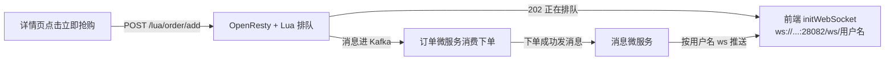

# 秒杀详情页静态化与倒计时、热点商品抢单与长连接状态响应、Sentinel 接入

进入千亿级电商秒杀项目的高并发处理方案一章，这条线围绕三个问题展开：详情页怎么扛住流量——用 Freemarker 把商品详情生成静态页；热点商品怎么下单——前端把请求交给 OpenResty 的 Lua 脚本排队，返回 202 后用 WebSocket 长连接等抢单结果；服务怎么保护自己——接入 Sentinel 做熔断限流。十个视频从数据模型准备一路讲到 Sentinel 接入验证，正好是详情页与抢单链路的完整闭环。

## 先给结论

- 详情页静态化基于 Freemarker：控制器用 `@PathVariable` 接收商品 ID，调 `skuFeign.findById` 查商品详情，组装 dataMap（path、templateName=items.ftl、name=id.html、sku、images、spec）后交给 `skuPageService.itemPage` 生成 id.html；配套还有 `@DeleteMapping("/html/{id}")` 删除静态页。
- 模板 items.ftl 由资料里的 detail.html 改后缀而来：标题取 `sku.name`，秒杀价 `seckillPrice`、原价 `price`、品牌 `brandName`、分类取三级 `category3Name`；images 字段逗号分隔，后端 split 成数组传给模板循环渲染。
- 倒计时是前端 Vue 实现：页面最外层补一个 `div#app` 作为挂载节点，data 里放 message/hours/minutes/seconds，loadTime 取 `seckillBegin`、`seckillEnd`，按总毫秒数整除换算时分秒——取整数部分，不是四舍五入；已过结束时间直接显示「活动已结束」。
- 抢单走 OpenResty + Lua：addOrder 从 localStorage 取 token，axios 加 `Authorization: Bearer` 头 POST `/lua/order/add?id=商品ID`；热点商品返回 202 表示正在排队。静态页部署在服务器 `/usr/local/server/web/items` 下，测试用 hosts 把 data-seckill-java.itheima.net 映射到 192.168.211.137——生产环境用域名不用 IP。
- 抢单状态靠 WebSocket 推送：响应 202 时前端 `initWebSocket` 连 `ws://消息服务:28082/ws/用户名`，Lua 响应里补上 username 字段供前端拼接地址；下单链路是排队进 Kafka、订单微服务消费下单、下单成功后调消息微服务，由它按用户名推送抢单状态，页面收到「抢单成功」，tb_order 订单数加一。
- Sentinel 是阿里出品、以流量为切入点的熔断限流组件：信号量隔离、熔断依据响应时间/异常比率/异常数、支持流量整形与系统负载保护，整体强于 Hystrix；接入两步——引 `spring-cloud-starter-alibaba-sentinel` 依赖，配置 dashboard（8858）与 transport 端口（8719），再开 `feign.sentinel.enabled`。

## 详情页静态化：数据模型准备与模板填充

第一章做过普通静态页生成，但不涉及商品详情；秒杀抢单要求数据是真实的商品数据，所以这里要完完整整把详情页做出来。Freemarker 生成静态页就两个要素：模板、数据模型。详情页上要展示的是商品详情、规格、价格、倒计时，这些全在商品详情里，所以数据来源就是按 ID 查询商品详情。

之前是直接把整个 SKU 传过来生成，不方便测试，改成按 ID 查询的版本。SKU 的 Feign 接口里已有 `findById`，注入 `skuFeign` 直接调用：

```java
@PostMapping(value = "/html/{id}")
public Result html(@PathVariable(value = "id") String id) throws Exception {
    // 数据模型
    Map<String, Object> dataMap = new HashMap<>();
    dataMap.put("path", htmlPath);
    dataMap.put("templateName", "items.ftl");
    dataMap.put("name", id + ".html");
    dataMap.put("address", "北京");

    // 获取商品数据
    Result<Sku> skuResult = skuFeign.findById(id);
    dataMap.put("sku", skuResult.getData());

    // 图片按逗号分割成数组
    dataMap.put("images", skuResult.getData().getImages().split(","));

    // 获取规格信息
    String spec = skuResult.getData().getSpec();
    Map<String, String> specMap = JSON.parseObject(spec, Map.class);
    String specList = "";
    for (Map.Entry<String, String> entry : specMap.entrySet()) {
        specList += entry.getValue();
    }
    dataMap.put("spec", specList);

    // 生成静态页
    skuPageService.itemPage(dataMap);
    return new Result(true, StatusCode.OK, "生成静态页成功！");
}
```

spec 在库里是 JSON 字符串，用 FastJson 的 `JSON.parseObject` 转成 Map 再取出值拼接；页面规格区要的正是这些值。删除静态页是反向操作，按 id 拼出文件名删掉即可：

```java
@DeleteMapping(value = "/html/{id}")
public Result delHtml(@PathVariable(value = "id") String id) {
    String fileName = id + ".html";
    skuPageService.delHtml(fileName, htmlPath);
    return new Result(true, StatusCode.OK, "删除静态页成功！");
}
```

模板来自资料里的详情页 detail.html，拷到工程 templates 目录、后缀改成 .ftl，得到 items.ftl，然后把动态数据逐个替换：标题 `${sku.name}`；秒杀价 `${sku.seckillPrice}`、原价 `${sku.price}`；商品名称、品牌 `${sku.brandName}`、分类取三级分类名称；规格区取组装好的 `${spec}`；图片列表循环渲染 `${images}`。

测试前还有一步：启动类要加 `@EnableFeignClients(basePackages = "...")` 扫到 Feign 接口，商品微服务（goods）也要启动。然后浏览器访问 `localhost:18087/html/商品ID`，静态页就落在配置的 htmlPath 目录下。页面初始可能不好看、图片不显示，把 axios.js、vue.js 一并拷到页面目录再刷新，效果就正常了。

倒计时代码资料里直接提供，拷进来改三处。页面最外层包一个 `<div id="app">`，否则 Vue 找不到挂载节点；data 里补 message、hours、minutes、seconds；核心逻辑是整除换算：

```javascript
var app = new Vue({
    el: '#app',
    data: { message: '', hours: '', minutes: '', seconds: '' },
    methods: {
        loadTime: function () {
            let tm1 = new Date(`${sku.seckillBegin}`);
            let tm2 = new Date(`${sku.seckillEnd}`);
            this.timeCalculate(tm1, tm2);
        },
        timeCalculate: function (tm1, tm2) {
            let nowtimes = new Date().getTime();
            if (nowtimes > tm2.getTime()) {
                this.message = '活动已结束！';
                return;
            }
            let nums = tm2.getTime() - nowtimes;   // 距离结束的总毫秒数
            this.hours = Math.floor(nums / (1000 * 60 * 60));
            this.minutes = Math.floor((nums - this.hours * 1000 * 60 * 60) / (1000 * 60));
            this.seconds = Math.floor((nums - this.hours * 1000 * 60 * 60 - this.minutes * 1000 * 60) / 1000);
        }
    },
    created: function () { this.loadTime(); }
});
```

小时是总毫秒除以每小时毫秒数取整数（只取整数部分，不存在四舍五入）；分钟用总时间减去整小时后的余数再除每分钟毫秒数取整；秒同理。message 用于活动结束后在页面上提示。重新生成静态页，页面上「距离结束还有 600 多天」——时间准确，因为这条测试数据的活动周期确实很长。

## 热点商品抢单：从点击抢购到进入排队

下单的前端流程要理解清楚。第一步是身份识别：从 localStorage 获取用户令牌。测试阶段模拟一个即可——把测试数据里现成的令牌塞进 `localStorage.setItem("token", ...)`，省得因为令牌问题下不了单。

第二步创建 axios 实例，给请求加认证头，然后 POST 到抢单下单地址。这个地址来自之前写的 Lua 脚本那套方案：`/lua/order/add?id=商品ID`，请求打到服务器 192.168.211.137 的 80 端口（80 端口可以不写）：

```javascript
addOrder: function () {
    localStorage.setItem("token", "测试令牌...");   // 模拟登录
    var token = localStorage.getItem("token");
    if (token != null && token != "") {
        var instance = axios.create({});
        instance.defaults.headers.common['Authorization'] = 'Bearer ' + token;
        instance.post("http://data-seckill-java.itheima.net/lua/order/add?id=${sku.id}")
            .then(function (response) {
                console.log(response);
                // 跳转个人中心
                location.href = "http://data-seckill-java.itheima.net/#/user";
            });
    } else {
        // 未登录
        location.href = "http://data-seckill-java.itheima.net/#/login";
        console.log("未登录！");
    }
}
```

未登录分支生产上要跳登录页，测试阶段每次都会塞令牌，不会真的走到。

测试前把环境摆成接近真实的形态。项目以后要发布到服务器，生产环境应该用域名而不是 IP——IP 变化概率太大。做法是在 hosts 文件里配一条域名映射：

```text
192.168.211.137  data-seckill-java.itheima.net
```

静态页也要放到服务器上，位置是之前配置详情页时定好的 `/usr/local/server/web` 下的 items 目录。重新生成一次静态页，把 id.html 放进去，之后就用域名访问：`http://data-seckill-java.itheima.net/items/xxx.html`。

服务端这边，OpenResty 的 Nginx 配置里，`/lua/order/add` 由 Lua 脚本 `seckill-order-add.lua` 处理——热点商品的排队、预扣都在 Lua 层完成。点击「立即抢购」，页面提示「您正在排队」，因为当前商品是热点商品：请求先进排队，服务端处理订单，处理完再通知前端。这个「通知前端」就是下一节的长连接。

## 抢单状态响应：WebSocket 长连接推送

排队之后服务端开始消费：之前的方案是用 Kafka 消费下单，下单成功后向消息微服务发消息，由消息微服务把抢单状态推给客户端。客户端要收到推送，必须先和服务端建立 WebSocket 连接。

前端把之前写过的 WebSocket 代码搬过来。声明全局 websocket 对象，进来先初始化为 null，然后实现 initWebSocket：

```javascript
initWebSocket: function (uname) {
    this.socket = new WebSocket("ws://localhost:28082/ws/" + uname);
    this.socket.onopen = function () {
        console.log("Socket 已打开");
    };
    this.socket.onclose = function () {
        console.log("Socket已关闭");
    };
    this.socket.onerror = function () {
        alert("Socket发生了错误");
    };
    this.socket.onmessage = function (event) {
        loadMessage(event.data);    // 后端消息接收
    };
}
```

28082 是消息微服务的端口，连接地址按用户名区分——消息服务给指定用户发消息就是按 `ws + 用户名` 寻址的。配套还可以写 send（`socket.send(msg)`）和 closeWs（`socket.close()`）两个方法，本场景前端主要是收消息，send 基本用不上。

关键的触发时机在后端响应上：下单请求返回 `response.data.code == 202`，表示正在排队，这时才建立长连接等结果：

```javascript
if (response.data.code == 202) {
    // 正在排队，建立 WebSocket 连接等待抢单状态
    app.initWebSocket(response.data.username);
}
```

这里有个必须解决的点：连接地址要按用户名拼接，而页面里用户名是拿不到的。解决办法是在 Lua 脚本响应里把用户名带上——脚本里用户名早就解析出来了，无论抢单结果如何都加一行 `response` 里的 `username` 字段。改完执行 `nginx -s reload`，再抢一次，响应里就多出了 username，前端拿 `response.data.username` 拼连接地址即可。

整条链路串起来：



测试流程：启动静态页服务，重新生成静态页放到服务器；先查一下数据库 `select count(*) from tb_order`，当前 1 个订单；页面清空缓存后点抢单，显示「您正在排队」；订单微服务消费后调用消息微服务，给指定用户发送抢单状态；前端 onmessage 收到消息，loadMessage 里 `console.log(g.data)` 输出「抢单成功」，再查 tb_order 订单数已经加一——热点商品抢单的状态响应闭环验证完成。

## Sentinel：为什么选它、装控制台、接入验证

### 熔断限流为什么是 Sentinel

熔断限流解决的是高并发场景下项目的雪崩灾难。微服务和微服务之间的稳定性越来越重要：流量很大时不做保护，相互调用很容易出问题，个别微服务假死就可能拖垮整个服务。Sentinel 是阿里巴巴的产物，以流量为切入点，从流量控制、熔断降级、系统负载保护等多个维度保护微服务稳定性。

它的四大特征：丰富的应用场景——承接了阿里巴巴十年双 11 大促流量的核心场景，秒杀就是典型：并发量高且流量极不确定，有的商品冷门有的突然爆量，Sentinel 能把突发流量控制在系统可容纳范围内，还能削峰填谷、实时熔断下游不可用的应用（A 调 B、B 调 C，C 挂了传统做法会一直调到超时，极易雪崩；Sentinel 发现 C 不响应就直接熔断，后续请求不再交给它）；完备的实时监控——控制台秒级数据，500 台以下集群可汇总；广泛的开源生态——与 Spring Cloud、Dubbo、gRPC 整合只需引依赖加配置；完善的 SPI 扩展点——快速定制逻辑、管理规则、适配数据源。

架构上两部分：核心库（Java 客户端，不依赖任何框架，引入即用）和控制台（Dashboard，基于 Spring Boot 开发，打包后直接运行，不需要额外的 Tomcat）。专注点是多元化的流量控制、熔断降级、系统负载保护、实时监控和控制台。和 Spring Cloud 之前的 Hystrix 对比，核心差异一张表：

| 特性 | Sentinel | Hystrix |
|---|---|---|
| 隔离策略 | 信号量隔离（并发线程数限流） | 线程池隔离 / 信号量隔离 |
| 熔断降级策略 | 基于响应时间、异常比率、异常数 | 基于异常比率 |
| 实时指标实现 | 滑动窗口（LeapArray） | 滑动窗口（基于 RxJava） |
| 扩展性 | 多个扩展点 | 插件形式 |
| 限流 | 基于 QPS / 并发数，支持基于调用关系的限流 | 有限支持 |
| 流量整形 | 支持慢启动、匀速器模式 | 不支持 |
| 系统负载保护 | 支持 | 不支持 |
| 控制台 | 开箱即用，功能丰富 | 较为简单 |

深入学习参考 `https://github.com/alibaba/spring-cloud-alibaba/wiki/Sentinel`。

### 控制台安装与接入

控制台提供机器发现（服务靠心跳包上报健康，心跳没了就可能挂了）、单机和集群聚合的秒级监控、统一的规则管理与推送、鉴权（生产环境重要，可自定义鉴权行为）。

安装方式一，jar 直接运行——控制台本身是 Spring Boot 写的，当前最新版本 1.7.2：

```bash
java -Dserver.port=8858 -Dcp.sentinel.dashboard.server=localhost:8858 -Dproject.name=sentinel-dashboard -jar sentinel-dashboard-1.7.2.jar
```

浏览器访问 `http://localhost:8858`，账号密码都是 sentinel。刚进去空空如也，因为还没有任何应用接入。方式二，Docker 容器安装：

```bash
docker pull bladex/sentinel-dashboard
docker run --name sentinel -d -p 8858:8858 bladex/sentinel-dashboard
```

课程虚拟机里已经装好，直接用 `192.168.211.137:8858` 访问即可；控制台里能看到 sentinel-dashboard 自己这个应用，这正是机器发现功能的体现。

项目接入两步走。导入现成的 sentinel 案例（生产者、消费者、微服务网关三个角色），第一步在消费者工程引依赖：

```xml
<dependency>
    <groupId>com.alibaba.cloud</groupId>
    <artifactId>spring-cloud-starter-alibaba-sentinel</artifactId>
</dependency>
```

第二步在 bootstrap.yml 里配置控制台地址与通信端口，并开启 Feign 对 Sentinel 的支持：

```yaml
spring:
  cloud:
    sentinel:
      transport:
        port: 8719            # 与控制台数据通信的端口
        dashboard: 192.168.211.137:8858
      feign:
        sentinel:
          enabled: true
```

验证：启动消费者（18082 端口），访问 `localhost:18082/consumer/ue/9`，接口返回正常；回到 Sentinel 控制台刷新，服务列表里多出 consumer 服务，点开实时监控，疯狂刷新页面，流量曲线跟着一起变——接入成功。总结就两个步骤：引依赖包，配置控制台地址和通信端口。

## 小结

- 详情页静态化的套路是「查数据 + 组模型 + 填模板」：`skuFeign.findById` 拿商品，dataMap 装 path、templateName、name、sku、images（split 后的数组）、spec（JSON 转 Map 拼值），`itemPage` 产出 id.html，删除接口做反向清理。
- 模板 items.ftl 从 detail.html 改造而来，秒杀价/原价/品牌/三级分类/规格/图片列表逐个换成 Freemarker 变量；倒计时是纯前端 Vue 整除换算，挂载节点 div#app 和 message 文案别漏。
- 抢单把流量先交给 OpenResty 的 Lua 脚本：token 放 localStorage、请求带 Bearer 头打 `/lua/order/add?id=`，热点商品返回 202 进入排队；测试用 hosts 域名映射模拟生产，静态页发到 `/usr/local/server/web/items`。
- 状态响应的解法是 WebSocket 长连接：202 才 `initWebSocket`，地址 `ws://消息服务:28082/ws/用户名`；Lua 响应补 username 解决前端拿不到用户名的问题；Kafka → 订单微服务 → 消息微服务 → ws 推送，前端收到「抢单成功」、tb_order 加一即为闭环。
- Sentinel 以流量为切入点做熔断限流，信号量隔离、三种熔断依据、支持流量整形与系统负载保护，对比 Hystrix 全面占优，且核心库不依赖框架、控制台 Spring Boot 直接跑。
- 接入成本极低：`spring-cloud-starter-alibaba-sentinel` 依赖 + dashboard/transport 配置 + `feign.sentinel.enabled`，访问一次接口控制台就能看到服务和秒级流量。
