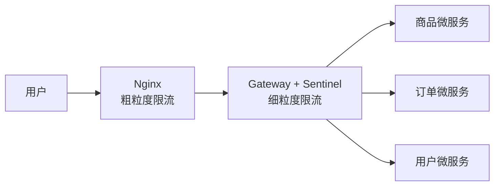

# 秒杀限流双闸门：Sentinel Feign 降级兜底与流控降级规则落地，Nginx 漏桶限流控速率控并发与 LVS 开篇

Sentinel 接进项目并不等于限流就位。服务调用链是 A 调 B、B 调 C，C 一挂，Sentinel 此前管不到 Feign 这条链路，得先把 FallbackFactory 补上；流控、降级、热点、授权四类规则配齐之后，还会撞上另一个事实——Gateway 跑起来本质是个 Tomcat，扛不住最外端的洪峰，真正站在门口接流量的应该是 Nginx。这一篇从 Feign 降级兜底讲到 Nginx 的 limit_req 与 limit_conn 双套限流，最后带出 4 层负载均衡 LVS。

## 先给结论

- Feign 接 Sentinel 只需两步：`application.yml` 开 `feign.sentinel.enabled: true`，再写一个实现 `FallbackFactory<GoodsFeign>` 的 `@Component` 降级类，`@FeignClient` 上用 `fallbackFactory` 指过去，缺一不可。
- 流控阈值有两种口径：QPS 限"每秒请求数"，浏览器手速就能压测；线程数限"并发工作线程"，接口响应太快根本攒不出并发，必须 JMeter 开两个线程永久循环才能压出降级。
- 流控效果三种：快速失败直接拒绝；Warm Up 以阈值 1/3 起步缓慢爬升，对症秒杀开抢瞬间的流量猛增；排队等待把多余请求放进队列匀速放行，允许慢但不允许拒。
- 降级三策略：平均 RT 超阈值（毫秒）触发、时间窗口过后自动恢复；异常比例 0.01 即 1% 占比触发，错多了连正常请求也进不来；异常数按次数统计。热点规则按参数索引（下标 0 是第一个参数）单独限 QPS，授权规则管黑白名单。
- Nginx 限流两大件：`limit_req_zone`/`limit_req` 基于漏桶控速率（rate=2r/s、burst=4 nodelay），`limit_conn_zone`/`limit_conn` 控并发连接数——perip 限单用户，perserver 限整台服务器总量，限流阈值按后端承载力倒推（三台各扛 500，总闸 1500）。
- 链路定调：用户 → Nginx（粗粒度，单点 5 万并发）→ Gateway + Sentinel（细粒度）→ 微服务；Nginx 之上还想再扛，就轮到内核层 4 层负载的 LVS（400 万并发），下一篇展开。

## Sentinel：Feign 降级兜底与四类规则

服务自身被限流熔断时有兜底，但项目里大量调用走 Feign，下游出问题时降级逻辑得挂在调用方。补齐方式很简单，先在 `application.yml` 里打开开关：

```yaml
feign:
  sentinel:
    enabled: true
```

然后写降级工厂类，写法和之前 Hystrix 的 fallback 没什么区别：

```java
@Component
public class GoodsFeignFallback implements FallbackFactory<GoodsFeign> {
    @Override
    public GoodsFeign create(Throwable throwable) {
        return new GoodsFeign() {
            @Override
            public String one(Integer max) {
                return "服务降级：";
            }
        };
    }
}
```

两个容易漏的点：类必须交给容器管理，`@Component` 不能丢，泛型写对应的 Feign 接口；再在 `@FeignClient` 上把工厂指过去：

```java
@FeignClient(value = "goods", fallbackFactory = GoodsFeignFallback.class)
public interface GoodsFeign {
    @GetMapping(value = "/goods/one/{max}")
    String one(@PathVariable(value = "max") Integer max);
}
```

验证时 goods 服务的 one 方法故意做了处理：参数大于 10 抛异常，小于 10 正常返回。启动两个服务后访问 localhost:18083 的 consumer 接口，传 10 刷新多少次都没问题；换成 11 立刻返回"服务降级："——比直接给用户抛一个异常体面得多。Sentinel 控制台（演示环境 `http://192.168.211.137:8858`）里也能看到 consumer 服务的实时监控曲线。

规则层面，控制台四类规则的使用频率差别很大：流控和降级是日常主力，热点和授权频率不高，了解即可。

流控阈值先分清两种口径。QPS 好测：对簇点链路里的资源新增流控，单机阈值填 3，QPS 到 3 就触发服务降级，第 4 个请求立刻被挡。线程数则单靠手速测不出来——请求处理太快，攒不出并发线程，得借助 JMeter：线程组开 2 个线程、永久循环，HTTP 请求指向 `127.0.0.1:18083`，跑起来之后多开的线程就会触发降级。

流控模式里直连最常用；关联本质是一种资源调配——支付业务和外卖业务并存，支付请求量暴增时把外卖降级，资源挪给支付；链路模式跟 Sentinel 版本有关系，演示里没有展开测。

流控效果三种，行为差异明显：

| 流控效果 | 行为 | 适用场景 |
| --- | --- | --- |
| 快速失败 | 超阈值直接拒绝，返回降级信息 | 常规接口 |
| Warm Up（预热） | 以阈值的 1/3 起步，缓慢增长到设定值 | 秒杀开抢瞬间流量猛增 |
| 排队等待 | 多余请求排队匀速放行，页面出现等待转动 | 允许慢但不允许拒的场景 |

降级规则三个策略。平均响应时间（RT，单位毫秒）超过阈值开始降级，时间窗口（演示配 5 秒）过后自动恢复——演示时接口响应太快，阈值从 1000ms 一路压到 1ms 才看到降级效果。异常比例按占比统计，0.1 表示 10%、0.01 表示 1%：输入 11 出错没关系，一会儿还能继续访问，但故意频繁错几次之后，连传 10 的正常请求也被挡住了。异常数则是统计窗口内异常出现的次数。热点规则针对高频参数——秒杀里 10 件库存十万人抢的商品就是典型热点，按参数索引配置，下标 0 表示第一个参数，限流模式只有 QPS。授权规则就是黑白名单：只允许指定应用访问就配白名单，不允许某个应用访问就配黑名单。

最后是引入位置的选择。秒杀项目分订单、商品、用户等多个微服务，两种方案：在每个微服务节点各自引入，能把各节点流量控制到很细的程度；或者在 Gateway 统一引入，流量控制集中管理，对后端微服务形成整体保护——Gateway 本来就有过滤器体系，写个过滤器照样能对不同服务做差异化限流。秒杀项目选了后者：pom 里加 sentinel 与 sentinel-gateway 两个依赖，`bootstrap.yml` 配控制台地址：

```yaml
sentinel:
  transport:
    port: 8719
  dashboard: 192.168.211.137:8888
```

启动 Gateway 和商品微服务后（商品服务第一次起不来，Redis 没启动报 Connection refused，把 Redis 拉起来再启动即可），用 Postman 请求 `localhost:8001/api/brand`，控制台实时监控立刻出现 Gateway 的流量；簇点链路里每请求一个新地址就多一条资源，之后的流控、降级都基于这些链路配置。

## Nginx 漏桶限流：速率与并发双闸

为什么有了 Sentinel 还要 Nginx 限流？因为最外端不该是 Gateway。Gateway 是 Tomcat 发布的，并发处理能力有限，而且公司里网关都是集群部署，用户请求过来打哪个端口都成问题；用户也不可能去切换端口。真正的门面是 Nginx：单点轻松扛 5 万并发，资源消耗极小。于是链路变成这样：



多这一层网关不多——Nginx 放行的是大部分流量，只把超额部分拦下，限得粗；Gateway 那层限得细。两层配合才能对后端形成有效保护，这是项目对外发布的常见方式。限流标准按后端承载力倒推：一台服务器扛 500 并发，三台就是 1500，Nginx 的总闸照这个数设。用户刷单怎么控、总并发超载怎么控，Nginx 自身有限流机制，分两种：控制速率（像地铁进站排队，按速度放人）和控制并发连接数（像游乐船限载，一次只能上多少人，硬往里塞船会沉）。

控制速率的底层是漏桶算法：请求像水一样先进桶，桶底孔径固定、匀速出水；进水再快，出速不变，桶满了直接溢出——溢出就是拒绝请求。翻译成程序就是开辟一块空间把请求存起来，按固定速率一个一个处理。Nginx 用 `limit_req_zone` 定义"桶"，`limit_req` 引用它：

```nginx
# 漏桶：10m 存储空间，每秒放行 2 个请求
limit_req_zone $binary_remote_addr zone=contentRateLimit:10m rate=2r/s;

server {
    location /web/items/ {
        limit_req zone=contentRateLimit burst=4 nodelay;
        content_by_lua_file /usr/local/openresty/nginx/lua/items-access.lua;
    }
}
```

`$binary_remote_addr` 表示按客户端 IP 限流；10m 是这块缓存空间的大小；rate=2r/s 即每秒只放 2 个请求，约 500ms 处理一个。改完 `nginx -s reload`，去刷商品详情页，连刷几下就出 503——限流生效。把 rate 放大到 200r/s 之后怎么刷都没事，人手每秒点不出 200 次。

rate=2 直接上生产肯定误伤，所以还有 burst 参数：超过速率的请求不立刻拒绝，而是存进一个容量为 4 的队列，等前面的处理完再慢慢处理——页面表现是请求转很久才返回，这就是排队。再加 nodelay 后行为变了：burst 的 4 个名额一次性并行处理，不再一个一个等，超出名额的部分直接 503。生产上通常 burst 和 nodelay 搭配使用，既容忍突发又不拖慢响应。

并发连接数是另一套指令，控制的是"同时在处理中的连接"：

```nginx
limit_conn_zone $binary_remote_addr zone=perip:10m;
limit_conn_zone $binary_remote_addr zone=perserver:10m;

server {
    location /user/ {
        limit_conn perip 3;      # 单个 IP 并发连接不超 3
        limit_conn perserver 5;  # 整台服务器总连接不超 5
        proxy_pass http://192.168.0.101:18083;
    }
}
```

perip 和 perserver 是两个共享内存区：前者按个人远程 IP 统计，后者统计当前 server 域名下所有请求的总量；`limit_conn` 语法是 `limit_conn zone number`，可以出现在 http、server、location 三层。演示时 `/user/` 反代到 18083 的用户微服务，其分页查询接口里埋了 `Thread.sleep` 休眠十秒，这样并发现象一目了然：JMeter 开 5 个线程打 `http://192.168.211.137/user/search/1/1`，perip 配 2 时只有 2 个请求成功，其余被并发数挡下；改成 perip 3、perserver 5 之后，第一轮 5 个请求成功 3 个（单 IP 限 3 生效），让那 3 个继续占着连接，再发 5 个就只有 2 个成功（总量限 5 生效）。单用户限流防的是一个人狂刷把服务器拖垮，总量限流防的是整体过载，这两种并发限流在实际工作中使用概率非常高。配置时还踩过一个小坑：文件里混进一个中文冒号，nginx 直接报第 64 行语法错误，把全角符号换成半角才通过。

## LVS 开篇：Nginx 之上还有一层

Nginx 单点 5 万并发已经很强，但所有请求都从它进出、响应也压回它手里，吞吐量严重失衡，它自己也有挂的可能。后端全是集群（网关集群、微服务集群）的架构里，Nginx 自身也得集群化，面对更大的并发就轮到 LVS 了。

LVS 全称 Linux Virtual Server，即 Linux 虚拟服务器，只能在 Linux 下跑——服务端几乎都是 Linux，它的内存管理远优于 Windows。这个项目由章文嵩博士主导研发（他之前在阿里巴巴，后来去了滴滴），目前已经集成进 Linux 内核，在内核层实现了基于 IP 的数据请求负载均衡调度方案，所以它工作在 4 层：Nginx 扛 5 万并发，LVS 能扛 400 万，而且 LVS 自身还能再集群，性能远超 Nginx。不过它也有短板——功能不如 Nginx 完善，所以典型架构是 LVS 管性能、Nginx 管功能。

它的架构里，用户请求先打 LVS 的虚拟 IP（VIP，演示环境 192.168.211.130，一般作为对外 IP），LVS 按事先配好的负载均衡算法（轮询、加权等）分发给后端真实服务器；响应既可以由各服务器直接回给用户，也可以汇总回 LVS 再返回，或者统一交给路由器打包返回——用户全程只跟 VIP 交互，根本不知道是哪台机器处理的。LVS 之上还能再叠 keepalived 做主备防单点，这一块课程留作扩展。三种工作模式的对比、DR 模式下 VIP 与 ARP 的配置、ipvsadm 搭建 LVS+Nginx 集群的完整过程，留到下一篇展开。

## 小结

- Feign + Sentinel 的降级三件套：`feign.sentinel.enabled: true` 开关、FallbackFactory 降级类（@Component + 泛型）、@FeignClient 的 fallbackFactory 指向，缺一不可。
- 流控先分清 QPS 与线程数两种口径；效果里 Warm Up 对秒杀冷启动最对症，排队等待适合允许慢不允许拒的场景；降级看 RT、异常比例、异常数三个信号，热点按参数索引，授权按黑白名单。
- Gateway 统一引入 Sentinel 是集中管理方案：两个依赖加一段 transport 配置，网关流量全量纳入控制台，簇点链路按请求地址自动生成。
- Nginx 的 `limit_req`（漏桶：rate + burst + nodelay）守住速率，`limit_conn`（perip/perserver）守住并发连接，阈值按后端承载力倒推；全角符号会让 nginx 配置直接报语法错误。
- 链路最终形态：用户 → LVS（VIP，4 层，400 万并发）→ Nginx（5 万并发，粗限流）→ Gateway + Sentinel（细限流）→ 微服务集群。
