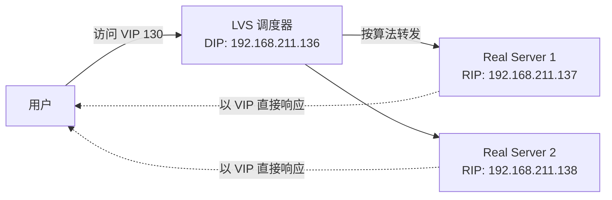

# LVS 负载均衡实战：NAT/TUN/DR 三种工作模式选型，DR 模式 VIP 与 ARP 配置，ipvsadm 搭建 LVS+Nginx 集群

上一篇把 LVS 引进架构完成了开篇：它集成在 Linux 内核里做 4 层负载，单点能扛 400 万并发。这一篇把它落到机器上——先在 NAT、TUN、DR 三种工作模式里做选型，再按推荐的 DR 模式给三台服务器配 VIP 和 ARP 内核参数，最后用 ipvsadm 把 LVS+Nginx 集群搭起来，并处理轮询调度里最容易迷惑人的会话持久化问题。

## 先给结论

- 三种工作模式一句话选型：NAT 的响应回程全压 LVS，吞吐量严重失衡，大并发不适用；TUN 性能最高，但 LVS 和所有 Real Server 都要绑外网 IP、暴露面太大，生产不推荐；DR 性能高、安全性好，是推荐模式。
- DR 模式的核心是"请求走 LVS、响应直回用户"：三台机器绑同一个 VIP 192.168.211.130——LVS 绑在 ens33:1，Real Server 绑在 lo:1（掩码 255.255.255.255），lo 是永不当机的本地回环接口。
- ARP 两个内核参数决定 DR 转发是否正常：arp_ignore=1（请求目的地址到达对应网卡才响应）、arp_announce=2（只在本网卡通告），all/default/lo 三个作用域都要配，`sysctl -p` 生效。
- ipvsadm 只装在 LVS 上：`-A -t VIP:80 -s rr` 建集群，`-a -t VIP:80 -r RIP:80 -g` 加节点（-g 即 DR 模式），`-Ln` 验证；大写字母操作集群，小写字母操作节点。
- 刷新页面"不轮询"不是集群坏了，是持久化在起作用：`-E -p 5` 把持久化窗口改成 5 秒，`ipvsadm --set 2 2 2` 把 TCP/TCPFIN/UDP 超时压到 2 秒，之后才能看到 137/138 来回切换。
- route add 与持久化这类临时配置重启就丢，要写进 `/etc/rc.local` 保住。

## 三种工作模式：NAT、TUN、DR

LVS 有三种工作模式，差异全在响应路径上。

NAT 即网络地址转换：用户请求先到 LVS，LVS 按算法转发给后端的真实服务器（Real Server，上面可以是 Tomcat 也可以是 Nginx），服务器处理完把结果原路还给 LVS，再由 LVS 返回给用户。问题就在这个回程——LVS 本来是为了解决海量并发，现在所有响应数据都从它手里过，吞吐量严重失衡，负载一重，处理并发的能力必然下降。并发量大的场景不适合 NAT。

TUN 是 IP 隧道模式：LVS 照样转发请求，但 Real Server 处理完不回 LVS，直接响应给用户。"谁处理谁响应"，这种模式的性能效率是三种里最高的。但生产环境不推荐它：LVS 和每一个 Real Server 都要暴露在外网、绑定外网 IP，用户都能直接访问到，服务器对外的暴露面增加，受攻击面也跟着增加，安全系数要求高的生产环境吃不消。

DR 直接路由模式是推荐方案：请求经过 LVS 转发给各服务节点，响应不回 LVS，由 Real Server 直接响应客户端。这样 LVS 的压力没有增加，服务节点也不用完全暴露在互联网外。用 LVS 还有个附带好处：用户永远不知道到底是哪台机器、哪个 IP 在处理他的业务，他只跟入口交互。

| 模式 | 响应路径 | 性能 | 主要问题 | 结论 |
| --- | --- | --- | --- | --- |
| NAT（网络地址转换） | Real Server → LVS → 用户 | 一般 | 回程数据全压 LVS，吞吐量失衡 | 大并发不适用 |
| TUN（IP 隧道） | Real Server → 用户 | 最高 | 所有节点绑外网 IP，受攻击面大 | 不推荐 |
| DR（直接路由） | Real Server → 用户 | 高 | 配置复杂，要动 VIP 和 ARP | 推荐 |

## DR 模式落地：VIP 与 ARP 配置

选定 DR 后准备三台机器：136 做 LVS，它的真实 IP 叫 DIP；137、138 做 Real Server，真实 IP 叫 RIP——RIP 和 DIP 本质都是内网 IP，只是作用不同才分开叫。第三个 IP 是 VIP 192.168.211.130，用户访问它；因为 Real Server 响应时统一用 VIP 发数据，所以三台机器都要绑这个 VIP。整体数据流如下：



第一步，每台机器先关闭网络配置管理器，不关的话后面配网卡很容易失败：

```bash
systemctl stop NetworkManager
systemctl disable NetworkManager
```

第二步，LVS 机器配 VIP。进入 `/etc/sysconfig/network-scripts/`，把 ifcfg-ens33 复制一份命名为 ifcfg-ens33:1，只保留静态配置需要的几项：

```bash
BOOTPROTO=static
DEVICE=ens33:1
ONBOOT=yes
IPADDR=192.168.211.130
NETMASK=255.255.255.0
```

`service network restart` 之后 `ip addr` 查看，ens33 网卡下多了 130，这就是 VIP。

第三步，两台 Real Server 配 VIP。这次绑在 lo 网卡上——本地回环地址相当于本机自带的一个接口，永远不会当机。把 ifcfg-lo 复制一份为 ifcfg-lo:1：

```bash
BOOTPROTO=static
DEVICE=lo:1
ONBOOT=yes
IPADDR=192.168.211.130
NETMASK=255.255.255.255
```

注意 IPADDR 写的还是同一个 VIP，子网掩码换成 255.255.255.255。`ifup lo` 刷新后，`ip addr` 里 lo 下也多了 130，两台 Real Server 按同样操作各配一次。

第四步，ARP 配置。地址解析协议相关有两个重要参数，直接决定 DR 模式转发是否正常。arp_ignore 控制系统收到外部 ARP 请求时是否返回响应：取 0 表示只要本机配置了 IP 就响应——Real Server 上绑着 VIP，这样会跟 LVS 抢着应答，不行；取 1 表示请求的目的地址到达对应网络接口才响应，推荐。arp_announce 控制发送 ARP 时的通告行为，简单说就是决定响应数据找谁发：0 表示本机任何网络接口都向外通告；2 表示只在本网卡进行通告，推荐。参数写进 `/etc/sysctl.conf`：

```
net.ipv4.conf.all.arp_ignore = 1
net.ipv4.conf.default.arp_ignore = 1
net.ipv4.conf.lo.arp_ignore = 1
net.ipv4.conf.all.arp_announce = 2
net.ipv4.conf.default.arp_announce = 2
net.ipv4.conf.lo.arp_announce = 2
```

all、default、lo 三个作用域一个都不能少，保存后 `sysctl -p` 刷新生效，两台 Real Server 各配一份。

第五步，在 Real Server 上加路由，把发往 VIP 的报文交给 lo:1 处理——外部报文一过来，就由这块网卡接收：

```bash
route add host 192.168.211.130 dev lo:1
```

执行后 `route -n` 能看到 130 的配置。临时配置开机就失效，把这条命令写进 `/etc/rc.local`，关机重启也不会丢。

## ipvsadm 实战：搭建 LVS+Nginx 集群

ipvsadm 是 LVS 的集群管理工具，提供集群的各种操作，注意只需要装在 LVS 机器上，别装进 Real Server：`yum install ipvsadm`。装完 `ipvsadm -Ln` 查看，输出 IP Virtual Server version 1.2.1，下面的集群表是空的——集群还没配，空是正常的；`ipvsadm -h` 能看全部命令。先把常用的过一遍：

| 命令 | 含义 |
| --- | --- |
| -A | 添加一个虚拟服务（虚拟集群） |
| -E | 编辑虚拟服务 |
| -D | 删除虚拟服务 |
| -C | 清空配置数据 |
| -R | restore，恢复配置 |
| -S | save，保存导出当前规则 |
| -a | 给集群添加一个节点 |
| -e | 编辑某个节点 |
| -t | 指定 TCP 请求地址（VIP:端口） |
| -s | 指定负载均衡算法 |
| -r | 指定 Real Server 地址 |
| -g | DR 模式（direct routing） |
| -p | 数据持久化超时时间 |

规律是大写字母操作集群本身，小写字母操作集群里的节点。创建集群：

```bash
ipvsadm -A -t 192.168.211.130:80 -s rr
```

-A 创建集群；-t 指定 TCP 请求地址，就是用户请求的 VIP；-s 指定调度算法，rr 是轮询——第一次路由给你、第二次给他，轮流分发。执行完 `ipvsadm -Ln`，表里多了一条 `TCP 192.168.211.130:80 rr`。接着把两个 Real Server 挂进去：

```bash
ipvsadm -a -t 192.168.211.130:80 -r 192.168.211.137:80 -g
ipvsadm -a -t 192.168.211.130:80 -r 192.168.211.138:80 -g
```

-a 添加节点，-r 指定真实服务的 IP 别搞错，-g 表示 DR 模式。再 `ipvsadm -Ln`，两个节点都在，转发方式显示 Route。调度算法不止 rr：wrr 加权轮询、lc 最小连接数调度、dh 目的地址哈希、sh 源地址哈希、lblc 本地最少连接等等，按需求选即可，rr 只是最好操作。

开始验证。两台 Real Server 先把 Nginx 启动起来，分别访问 137、138 都能看到欢迎页。但用户访问的应该是 VIP 而不是这两台，换成 130 访问——页面落在 138，刷新一次还是 138。这并不是集群没生效，而是之前提过的 persistent（持久化）参数在起作用：请求命中 138 后，请求数据被存储下来，下次请求先去找这条记录，找到了就继续发给 138，所以看不到轮询效果。

两步把它调开：

```bash
ipvsadm -E -t 192.168.211.130:80 -s rr -p 5     # 持久化窗口改成 5 秒
ipvsadm --set 2 2 2                              # TCP/TCPFIN/UDP 超时都压到 2 秒
```

-E 是编辑集群，-p 5 表示数据只持久化 5 秒，`ipvsadm -Ln` 里会出现 persistent 5 的标志；--set 则把 TCP、TCPFIN、UDP 三个协议的连接超时统一压缩，默认的 TCP 会话超时长达十几分钟，用户会一直粘在同一台机器上，`ipvsadm -Lnc` 里能看到连接明细和超时时间。现在再刷新页面：5 秒一过，请求从 138 切到 137，再等 5 秒又切回 138——LVS 按轮询调度把请求分发到两台 Nginx，LVS+Nginx 负载均衡集群就此跑通。后面集群真正上线还要考虑 LVS 自身的单点问题，用 keepalived 做主备，课程里留作扩展。

## 小结

- 模式选型记 DR：性能高、安全性好；NAT 回程压调度器、TUN 暴露面大，各有硬伤。
- DR 落地三件事：三台机器绑同一个 VIP（LVS 用 ens33:1，Real Server 用 lo:1 且掩码 255.255.255.255）、ARP 双参数 arp_ignore=1 与 arp_announce=2（all/default/lo 全配）、`route add host VIP dev lo:1` 并写进 rc.local 防重启丢失。
- ipvsadm 大写管集群、小写管节点：`-A -t VIP:80 -s rr` 建群，`-a -r RIP:80 -g` 加节点，`-Ln` 验证，算法 rr/wrr/lc/dh/sh/lblc 按需选。
- 轮询"不轮"先查持久化：`-E -p 5` 收窄持久化窗口，`--set 2 2 2` 压缩 TCP/TCPFIN/UDP 超时，验证时 5 秒一切换才符合预期。
- LVS 性能强悍但功能不如 Nginx 完善，LVS 管性能、Nginx 管功能的分层组合，是秒杀这类高并发架构的标准解法。
