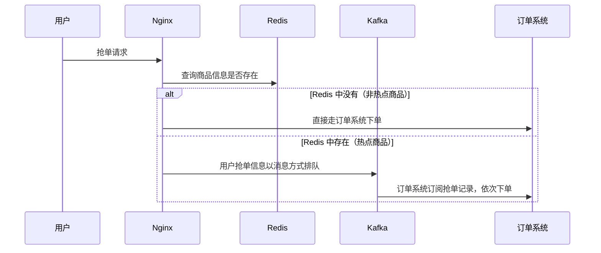

# 热点商品实时发现与隔离全链路：Druid 定时分析、Redis 集群事务坑与 JWT 登录

秒杀商品天然分两类：访问量平平的非热点商品，和被流量盯上的热点商品。两类商品的抢单路径不能一样——非热点商品直接走数据库下单，热点商品必须先隔离进缓存再异步排队，否则订单系统会被单点流量打崩。这一章把这条链路补齐：用 ElasticJob 定时分析 Apache Druid 里的访问日志，实时发现热点；先锁定数据库，再把热点商品写进 Redis 集群完成隔离，期间顺手解决 Redis 集群事务不生效的问题；抢单前用户必须登录，身份信息封装进 JWT 令牌，登录接口负责发令牌。

## 先给结论

- 热点判定靠"时间窗口 + 阈值"：统计最近 N 小时内访问量超过阈值的商品，不能拿累计历史访问量做标准，否则老爆款永远霸榜，新热点发现不了。
- 热点发现链路：访问日志实时收集进 Druid 后，监控程序用 ElasticJob 每 5 秒通过 JDBC（Avatica）查一次 Druid，查出的 uri 就是商品 ID。
- 每次查询必须排除 Redis 中已有的热点商品（SQL 追加 `AND uri NOT IN (...)`），否则同一批商品会被反复统计、反复隔离。
- 隔离 = 先锁库再进缓存：先把 SKU 表的 islock 置为 2（锁定后不再允许抢购），影响行数大于 0 才把库存数量和商品信息写入 Redis。
- Redis 集群不支持事务，多次写跨节点无法回滚；解法是"多次操作合并成一次操作、多条数据合并成一条数据"，用 putAll 一次写入。
- 用户登录用 JWT 令牌：普通用户和管理员各用一套密钥，HS256 签名；身份识别后续放到 Nginx 端用 Lua 解析，比回源后台快很多倍。

## 热点隔离全链路：从日志到抢单分流

前一阶段的日志实时收集已经完成，用户访问商品详情页的日志源源不断写进 Apache Druid。要做隔离，得先有"热点数据分析"环节：

- 用 ElasticJob 做定时任务，每秒（演示中为每 5 秒）到 Druid 查询一次统计结果；
- 查询条件是近期一段时间的访问频率，比如最近 1 小时访问量超过 1000 的商品才算热点；
- 查到热点商品后写进 Redis 缓存，完成隔离。

隔离之后，抢单请求的分流逻辑如下：



判断依据就在 Redis：热点商品隔离后会在 Redis 中有对应的商品信息，非热点商品则没有。热点商品抢购人数一定非常多，不能把请求全部压给订单系统，只发一条消息进 Kafka 排队，订单系统订阅抢单记录后按自己的节奏下单。

落地拆成三步：a. 编写定时任务，定时查询 Druid；b. 配置 Redis 集群，热点商品存入 Redis 实现隔离；c. 每次定时查询时，排除之前已经成为热点的商品。

## 定时发现热点：ElasticJob 每 5 秒查一次 Druid

监控模块（seckill-monitor）先补三类配置：Redis 集群连接、ElasticJob 的 ZooKeeper 地址与任务命名空间、Druid 的 JDBC 地址。Druid 地址不要写裸 IP，在 hosts 里把 `192.168.211.137` 映射成 `druid-server`，配置里用代号：

```text
druidurl: jdbc:avatica:remote:url=http://192.168.211.137:8082/druid/v2/sql/avatica
# hosts: 192.168.211.137 druid-server
```

先定热点标准：某一件商品访问量大于 N，且只统计最近 N 小时。按这个标准在 Druid 控制台验证 SQL：

```sql
SELECT COUNT(*) AS "viewCount", uri FROM logitems
WHERE _time > CURRENT_TIMESTAMP - INTERVAL '1' HOUR
GROUP BY uri
HAVING viewCount > 2
```

阈值写 2 是为了演示方便，真实场景换成 1000 这类业务值即可；uri 要一起查出来，它直接对应商品 ID。

程序侧用 JDBC 查询，地址注入进来，连接交给数据源管理：

```java
@Value("${druidurl}")
private String druidurl;

@Autowired
private DataSource dataSource;

public List<String> loadData() throws Exception {
    Connection connection = dataSource.getConnection();
    Statement statement = connection.createStatement();
    ResultSet resultSet = statement.executeQuery(druidSQL());
    List<String> ids = new ArrayList<>();
    while (resultSet.next()) {
        String uri = resultSet.getString("uri")
                .replace("/web/items/", "")
                .replace(".html", "");
        ids.add(uri);
    }
    return ids;
}
```

Druid 里存的是 `/web/items/商品ID.html` 这样的 uri，去掉前后缀拿到的就是商品 ID。

再解决"重复隔离"问题：这次查出的热点会存进 Redis（key 形如 `SKU_商品ID`），下次查询要把它们排除。做法是先用 `redisTemplate.keys("SKU_*")` 取出所有已隔离商品，把 key 截掉 4 位前缀，再按 Druid 的 uri 格式拼回 `NOT IN` 列表，前后缀 + 中间段组装成完整 SQL：

```java
public String druidSQL() {
    // prefix: SELECT ... GROUP BY uri HAVING viewCount > 2
    Set<String> keys = redisTemplate.keys("SKU_*");
    if (keys != null && keys.size() > 0) {
        StringBuilder in = new StringBuilder(" AND uri NOT IN (");
        keys.forEach(key -> in.append("'/web/items/")
                .append(key.substring(4)).append(".html',"));
        String middle = in.substring(0, in.length() - 1) + ")"; // 去掉尾部逗号
        return prefix + middle + suffix;
    }
    return prefix + suffix;
}
```

定时任务本身很薄：

```java
@ElasticSimpleJob(
    cron = "0/5 * * * * ?",
    jobName = "monitorTask",   // 与配置的命名空间保持一致
    shardingTotalCount = 1
)
public class MonitorTask implements SimpleJob {
    @Autowired
    private MonitorItemsAccess monitorItemsAccess;

    @Override
    public void execute(ShardingContext shardingContext) {
        monitorItemsAccess.loadData();
    }
}
```

启动类要排除数据源自动装配，Redis 配置类没有被自动扫描时，手动用 `@Bean` 引入 `RedisConfig`：

```java
@SpringBootApplication(exclude = DataSourceAutoConfiguration.class)
public class MonitorApplication {
    public static void main(String[] args) {
        SpringApplication.run(MonitorApplication.class, args);
    }
}
```

验证方式很直接：启动监控服务，刷新商品详情页凑访问量。刷新一次、两次都不是热点，第三次刷新（超过阈值 2）后，Druid 里马上出现这条 uri，Redis 里也立刻多出该商品的 key——热点数据实时发现就通了。

## 隔离落地：先锁库再进缓存，外加集群事务的坑

热点商品发现后，监控程序调商品微服务执行隔离。隔离有两个动作，顺序不能乱：

1. **数据库锁定商品**。SKU 表有锁定字段 islock，1 是未锁定、2 是锁定。隔离期间如果还允许用户抢购，库存数量会被改得不清不楚，所以必须先锁定；
2. **锁定成功才写 Redis**。锁定条件必须带上 islock=1——已被锁定的商品不重复处理；影响行数大于 0 说明本次锁定生效，才继续往缓存写。

```java
public void isolation(String id) {
    // 1. 数据库锁定：只有未锁定的商品才锁
    Sku sku = new Sku();
    sku.setIslock(2);
    Example example = new Example(Sku.class);
    example.createCriteria()
            .andEqualTo("islock", 1)
            .andEqualTo("id", id);
    int count = skuMapper.updateByExampleSelective(sku, example);

    // 2. 锁定成功，把商品存入 Redis 缓存进行隔离
    if (count > 0) {
        String key = "SKU_" + id;
        Sku currentSku = skuMapper.selectByPrimaryKey(id);
        // 存库存数量
        redisTemplate.boundHashOps(key).increment("num", currentSku.getSeckillNum());
        // 存商品信息
        Map<String, Object> info = new HashMap<>();
        info.put("id", id);
        info.put("price", currentSku.getSeckillPrice());
        info.put("name", currentSku.getName());
        redisTemplate.boundHashOps(key).put("info", info);
    }
}
```

商品信息里价格一定要存：价格可能变更，Redis 里的价格要跟着变；名称可存可不存。

但这段代码在 Redis 集群里有个隐患：**Redis 集群不支持事务**（单机 Redis 支持）。increment 存数量、put 存信息是两次保存，数据落在不同节点上，第一步成功、第二步失败时，已写入的数据无法回滚。

解法遵循两条原则：多次操作合并成一次操作；多条数据合并成一条数据。

```java
Map<String, Object> dataMap = new HashMap<>();
dataMap.put("num", currentSku.getSeckillNum()); // 库存数量
dataMap.put("info", info);                      // 商品信息
redisTemplate.boundHashOps(key).putAll(dataMap); // 一次写入
```

合并后一个 key 只有一条数据，必然落在一个节点上，不存在跨节点回滚的问题。下一次操作落到集群里的另一台 Redis，同样按这两条原则合并即可。目前没有比这更好的办法。

监控端通过 Feign 调商品微服务：控制层提供 `@PostMapping("/hot/isolation")` 接口，用 `@RequestParam` 接收 `List<String> ids`，循环调用 isolation 完成隔离并返回"热点数据隔离成功"；监控模块定义 SkuFeign 接口，启动类加 `@EnableFeignClients(basePackages = "com.seckill.goods.feign")`，定时任务里拿到 ids 后调用 `hotIsolation(ids)`。

全链路测试：先启动商品服务再启动监控服务。拿一个未锁定的商品模拟一个静态页，刷新一次、两次都不会被收集；第三次刷新，Druid 马上统计到访问量，监控程序立刻查出热点、调 Feign 隔离，数据库 islock 变为 2，Redis 里同时出现数量和商品信息——实时收集、实时分析、实时隔离整条链路跑通。

## 抢单前的登录：JWT 令牌生成与解析

用户抢单必须先登录。登录之后身份信息封装进 JWT 令牌，抢单时携带过去，解析成功即放行。这类身份识别以往放在网关后台做，这里直接放到 Nginx 端用 Lua 脚本解析（下一篇展开），速度比后台识别快很多倍。

seckill-common 里提供了 JwtTokenUtil 工具类，两个要点：

- 顶部两个密钥常量：`SECRETUSER` 给普通用户、`SECRETADMIN` 给管理员，唯一区别就是密钥不同；
- `parseToken` 兼容 `Bearer` 前缀，解析成功返回令牌明文信息（Claims）。

```java
public static String generateToken(String uid, Map<String, Object> payload,
                                   long ttlMillis, String secret) throws Exception {
    SignatureAlgorithm signatureAlgorithm = SignatureAlgorithm.HS256;
    long nowMillis = System.currentTimeMillis();
    Date now = new Date(nowMillis);
    Key signingKey = new SecretKeySpec(secret.getBytes(), signatureAlgorithm.getJcaName());
    Map<String, Object> header = new HashMap<>();
    header.put("typ", "JWT");
    header.put("alg", "HS256");
    JwtBuilder builder = Jwts.builder().setId(uid)
            .setIssuedAt(now)
            .setSubject(uid)
            .setHeader(header)
            .signWith(signatureAlgorithm, signingKey);
    builder.addClaims(payload);
    return builder.compact();
}

public static Map<String, Object> parseToken(String token) {
    if (token.startsWith("Bearer")) {
        token = token.substring(6).trim();
    }
    // 用对应密钥解析，返回 Claims 明文
    Claims claims = Jwts.parser()
            .setSigningKey(signingKey)
            .parseClaimsJws(token)
            .getBody();
    return claims;
}
```

测试时注意一个坑：生成管理员令牌后，解析必须换管理员密钥，拿普通用户密钥去解析管理员令牌必然失败，测完要换回来。

登录接口在用户微服务里，tb_user 表的密码是 MD5 加密存储，匹配时也要加密比对：

```java
@GetMapping(value = "/login")
public Result login(String username, String password) throws Exception {
    User user = userService.findById(username);
    if (user == null) {
        return new Result(false, StatusCode.ERROR, "账号不存在！");
    }
    if (!user.getPassword().equals(DigestUtils.md5DigestAsHex(password.getBytes()))) {
        return new Result(false, StatusCode.ERROR, "密码错误！");
    }
    String uid = UUID.randomUUID().toString();
    Map<String, Object> payload = new HashMap<>();
    payload.put("username", user.getUsername());
    payload.put("phone", user.getPhone());
    payload.put("name", user.getName());
    String token = JwtTokenUtil.generateTokenUser(uid, payload, 3600 * 1000);
    return new Result(true, StatusCode.OK, "登录成功！", token);
}
```

调试时踩过一个小坑：密码明明正确却总提示"密码错误"，断点发现判断条件少了取反——`equals` 为 true 表示密码匹配，外层要加 `!` 才是"密码不正确"分支。修正后访问 `http://localhost:18083/user/login?username=itheima&password=itheima`，返回的标准 JWT 令牌是三段式结构，中间两个点分隔，令牌生成与解析全部打通。

## 小结

- 热点发现是"定时统计 + 时间窗口 + 阈值 + 排除已隔离"的循环：ElasticJob 每 5 秒查一次 Druid，查到的 uri 去掉前后缀就是商品 ID，Redis 里已有的热点用 NOT IN 条件挡在外面。
- 隔离动作必须先锁库再写缓存，islock=1 才允许锁定，影响行数大于 0 才进 Redis，保证隔离期间库存不被继续抢购污染。
- Redis 集群不支持事务，把多次写合并成一次 putAll、多条数据合并成一条数据，是集群环境下保住数据一致性的务实解法。
- 登录接口校验账号和 MD5 密码后签发 JWT 令牌，普通用户与管理员双密钥隔离；下一章在 OpenResty/Nginx 层用 Lua 解析令牌，并实现非热点与热点两套抢单链路。
