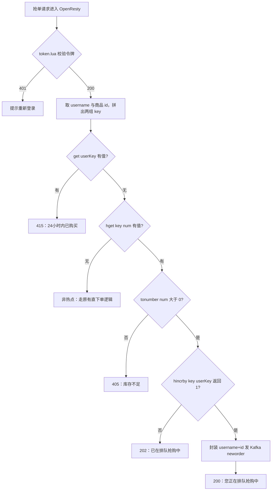

# 热点商品抢单闭环：Redis 集群工具验证、Kafka 封装、Lua 抢单脚本与队列下单

上一章备齐了三样零件：token.lua 令牌校验、非热点直下单，以及操作 Redis 集群的 Lua 工具。这一章把零件组装成完整闭环——先在 Nginx 里验证集群工具真能跑，再把 Kafka 生产者封装成公共模块；然后写出热点与非热点合流的抢单控制脚本，令牌、限购、热点、库存、排队去重一条链判完；排队消息进 Kafka 的 neworder 队列，由订单服务异步消费完成下单、扣库存、清标识。抢购请求从 Nginx 到订单落库，判断全部前移，不再穿透到后台。

## 先给结论

- 工具先验证再上场：给 Nginx 加 /test/redis 测试入口，调工具的 hget 取商品库存字段并以 JSON 输出；首跑 500 的根因是 Lua 里命令调用用了点号，统一换成冒号后通过。
- Kafka 生产者抽成公共模块 kafka.lua：只留 broker 列表和 producer 对象，对外一个 send(队列名, 消息)，队列名不写死，消息由调用方转好 JSON 再传。
- 抢单控制脚本是一条判断链：令牌 200 → 24 小时未购买 → 能从 Redis 取到商品信息即热点 → 库存大于 0 → hincrby 返回 1 才入队发 Kafka，每一步失败都有明确响应。
- 排队去重靠 hash 字段自增：以 USER_用户名_商品ID 为字段对 SKU_商品ID 做 hincrby，返回 1 是首次排队，大于 1 说明已在排队，点多少次只入队一次。
- 下单在订单服务异步完成：@KafkaListener 监听 neworder，解析出 username 和 id，查 Redis 库存、Feign 查商品、订单落库，然后 num 减一、清排队标识、写 24 小时购买标记。
- 两处收尾：totalNum 固定为 1（每单限购一件）；库存减到 0 时通过 Feign 的 zero 方法把数据库库存同步为 0。

## 先让 Redis 集群工具跑起来：给 Nginx 加个测试入口

工具封装好了不代表能用，Redis 集群和单机行为差异不小，先做一次真实验证。在 nginx.conf 里加一个专门的测试 location，请求进来直接执行一段测试 Lua：

```nginx
location /test/redis {
    content_by_lua_file /usr/local/openresty/nginx/lua/redis-cluster.lua;
}
```

测试脚本里做三件事：设置响应类型、引入依赖、调用工具方法。这里只验证 hget 一个命令，能拿到数据就说明工具在集群环境下可用：

```lua
-- 响应类型设为 JSON
ngx.header.content_type = "application/json;charset=utf8"

-- 引入上一章封装的集群工具与 cjson
local lredis = require "rediscluster"
local cjson = require "cjson"

-- 验证 hget：第一个参数是最外层商品 key，第二个是字段名
local result = lredis.hget(key, "num")
ngx.say(cjson.encode(result))
```

重载配置后访问 http://192.168.211.137/test/redis，第一次直接 500。排查看错误日志：

```bash
cat /usr/local/openresty/nginx/logs/error.log
```

日志指向工具里的命令调用"对象无效"。根因很典型：执行 Redis 命令时写成了点号调用。Lua 里点号只是取出对象上的字段再调用，不会把对象自身作为 self 传入；Redis 命令都绑定在连接对象上，必须用冒号：

```lua
red_c.hmset(key1, key2, value)   -- 错误：点号调用，运行时报对象无效
red_c:hmset(key1, key2, value)   -- 正确：冒号调用，自动传入 self
```

把工具里所有命令调用统一换成冒号，nginx -s reload 后再请求，接口返回了 Redis 里存的库存数据，工具验证通过。

## 把 Kafka 生产者封装成 kafka.lua 公共模块

热点商品排队要向 Kafka 发消息，而之前做日志收集时已经在 Lua 里写过一遍 Kafka 生产者配置。抢单脚本再复制一份显然不合理，把那段代码抽成公共模块 kafka.lua——cjson、无关配置全部删掉，只保留真正干活的两段：broker 地址列表和 producer 对象。

```lua
local producer = require "resty.kafka.producer"

-- Kafka 地址，沿用日志收集时的配置
local broker_list = {
    { host = "192.168.211.137", port = 9092 }
}

-- 异步生产者：攒一批再发，适合高频场景
local bp = producer:new(broker_list, { producer_type = "async" })

local _M = {}

-- 发送队列消息：qname 队列名不写死，message 由调用方转好 JSON 再传
function _M.send(qname, message)
    return bp:send(qname, nil, message)
end

return _M
```

两个设计点：队列名作为参数传入，一个模块可以服务任意 topic；消息体由调用方自己 cjson.encode，工具只负责投递。之后所有需要发消息的 Lua 脚本，require 之后一个 send 方法搞定。

## 抢单控制脚本：热点与非热点同链分流

抢单入口挂在 Nginx 上，脚本把热点和非热点两条路合到一起判断，整条链如下：



落到代码上分四步。第一步令牌校验（上一章已实现，返回 200 即已登录），从校验结果里取用户名，并拼出后面反复使用的两组 key：

```lua
-- 校验结果结构：body.payload.username
local username = result["body"]["payload"]["username"]
local id = ngx.req.get_uri_args()["id"]

local userKey = "USER_" .. username .. "_" .. id  -- 用户维度：抢购/排队标识
local key = "SKU_" .. id                          -- 商品维度：热点商品在 Redis 的 hash
```

第二步判断 24 小时内是否购买过。工具的 get 返回集合，空有两种形态，nil 和 ngx.null 都要判：

```lua
local hasbuy = lredis.get(userKey)
if hasbuy == nil or hasbuy[1] == nil or hasbuy[1] == ngx.null then
    -- 没买过，继续往下
else
    response["code"] = 415
    response["message"] = "您24小时内购买过该商品，请稍后再来"
    ngx.say(cjson.encode(response))
    return
end
```

第三步热点判断加库存校验。只有被隔离的热点商品才会写进 Redis，所以能 hget 到商品信息就是热点；取不到就走上一章实现的非热点直下单逻辑（拷过来并 return）。有值时要先 tonumber 转成数字再和 0 比较：

```lua
local num = lredis.hget(key, "num")
if num == nil or num[1] == ngx.null then
    -- 非热点：直接下单，沿用原有实现
else
    local count = tonumber(num[1])
    if count > 0 then
        -- 热点商品：进入排队流程
    else
        response["code"] = 405
        response["message"] = "库存不足"
        ngx.say(cjson.encode(response))
        return
    end
end
```

第四步排队去重。用户很可能连点多次，不能重复排队：以 userKey 为字段对商品 hash 做自增，返回 1 才是第一次排队，入队并响应；非 1 说明已经在队列里，直接提示：

```lua
local inc = lredis.hincrby(key, userKey, 1)
if inc == 1 then
    -- 首次排队：抢单消息发进 Kafka
    local userorder = {}
    userorder["username"] = username
    userorder["id"] = id
    kafka.send("neworder", cjson.encode(userorder))
    response["code"] = 200
    response["message"] = "您正在排队抢购中"
else
    -- 已在排队，不再重复入队
    response["code"] = 202
    response["message"] = "正在排队抢购中"
end
ngx.say(cjson.encode(response))
```

整条链对外的响应汇总成一张表：

| 场景 | code | 提示 |
| --- | --- | --- |
| 未登录/令牌无效 | 401 | 请重新登录（token.lua 完成） |
| 24 小时内已购买 | 415 | 您24小时内购买过该商品，请稍后再来 |
| 热点商品库存不足 | 405 | 库存不足 |
| 首次排队成功 | 200 | 您正在排队抢购中 |
| 重复点击已在排队 | 202 | 正在排队抢购中 |
| 非热点商品 | — | 不排队，直接走原有下单逻辑 |

测一遍：清掉已有订单、重载 Nginx 后先抢非热点商品，第一次直接下单成功，订单表多出一条记录；紧接着抢同一个商品，返回 415——说明非热点直下单成功后同样写了 24 小时购买标记。换成热点商品，第一次返回"正在排队"，继续点响应不变，排队没有被重复触发。

## 队列下单：订单服务消费 neworder 收尾

排队只是把请求挡在 Nginx 层，真正的下单动作在订单服务里异步完成。新建 KafkaOrderListener 监听 neworder 队列：

```java
@Component
public class KafkaOrderListener {

    @Autowired
    private OrderService orderService;

    @KafkaListener(topics = "neworder")
    public void getMessage(String message) {
        // 抢单消息只有 username、id 两个字段
        Map<String, String> orderMap = JSON.parseObject(message, Map.class);
        orderService.hotAdd(orderMap);
    }
}
```

hotAdd 承担消费后的全部动作，方法返回值改成 void——队列下单不需要回传结果，接口签名同步调整：

```java
@Override
public void hotAdd(Map<String, String> orderMap) {
    String username = orderMap.get("username");
    String id = orderMap.get("id");

    // 与 Lua 端拼法完全一致的两把钥匙
    String key = "SKU_" + id;
    String userKey = "USER_" + username + "_" + id;

    // 1. 商品信息还在 Redis 中才继续处理
    if (redisTemplate.hasKey(key)) {
        Integer num = Integer.parseInt(
                redisTemplate.boundHashOps(key).get("num").toString());
        if (num <= 0) {
            return;
        }

        // 2. Feign 查商品，创建订单落库
        Result<Sku> skuResult = skuFeign.findById(id);
        Sku sku = skuResult.getData();
        Order order = new Order();
        order.setId("No" + idWorker.nextId());
        order.setTotalNum(1);                    // 每单限购一件
        order.setCreateTime(new Date());
        order.setUpdateTime(order.getCreateTime());
        order.setOrderStatus("0");
        order.setPayStatus("0");
        order.setConsignStatus("0");
        order.setSkuId(id);
        order.setSkuName(sku.getName());
        order.setPrice(sku.getSeckillPrice() * order.getTotalNum());
        orderMapper.insertSelective(order);

        // 3. 库存递减，同时把排队标识字段清回 0
        num--;
        Map<String, Object> allMap = new HashMap<>();
        allMap.put("num", num);
        allMap.put(userKey, 0);
        redisTemplate.boundHashOps(key).putAll(allMap);

        // 4. 记录购买标记，作为 24 小时限购依据
        redisTemplate.boundValueOps(userKey).set("");

        // 5. 库存归零，同步数据库
        if (num == 0) {
            skuFeign.zero(id);
        }
    }
}
```

几个细节值得留意：订单价格取 Feign 现查的 SKU 秒杀价乘件数，排队消息里不带商品数据，避免消息膨胀和数据不一致；排队标识和库存同属 SKU_商品ID 这个 hash，一次 putAll 同时完成扣库存和清排队；购买标记写在独立的 userKey 字符串键上，Lua 端的限购判断读的正是它。

联调把相关微服务一起启动，挑一个之前排过队的商品清掉排队标识，从抢单入口（192.168.211.137:8081）发起请求，逐项核对：

- 接口返回"正在排队抢购中"，随后订单表新增一条记录；
- Redis 里 num 从 1000 减到 999；
- 商品 hash 里的排队标识被清回 0；
- 出现该用户的 24 小时购买标识。

四项全对上，热点商品从抢到单的闭环才算真正走通。

## 小结

- 闭环分两层：Nginx+Lua 层负责全部判断与排队（令牌、限购、热点、库存、去重），订单服务只做 neworder 消费后的纯下单动作，判断与执行彻底解耦。
- 两个公共模块先验证再复用：集群工具在 /test/redis 跑通 hget（点号换冒号的坑记牢），kafka.lua 只暴露一个 send，队列名和消息全部参数化。
- 判断链每一环都有明确失败响应：401/415/405/202，成功出口只有两个——非热点直下单、热点排队返回"正在排队抢购中"。
- hincrby 的返回值是去重开关：等于 1 才入队发 Kafka，大于 1 一律拒绝，重复点击无副作用。
- 消费侧五步：校验 Redis、创建订单、num 减一并清排队标识、写 24 小时购买标记、库存归零同步数据库。
