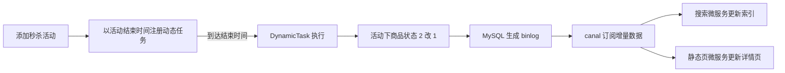

# 分布式任务调度选型与 ElasticJob 实战：静态/动态任务、Date 转 cron、监听器与秒杀活动联动更新

微服务里很多逻辑要定时处理，每次手工执行既麻烦又容易出错；分布式环境下传统单机定时任务也解决不了多节点协同——A 节点执行任务时，B 节点不能再执行同一个任务。这一章先横向对比市面主流调度器，再落到本项目的选择 Elastic-Job：从静态任务入门，到程序运行时动态添加任务，再到 Date 转 cron、任务监听器两个实战增强；最后回到秒杀业务，用动态任务补上"活动结束后索引和静态页不更新"的缺口，并分析日志收集如何定位热门商品。

## 先给结论

- 选型看协同方式：Quartz 多节点靠竞争数据库锁保证只有一个节点执行，无任务分片、无管理界面；Elastic-Job 依托 ZooKeeper 注册与发现，支持动态加节点、水平扩容，高级功能最全；XXL-Job 支持集群部署，GLUE 支持在线改代码免发布。
- 对定时任务灵活度和作业能力要求高，选 Elastic-Job：弹性扩容、多种作业模式、失效转移、运行状态收集、多线程处理数据、幂等性、容错处理、Spring 命名空间支持。
- 静态任务三步走：elastic-job-lite-spring-boot-starter 依赖 → bootstrap.yml 配 ZooKeeper 地址与命名空间 → 实现 SimpleJob 接口，@ElasticSimpleJob 声明 jobName、cron、分片数。
- 动态任务把写死的参数程序化：ZookeeperConfiguration + ZookeeperRegistryCenter（先 init）注册，JobCoreConfiguration/LiteJobConfiguration 构建作业，overwrite(true) 允许同名覆盖，SpringJobScheduler.init() 启动。
- Date 转 cron 解决"延迟 N 毫秒后只执行一次"：按 ss mm HH dd MM ? yyyy 的位序格式化目标时间，年份参与格式化，任务只在该时刻触发一次。
- 秒杀联动：把活动结束时间注册成动态任务，到点把活动下商品状态 2 改 1 触发 binlog，canal 订阅后联动更新索引和静态页；日志收集走 Nginx→Kafka→Druid，按访问频率圈出热门商品。

## 主流调度器怎么选：一张对比表看清差异

现在系统大多是分布式或微服务架构，定时任务需要多节点协同执行：一个任务在某个节点跑起来，其他节点就不能重复执行，传统定时任务做不到。目前主流的分布式任务调度器有 Elastic-Job、XXL-Job、Quartz（另有 Antares、OpenCron 等个人项目），重点对比前三个，核心差异如下：

| 维度 | Quartz | Elastic-Job | XXL-Job |
| --- | --- | --- | --- |
| 依赖 | MySQL | JDK1.7+、ZooKeeper 3.4.6+、Maven3.0.4+ | MySQL、JDK1.7+、Maven3.0+ |
| 高可用 | 多节点部署，靠竞争数据库锁保证只有一个节点执行任务 | 依托 ZooKeeper 注册与发现，可动态添加服务器，支持水平扩容 | 支持集群部署 |
| 任务分片 | 无 | 支持 | 支持 |
| 文档完善度 | 完善 | 完善 | 完善 |
| 管理界面 | 无 | 有 | 有 |
| 难易程度 | 简单 | 简单 | 简单 |
| 高级功能 | 无 | 弹性扩容、多种作业模式、失效转移、运行状态收集、多线程处理数据、幂等性、容错处理、Spring 命名空间支持 | 弹性扩容、分片广播、故障转移、Rolling 实时日志、GLUE（在线编辑代码免发布）、任务进度监控、任务依赖、数据加密、邮件报警、运行报表、国际化 |
| 出品方 | OpenSymphony | 当当网 | 个人 |
| 使用企业 | 对分布式调度要求不高的大众化产品大面积使用 | 当当网、国美、联想、唯品会、36氪、平安等 | 大众点评、优信、平安、拍拍贷等 |

依赖一项各家都有——Quartz 和 XXL-Job 依赖数据库，Elastic-Job 依赖 ZooKeeper——说不上谁好谁坏。Quartz 的约束在于集群协同只能靠数据库锁，且没有任务分片和管理界面；Elastic-Job 和 XXL-Job 市场占比更高，两者文档都完善、都简单易用。结论：对定时任务灵活度要求很高就选 Elastic-Job，XXL-Job 同样优秀，大型公司两者都用得多。

## ElasticJob-Lite 上手：静态任务三步，动态任务一段配置

Elastic-Job 是一个分布式调度解决方案，由两个相互独立的子项目组成：Lite 定位轻量级、无中心化，以 jar 包形式提供分布式任务的协调服务；Cloud 额外提供资源治理、应用分发、进程隔离等功能，比 Lite 丰富。常用场景 Lite 完全够用，项目里采用 Lite。

### 静态任务：执行时间写死的简单场景

静态任务把时间定死，比如每天早上六点执行某个动作，功能单一但入门必会。以商品微服务 seckill-goods 为例，三步实现。

第一步，引入依赖：

```xml
<dependency>
    <groupId>com.github.kuhn-he</groupId>
    <artifactId>elastic-job-lite-spring-boot-starter</artifactId>
    <version>2.1.5</version>
</dependency>
```

第二步，在 bootstrap.yml 里配置 ZooKeeper 节点地址和任务命名空间——Elastic-Job 用 ZooKeeper 做注册中心和任务发现：

```yaml
elasticjob:
  zookeeper:
    server-lists: zk-server:3181
    namespace: updatetask
```

第三步，实现自定义任务：实现 SimpleJob 接口，加 @Component 交给容器管理，再用 @ElasticSimpleJob 声明任务属性。jobName 要与配置里的命名空间保持一致；cron 从第 1 秒开始每 5 秒执行一次，字段依次是秒、分、时、日、月、周、年；分片数设为 1 表示不开多线程，单程序执行：

```java
@Component
@ElasticSimpleJob(
    jobName = "updatetask",       // 与命名空间保持一致
    cron = "1/5 * * * * ?",       // 第 1 秒起，每 5 秒执行一次
    shardingTotalCount = 1        // 分片总数 1：单线程执行
)
public class StaticJob implements SimpleJob {
    @Override
    public void execute(ShardingContext shardingContext) {
        SimpleDateFormat sdf = new SimpleDateFormat("mm:ss");
        System.out.println("时间：" + sdf.format(new Date()));
    }
}
```

启动服务观察控制台：31、36、41……整 5 秒一条，静态任务生效。

### 动态任务：程序运行时添加定时任务

动态任务指程序运行时动态添加定时任务，应用场景非常广泛。参考官方案例的步骤可以精简成四件事：配置 ZooKeeper 地址与动态任务命名空间（必配但不一定用得上）、注册初始化数据、动态添加任务、任务处理实现 SimpleJob；监听器属于可选扩展，最后再加。核心是一个配置类，把静态任务里写死的参数全部改成方法入参：

```java
@Configuration
public class ElasticJobDynamicConfig {

    @Value("${zkserver}")
    private String zkserver;         // ZooKeeper 地址，与静态任务共用同一个
    @Value("${zknamespace}")
    private String zknamespace;      // 动态任务命名空间

    @Bean
    public ZookeeperConfiguration zkConfig() {
        return new ZookeeperConfiguration(zkserver, zknamespace);
    }

    @Bean(initMethod = "init")
    public ZookeeperRegistryCenter registryCenter(ZookeeperConfiguration zkConfig) {
        return new ZookeeperRegistryCenter(zkConfig);
    }

    @Autowired
    private ZookeeperRegistryCenter registryCenter;

    public void addDynamicTask(String jobName, String cron,
                               int shardingTotalCount, String id, SimpleJob instance) {
        // 构建 Lite 作业配置：核心参数 + 任务类全名
        LiteJobConfiguration liteJobConfiguration = LiteJobConfiguration.newBuilder(
                new SimpleJobConfiguration(
                        JobCoreConfiguration.newBuilder(jobName, cron, shardingTotalCount)
                                .jobParameter(id)        // 额外参数，任务里可取回
                                .build(),
                        instance.getClass().getName()))
                .overwrite(true)          // 同名任务：后添加的覆盖先添加的
                .build();

        // 交给 Spring 任务调度器：任务实例 + 注册中心 + 作业配置 + 监听器（可变参数，可不传）
        new SpringJobScheduler(instance, registryCenter, liteJobConfiguration).init();
    }
}
```

两个容易忽略的点：ZookeeperRegistryCenter 必须在注册之前先调用 init 初始化，用 @Bean(initMethod = "init") 让容器代劳；overwrite(true) 决定同名任务的覆盖语义——比如添加一个 15 秒后执行的 A 任务，还没到点又添加了一个同名 A 任务，旧配置会被覆盖。

任务处理过程与静态任务写法一致，实现 SimpleJob；额外参数通过 jobParameter 传入、getJobParameter 取回：

```java
public class DynamicTask implements SimpleJob {
    @Override
    public void execute(ShardingContext shardingContext) {
        String id = shardingContext.getJobParameter();   // 添加任务时传入的额外参数
        String jobName = shardingContext.getJobName();
        System.out.println("任务名：" + jobName + "，参数：" + id);
    }
}
```

再写个控制器暴露触发入口：

```java
@RestController
@RequestMapping(value = "/task")
@CrossOrigin
public class TaskController {

    @Autowired
    private ElasticJobDynamicConfig elasticJobDynamicConfig;

    @GetMapping
    public Result task(String jobName, Integer time, String id) {
        // 从第 1 秒起，每 time 秒执行一次
        String cron = "1/" + time + " * * * * ?";
        elasticJobDynamicConfig.addDynamicTask(jobName, cron, 1, id, new DynamicTask());
        return new Result(true, StatusCode.OK, "执行成功！");
    }
}
```

测试：请求 localhost:18081/task?jobName=abc&time=10&id=1，10 秒后开始每 10 秒输出一次；再用同名 abc 传 time=2，输出立刻变成每 2 秒一次——overwrite 覆盖生效。再开一个 jobName=b 的任务两秒一次、ID 传 2，与 A 任务（五秒一次、ID 传 1）并行执行互不影响，多个动态任务可以同时存在。

### Date 转 cron：让任务在"当前时间 + 延迟"只执行一次

上面的 cron 还是拼接字符串，更常见的需求是：传入一个延迟时间，让任务在当前时间往后延迟一段时间执行一次。做法是把目标时间按 cron 的位序格式化成表达式，格式为 ss mm HH dd MM ? yyyy——秒、分、时、日、月、周（? 表示不指定周几）、年：

```java
private static final String CRON = "ss mm HH dd MM ? yyyy"; // 秒 分 时 日 月 周(?) 年

public static String date2cron(Date date) {
    SimpleDateFormat sdf = new SimpleDateFormat(CRON);
    return sdf.format(date);
}
```

控制器里把"当前时间 + time 毫秒"转换后传入，注意单位是毫秒：

```java
String cron = ElasticJobDynamicConfig.date2cron(
        new Date(System.currentTimeMillis() + time));
elasticJobDynamicConfig.addDynamicTask(jobName, cron, 1, id, new DynamicTask());
```

表达式里带了年份，任务只在目标时刻执行一次：传 2000 就是两秒后执行一次即停，传 5000 就是五秒后。之前"每 N 秒循环"的拼串方式换成了精确的一次性触发，两种姿势覆盖两类场景。

### 监听器：任务执行前后的通知

监听器在任务执行前、执行后做监听，机制类似 AOP。写一个类继承 AbstractDistributeOnceElasticJobListener，实现执行前、执行后两个通知方法；构造器带两个超时时间参数：

```java
public class DynamicTaskListener extends AbstractDistributeOnceElasticJobListener {

    public DynamicTaskListener(long startedTimeoutMilliseconds,
                               long completedTimeoutMilliseconds) {
        super(startedTimeoutMilliseconds, completedTimeoutMilliseconds);
    }

    @Override
    public void doBeforeJobExecutedAtLastStarted(ShardingContexts shardingContexts) {
        System.out.println("before：任务执行前");
    }

    @Override
    public void doAfterJobExecutedAtLastCompleted(ShardingContexts shardingContexts) {
        System.out.println("after：任务执行后");
    }
}
```

在配置类里注册成 Bean，哪里要用哪里注入；SpringJobScheduler 的第四个参数是可变参数，把监听器实例传进去即生效：

```java
new SpringJobScheduler(instance, registryCenter, liteJobConfiguration, dynamicTaskListener).init();
```

请求一次任务接口，控制台先输出 before，再执行任务逻辑，最后输出 after，前后通知链完整。

## 回到秒杀：活动结束联动更新，日志收集定位热门商品

### 活动结束后，索引和静态页为什么不会自己变

索引和静态页的动态更新此前已经实现：canal 监听数据库增量数据，canal 微服务订阅增量后，调用搜索微服务和静态页微服务的接口完成更新。这套链路有个前提——数据库数据要发生变化。问题恰恰在这里：秒杀商品到了活动结束时间，如果数据库里的数据没有任何变化，canal 就没有增量可订，索引和静态页永远停在"秒杀中"。

解决思路是用动态任务调度补上这个触发点。活动一创建就带着结束时间（活动表的 begintime、endtime 两列），把活动结束时间当作定时任务的执行开始时间注册进去；到点任务执行，查询该活动下的秒杀商品并把秒杀状态从 2 改成 1——数据库一变，binlog 产生，canal 监听生效，索引和静态页跟着同步更新，"活动结束了页面还在秒杀"的现象消失。

### 实现：添加活动时注册任务，到点改状态

在添加活动的方法里注入 ElasticJobDynamicConfig 并注册动态任务。任务名用活动 ID，天然不重复；cron 用 date2cron 转换活动结束时间；分片数 1；额外参数 jobParameter 传活动 ID——任务里要根据它反查商品列表：

```java
// 添加活动时，把活动结束时间注册成任务执行时间
elasticJobDynamicConfig.addDynamicTask(
        activity.getId(),
        ElasticJobDynamicConfig.date2cron(activity.getEndTime()),
        1,
        activity.getId(),
        new DynamicTask());
```

DynamicTask 的 execute 从 jobParameter 里拿活动 ID，做两步操作：先查 SKU_ACT 中间表（它记录活动与秒杀商品的关联），把商品 ID 收集成集合；再修改秒杀商品状态：

```java
public class DynamicTask implements SimpleJob {

    @Autowired
    private SkuActMapper skuActMapper;
    @Autowired
    private SkuMapper skuMapper;

    @Override
    public void execute(ShardingContext shardingContext) {
        modify(shardingContext.getJobParameter());   // 参数即活动 ID
    }

    private void modify(String id) {
        // 1. 查 SKU_ACT 中间表，拿到该活动下的秒杀商品集合
        SkuAct skuAct = new SkuAct();
        skuAct.setActivityId(id);
        List<SkuAct> skuActs = skuActMapper.select(skuAct);
        List<String> ids = new ArrayList<>();
        for (SkuAct act : skuActs) {
            ids.add(act.getSkuId());
        }

        // 2. 把秒杀商品状态从 2 改成 1（活动结束，不再是秒杀商品）
        Sku sku = new Sku();
        sku.setStatus("1");
        Example example = new Example(Sku.class);
        Example.Criteria criteria = example.createCriteria();
        criteria.andEqualTo("status", "2");   // 之前必须是秒杀状态
        criteria.andIn("id", ids);            // 且必须是本活动下的商品
        skuMapper.updateByExampleSelective(sku, example);
    }
}
```

修改条件带两个约束：状态必须还是 2 才改，商品必须在本活动的 ID 集合里。UPDATE 一执行，binlog 生成，后面的 canal 订阅与搜索/静态页微服务更新自动衔接：



### 日志收集：用访问频率圈出热门商品

秒杀系统里另一个必须实时的环节是日志定向收集。收集用户访问商品的日志并加以分析，是秒杀系统必不可少的环节：根据用户访问商品的频率判断哪些是热门商品，热门商品要做隔离处理——上一章的抢单隔离正是它的下游——否则热点流量会直接压垮服务器。

业务流程分四段：用户访问 Nginx 时，先把访问信息发到 Kafka，详情页的请求地址、用户唯一标识、请求时间等都可以记录；发完日志，Nginx 直接去磁盘返回对应静态页，不被日志处理拖慢；Kafka 里的日志由 Apache Druid 订阅并写入；Druid 承担海量数据的实时分析与统计，用对应的查询语句就能分析出哪些商品是热门商品。后续章节展开 Kafka 常用操作（搭建、消息发送、消息订阅）与 Lua 结合 Nginx 的定向收集实现。

## 小结

- 调度器选型的分水岭在协同方式：Quartz 靠数据库锁、Elastic-Job 靠 ZooKeeper 注册发现、XXL-Job 靠集群部署；要弹性扩容和丰富作业能力就选 Elastic-Job。
- 静态任务三步：依赖、ZooKeeper 配置、SimpleJob 实现；@ElasticSimpleJob 的 jobName 与命名空间保持一致，cron 和分片数决定执行节奏。
- 动态任务是静态任务参数的程序化：注册中心先 init，JobCoreConfiguration/LiteJobConfiguration 构建作业，overwrite 控制同名覆盖，SpringJobScheduler.init() 启动，jobParameter 让任务携带业务参数。
- date2cron 把"延迟执行一次"变成一行格式化：ss mm HH dd MM ? yyyy，年份字段保证只触发一次。
- 监听器提供任务前后通知（类 AOP），挂在 SpringJobScheduler 的可变参数上。
- 秒杀侧两个落点：活动结束时间注册成动态任务，改商品状态触发 binlog 让 canal 联动更新索引/静态页；日志收集链 Nginx→Kafka→Druid，为热点商品隔离提供数据依据。
