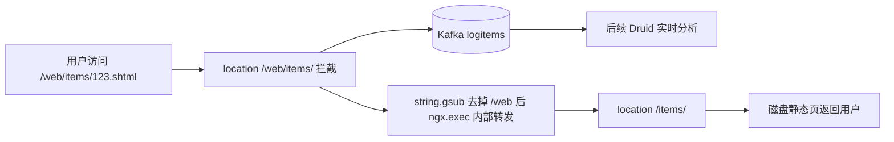

# Kafka 安装与常用操作 + OpenResty lua-resty-kafka 实时日志收集全链路

千亿级电商秒杀的第二章「热点数据实时收集」要解决一个问题：用户每访问一次秒杀商品详情页，系统都要把这次访问实时记录下来，供后续热点数据分析使用。这条链路里，Kafka 负责日志中转，OpenResty 加 Lua 负责在 Nginx 层直接采集访问信息。本文把整套环境一次搭完：Docker 部署 Kafka 并跑通常用命令，编译安装 OpenResty 并用它发布商品详情静态页，最后用 lua-resty-kafka 写出实时日志采集脚本，浏览器一刷新就能在 Kafka 消费端看到日志。

## 先给结论

- 选型推荐 Kafka 或 RocketMQ：Kafka 单机吞吐最强（普通机器每秒 10 万级），RocketMQ 胜在顺序消息与事务消息；RabbitMQ 协议支持最丰富，但吞吐在三者中最弱。
- Kafka 用 Docker 部署很快：先起 Zookeeper（课程环境用 3181 端口），再起 Kafka 容器，关键是 KAFKA_ADVERTISED_LISTENERS 要写宿主机真实 IP，另进容器在 server.properties 补一个 host.name。
- 常用操作全靠 bin 目录下的脚本三件套：kafka-topics.sh 管 topic，kafka-console-producer.sh 发消息，kafka-console-consumer.sh 消费，再进 Zookeeper 的 zkCli.sh 确认注册信息。
- OpenResty 是基于 Nginx 与 Lua 的高性能 Web 平台，编译安装后自带 Nginx 和一批 Lua 库，可以直接发布商品详情静态页，绕开 Tomcat 和数据库。
- 日志收集的核心是 Nginx 两个 location 的接力：/web/items/ 开头的请求先由 Lua 脚本把 actime、uri、ip、token 异步发进 Kafka，再剥掉 /web 前缀内部转发给 /items/ location 返回静态页，页面访问全程无感。
- 这是定向日志收集：只采集对热点分析有价值的四个字段，不做全量抓取。

## 消息中间件选型：为什么是 Kafka

整体业务流程中，用户访问商品后由 Nginx 记录访问日志，日志先进 Kafka 中转，再交给 Apache Druid 做实时分析。Kafka 在这条链路里承担的就是消息中间件的角色。市面上主流 MQ 有 Kafka、RocketMQ、RabbitMQ、ActiveMQ 四款，特性差别不小。

Kafka 是分布式、多分区、多副本、基于 Zookeeper 协调的分布式消息系统，用 Scala 编写，2010 年起是 Apache 顶级开源项目。它的六大特性：

- 快速持久化：依赖零拷贝机制，落盘速度快，数据不丢
- 高吞吐：单台普通机器可达每秒 10 万条
- 高堆积：支持海量消息堆积，topic 下消费者可长时间高负载
- 完全分布式：Broker、Producer、Consumer 天然支持集群，扩展不麻烦
- 支持 Hadoop 数据并行加载
- 高并发：支持数千个客户端同时读写

RocketMQ 前身是 Metaq，3.0 发布时更名，同为 Apache 顶级项目，是经过双11大规模检验的阿里系产品。它的架构与 Kafka 相似、特性贴近，但用 Java 编写，另外多出几样：严格顺序消息、推拉结合的丰富拉取模式、毫秒级实时消息订阅、亿级消息堆积，以及独创的事务消息。注意事务消息和「依赖 MQ 实现事务」是两码事，很多人在这一块有误解。

RabbitMQ 用 Erlang 编写，协议支持最丰富：AMQP、XMPP、SMTP、STOMP，对消息路由、负载均衡、数据持久化都有良好支持，企业里用它的团队也不少。

| 组件 | 开发语言 | 突出特性 | 吞吐表现 |
| --- | --- | --- | --- |
| Kafka | Scala | 零拷贝、高吞吐、高堆积、天然分布式 | 单机最强 |
| RocketMQ | Java | 顺序消息、事务消息、毫秒级订阅、亿级堆积 | 其次 |
| RabbitMQ | Erlang | 多协议（AMQP/XMPP/SMTP/STOMP） | 三者中最弱 |

实际项目建议优先 Kafka 或 RocketMQ。本项目做实时日志收集，看重的正是 Kafka 的吞吐与堆积能力。想系统学可以直接看 Kafka 官网 Quickstart，上面从下载、启动 Zookeeper、启动服务到创建 topic 都有现成命令。

## Docker 部署 Kafka 与常用命令

### 安装

Kafka 提供直接安装和容器两种方式，课程采用 Docker。Kafka 依赖 Zookeeper 做协调，所以先把 Zookeeper 跑起来，这里没有用默认的 2181 而是 3181 端口：

```bash
docker run -d --name zookeeper -p 3181:3181 -v /etc/localtime:/etc/localtime wurstmeister/zookeeper
```

`-v /etc/localtime:/etc/localtime` 把宿主机时区文件挂进容器，保证容器内外时间同步，分布式系统里这一步很关键。

接着启动 Kafka：

```bash
docker run -d --name kafka -p 9092:9092 \
  -e KAFKA_BROKER_ID=0 \
  -e KAFKA_ZOOKEEPER_CONNECT=192.168.211.137:3181/kafka \
  -e KAFKA_ADVERTISED_LISTENERS=PLAINTEXT://192.168.211.137:9092 \
  -e KAFKA_LISTENERS=PLAINTEXT://0.0.0.0:9092 \
  -v /etc/localtime:/etc/localtime wurstmeister/kafka
```

几个环境变量的含义：

| 参数 | 含义 |
| --- | --- |
| KAFKA_BROKER_ID | 当前 Broker 的唯一 ID，集群里从 0 开始 |
| KAFKA_ZOOKEEPER_CONNECT | 使用的 Zookeeper 地址与端口 |
| KAFKA_ADVERTISED_LISTENERS | 对外发布的监听器，外部程序按这个地址连 Kafka |
| KAFKA_LISTENERS | 监听器，声明用什么协议访问哪个主机名和端口，写 0.0.0.0 表示本机任意 IP 都可以 |

`docker ps` 确认容器起来之后还有一步：进容器改配置。Kafka 配置文件在容器内 `/opt/kafka_2.12-2.4.1/config/server.properties`，在文件末尾追加宿主机 IP，保存后重启 Kafka 容器：

```properties
host.name=192.168.211.137
```

### 常用操作

进入容器 bin 目录，常用脚本就三个：kafka-topics.sh 创建和管理队列（topic），kafka-console-producer.sh 做消息生产，kafka-console-consumer.sh 做消息消费。

```bash
# 创建 topic：副本数 1、分区数 1、名称 itemaccess
./kafka-topics.sh --create --bootstrap-server localhost:9092 \
  --replication-factor 1 --partitions 1 --topic itemaccess

# 发消息：进入命令行模式，粘入 JSON 回车即发送
./kafka-console-producer.sh --broker-list localhost:9092 --topic itemaccess

# 消费：--from-beginning 从头开始，一条不落
./kafka-console-consumer.sh --bootstrap-server localhost:9092 \
  --topic itemaccess --from-beginning
```

创建命令的参数含义：`--bootstrap-server` 指定要操作的 Kafka 地址端口，`--replication-factor` 设置分区副本数量，`--partitions` 设置分区数，`--topic` 是队列名称。演示时向 itemaccess 发了一条模拟的访问日志：

```json
{"actime":"2020-4-10 9:50:10","url":"http://www.seck11.itheima.net/items/333.html","IP":"119.123.33.231","Token":"Bearer itcast"}
```

消费窗口随即收到了这条消息，生产、消费链路打通。还有几条管理命令，注意这些走的是 `--zookeeper` 参数、指向 3181 端口：

| 用途 | 命令 |
| --- | --- |
| 查看已有主题 | `./kafka-topics.sh --zookeeper localhost:3181 --list` |
| 删除指定主题 | `./kafka-topics.sh --zookeeper localhost:3181 --delete --topic itemaccess` |
| 查看主题详情 | `./kafka-topics.sh --zookeeper localhost:3181 --describe --topic itemaccess` |

最后进 Zookeeper 容器，用 zkCli.sh 看 Kafka 的注册信息：

```bash
docker exec -it zookeeper /bin/bash
cd bin
./zkCli.sh
ls /
```

输出里能看到 kafka 节点，说明 Kafka 已正常注册。

## OpenResty 安装与商品详情页发布

Lua 是轻量小巧的脚本语言，C 语言编写、完全开源，设计初衷是嵌入应用程序，为应用提供灵活的扩展与功能定制，通俗讲就像给程序写外挂。OpenResty 则是基于 Nginx 与 Lua 的高性能 Web 平台：Nginx 本身并发能力强，结合 Lua 之后能调用各类 Lua 库和 C 支持的功能点，实现负载均衡、请求路由、安全认证、服务鉴权、流量控制、日志处理等扩展，足以构建 10K 乃至 1000K 级单机并发连接的高性能 Web 应用。安装参考中文官网 openresty.org/cn/，源码编译方式如下：

```bash
wget https://openresty.org/download/openresty-1.11.2.5.tar.gz
tar -xf openresty-1.11.2.5.tar.gz
cd openresty-1.11.2.5
./configure --prefix=/usr/local/openresty --with-luajit \
  --without-http_redis2_module --with-http_stub_status_module \
  --with-http_v2_module --with-http_gzip_static_module --with-http_sub_module
make && make install
```

`--prefix` 指定安装位置，后面一串是模块开关。装完后 `/usr/local/openresty` 下有 nginx、LuaJIT、lualib 等目录——Nginx 已内置，还带了大批精良 Lua 库。把 nginx 加进环境变量：

```bash
# 编辑 /etc/profile 追加
export PATH=/usr/local/openresty/nginx/sbin:$PATH
source /etc/profile
```

接下来用它发布上一章生成的秒杀商品详情静态页。在服务器建目录、上传静态页并归位：

```bash
mkdir -p /usr/local/server/web/items
# 把上一章生成的详情静态页上传到 items 目录下
```

访问路径规划为 `http://192.168.211.137/items/123.shtml`：只要请求以 /items/ 开始，就让 Nginx 去 `/usr/local/server/web` 目录下找 items 子目录里的对应文件。nginx.conf 里加一个 location，用 root 指令直接到指定目录查文件，不走 Tomcat 也不走数据库：

```nginx
# 商品详情页发布：以/items/开始的请求直接找静态文件
location /items/ {
    root /usr/local/server/web;
}
```

启动 Nginx 后访问该地址，静态详情页直接返回，秒杀商品页的发布就完成了。

## Lua + lua-resty-kafka：实时日志采集实现

### 设计思路

日志收集是定向的：只采集对业务有分析价值的访问记录。每条日志四个字段，各有用途：

| 字段 | 含义 | 后续用途 |
| --- | --- | --- |
| actime | 访问时间 | 记录访问时刻 |
| uri | 请求的商品详情页地址 | 判断用户访问了哪个商品，做热点数据分析 |
| ip | 用户 IP | 同一 IP 频繁访问可用于刷单惩罚、封禁 |
| token | 用户登录令牌 | 用户爱好分析，进而支撑广告投放 |

整体流程如下：



关键在两个 location 的接力：`/web/items/` 的 location 不找文件，先用 Lua 把日志发进 Kafka，再把 URI 里的 /web 去掉，用剩下的路径内部转发；`/items/` 的 location 按 root 找静态文件响应给用户。日志采集与页面访问互不干扰。

### 安装 lua-resty-kafka

Lua 里向 Kafka 生产消息依赖第三方库 lua-resty-kafka，从 GitHub 下载 zip 解压，lib 目录下 resty/kafka 内是一组库文件，其中 producer.lua 是消息生产者、client.lua 是客户端。把库路径告诉 Nginx，在 http 块里加：

```nginx
# lua模块设置
lua_package_path "/usr/local/openresty/lua-resty-kafka-master/lib/?.lua;;";
```

### 编写采集脚本

脚本统一放在 `/usr/local/openresty/nginx/lua/` 目录下，命名为 itemaccess.lua。编写工具用 LuaEditor：国产开源编辑器，支持 require、os.date 等代码提示，能打断点调试（用法和 IDE 几乎一样），可切换字体主题风格，还能识别变量。它可以直接打开服务器上的文件，编辑保存后自动同步到远端，比在终端 vi 里写 Lua 舒服得多。

脚本按六步走：依赖库、配置 Kafka 地址、创建异步生产者、组装消息、发送、剥前缀转发。

```lua
-- 依赖cjson：把对象转成json字符串
local cjson = require "cjson"
-- 依赖kafka生产者
local producer = require "resty.kafka.producer"

-- 配置Kafka服务地址，多broker可继续追加
local broker_list = {
    { host = "192.168.211.137", port = 9092 }
}
-- 创建生产者，异步方式提交
local pro = producer:new(broker_list, { producer_type = "async" })

-- 获取用户IP：请求头优先，取不到回退到remote_addr
local headers = ngx.req.get_headers()
local ip = headers["X_REAL_IP"] or headers["X_FORWARDED_FOR"] or ngx.var.remote_addr or "0.0.0.0"

-- 组装日志消息
local logjson = {}
logjson["actime"] = os.date("%Y-%m-%d %H:%M:%S")
logjson["uri"]    = ngx.var.uri
logjson["ip"]     = ip
logjson["token"]  = "Bearer ETHMA"   -- 演示环境未做登录，token先随意写

-- 发送到logitems队列，key不指定传nil
pro:send("logitems", nil, cjson.encode(logjson))

-- 去掉/web前缀，内部转发到静态页location
local uri = ngx.var.uri
uri = string.gsub(uri, "/web/", "")
ngx.exec(uri)
```

几个实现细节：IP 从请求头取，`ngx.req.get_headers()` 是 OpenResty 内置 API，这类 API 数量很多不用背，查 ngx 参考手册即可；时间用 `os.date` 按 `%Y-%m-%d %H:%M:%S` 格式化；message 对象不能直接发，必须 `cjson.encode` 转成字符串；发送完用 `string.gsub` 把 URI 里的 `/web/` 替换掉，再用 `ngx.exec` 在 Nginx 内部转发，用户全程无感。

### 接入 Nginx 并测试

修改 nginx.conf，让 /web/items/ 开头的请求交给这个 Lua 文件处理：

```nginx
server {
    listen      80;
    server_name localhost;

    # /web开始的请求：记录日志，再跳转到下面的location
    location /web/items/ {
        content_by_lua_file /usr/local/openresty/nginx/lua/itemaccess.lua;
    }

    # /items开始的请求：直接在详情页目录下找文件
    location /items/ {
        root /usr/local/server/web;
    }
}
```

测试前重载配置，并另开一个终端跑消费者盯着 logitems：

```bash
nginx -s reload
# 进入kafka容器bin目录后执行
./kafka-console-consumer.sh --bootstrap-server localhost:9092 --topic logitems --from-beginning
```

浏览器访问 `http://192.168.211.137/web/items/s1235433012716498944.html`：页面正常打开，同时消费者终端立刻输出一条日志：

```json
{"token":"Bearer ETHMA","actime":"2020-4-10 9:50:30","ip":"119.123.33.231","uri":"/web/items/s1235433012716498944.html"}
```

刷新几次页面，日志实时跟进。有个容易踩的点：直接访问 `/items/xxx.html` 不会有日志输出，因为请求没经过第一个 location，只有带 /web 前缀的访问才会触发采集。

## 小结

这条链路分工明确：Kafka 做日志中转，Docker 两行命令拉起 Zookeeper 和 Kafka，脚本三件套搞定建队列、生产、消费；OpenResty 发布静态详情页，秒杀页面不走 Tomcat；Lua 脚本挂在 /web/items/ 的 location 上，异步把 actime、uri、ip、token 四要素打进 logitems，再剥前缀内部转发，页面访问零感知。日志进了 Kafka，就为下一篇的 Druid 实时分析备好了数据源。
