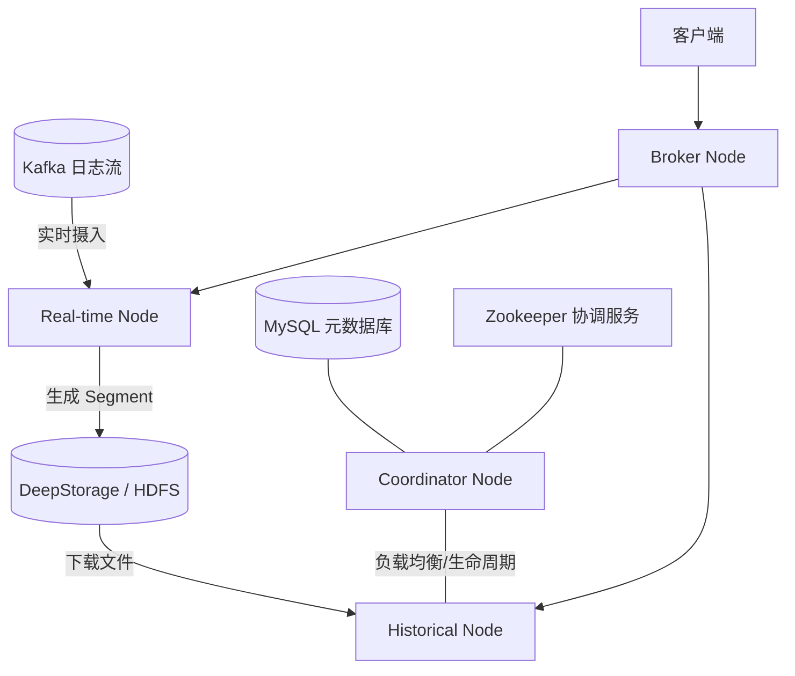

# Druid 架构与安装、文件/实时两种数据摄入、Druid SQL 与 JDBC 查询落地

日志收进 Kafka 之后只是完成了存储，要变成可用的业务决策还得有实时分析层。秒杀项目的这一章引入 Apache Druid：先看热点商品为什么必须做实时分析，再过 Druid 的定位、选型对比与四节点架构，然后单机安装，走通基于文件的离线摄入和对接 Kafka 的实时摄入两条路，最后用 Druid SQL 查数据，并在 Java 程序里通过 JDBC 把查询自动化。

## 先给结论

- 秒杀场景下占比不到 1% 的热点商品会占掉服务器 99% 的资源，系统必须具备热点商品的发现、收集、处理三种能力；上一章的日志实时收集解决了「发现」，Druid 负责存储与分析。
- 热点处理三条路：优化（热点数据进缓存、按需取列省磁盘 IO）、限制（抢购请求进消息队列排队、有序消费防雪崩）、隔离（热点数据不进 MySQL 只操作 Redis，热点抢单流程独立部署）。
- Druid 是分布式、支持实时多维 OLAP 分析的数据处理系统，PB 级交互式查询能做到一二秒级响应，支持按时间戳聚合摄入与聚合分析；秒杀主要关注超大规模数据和查询效率，选它正合适。
- 架构四类节点：Real-time 实时摄入生成 Segment、Historical 加载文件供查询、Broker 合并两边查询结果、Coordinator 做 Historical 的负载均衡；外部依赖 MySQL（元数据）、Zookeeper（一致性协调）、DeepStorage/HDFS（数据文件存储）。
- 安装要求 Java 8（8u92 以上）且不支持 Windows：解压后执行 ./bin/start-micro-quickstart，8888 端口进 Web 控制台；文件摄入与 Kafka 实时摄入都在 Load Data 向导里配置，实时摄入把 actime 列类型设为 AUTO 即可补上主时间列。
- 程序里查 Druid 不能用普通 JDBC 驱动，要引入 Calcite 的 avatica-core，连接地址 jdbc:avatica:remote:url=…:8082/druid/v2/sql/avatica/，端口 8082，其余按标准 JDBC 流程写。

## 业务场景：热点商品为什么必须实时分析

秒杀业务里，随着用户抢购，有些商品会被大量用户同时抢，这些就是实时热点商品。热点商品流量蜂拥而至，服务器并发巨大、压力陡增，处理性能下降，甚至直接宕机。问题在于这些热门商品数量极少——很可能连 1% 都不到，却占据服务器 99% 的资源。所以秒杀系统必须具备三种能力：热点商品的发现能力、收集能力、处理能力。

热点商品的发现与收集，上一章的实时日志收集已经完成了一部分：用户访问详情页的日志实时进了 Kafka。热点收集到之后怎么优化？课程给了三种思路：

| 思路 | 做法 | 效果 |
| --- | --- | --- |
| 优化 | 热点商品数据隔离出来放进缓存；查询按需取列，只要三列就不要查十列 | 查询不走数据库，降低数据库压力；节省磁盘 IO |
| 限制 | 抢购请求不直接压到服务器，先向消息队列发抢购消息，服务端对队列有序消费 | 避免服务器同时处理海量请求，防止雪崩 |
| 隔离 | 数据隔离：热点商品不存数据库、操作直接走 Redis；程序隔离：热点商品抢单流程独立出去 | 即便热点把抢单流程压垮，也不影响非热点商品服务 |

对应到架构上，数据被分成两层：用户请求经 Nginx 进入 Kafka 实时分发，由 Apache Druid 做实时分析沉淀实时热点；历史热点走离线数据存储，非热点商品仍在 MySQL。分库设计让热点与非热点的数据和操作流程彻底解耦。

现在热点数据发现已经具备，剩下的事情就是让 Druid 把 Kafka 里的数据订阅过来、存起来，再用 Druid SQL 做分析。

## Druid 定位与架构：OLAP 引擎、四类节点、三个外部依赖

### Druid 是什么

Apache Druid 是一个分布式的、支持实时多维 OLAP 分析的数据处理系统，支持高速的数据实时摄入，也支持实时且灵活的多维数据分析查询，常见背景是大数据下灵活快速的多维 OLAP 分析。它还有一个特点：支持根据时间戳做聚合摄入和聚合分析，所以时序处理分析场景也能用。

这里涉及一个概念 OLAP。传统关系型数据库的主要应用是 OLTP，做日常操作和事务处理；OLAP 是数据仓库系统的主要应用，支持复杂分析操作，侧重决策支持，能给出直观易懂的分析查询结果。两者差别：

| 维度 | OLTP | OLAP |
| --- | --- | --- |
| 用户 | 面向操作人员的日常操作 | 面向决策人员，支持管理需要 |
| 功能 | 日常操作处理 | 分析决策 |
| DB 设计 | 面向应用，事务驱动 | 面向主题，分析驱动 |
| 数据 | 当前的、最新的细节 | 历史的、聚集的、多维的、集成的、统一的 |
| 存取 | 可更新，读/写数十条记录 | 不可更新但有刷新周期，每次可读上百万条 |
| 工作单位 | 简单的事务 | 复杂的查询 |
| DB 大小 | 100MB-GB | 100GB-TB |

一句话总结：OLTP 是面向应用系统的数据库，OLAP 面向数据仓库。

Druid 的特性：PB 级别的交互式查询可以做到一二秒级响应，支持较高并发；采用分布式架构，可扩展到 PB 级；支持数据实时导入和实时查询；支持 count、sum 等聚合查询，也支持 GroupBy、Select、Search 这类分组与复杂查询。

选型时可以横向对比开源 OLAP 系统：

| 系统 | 数据规模 | 查询效率 | 并发度 | SQL 支持 | 灵活性 |
| --- | --- | --- | --- | --- | --- |
| Druid | 超大 | 高 | 高 | 中 | 中 |
| Kylin | 超大 | 高 | 高 | 低 | 高 |
| Elasticsearch | 中等 | 中等 | 高 | 中 | 高 |
| Spark SQL | 超大 | 低 | 低 | 高 | 高 |

秒杀系统主要关注两点：超大规模的数据，以及查询效率。Druid 在这两项上都是顶级，所以选它非常合适。

### 四类节点与外部依赖

Druid 自身包含四类节点，外部依赖三个组件，一起构成完整架构：



- **Real-time Node**：实时数据导入，导入后生成数据文件块（Segment，LSM-Tree 实现，与 HBase 基本一致）。它可以直接订阅 Kafka 里的日志数据，导入本地生成数据块文件——这正是本项目实时日志收集的下游。
- **Historical Node**：加载已生成好的数据文件，对外提供查询服务。
- **Broker Node**：介于 Real-time 和 Historical 之间的中间服务，从两边查询数据，综合后返回客户端。
- **Coordinator Node**：为 Historical 的数据提供负载均衡，并通过 Rule 管理数据生命周期。

三个外部依赖：元数据库（Metastore）存储 Druid 集群的元数据信息，一般用 MySQL；分布式协调服务（Coordination）为集群提供一致性服务，用 Zookeeper；数据文件存储（DeepStorage）存放生成的 Segment 文件，供 Historical 下载，可用 HDFS。

数据摄入对应分两种：Kafka 这类流式数据实时导入叫流式摄入，HDFS 这类系统的数据整体导入叫批量摄入。

## 安装与两种数据摄入

### 安装启动

Druid 对环境有要求：Java 8 以上且必须是 8u92 以上，官方仅支持 Java 8，更高版本属于实验性；操作系统不支持 Windows。快速评估建议 4CPU/16GB 内存的机器，用 micro-quickstart 配置。下载 apache-druid-0.18.0 后解压、启动：

```bash
tar -xf apache-druid-0.18.0-bin.tar.gz
cd apache-druid-0.18.0
./bin/start-micro-quickstart
```

解压后的目录：bin 是可执行脚本，conf 是配置文件，extensions 是扩展组件，hadoop-dependencies 是 Hadoop 依赖，lib 是依赖包，quickstart 是快速启动脚本和示例数据。启动后浏览器访问 `http://192.168.211.137:8888` 进入管理界面，能看到 Status、Datasources、Segments、Supervisors、Tasks、Services、Lookups 等模块，加载完成即安装成功。

### 基于文件的数据摄入

官方文档 Data Loading 里有两条路：Loading a file（文件摄入）和 Loading Stream Data from Apache Kafka（流式摄入）。文件摄入全程在 Web 控制台的向导里完成：

1. 点 **Load data**，数据源选 **Local disk**，点 **Connect data**。
2. 填目录 `quickstart/tutorial/` 和文件名 `wikipedia.json`——文件过滤支持通配符，多个文件可以写星号；点 Apply 后 JSON 数据加载进来。
3. 点下一步 **Parse data**：原始 JSON 看着臃肿，解析后就变成像数据库一样一行行、一列列的数据，还能用 search 按列过滤。
4. 点 **Parse time**：Druid 会给所有数据自动添加一个主时间列（primary timestamp column），存在 `__time` 列里，类似一个组件列。样例数据有 time 列（ISO 格式），时间就来源于它；也可以在 mapper 里配置别的日期格式。
5. **Transform**：支持添加逻辑列。比如经常要按名称、品牌、分类搜索，匹配三次效率太低，可以把多个列的值拼接组合成一个逻辑列（Add column transform 写表达式），以后只在一个列里找；不需要时点开它可修改或删除表达式。
6. **Configure schema**：重点处理 `__time` 列的查询粒度。默认精确到小时——同一小时内插入的多条数据会聚合成一条并做 count 递增，粒度直接决定数据详细程度；点开 time 列可把粒度换成 second。
7. **Partition 分区**：配置 segment 粒度，比如一天一个数据块文件或每小时一个；还可以设置每个数据块文件里最大行数。
8. **Publish**：给数据源（数据库）取名字；再下一步核对配置（数据源名、查询精度、segment 粒度），点 **Submit** 提交。

到 Datasources 页面稍等几秒刷新，新数据源加载成功。在数据源上右键 **Query with SQL**，执行 `SELECT * FROM "wikipedia"` 点 Run，就能查到导入的数据。

### 对接 Kafka 的实时摄入

实时摄入对接的是前面用户访问商品详情页的日志收集：日志先发 Kafka，再由 Druid 订阅消费出来存进 Druid，后面才能查询分析。入口同样是 Load data，数据源选 **Apache Kafka**，点 **Connect data** 后填两项：Bootstrap servers 是 Kafka 的 IP 加端口 `192.168.211.137:9092`，topic 填日志队列名 `logitems`，点 Apply。演示时 Kafka 容器忘了启动，`docker start kafka` 拉起来即可。

读到数据后同样走向导：解析成行列；到 Parse time 这一步发现数据里没有现成的 time 列——把 actime 列的类型选为 **AUTO**，点应用，时间值就被复制过来充当主时间列了；Configure time 把时间粒度换成以秒为单位或不做处理，时间最精确；Publish 时数据源名字写 logitems；最后核对配置提交，实时摄入任务开始运行。

验证：请求一次商品详情页 `http://192.168.211.137/web/items/xxx.html`，打开 Datasources 里刚建的 logitems，右键 Query with SQL 查看，刚才那条访问日志已经在里面；再连续刷新三次详情页，三条新数据都实时进了 Druid。

## Druid SQL 与 JDBC 查询

### 从 JSON 到 Druid SQL

Druid 早期查询基于 JSON 语句：写明 query type、数据源、查询列，一条查询写下来非常臃肿。于是 Druid 定制了一套 SQL 语句来取代 JSON 查询，这就是 Druid SQL——一个内置的 SQL 层，是 JSON 查询语言的替代品，由基于 Apache Calcite 的解析器和规划器提供支持。SQL 在 Broker 中转换为原生 Druid 查询再传给数据进程，Broker 上这点转换开销很轻量，可以忽略不计。

语法上要注意几点：

- 数据源都在默认的 Druid 模式下，引用写 `druid.dataSourceName` 或直接 `dataSourceName`；
- 数据源、列名等标识符建议用双引号引起来，标识符里的双引号用两个双引号转义，所有标识符区分大小写；
- 字符串文字用单引号；数字直接写 100、100.0、1.0e5；时间运算用 `INTERVAL '1' HOUR` 这类写法。

常用查询和标准 SQL 几乎一样：

```sql
-- 查询所有
SELECT * FROM "logitems";
-- 查询指定列（标识符建议加双引号，不加也能执行）
SELECT "uri" FROM "logitems";
-- 查询前两条
SELECT * FROM "logitems" LIMIT 2;
-- 分组：按 SQL 标准，SELECT 里出现什么 GROUP BY 就跟什么
SELECT "token" FROM "logitems" GROUP BY "token";
-- 按时间降序 / 升序
SELECT * FROM "logitems" ORDER BY "__time" DESC;
SELECT * FROM "logitems" ORDER BY "__time" ASC;
-- 最近一小时的数据
SELECT * FROM "logitems" WHERE "__time" >= CURRENT_TIMESTAMP - INTERVAL '1' HOUR;
-- 六年以内的数据（改成 < 就是六年以前，当前环境自然查不到）
SELECT * FROM "logitems" WHERE "__time" >= CURRENT_TIMESTAMP - INTERVAL '6' YEAR;
-- 去重
SELECT DISTINCT "ip" FROM "logitems";
```

聚合函数 SUM、MAX、AVG 也都支持，模板形如 `SELECT SUM("count") FROM "logitems"`——本项目的日志数据里没有可求和的列，按此写法套用即可。完整语法还包括 HAVING、UNION 等，参考官方文档学习。

### JDBC 查询 Druid

Java 程序里自动查询 Druid，不能用普通 JDBC 驱动，得用 Apache Calcite 的 JDBC 驱动。Apache Calcite 是面向 Hadoop 的新型查询引擎，提供标准 SQL 语言、多种查询优化和连接各种数据源的能力，还提供 OLAP 和流处理的查询引擎。先引入依赖：

```xml
<dependency>
    <groupId>org.apache.calcite.avatica</groupId>
    <artifactId>avatica-core</artifactId>
    <version>1.15.0</version>
</dependency>
```

其余完全按 JDBC 的老流程写：获取连接、获取 Statement、准备 SQL、执行查询、遍历结果集、关闭资源。只有两处不同——连接地址换成 Druid 的 Avatica 地址（注意端口是 8082），连接对象强转为 AvaticaConnection：

```java
public class DruidSQLTest {
    public static void main(String[] args) throws Exception {
        // 数据库连接地址，端口是8082
        String url = "jdbc:avatica:remote:url=http://192.168.211.137:8082/druid/v2/sql/avatica/";
        // 获取连接对象，强转为AvaticaConnection
        Connection connection = (AvaticaConnection) DriverManager.getConnection(url);
        // 获取Statement对象
        Statement statement = connection.createStatement();
        // 准备SQL语句
        String sql = "SELECT * FROM logitems";
        // 执行查询
        ResultSet resultSet = statement.executeQuery(sql);
        // 遍历结果集
        while (resultSet.next()) {
            System.out.println(resultSet.getString("uri"));
        }
        // 关闭资源
        resultSet.close();
        statement.close();
        connection.close();
    }
}
```

运行后控制台把 logitems 里的 uri 全部输出，日志里能看到 HTTP 连接、路由分配的详细信息，JDBC 查询 Druid 打通。到这里，Java 程序里就能自动执行热点商品的查询分析了。

## 小结

这一章补上了日志链路的最后一环：Nginx 采集、Kafka 中转之后，Druid 以四节点加三依赖的架构把 Kafka 里的访问日志实时摄入成 Segment，Load Data 向导让文件摄入和 Kafka 实时摄入都变成界面操作，actime 一键设为 AUTO 即可补齐主时间列。Druid SQL 让查询回到熟悉的 SQL 语法，Avatica 驱动让 Java 程序按标准 JDBC 流程直连 8082 端口自动查询。热点商品的发现、收集、存储、分析从此闭环，后续的限流与隔离策略就有了数据依据。
