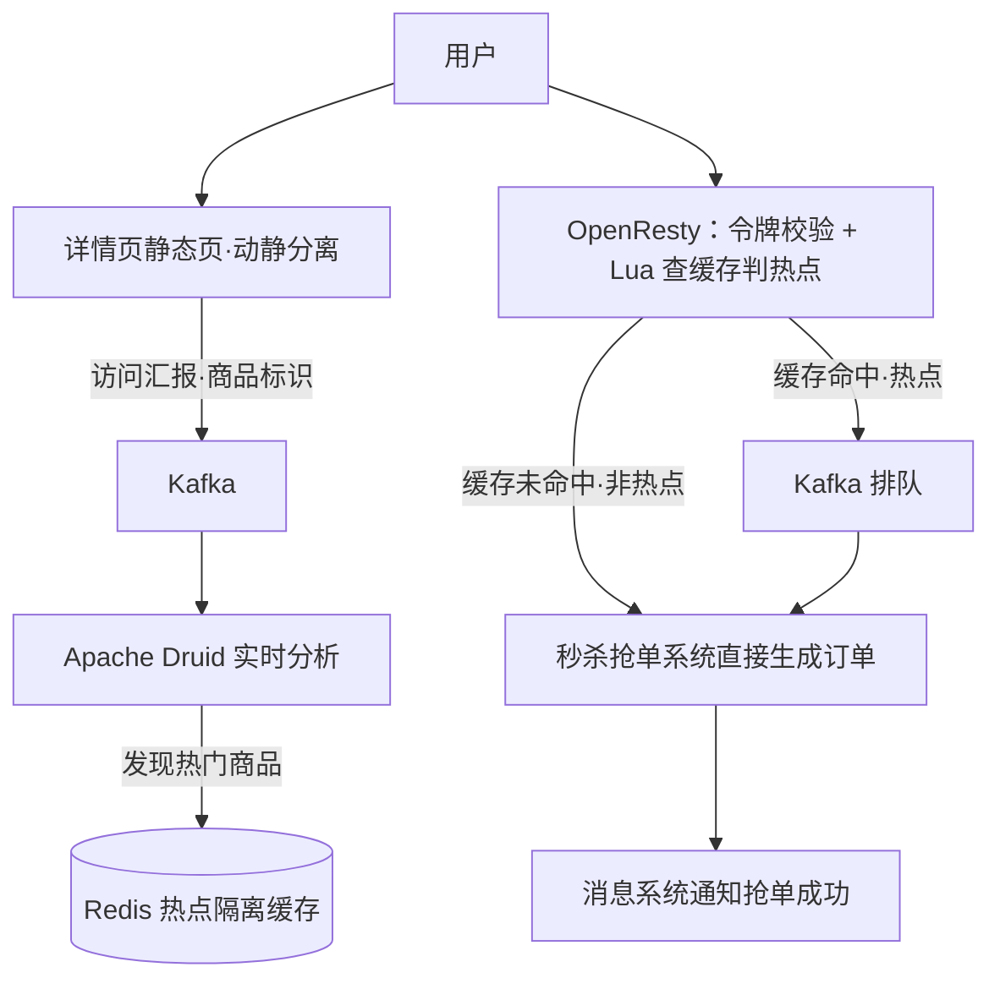

# 秒杀系统开篇：业务流程、多级架构设计、库表设计与技术栈全景

秒杀是电商里技术挑战最大的业务：价格比平时低一大截，抢购人数是平时的好多倍，商品量级又庞大。作为开篇，这篇先把五章学习路线、五套系统的业务分工、多级架构的设计动机、四个数据库的表结构和技术栈工程结构铺开，最后用一次真实的 `/api/brand` 请求和批量导入前的分页查询准备收尾。

## 先给结论

- 课程分五章递进：基础数据维护 → 热点数据收集 → 热点数据隔离+秒杀抢单 → 分布式事务+抢单状态通知 → 熔断限流+压力测试；第一章围绕秒杀商品维护，覆盖业务流程、架构、库表、ES 索引导入与搜索、Freemarker 静态化和 Canal 增量同步。
- 业务上拆五套系统：管理员后台、搜索系统、秒杀抢单脚本控制、秒杀抢单系统、热点数据发现与收集系统；热点数据有两个来源——实时访问频率和历史上的订单、购物车、搜索记录。
- 架构三个核心决策：变更频率极低的详情页静态化，由代理服务器直接访问（动静分离）；最外层流量交给 Nginx+Lua（OpenResty）而不是 Tomcat；热点商品隔离进缓存，抢购请求进 Kafka 排队，非热点商品直接下单。
- 数据库按微服务拆四个库：秒杀商品库（活动、品牌、时间段、SKU、活动商品中间表、undo_log）、秒杀订单库（一单只抢一件）、管理员库、用户库。
- 技术栈：LVS 四层负载+Nginx 七层负载接入，Lua 脚本查缓存，Gateway 网关，Nacos/Sentinel/Ribbon/Skywalking 治理，RocketMQ/Kafka 消息，Seata 分布式事务，MySQL+Redis+Elasticsearch 存储，Canal 做增量同步。
- 工程直接导入 seckill-parent（api/gateway/module/service 四类模块），配置全用 hosts 别名而非 IP；请求默认要过 Gateway 的 AuthorizeFilter 令牌校验，缺令牌直接 401。

## 学习路线与第一章知识点

整个秒杀系统的学习路线分五章：

| 章节 | 内容 |
| --- | --- |
| 第 1 章 基础数据维护 | 秒杀商品索引数据的创建、搜索、更新，商品详情页更新 |
| 第 2 章 热点数据收集 | 实时发现访问量非常大的商品，收集并分析其信息 |
| 第 3 章 热点数据隔离+秒杀抢单 | 热点与非热点数据不放到一起，抢单模式也不止一种 |
| 第 4 章 分布式事务+抢单状态通知 | 解决抢单中数据回滚的问题，实现抢单状态实时更新 |
| 第 5 章 熔断限流+压力测试 | 系统保护与容量验证 |

第一章目标有七个：秒杀流程设计、秒杀表结构、秒杀工程导入、秒杀索引导入和搜索（elasticsearch）、商品详情页 freemarker 静态化、Canal 增量数据同步讲解、用 Canal 实时同步索引和静态页。静态化动机直接：详情页做成静态页，提高加载速度与服务抗压能力。

## 业务流程与架构设计：五套系统、两条抢单链路

### 业务流程：五套系统怎么分工

完整业务是：后台发布秒杀商品或将现有商品列入秒杀商品，热点分析系统对商品进行分析，对热点商品做特殊处理；商城会员在活动时间内抢购，抢购后在线支付，订单由平台工作人员发货，超时未支付自动取消。支撑这条业务的是五套系统：

| 系统 | 职责 |
| --- | --- |
| 管理员后台 | 秒杀商品增删改查、审核，秒杀订单管理；挑战不大，只讲有挑战的部分 |
| 搜索系统 | 商品搜索：后台审核通过的商品在这里能被用户检索到 |
| 秒杀抢单脚本控制 | 控制热点商品抢单与非热点商品抢单两条链路 |
| 秒杀抢单系统 | 处理两类商品订单：非热点商品订单、热点商品订单 |
| 热点数据发现与收集系统 | 实时访问数据收集分析，加历史热点统计 |

热点数据来源有两类。实时热点：一分钟内访问频率非常高的商品；历史热点：统计过往的订单、购物车、搜索记录、详情页搜索记录，导入热点数据发现系统分析后做隔离。

### 架构设计的前置问题

秒杀价格远低于平时，抢购人数是平时的好多倍，服务压力和并发随之翻好多倍；商品数量非常庞大；商品有冷热之分——有的双 11 卖不出去一件，有的双 11 能卖出好多件；大量商品数据几乎不变，这种低频变更数据要做优化处理。

接入层选型由此确定：用 Tomcat 直接处理最外层流量一定会出问题。单台 Tomcat 抗压能力只能调整到大约 1000，占用资源较大；Nginx 抗压能力轻松到 5 万，占用资源极小、运行稳定。所以用 Nginx+Lua（OpenResty）扛最外层，Lua 用来扩展 Nginx 能处理的业务流程。

### 两条抢单链路



详情页大部分数据几乎不变，会变的只有数量和价格，变更频率极低，用模板技术生成静态页，不走后端服务、由代理服务器直接访问——动静分离。访问详情页的频率越高，商品越热门，所以访问详情页时把商品标识汇报给 Kafka；大数据实时分析系统 Apache Druid 订阅数据，定时分析哪些商品访问频率远高于冷门商品，定义为热门商品。热门商品压力比冷门商品高得多，要隔离单独处理：放进缓存，加载热门商品直接从缓存拿。

抢单前必须先登录。识别放在 OpenResty 层：直接判断令牌，能正确解析就算登录成功，不用到后端微服务才识别。走哪条抢单模式取决于商品是热门还是非热门：

- **非热点商品**：缓存查不到商品信息，直接走秒杀抢单系统生成订单，同时控制超卖——一个商品不能下两个订单。还要防意外：判断时是非热点，下单那一刻可能突然变成热门，要回头走热点模式兜底。
- **热点商品**：缓存能读到商品信息。服务器直接处理所有请求很可能被打崩，于是把下单信息发给 Kafka，下单从「抢单」变成「排队」——秒杀抢单系统订阅抢单信息，排队挨个处理，压力随之减小。生成订单后通过消息系统通知用户抢单成功。

## 库表设计：四个数据库、一张核心表

整体是微服务架构，数据库按业务拆分：秒杀商品库、秒杀订单库、管理员库、用户库。重点讲前两个，后两个是辅助（各存登录信息）。

| 数据库 | 表 | 说明 |
| --- | --- | --- |
| seckill_goods 秒杀商品库 | tb_activity | 秒杀活动：名称、状态（1 开启 2 未开启）、开始/结束时间、总时长 |
| | tb_brand | 品牌：名称、图片、首字母、排序 |
| | 分类表、规格表 | 服务于后面的搜索实现 |
| | 秒杀时间段表 | 早晨 8 点到 10 点、10 点到 12 点这类时间段，不精确到哪一天 |
| | tb_sku | 秒杀商品核心表 |
| | tb_sku_act | 秒杀活动商品中间表，记录 sku_id 与 activity_id |
| | undo_log | Seata 分布式事务回滚日志，用到 Seata 的章节再讲 |
| 秒杀订单库 | tb_order | 秒杀订单，一单只抢一件商品 |
| 管理员库 / 用户库 | tb_admin / tb_user | 管理员与用户信息，实现登录 |

活动表记录类似京东「早晨 8 点到 10 点」「双 11 抢购」这类时间段活动，建表语句：

```sql
CREATE TABLE `tb_activity` (
  `id` varchar(60) NOT NULL,
  `name` varchar(100) NOT NULL COMMENT '活动名称',
  `status` int(2) NOT NULL DEFAULT '1' COMMENT '状态：1开启，2未开启',
  `start_time` datetime DEFAULT NULL COMMENT '开始时间，单位：时分秒',
  `end_time` datetime DEFAULT NULL COMMENT '结束时间，单位：时分秒',
  `total_time` float DEFAULT NULL COMMENT '总时长，单位：分',
  `is_del` int(1) DEFAULT '1' COMMENT '删除：1未删除，2已删除',
  PRIMARY KEY (`id`)
) ENGINE=InnoDB DEFAULT CHARSET=utf8;
```

核心的秒杀商品表 tb_sku 要重点理解几个字段：

| 字段 | 含义 |
| --- | --- |
| price / seckill_price | 商品价格 / 秒杀价格（单位分） |
| num / alert_num | 当前库存量 / 库存预警值 |
| seckill_begin / seckill_end | 商品参与秒杀的开始、结束时间 |
| status / is_lock | 1 普通商品 2 参与秒杀 / 1 未锁定 2 锁定 |
| seckill_num | 参与秒杀的商品数量：库存一千件，参与秒杀的可能只有五件 |
| category1/2/3_id 与名称、brand_name | 分类与品牌冗余字段，用于分类、品牌过滤搜索 |
| spec / sale_num / comment_num | 规格（对搜索有帮助）/ 销量 / 评论数量 |

订单表 tb_order 有个特殊设计：不支持购物车那种一单多商品的模式，一个订单只抢购一件商品。字段除了支付类型、创建/付款/发货/完成/关闭交易等时间、收货人信息、交易流水号和订单/支付/发货/删除状态之外，还有商品 ID、名称、价格和所属用户；默认只能抢一件，价格就是单件价格，将来开放多件则是单价乘以数量。

## 技术栈、工程结构与一次真实请求

### 技术栈全景

| 层 | 组件 |
| --- | --- |
| 终端 | 安卓、iOS、PC 都可以 |
| 接入层 | Keepalived，四层负载 LVS，七层负载 Nginx |
| 脚本控制 | Lua 脚本查缓存、操作数据库与 MQ；缓存用 Redis，配 Sentinel 哨兵策略 |
| 网关层 | Gateway，路由用户请求到服务层 |
| 服务层 | 管理员后台、热点数据发现、秒杀系统、搜索系统等 |
| 数据同步 | Canal，实时同步、实时监听增量数据 |
| 服务治理 | 注册与发现 Nacos，限流 Sentinel，负载均衡 Ribbon，链路追踪 Skywalking |
| 消息中间件 | RocketMQ、Kafka 都可以用 |
| 分布式事务 | Seata，在微服务方面非常容易使用 |
| 存储 | 关系型 MySQL，非关系型 Redis，海量搜索 Elasticsearch |

### 工程结构与导入

项目是微服务结构，父工程 seckill-parent 下分四类模块：

- **seckill-api**：各微服务对应的 Pojo 和 Feign 接口。JavaBean 用 JPA 注解与数据库表一一对应；Feign 接口用来实现微服务之间相互调用。
- **seckill-gateway**：微服务网关，配置路由。
- **seckill-module**：公共模块，写工具类——JWT 令牌管理、Redis 操作工具，以及统一响应对象 Result（flag 操作是否成功、code 状态码、message 提示信息、data 逻辑数据）和状态码常量：OK=20000、ERROR=20001、LOGINERROR=20002（账号名或密码错误）等；库存与抢单相关的有 DECOUNT_SUCCESS=20010（递减成功）、DECOUNT_NOTENOUGH=20011（库存不足）、DECOUNT_NOTGOODS=20012（商品不是热卖商品）、ORDER_QUEUE_SUCCESS=20020（抢购商品正在排队）、ORDER_ONE_SUCCESS=20021（抢单成功）。
- **seckill-service**：所有业务微服务——seckill-goods 商品、seckill-manager 管理员、seckill-monitor 热点数据实时监控发现、seckill-order 秒杀订单抢单、seckill-search 秒杀商品搜索、seckill-user 用户管理。微服务内部是 Controller → Service → ServiceImpl → DAO 四层，DAO 继承通用 Mapper，基本增删改查和分页直接用它的方法。

课程采取企业的真实开发模式：不从 0 到 1 搭建工程，直接把资料里的 seckill-parent 导入 IDEA，在已有工程上只写价值较高的部分——去公司里很少从零搭建工程。

配置里服务器地址全写代号不写 IP（如 `nacos-server:8848`、Redis 节点 `redis-server:7001` 到 `redis-server:7005`），换环境只需在 hosts 文件（`C:\Windows\System32\drivers\etc\hosts`）加映射，不改项目。演示环境的服务都装在一台虚拟机上：IP 192.168.211.137，root 账号，Docker 容器里有 MySQL、Elasticsearch、ESHead、Seata 等。

```yaml
nacos:
  config:
    file-extension: yaml
  server-addr: nacos-server:8848
  discovery:
    server-addr: nacos-server:8848
```

### 案例：一次 /api/brand 请求的完整走向

拿品牌查询案例梳理请求到数据的全过程。真实请求先转发给 Nginx，再路由到微服务网关；课程演示跳过 Nginx，直接从 Gateway 讲起：

```yaml
spring:
  cloud:
    gateway:
      routes:
        - id: goods_route
          uri: lb://seckill-goods
          predicates:
            - Path=/api/skuAct/**, /api/activity/**, /api/brand/**, /api/category/**, /api/seckill
          filters:
            - StripPrefix=1
        - id: order_route
          uri: lb://seckill-order
          predicates:
            - Path=/api/order/**
          filters:
            - StripPrefix=1
```

请求 `/api/brand` 先被 seckill-gateway 拦截，StripPrefix=1 把第一层路径削掉，真实到达 `/brand` 并路由到 seckill-goods；控制器里 GET 提交映射到 findAll 方法，接着调 Service、找 ServiceImpl，最终落到继承通用 Mapper 的 BrandMapper。

浏览器直接访问 `localhost:8001/api/brand` 会报 401：Gateway 的全局过滤器 AuthorizeFilter 放行 `api/user/login`、`api/admin/login`、`api/search`，其他地址要从请求头 Authorization 取令牌，为空再从 URL 参数、Cookie 里取，全都拿不到就返回 401。想请求通，要么注释掉过滤器，要么带令牌——演示时用已生成好的令牌带上请求头，查询成功返回品牌列表。

### 批量导入前的准备：分页查询秒杀商品

秒杀商品数量庞大，快速检索若查数据库，压力大、效率低，甚至把数据库打崩；存 Redis 占内存，PB 级量缓存放不下。所以把海量商品存进全文检索引擎 Elasticsearch，实现 PB 级数据的实时检索和实时更新。

批量导入放在搜索微服务里做，它直接管理索引库：用 Feign 接口调商品微服务查秒杀商品集合，导入索引库。海量数据不建议逐条导入，也不建议一次全塞（容易超时），分页批量导入——一次查十条、一百条、一千条、一万条，按数据量来。

第一步在商品微服务里准备查总数 `count()` 和分页列表 `list(page, size)` 两个方法。查询条件有三个：商品必须是秒杀商品（status=2）；秒杀数量大于 0，没有商品不该加载出来；秒杀结束时间大于当前时间——活动已结束的商品没必要导入索引库：

```java
@Override
public Integer count() {
    Example example = new Example(Sku.class);
    Example.Criteria criteria = example.createCriteria();
    // 1.商品状态必须是秒杀商品
    criteria.andEqualTo("status", "2");
    // 2.秒杀数量大于0
    criteria.andGreaterThan("seckillNum", 0);
    // 3.秒杀结束时间大于当前时间
    criteria.andGreaterThan("seckillEnd", new Date());
    return skuMapper.selectCountByExample(example);
}

@Override
public List<Sku> list(Integer page, Integer size) {
    // 分页：PageHelper.startPage 必须写在查询前面
    PageHelper.startPage(page, size);
    // 条件与 count 完全一致
    Example example = new Example(Sku.class);
    Example.Criteria criteria = example.createCriteria();
    criteria.andEqualTo("status", "2");
    criteria.andGreaterThan("seckillNum", 0);
    criteria.andGreaterThan("seckillEnd", new Date());
    return skuMapper.selectByExample(example);
}
```

条件用通用 Mapper 的 Example 封装，分页用第三方插件 PageHelper。控制层对应暴露 `GET /count` 和 `GET /list/{page}/{size}` 两个接口，并同步补到 seckill-api 的 SkuFeign 接口（`@FeignClient("seckill-goods")`）里，批量导入时搜索微服务要跨服务调用。

## 小结

这篇打完地基：五章路线定学习顺序，五套系统划清业务边界；架构上动静分离消化低频变更的详情页，Nginx+Lua 扛入口流量，Kafka 排队消化热点抢购，Druid 发现热点并隔离进缓存；数据层拆四个库，tb_sku 为抢单控制预留字段；工程层导入 seckill-parent，hosts 别名解耦环境，AuthorizeFilter 收口令牌校验。批量导入第一步的分页查询已就绪，下一篇把商品数据灌进 Elasticsearch 索引库。
