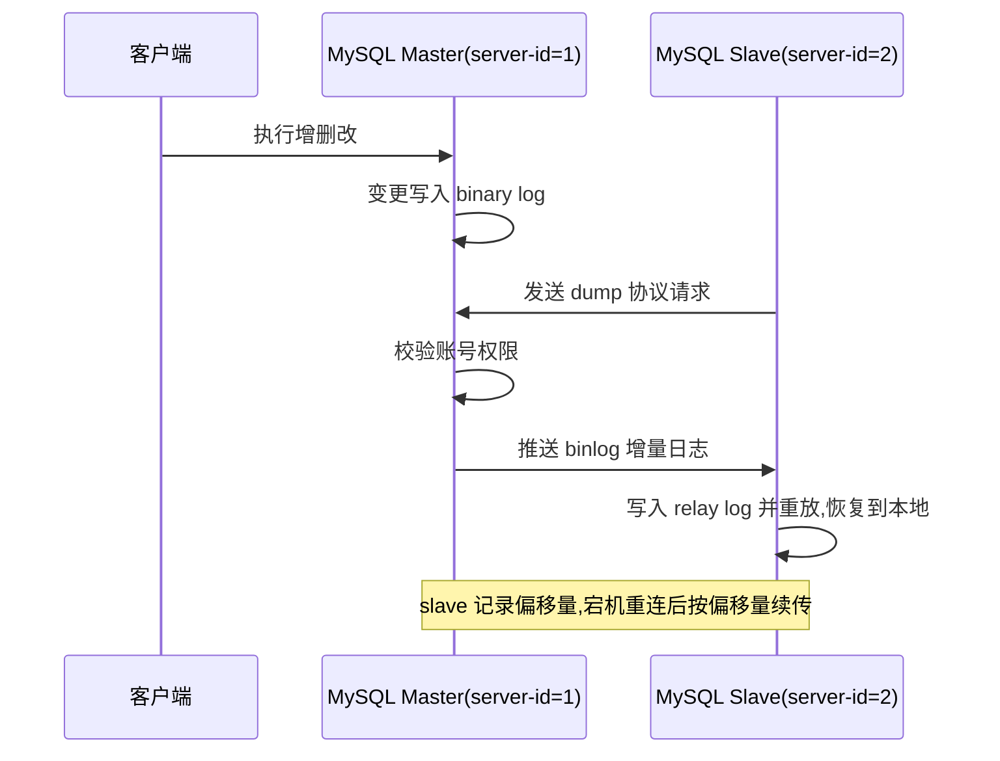

# 静态页删除收尾与 Canal 增量同步：从 binlog 原理到微服务消费，索引和静态页实时联动

秒杀商品维护的第一章在这里收尾。前面已经把秒杀商品批量导入索引库、增量导入、商品搜索、详情页静态页生成这些接口全部写完，但接口本身不会自己跑——数据库里商品一变，索引库和静态页必须跟着变，问题就落在"如何监听数据库变更、如何订阅变更数据"上。这一单元先补齐静态页删除，再引入 Canal：从 binlog 原理讲到 Docker 安装，最后用 canal 微服务消费增量数据，把索引同步和静态页同步串成一条完整链路。

## 先给结论

- 静态页删除与生成完全对称：`DELETE /page/html/{id}` 收商品 ID，拼出 `id.html` 文件名，服务层 `new File(htmlPath, fileName)` 判断存在后 `delete()`；对外通过 `SkuPageFeign`（`@FeignClient(name = "seckill-page")`）暴露给其他微服务调用。
- 接口测试口径：启动 page 服务（端口 18087）后，`POST http://localhost:18087/page/html` 传 Sku JSON（演示用 id=1234）生成 `1234.html`；再用 DELETE 方式带 `1234` 请求删除接口，文件随即消失。
- Canal 是阿里巴巴开源的增量日志订阅与消费组件，基于 MySQL binlog 解析，出身场景是杭州与美国机房的数据同步；下游可对接另一个 MySQL、Kafka、Elasticsearch、RocketMQ、Redis 等，替代低效的轮询查询。
- Canal 的原理就是 MySQL 主从复制的原理：master 把增删改变更写入 binary log，slave 通过 dump 协议拉取、写入 relay log 后重放；canal 把自己伪装成 slave 向 master 发 dump 协议拿 binlog，且记录偏移量，断线重连后从上次位置续传。
- 落地三步走：MySQL 开启 binlog（log-bin、binlog-format=ROW、server-id）并创建 canal 账号授权 REPLICATION 权限；Docker 安装 canal-server（11111 端口），在 instance.properties 里配 master 地址与 `canal.instance.filter.regex=seckill.tb_sku`；微服务引入 canal-spring-boot-autoconfigure，实现 EntryHandler 监听 tb_sku 的增删改。
- 消费侧按 status 驱动联动：status=2 的秒杀商品新增/修改时调 `SkuInfoFeign.modify` 同步索引（type 1 增、2 改、3 删）并经 `SkuPageFeign` 生成静态页；由 2 变 1 退出秒杀则删索引、删静态页。测试时踩过一个坑：搜索服务 modify 方法写了实现却没写调用，索引一直不更新。

## 静态页删除：与生成对称的收口

生成静态页时，文件名规则是"商品 ID + .html"，存储路径由配置注入的 htmlPath 决定。删除走同一套规则：把商品 ID 传过来，组装出文件名，到指定路径下把文件删掉即可。服务层实现只有几行：

```java
@Override
public void delHtml(String name, String htmlPath) {
    File file = new File(htmlPath, name);
    if (file.exists()) {
        file.delete();
    }
}
```

控制器用 `@DeleteMapping` 暴露 REST 接口，`@PathVariable` 从 URL 里取商品 ID，拼出文件名后交给服务层：

```java
@DeleteMapping(value = "/html/{id}")
public Result delHtml(@PathVariable(value = "id") String id) {
    String fileName = id + ".html";
    skuPageService.delHtml(fileName, htmlPath);
    return new Result(true, StatusCode.OK, "删除静态页成功！");
}
```

生成接口这边，是把模板信息、输出路径、文件名一起放进数据模型，交给 FreeMarker 渲染 items.ftl 模板：

```java
@PostMapping(value = "/html")
public Result html(@RequestBody Sku sku) throws Exception {
    Map<String, Object> dataMap = new HashMap<>();
    dataMap.put("path", htmlPath);
    dataMap.put("templateName", "items.ftl");
    dataMap.put("name", sku.getId() + ".html");
    dataMap.put("address", "北京");
    dataMap.put("sku", sku);
    skuPageService.itemPage(dataMap);
    return new Result(true, StatusCode.OK, "生成静态页成功！");
}
```

这两个接口随后通过 Feign 暴露给别的微服务，后面 canal 微服务消费到变更数据时，调的就是它们：

```java
@FeignClient(name = "seckill-page")
public interface SkuPageFeign {

    @DeleteMapping(value = "/page/html/{id}")
    Result delHtml(@PathVariable(value = "id") String id);

    @PostMapping(value = "/html")
    Result html(@RequestBody Sku sku) throws Exception;
}
```

测试流程：给 page 服务创建 PageApplication 启动类跑起来，用 REST 客户端向 `http://localhost:18087/page/html` 以 POST 方式提交一条 Sku JSON（id 取 1234，名称"黑马IT培训"），请求成功后输出目录里出现 1234.html，页面渲染出模板数据（"今天去北京玩！"）；再用 DELETE 方式请求 `/page/html/1234`，静态文件被删除。生成与删除到此闭环。

## Canal 原理：伪装成 slave 的 binlog 订阅者

先回答为什么需要 Canal。前面写的接口都得配合数据库变更使用：库里新增秒杀商品，要导入索引库并生成静态页；删除秒杀商品，要移除索引、删掉静态页。要动态调用这些接口，前提是做到两件事——监听到数据库变更、订阅到对应的变更数据。Canal 就是干这个的：阿里巴巴开源，基于 MySQL 数据库增量日志解析，提供增量数据的订阅与消费。它最早用于阿里杭州和美国机房之间的数据同步，由此衍生的业务包括数据镜像、数据实时备份、索引构建与实时维护、业务缓存刷新，以及带业务逻辑的增量数据处理。目前支持的数据源是 MySQL，同步目标覆盖另一个 MySQL、Kafka、Elasticsearch、HBase、RocketMQ、Redis 等——相比"每次变更轮询查一遍数据库"的老办法，效率高得多。

理解 Canal 之前先看 MySQL 主从复制。以杭州的 A 库（master，server-id=1）和美国的 B 库（slave，server-id=2）为例，两边要实时同步，靠的是 MySQL 自带的主从复制机制：



三步概括：master 将数据变更写入二进制日志 binary log，其中的记录叫 binary log events，可用 `show binlog events` 查看；slave 把 master 的 binary log events 拷贝到自己的中继日志 relay log；slave 重放 relay log 中的事件，把数据变更反映到自己的库。关键交互是 slave 向 master 发送 dump 协议，master 校验权限通过后推送 binlog；每次同步 slave 都会记录偏移量（日志读到了哪里），所以 slave 宕机对两边没有影响，重连后再发 dump 协议时，master 按之前记录的偏移量继续推送。

Canal 的工作原理与主从复制一模一样，只是把自己摆在了 slave 的位置：模拟 MySQL slave 的交互协议，伪装成从库向 master 发送 dump 协议；master 收到请求、权限校验通过后，把 binary log 推给 canal；canal 解析 binary log 对象（原始为 byte 流），还原出增量数据。程序则可以连接 canal、订阅这些增量日志信息——这正是后面 canal 微服务要做的事。

## 安装落地：MySQL 开 binlog + canal-server 容器

### MySQL 端：开 binlog，建账号

Canal 要拉 binlog，前提是 MySQL 必须开启 binlog。演示环境的 MySQL 跑在 Docker 里，先进容器找到核心配置文件：

```bash
docker exec -it -u root mysql /bin/bash
cd /etc/mysql/mysql.conf.d
# 编辑配置文件，追加以下三项
```

```properties
log-bin=/var/lib/mysql/mysql-bin
binlog-format=ROW
server-id=12345
```

三项分别指定 binlog 的生成位置、日志模式（ROW 行模式，Canal 解析依赖它）和 server-id 唯一标识。接着创建 canal 账号并授权——不授权的话，后面发 dump 协议时校验不通过：

```sql
create user 'canal'@'%' IDENTIFIED BY 'canal';
GRANT SELECT, REPLICATION SLAVE, REPLICATION CLIENT, SUPER ON *.* TO 'canal'@'%';
FLUSH PRIVILEGES;
```

重启容器，再验证 binlog 是否开启：

```bash
docker restart mysql
```

```sql
show variables like "%log_bin%";
```

查询结果里 log_bin 的值为 ON 即开启成功。此后每次执行增删改，binlog 目录下都会新增对应的二进制日志文件，所谓同步，本质就是把这些日志里的变更信息推给订阅方。

### Canal 端：容器安装与实例配置

Canal 官方提供普通安装和 Docker 两种方式，课程采用 Docker。镜像提前拉好（canal-server v1.1.1），一条命令完成安装启动：

```bash
docker pull canal/canal-server:v1.1.1
docker run -p 11111:11111 --name canal -d docker.io/canal/canal-server
```

进入容器，conf 目录下是核心配置：canal.properties 是全局配置，example 目录下的 instance.properties 是实例配置——一个 canal 可以配置多个这样的实例。两处需要改动：

1. canal.properties 里的 canal.id 是 canal 的唯一标识。既然伪装成从库，就得有自己的标识，且不能与 MySQL 的 server-id（前面设的 12345）冲突，改成一个不重复的值即可。
2. instance.properties 里配监听目标：canal.instance.master.address 写真实要监听的数据库地址（演示环境 192.168.211.137:3306），账号密码用前面创建的 canal/canal；再配 canal.instance.filter.regex 决定监听哪些表。

表过滤正则默认是 `.*\\..*`，表示监听该地址下所有数据库的所有表，范围太大。课程案例改成只监听 seckill 库的 tb_sku 表——只有这张表变化，才需要同步索引和静态页。表达式规则如下：

| 表达式 | 含义 |
| :--- | :--- |
| `.*\\..*` | 所有数据库的所有表（默认值） |
| `seckill\\..*` | seckill 库下的所有表 |
| `seckill\\.canal.*` | seckill 库下以 canal 开头的表 |
| `seckill\\.tb_sku` | seckill 库下指定的 tb_sku 表 |

有多个库或多张表时用逗号隔开，每个位置都支持通配符。配置保存后重启 canal 容器生效。

## 微服务消费：EntryHandler 到索引与静态页实时同步

### canal 微服务搭建

新建 seckill-canal 微服务（端口 18088），引入第三方包 canal-spring-boot-autoconfigure——它在 canal 客户端之上做了 Spring Boot 封装，对 insert/update/delete 的增量监听封装得很省事：

```xml
<dependency>
    <groupId>top.javatool</groupId>
    <artifactId>canal-spring-boot-autoconfigure</artifactId>
    <version>1.2.1-RELEASE</version>
</dependency>
```

bootstrap.yml 里 canal 相关只有两处必填：canal.server 指向 canal 服务地址，destination 与服务端的实例名（example）保持一致；canal.mode 默认 simple 单机模式（还支持集群、kafka 模式），user/password 可以不写，batch 每次读取的消息条数默认为 1。另外服务启动后会不停输出获取消息的日志，把日志级别调成 error 保持控制台清爽：

```yaml
server:
  port: 18088
spring:
  application:
    name: seckill-canal
canal:
  server: canal-server:11111
  destination: example
logging:
  level:
    root: error
```

用法上，如果实体类用的是 JPA 注解可以直接复用；否则用它提供的 @CanalTable 注解取代 JPA 的表注解。监听器实现 EntryHandler 接口，泛型写数据库表对应的实体类，重写三个方法：insert 收新增后的对象，update 收修改前、修改后两个对象，delete 收被删除的对象。若想监听所有表的变化，泛型用 `Map<String, String>` 接收即可。

### 监听 tb_sku 驱动索引和静态页

先写最小验证版——三个方法各打印一行日志，创建 CanalApplication 启动类跑起来，到数据库改一条 tb_sku 记录，控制台立刻打印出修改前、修改后两份数据，删除操作同样被监听到，说明消费链路已通（新增一条完整 SKU 列太多，课程没演示 insert）。

接下来接业务。tb_sku 里 status=2 表示秒杀商品，状态变化决定了索引和静态页该增、该改还是该删。引入搜索微服务和 page 微服务的 Feign 接口并注入，改造 SkuHandler：

```java
@Component
@CanalTable(value = "tb_sku")
public class SkuHandler implements EntryHandler<Sku> {

    @Autowired
    private SkuInfoFeign skuInfoFeign;
    @Autowired
    private SkuPageFeign skuPageFeign;

    @Override
    public void insert(Sku sku) {
        // status=2 才是秒杀商品（结束时间是否过期，课程未做判断）
        if ("2".equals(sku.getStatus())) {
            // type=1 增加索引
            skuInfoFeign.modify(1, JSON.parseObject(JSON.toJSONString(sku), SkuInfo.class));
            skuPageFeign.html(sku);
        }
    }

    @Override
    public void update(Sku before, Sku after) {
        int type = 1;
        if ("2".equals(after.getStatus())) {
            type = 2; // 增量操作 -> 修改索引（1 或 2 均可，索引整条覆盖）
            skuPageFeign.html(after);
        } else if ("2".equals(before.getStatus()) && "1".equals(after.getStatus())) {
            type = 3; // 增量操作 -> 删除索引
            skuPageFeign.delHtml(after.getId());
        }
        skuInfoFeign.modify(type, JSON.parseObject(JSON.toJSONString(after), SkuInfo.class));
    }
}
```

几个判断口径：insert 时只有 status=2 才动索引，商品结束时间课程里没有做判断；update 时 after 的状态是 2 就按秒杀数据处理，type 写 1（增加）或 2（修改）都可以——索引每次是整条替换，真正要单独区分的是 2 变 1 退出秒杀的情况，type=3 走删除索引；静态页更简单，参与秒杀就生成，退出就删除。delete 方法不做处理，业务上数据一般不会真实删除。

中间还有两处补课：搜索微服务的 modify 接口原本没接路径参数，要补上 `@PathVariable(value = "type") Integer type`；canal 微服务启动类要开启 Feign 客户端扫描：

```java
@EnableFeignClients(basePackages = {"com.seckill.search.feign", "com.seckill.page.feign"})
```

### 联调测试

启动 canal 微服务后分三步验证：

1. 修改一条状态为 2 的秒杀商品名称（演示把名称改成 QQ），静态页目录里的文件立即重新生成，页面内容跟着变。
2. 第一次测试时索引库没变化——排查发现搜索微服务的 modify 方法写了实现但没写调用，服务层补上 `skuInfoService.modify(type, skuInfo)` 后，改名称再保存，按 id 搜索索引库，数据同步更新成功。
3. 把商品状态从 2 改成 1（退出秒杀），静态页文件消失，索引库里搜索该商品也查不到了。

至此删除、修改、状态切换对应的联动全部打通：数据库一变，索引和静态页实时跟上。

## 小结

第一章到此完整收官。回顾整章脉络：先做秒杀的业务设计（后台管理、搜索、秒杀、抢单、热点监控等系统划分）、架构设计与数据库设计（秒杀商品库与订单库，商品与订单一对一并入一张表）；再按企业开发模式直接导入工程开发；索引库管理覆盖批量导入（工作中低频使用）、增量导入与商品搜索；详情页处理覆盖静态页的生成与删除；最后靠 Canal 补上"数据库变更如何被感知"这一环——MySQL 开 binlog、canal 伪装 slave 拉日志、canal 微服务订阅增量数据，再通过 Feign 调用搜索服务和 page 服务，实现索引与静态页的实时同步。这套"binlog → canal → 微服务消费 → 下游联动"的模式，也是后续章节处理库存、缓存等实时性问题的基础模板。
