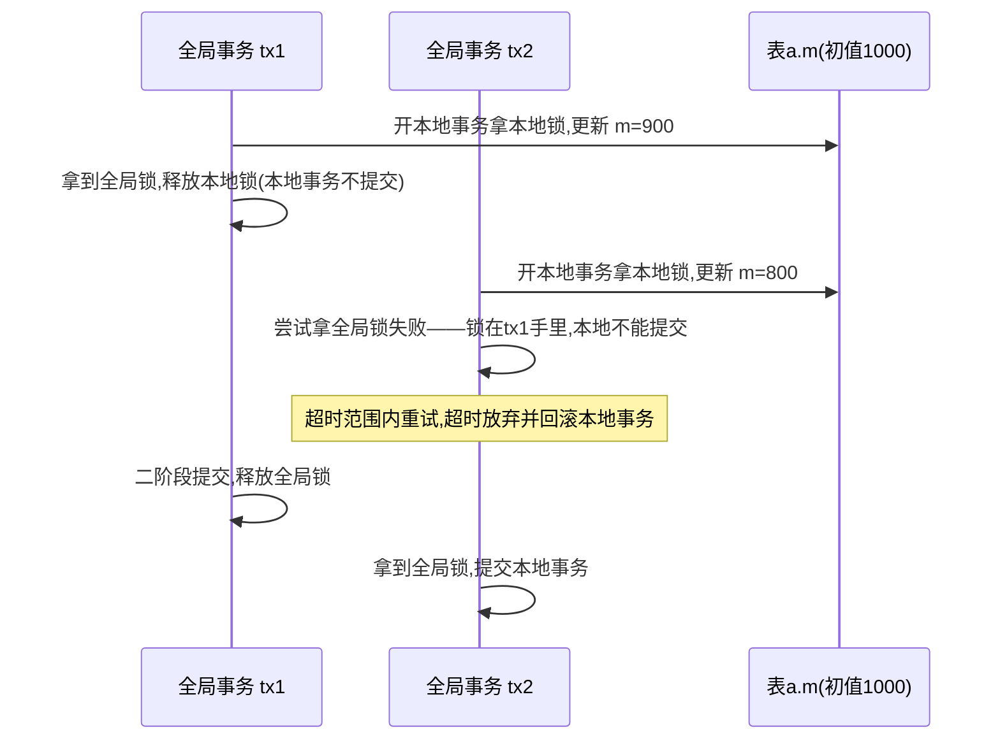

# 秒杀超卖根因与 Redisson 分布式锁实战：CAP、2PC/TCC 理论与 Seata AT 写隔离

秒杀抢单进入数据一致性篇章：一是热点商品并发抢购的超卖，用 Redisson 分布式锁解决，从原理、配置、封装做到 hotAdd 改造；二是下单与库存扣减跨服务跨库，需要分布式事务兜底，从 ACID、CAP 讲到 2PC、TCC，最后落到 Seata 的 AT 模式与写隔离。

## 先给结论

- 超卖根因是数据共享不安全：库存只剩 1 时，A、B 并发判断"库存 > 0"都通过，双双下单。解法是把"判断库存到抢单结束"整段用锁串行化——所有用户抢同一把锁，只有拿到锁的一个能执行。
- 分布式锁三种实现推荐 Redis 或 ZooKeeper：数据库锁（悲观/乐观锁）实现简单但效率低；Redis 性能高、集群部署高可用，市面主流。
- Redisson 加锁、释放锁各是一段 Lua 脚本：key 不存在则 hset 加锁，已存在则返回剩余有效期循环重试；释放锁递减计数，减到 0 删 key 并 publish 通知。watch dog 每 10 秒为未释放的锁续期。缺陷：主从异步复制，故障转移瞬间可能两个客户端同时持锁产生脏数据，概率极小。
- 工程封装 DistributedLocker 接口（lock/tryLock/unlock），实现类 RedissonDistributedLocker；RedisConfig 从 redisson.yml 创建 RedissonClient 和 RedissonConnectionFactory。
- hotAdd 改造要点：锁的是 `LOCKSku_ + id`，不能直接锁商品 key `SKU_ + id`（下面还要操作它）；tryLock 成功才执行库存判断与下单，末尾 unlock 释放。
- 分布式事务 = 参与者、资源服务器、事务管理器分布在不同节点（多个 Service、多个 Resource）。CAP 最多两两成立，只能选 CP 或 AP；2PC 强一致但同步阻塞，TCC 灵活但要写补偿；Seata AT 无侵入自动补偿——一阶段前后镜像与业务 SQL 同一本地事务提交即释放本地锁，二阶段靠全局锁写隔离。

## 超卖从哪来：共享库存被并发判断

热点商品下单入口在 OrderServiceImpl 里，抢单流程是先判断商品数量是否大于 0，再创建订单。问题出在"数量"被共享操作：A 用户判断时数量是 1，B 用户同时判断也是 1，两边都通过校验、都去抢单——库存只有 1 却卖出两单。根因：数据共享不安全。

解决思路是从进入抢单流程到抢单结束做锁的控制：多个用户都先抢同一把锁（对某个变量加锁），抢到的才能往后执行——同一时刻只有一个人在里面，库存判断就精准了。

## Redisson：从 Lua 原理到工程封装

分布式锁解决分布式场景下数据的最终一致问题。单系统单进程里，多线程同时改一个变量，加个同步块就能线性执行；分布式应用多部署多进程，同步块管不到别的进程，必须换分布式锁。三种常见实现：

| 实现方式 | 特点 | 建议 |
| :--- | :--- | :--- |
| 基于数据库 | 利用数据库锁机制（悲观锁/乐观锁），实现非常简单 | 效率低，不推荐 |
| 基于 Redis | 性能好，缓存集群部署保障高可用 | 推荐，市面主流 |
| 基于 ZooKeeper | 同样可用 | 可选 |

Redisson 是 Redis 官方推荐的方案：获取锁、释放锁与 JDK 的 Lock 用法类似；依赖 Redis（使用前必须安装）；支持单机和集群两种实现，本质是设置 Key——多线程抢占同一个 Key。

### 加锁与释放锁的 Lua 实现

加锁 Lua 脚本：

```lua
if (redis.call('exists', KEYS[1]) == 0) then
    redis.call('hset', KEYS[1], ARGV[2], 1);
    redis.call('pexpire', KEYS[1], ARGV[1]);
    return nil;
end;
if (redis.call('hexists', KEYS[1], ARGV[2]) == 1) then
    redis.call('pexpire', KEYS[1], ARGV[1]);
    return nil;
end;
return redis.call('pttl', KEYS[1]);
```

三种情况：key 不存在就 hset 加锁并设过期时间；已存在且是自己持有的（第二个 if）就续期；都不是就返回剩余有效期，客户端循环重试——资源互斥。释放锁对计数递减，有重入就刷新过期时间；减到 0 就 del 删 key 并 publish，其他客户端随即来抢锁。

watch dog（看门狗）每 10 秒检查未释放的锁并自动续期。缺陷：Redis 主从异步同步，客户端 A 在 master 加锁、还没同步到 slave 时 master 宕机，slave 晋升为新 master，B 客户端在新 master 上也能加锁成功——两客户端同时持锁产生脏数据，只在故障转移瞬间发生，概率极小。

### 接口封装与配置

Redisson 核心就加锁、解锁两个流程，工程里定义 DistributedLocker 接口：

```java
public interface DistributedLocker {
    /** 加锁：循环加锁直到拿到 */
    RLock lock(String lockkey);

    /** 加锁：指定超时时间 */
    RLock lock(String lockkey, long timeout, TimeUnit unit);

    /** 加锁：指定等待超时和锁持有时间，防死锁 */
    boolean tryLock(String lockkey, long timeout, long leaseTime, TimeUnit unit);

    void unlock(String lockkey);

    void unlock(RLock lock);
}
```

实现类交给容器管理，注入 RedissonClient，拿锁就是 `redissonClient.getLock(lockkey)`：

```java
@Component
public class RedissonDistributedLocker implements DistributedLocker {
    @Autowired
    private RedissonClient redissonClient;

    @Override
    public RLock lock(String lockkey) {
        RLock lock = redissonClient.getLock(lockkey);
        lock.lock();
        return lock;
    }

    @Override
    public RLock lock(String lockkey, long timeout, TimeUnit unit) {
        RLock lock = redissonClient.getLock(lockkey);
        lock.lock(timeout, unit);
        return lock;
    }

    @Override
    public void unlock(RLock lock) {
        lock.unlock();
    }
}
```

配置创建两个对象。redisson.yml 放核心参数（连接空闲超时、重试次数与间隔、密码等，类似连接池配置）：

```yaml
clusterServersConfig:
  idleConnectionTimeout: 10000
  retryAttempts: 3
  retryInterval: 1500
  reconnectionTimeout: 3000
  failedAttempts: 3
  password: test1234
  subscriptionsPerConnection: 5
  loadBalancer: 'org.redisson.connection.balancer.RoundRobinLoadBalancer'
```

RedisConfig 三步走：加载配置、解析、创建 RedissonClient，再创建 RedissonConnectionFactory 供 RedisTemplate 用：

```java
@Configuration
public class RedisConfig {

    @Bean
    public RedissonClient redissonClient() throws IOException {
        Config config = Config.fromYAML(
                new ClassPathResource("redisson.yml").getInputStream());
        return Redisson.create(config);
    }

    @Bean
    public RedissonConnectionFactory redissonConnectionFactory(RedissonClient redissonClient) {
        return new RedissonConnectionFactory(redissonClient);
    }

    @Bean
    public RedisTemplate<Object, Object> redisTemplate(RedissonConnectionFactory factory) {
        RedisTemplate<Object, Object> redisTemplate = new RedisTemplate<>();
        redisTemplate.setConnectionFactory(factory);
        redisTemplate.setValueSerializer(new StringRedisSerializer());
        redisTemplate.setKeySerializer(new StringRedisSerializer());
        redisTemplate.setHashKeySerializer(new StringRedisSerializer());
        return redisTemplate;
    }
}
```

### 锁测试：只有一个能拿到

写一个 RedissonController 模拟多用户抢锁：请求带休眠时间 time，流程是打印当前休眠标识 → 加锁（key 随手写个 uuuuuu）→ 打印"执行休眠"并 sleep(time) → 打印"休眠完成，准备释放锁" → 释放锁。启动踩坑：配置解析误写成 fromJSON 报错，改回 fromYAML 才正常。浏览器开两个窗口同时请求（端口 18085）：`/redisson/lock?time=15` 和 `/redisson/lock?time=1.5`。第一个拿到锁休眠 15 秒；第二个只打印休眠标识，一直没拿到锁，等第一个 15 秒释放锁才往下执行——抢同一把锁，永远只有一个能拿到。

## 改造 hotAdd：锁住"判断库存到下单"整段

回到秒杀，hotAdd 注入 redissonDistributedLocker，把获取库存到抢单结束的流程包进锁里：

```java
public void hotAdd(Map<String, String> orderMap) {
    String username = orderMap.get("username");
    String id = orderMap.get("id");
    // Redis key
    String key = "SKU_" + id;
    String lockkey = "LOCKSku_" + id;
    String userKey = "USER_" + username + "_ID" + id;

    boolean bo = redissonDistributedLocker.tryLock(lockkey, timeout, leaseTime, unit);
    if (bo) {
        // 获取商品数量
        Integer num = Integer.parseInt(
                redisTemplate.boundHashOps(key).get("num").toString());
        if (num <= 0) {
            return;
        }
        Result<Sku> skuResult = skuFeign.findById(id);
        Sku sku = skuResult.getData();
        // 1. 创建订单
        Order order = new Order();
        order.setTotalNum(1);
        order.setCreateTime(new Date());
        order.setUpdateTime(order.getCreateTime());
        order.setOrderId("No" + idWorker.nextId());
        order.setOrderStatus("0");
        order.setPayStatus("0");
        order.setConsignStatus("0");
        order.setSkuId(id);
        order.setName(sku.getName());
        order.setPrice(sku.getSeckillPrice() * order.getTotalNum());
        orderMapper.insertSelective(order);
        // 2. 记录抢单时间点，24 小时内不能再抢该商品
        redisTemplate.boundValueOps(userKey).set("1");
        redisTemplate.boundValueOps(userKey).expire(timeout, unit);
        // 3. 释放锁
        redissonDistributedLocker.unlock(lockkey);
        return StatusCode.ORDER_OK;
    }
}
```

锁 key 有讲究：不要直接锁商品的 key（SKU_ 前缀那个），下面还要操作它；要锁当前商品对应的"锁定 key"，写成 `LOCKSku_ + id`。抢购同一商品的用户只能一个一个进来，库存判断精准，超卖被堵住。

## 分布式事务：ACID、CAP 到 Seata AT 写隔离

### 事务与 ACID

事务把一个业务涉及的所有操作纳入一个不可分割的执行单元，所有操作均正常执行才能提交，任何一个失败都导致整个事务回滚——要么不做，要么做全套。订单支付是典型：支付成功后要更新订单状态、优惠券状态、给用户添加积分，任何一个失败，前面的都得回滚。

四大特性（面试高频）：

| 特性 | 含义 |
| :--- | :--- |
| 原子性 Atomicity | 所有操作要么全部完成要么全部不完成，不存在中间环节；任何一处出错整体回滚，与没执行一样 |
| 一致性 Consistency | 事务执行前后数据库都处于一致性状态；全部成功或全部失败 |
| 隔离性 Isolation | 并发事务操纵相同数据时，事务间有各自完整的数据空间；未提交的修改查不到，提交后才能看到 |
| 持久性 Durability | 事务成功结束后对数据库的变更永久保存；哪怕数据库崩溃，数据也是改后的 |

分布式事务：参与者、服务器、资源服务器与事务管理器位于不同分布式系统的不同节点之上——多个服务、多个数据库。产生条件：多个 Service、多个 Resource。

### CAP：三者最多两两成立

CAP 定理又叫布鲁尔定理，是分布式系统设计的入门理论。C（一致性）：某节点更新了数据，其他节点能同时读到最新值就是强一致，读不到就是分布式不一致。A（可用性）：非故障节点在合理时间内返回合理响应——时间合理（不能阻塞等半天），响应合理（要 200 不能给 400）。P（分区容错性）：出现网络分区后系统仍能继续工作，集群几台机器故障但整体照常服务。

三者不能同时成立：网络无法 100% 可靠，分区是必然现象，不可能选 CA 架构，只能选 CP 或 AP——CP 放弃可用性追求强一致，ZooKeeper 是典型；AP 放弃强一致追求可用性和分区容错，BASE 理论基于 AP 扩展。选 CP 不是彻底放弃 A：P 概率小，大部分时间仍要保证 CA。CAP 忽略网络延迟，现实中复制总有时间差，存在短暂不一致。

### 2PC 与 TCC

2PC（两段提交协议）两种角色：事务协调者（事务管理器）和多个事务参与者（每个应用的本地事务执行者）。流程：事务管理器通知所有参与者开启事务，各自本地执行增删改，无异常则投"提交"票；全部投提交票，管理器统计后通知所有人提交——准备到投票是第一阶段，统计投票并通知提交/回滚是第二阶段。只要有一个投回滚票，全部节点回滚。优点是强一致性强，适合一致性要求高的关键业务；缺点是牺牲可用性、性能影响大——本地事务执行完要一直等其他参与者投票，期间占用连接资源，不适合高并发。

TCC 是服务化的两阶段编程模型，Try、Confirm、Cancel 三个方法都要自己实现：

| 方法 | 职责 |
| :--- | :--- |
| Try | 预留业务资源/数据校验，检查操作是否可执行，符合就加锁锁定 |
| Confirm | 确认执行业务，实际提交数据；try 成功则 confirm 必定成功，需保证幂等 |
| Cancel | 取消执行业务，实际回滚数据，取消 Try 的预留，需保证幂等 |

事务管理器通知各服务执行 Try，没问题就通知 Confirm 提交；Try 发现问题（如余额不够）就通知 Cancel 取消预留。与 2PC 相比流程更简单、灵活度高；缺点：一致性比 2PC 差——Try 都通过、Confirm 阶段一旦异常，前面数据没法回滚；Confirm 或 Cancel 可能失败，得按业务写补偿代码，还要考虑幂等。

### Seata 与 AT 模式写隔离

Seata 是当前微服务下解决分布式事务的最主流方案：开源的分布式事务解决方案，致力于在微服务架构下提供高性能、简单易用的分布式事务服务。前身在阿里内部扮演分布式一致性中间件，支撑历年双十一；2019 年开源，最初叫 Fescar，蚂蚁金服加入后改名 Seata。支持 Dubbo、Spring Cloud、Sofa-RPC、Motan、gRPC 等主流框架，一个注解就能启用；提供 AT、TCC、SAGA、XA 四种模式（XA 还在开发中）。AT 是无侵入自动补偿的事务模式，只需每个数据库建一张事务日志表；TCC 可与 AT 混用；SAGA 面向长事务，用得不多。TC 是独立服务，支持集群部署，低版本没有集群能力，选 0.8 以上版本。项目里非热点商品抢单库存递减成功后才下单，下单失败需库存回滚，就用 Seata 管。

术语先分清：

| 角色 | 职责 |
| :--- | :--- |
| TC 事务协调者 | 维护全局和分支事务的状态，驱动全局事务提交或回滚 |
| TM 事务管理器 | 定义全局事务范围：开始、提交、回滚全局事务 |
| RM 资源管理器 | 管理分支事务资源，向 TC 注册分支并报告分支事务状态，驱动分支提交或回滚 |

AT 模式两个前提：基于支持本地 ACID 事务的关系型数据库（Redis 不行），Java 应用通过 JDBC 访问数据库。机制是两阶段提交协议的演变：

- 一阶段：业务数据和回滚日志在同一个本地事务中提交，并释放本地锁和连接资源。以一条 update 为例：先解析 SQL，查出修改前的数据存入 undo_log 表，执行修改，修改后的数据也存入 undo_log——存前镜像、执行业务、存后镜像三步在同一个本地事务里，日志与业务同成功同失败，提交即释放连接。
- 二阶段：提交异步化。全局提交成功就异步删除 undo_log；全局回滚则按日志反向补偿——用操作前快照恢复数据，恢复前还要校验当前数据与操作后的快照一致，否则就是发生了脏写。这套流程被框架封装好，业务代码无感。

写隔离三条规则：一阶段本地事务提交前必须先拿到全局锁；拿不到全局锁不能提交本地事务；拿锁尝试限制在一定范围内，超出就放弃，并回滚本地事务、释放本地锁。举例：全局事务 tx1、tx2 都更新表 a 的 m 字段（初值 1000，各减 100）：



tx1 先来：开本地事务拿本地锁，更新 m=900，然后拿该记录的全局锁，拿到之后才释放本地锁——全局锁到手才放本地锁。tx2 再来：同样能拿到本地锁修改数据（tx1 本地锁已释放，全局事务虽未提交），但改完不能提交——它还没拿到全局锁；全局锁在 tx1 手里，tx2 只能在超时范围内不停尝试。两种结局：tx1 二阶段全局提交，释放全局锁，tx2 拿到锁提交本地事务，m 变成 800；tx1 二阶段全局回滚，要重新获取本地锁做反向补偿，但本地锁被 tx2 持有，回滚失败——tx1 一直重试，直到 tx2 全局锁超时放弃、本地回滚释放锁，tx1 再拿锁完成回滚。全局锁始终在 tx1 手里，tx2 提交不了，最终只能回滚——脏数据不会发生。

## 小结

前半段解决"抢"，后半段解决"一致"。超卖根因是共享库存被并发判断，Redisson 把抢单关键段串行化堵住超卖：Lua 加锁释放锁、watch dog 续期、DistributedLocker 封装、hotAdd 锁 `LOCKSku_` key。分布式事务理论坐标：ACID 四性、CAP 三选二只能 CP 或 AP；2PC 强一致但同步阻塞，TCC 灵活但要写补偿；Seata AT 用 undo_log 前后镜像、一阶段本地提交即释放本地锁、全局锁写隔离，无侵入自动补偿，后续章节用它处理抢单与库存回滚。
