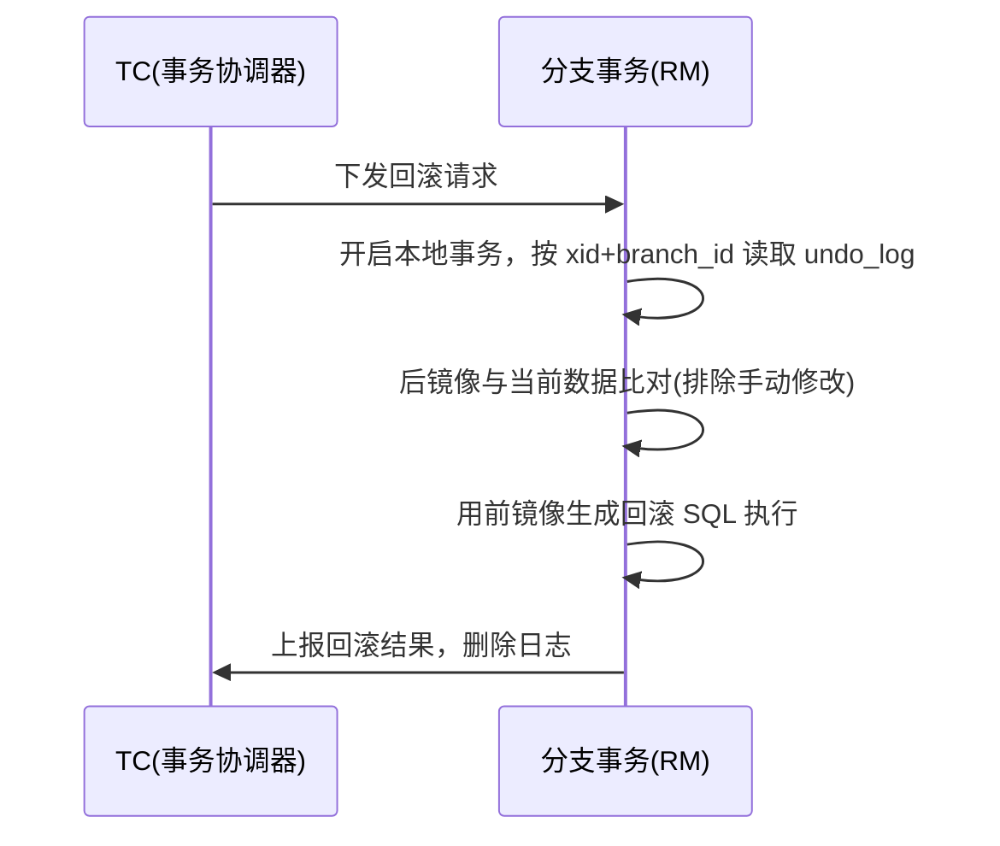

# Seata AT 读隔离与 undo_log 工作流：抢单分布式事务落地与 WebSocket 开篇

秒杀的数据一致性还没有收尾。这一篇补齐 Seata AT 模式的读隔离与完整工作流，对比 TCC、Saga 两种模式，然后把 Seata 真正接入抢单链路，用一次人为异常验证跨服务回滚，最后进入 WebSocket 篇章——热点商品排队下单后，订单状态要靠长连接推送。

## 先给结论

- Seata AT 的默认全局隔离级别是读未提交；需要读隔离时，只能对 `select ... for update` 做代理：执行时向 TC 申请全局锁，拿不到就释放本地锁并阻塞重试，直到拿到锁、读到其他事务已提交的数据为止。普通 select 一律不代理，否则查询远多于增删改的系统性能会明显下降。
- AT 一阶段：解析业务 SQL 查出前镜像 → 执行业务 SQL → 按主键查出后镜像 → 前后镜像连同业务信息插入 undo_log，这一切与业务操作在同一个本地事务里提交；本地事务提交前，先向 TC 申请该行数据的全局锁。
- 二阶段提交是异步的：请求进入异步任务队列，提交成功后批量删除 undo_log；二阶段回滚则按 xid + branch_id 找到 undo_log，先拿后镜像与当前库中数据比对，确认没被手动改过，再用前镜像生成回滚 SQL 恢复数据。
- 每个参与分布式事务的数据库都必须建 undo_log 表（唯一键 `ux_undo_log(xid, branch_id)`），且不同 Seata 版本的表结构有差异，要按所用版本建表。
- TCC 不依赖底层数据源的事务支持，Prepare/Commit/Rollback 三个逻辑全部自己实现；Saga 面向长业务流程，各参与者直接提交本地事务，某一步失败就补偿前面已成功的步骤，无锁、事件驱动、吞吐高，但不保障隔离性——两者的补偿代码都要自己开发。
- 抢单链路（扣库存 → 下单 → 支付日志）跨三个微服务，Spring 本地事务管不了，用 Seata AT 五步接入：各库建 undo_log、装 TC、配代理数据源、配 registry/file.conf 与事务组、下单方法加 @GlobalTransactional。验证方式：下单中途抛 ArithmeticException，库存停在 999 而不是减到 998，即回滚生效。

## AT 模式：undo_log 工作流与读隔离

undo_log 是 AT 模式的地基：只要做分布式事务，每个参与业务的数据库都必须建这张表，用来存放回滚所需的镜像数据。

```sql
CREATE TABLE `undo_log` (
  `id` bigint(20) NOT NULL AUTO_INCREMENT,
  `branch_id` bigint(20) NOT NULL,
  `xid` varchar(100) NOT NULL,
  `context` varchar(128) NOT NULL,
  `rollback_info` longblob NOT NULL,
  `log_status` int(11) NOT NULL,
  `log_created` datetime NOT NULL,
  `log_modified` datetime NOT NULL,
  PRIMARY KEY (`id`),
  UNIQUE KEY `ux_undo_log` (`xid`,`branch_id`)
) ENGINE=InnoDB DEFAULT CHARSET=utf8;
```

一阶段以 product 表的一次更新为例：

```sql
-- 解析业务 SQL 的条件并替换成查询语句，得到修改前的数据（前镜像）
select id, name, since from product where name = 'TXC';
-- 执行业务 SQL
update product set name = 'GTS' where id = 1;
-- 按主键定位，查出修改后的数据（后镜像）
select id, name, since from product where id = 1;
```

前镜像、业务 SQL、后镜像组装成一条回滚日志插入 undo_log，并且与业务更新在同一个本地事务中提交；本地事务提交前，先向 TC 申请 id=1 这行数据的全局锁。二阶段分两条路：

- 提交：TC 通知提交，请求放进异步任务队列执行，提交成功后批量删除 undo_log——日志不能一直堆着，否则表会被撑爆。
- 回滚：收到 TC 的回滚请求后重新开启本地事务，通过 xid + branch_id 去 undo_log 里找日志；回滚前先拿后镜像与当前库中数据比对，若数据被人手动改过要走额外策略处理，没改过则直接用前镜像恢复；恢复完成后提交本地事务，删除日志并把执行结果上报 TC。



读隔离方面，AT 的默认隔离级别是读未提交——查数据一般不需要隔离，Seata 也不会为普通 select 做任何代理。确有"读的时候不允许别人改"的需求，必须显式写 for update：

```sql
select m from a where id = 1 for update;
```

Seata 只对带 for update 的 select 做代理：执行该查询时向 TC 申请全局锁；全局锁若被其他事务持有，就释放这条语句的本地锁并阻塞重试（Blocking... Retry SELECT），一直持续到拿到全局锁为止——此时返回的是其他事务已提交的数据。出于整体性能考虑，代理范围被严格限制在 for update 查询上：一个系统里查询的概率远高于增删改，对所有 select 代理必然拖垮效率。想要读隔离，就得自己加上 for update。

## TCC 与 Saga：不依赖 undo_log 的两条路

TCC 同样是两阶段提交模型：全局事务由若干分支事务组成，每个分支事务都要具备一阶段 Prepare、二阶段 Commit 或 Rollback 行为。区别在于 AT 基于"支持本地 ACID 事务的关系型数据库"，一阶段是业务数据与 undo_log 在本地事务中一起提交，二阶段提交是异步清理日志、回滚靠日志做反向补偿；TCC 则不依赖底层数据资源的事务支持，Prepare 调用自定义的 Prepare 逻辑，Commit、Rollback 也调用自定义逻辑——三段代码全要自己写。所谓 TCC 模式，就是支持把自定义的分支事务纳入到全局事务的管理中。

Saga 是 Seata 提供的长事务解决方案，理论基础是 Hector 与 Kenneth 1987 年发表的论文《Sagas》，适合业务流程长、参与者多、甚至跨公司对接的场景——比如公司 A 的系统要对接另一家公司的 B 系统，对方无法提供 TCC 模式要求的三个接口。Saga 的做法是：业务流程中每个参与者都直接提交本地事务，某个参与者失败时，逐个补偿前面已经成功的参与者。

| 模式 | 依赖 | 代码量 | 特点 |
| :--- | :--- | :--- | :--- |
| AT | 支持本地 ACID 的关系型数据库，需建 undo_log | 无侵入 | 自动前后镜像补偿，默认读未提交 |
| TCC | 不依赖底层数据源的事务支持 | Prepare/Commit/Rollback 三接口自定义 | 把自定义分支事务纳入全局事务管理 |
| Saga | 无 | 补偿逻辑自行开发 | 无锁、事件驱动、参与者可异步执行；不保障隔离性 |

Saga 的优势：一阶段提交本地事务、无锁、性能高；基于事件驱动，参与者可异步执行、吞吐量高；补偿各自维护、易于实现。缺陷是不能保障隔离性，官方用户文档给出了应对方案。两者都绕不开自己写业务逻辑，这也是项目里优先选 AT 的原因。

## 抢单链路接入 Seata：五步配置与回滚验证

非热点商品抢单的 add(Order) 流程是：先通过 Feign 调用库存微服务递减库存，成功后下单写订单库，中间还应记录一条支付日志（paylog 微服务）。程序按正常流程执行没有问题，但任何一步都可能因特定场景发生异常：库存扣成功、下单失败，或者前两步都成功、支付日志失败——需要让前面成功的库存微服务跟着回滚。这种跨微服务的事务回滚，Spring 自身的事务实现不了，必须用分布式事务，方案选 Seata 的 AT 模式。落地按五步走：

1. 在参与分布式事务的数据库里建 undo_log。涉及两个微服务：库存微服务对应的商品库、订单微服务对应的订单库，两边都要执行一遍建表脚本，各多一张存回滚信息的表。
2. 安装 TC（事务协调器），全局事务管理与全局锁申请都经过它。从 GitHub 下载 seata-server，可选 1.2.0、1.1.0、1.0；稳定版从 0.6 开始，建议不低于 0.8，更早的版本还不叫 Seata，叫 Fescar（Fast Easy Commit And Rollback）。压缩包三个目录：bin 可执行文件、conf 配置脚本、lib 内部依赖包，Windows 下双击 bin 里的 seata-server.bat 就能启动。课程最终用 Docker 容器部署：

```bash
docker run -d --name seata -p 8191:8091 seataio/seata-server:latest
```

   TC 默认端口 8091，演示环境里它与其他应用端口冲突，改用 8191 启动，`docker ps` 看到端口为 8191 的容器即安装完成。

3. 配置代理数据源。SQL 解析、前后镜像提取、快照保存整体发生在代理数据源里——业务代码看不到这些操作，配好代理数据源，流程由框架自动完成。工程上把这部分抽成独立模块 seckill-seata，谁需要分布式事务谁就依赖它。模块引入 mybatis 依赖（作用范围 provided，保证编译不出错即可）和 spring-cloud-starter-alibaba-seata，然后写三个 Bean：

```java
@Configuration
public class DataSourceConfig {

    @Bean
    @ConfigurationProperties(prefix = "spring.datasource")
    public DruidDataSource dataSource() {
        return new DruidDataSource();
    }

    @Bean
    public DataSourceProxy dataSourceProxy(DruidDataSource dataSource) {
        // io.seata.rm.datasource.DataSourceProxy，SQL 解析与快照保存在这里完成
        return new DataSourceProxy(dataSource);
    }

    @Bean
    public SqlSessionFactory sqlSessionFactory(DataSourceProxy dataSourceProxy) throws Exception {
        SqlSessionFactoryBean factoryBean = new SqlSessionFactoryBean();
        // MyBatis 的数据源必须换成代理数据源
        factoryBean.setDataSource(dataSourceProxy);
        return factoryBean.getObject();
    }
}
```

   这一步的关键是 SqlSessionFactory 注入的数据源要换成 DataSourceProxy，持久层走的才是被代理的连接。

4. 配置微服务与 TC 的交互信息和注册信息，即 registry.conf 与 file.conf 两个文件。注册方式可选 file、nacos、eureka、redis、zk、consul 等，课程选默认的 file；与 TC 的交互基于 Netty，transport 段不用动，重点是 file.conf 的 service 段：

```text
service {
  # 事务组名，自取；参与分布式事务的微服务必须与它保持一致
  vgroup_mapping.seckill = "default"
  # TC 地址，IP + 端口，这个一定要改
  default.grouplist = "127.0.0.1:8191"
}
```

5. 指定谁参与全局事务。goods 和 order 两个工程依赖 seckill-seata 模块，并在各自的配置文件里绑定同一个事务组：

```yaml
alibaba:
  seata:
    tx-service-group: seckill
```

   最后在下单方法上打一个注解，全局事务声明即完成：

```java
@GlobalTransactional
@Override
public int add(Order order) { ... }
```

测试启动库存微服务、订单微服务和网关，清空订单表，选一个非热点商品（库存 1000）。Postman 正常下单：库存减到 999、订单多一条，链路没问题。接着制造异常——在库存递减成功之后、下单之前插入一行：

```java
int q = 10 / 0; // 制造异常：能执行到这里，说明库存递减一定已成功
```

重启订单服务再测：控制台抛出 by zero 异常，订单没有新增，再看库存——仍是 999。判断口径很简单：库存是 999 说明分布式事务生效、库存被回滚；如果减到 998，说明事务失效。异常本身不是目的，验证的是"库存递减 + 下单"这条跨服务链路能否一起回滚。

一个版本相关的坑：1.0 以上版本开箱即用；0.8 及更低版本里，全局异常处理器会把异常拦截掉，Seata 感知不到失败、事务不回滚，需按官方提供的 AOP 方案处理（切面捕获异常手动回滚）。直接用高版本可以省掉这些麻烦。

## WebSocket 开篇：从轮询到长连接

分布式事务解决的是非热点商品直单的一致性，热点商品抢单还有另一个问题：用户排队下单，无法立刻拿到订单状态，前端需要在排队之后继续与服务端保持连接、查询数据。传统做法是 Ajax 轮询——定时向服务端发 HTTP 请求。缺陷有二：每次请求都要封装完整的请求头等规范数据，HTTP 请求头较长而有效数据只占很小一部分，白白消耗带宽；定时查询必然有延时误差，轮询间隔 2 秒，数据误差就在 2 秒以内，间隔 10 秒误差就放大到 10 秒。

WebSocket 是 HTML5 开始提供的、在单个 TCP 连接上进行双向通信的协议。浏览器与服务器只需完成一次握手，两者之间就直接建立持久性连接并进行双向数据传输：服务端可以向客户端推送数据，客户端也可以向服务端发送数据，请求头只封装一次，数据量只取决于发送的内容本身。热点商品抢单的订单状态通知就采用 WebSocket 长连接实现。

| 对比项 | Ajax 轮询 | WebSocket |
| :--- | :--- | :--- |
| 通信模式 | 请求-响应，响应即会话结束 | 一次握手建持久连接，任一方主动关闭才结束 |
| 头部开销 | 每次查询都封装请求头，有效数据占比小 | 请求头只封装一次 |
| 实时性 | 定时查询，误差随轮询间隔放大 | 服务端有更新立即推送，低延时 |
| 数据量 | 被冗余规范数据拖累 | 只取决于发送的数据本身 |

WebSocket 本质基于 TCP。客户端建连时先发一个 HTTP 请求，但请求头里带 `Upgrade: websocket`，声明这是一次协议升级；服务端解析到该属性，就与客户端建立连接——连接有状态、长期保持，与无状态的普通 HTTP 有本质区别；保持期间双方随时传输数据，直到任何一方主动关闭，会话才结束。

前端的 WebSocket API 用法与 Java 几乎一样，围绕项目要用到的部分：创建对象 `var socket = new WebSocket(url, [protocol])`，第一个参数是连接地址，第二个是对应的协议信息。两个只读属性：readyState 表示连接状态——0 尚未建立连接（不能与服务端通信）、1 已建立（双方可互发数据）、2 正在关闭、3 已关闭或连接打不开；bufferedAmount 是已调用 send() 但尚未传输出去的 UTF-8 字节数——send 的数据先进队列等待传输，不是立刻到达。四个事件：onopen 连接建立时触发；onmessage 接收服务端推送，msg.data 即文本内容；onerror 捕获通信异常；onclose 连接关闭时触发——浏览器页面一关就会自动调用。两个方法：socket.send() 发送数据，socket.close() 主动关闭连接。

客户端完整实现：

```javascript
var socket;
if (typeof (WebSocket) == "undefined") {
    console.log("您的浏览器不支持WebSocket"); // 老浏览器（如 IE8）不支持
} else {
    console.log("您的浏览器支持WebSocket");
    // 创建 WebSocket 对象，指定服务器地址与端口
    socket = new WebSocket("ws://localhost:18085/socket/zhangsan");
    // 连接建立事件
    socket.onopen = function () {
        console.log("Socket 已打开");
    };
    // 获得消息事件，msg.data 为服务端推送的文本
    socket.onmessage = function (msg) {
        $("#msg").append(msg.data + "<br/>");
    };
    // 关闭事件
    socket.onclose = function () {
        console.log("Socket已关闭");
    };
    // 发生了错误事件
    socket.onerror = function () {
        alert("Socket发生了错误");
    };
}

// 主动关闭连接
function closeWebSocket() {
    socket.close();
}

// 发送消息
function send() {
    var message = document.getElementById("text").value;
    socket.send(message);
}
```

演示时把地址指向一个公网上用于测试的公共 WebSocket 服务：页面打开即建立连接，输入 hello 发送，服务端回显"你发送的消息是 hello"；调用关闭方法后再发消息没有任何响应；刷新页面重新建立连接，又能继续收发。

## 小结

- AT 模式靠 undo_log 表工作：一阶段前后镜像与业务 SQL 在同一本地事务提交、提交前申请全局锁；二阶段提交异步删日志，回滚按日志做反向补偿，回滚前用后镜像比对排除手动改数据。
- 读隔离默认关闭（读未提交），select for update 是唯一入口：申请全局锁、阻塞重试，普通 select 不代理。
- TCC 把自定义分支事务纳入全局事务管理，三段逻辑全手写；Saga 面向长流程与跨公司场景，本地事务直接提交、失败逐个补偿，无锁高性能但不保障隔离性。
- 抢单链路按五步接入 Seata AT：双库建 undo_log、Docker 装 TC（8191）、seckill-seata 模块配代理数据源、registry.conf/file.conf 定事务组与 TC 地址、add 方法加 @GlobalTransactional；10/0 异常后库存停在 999 即验证回滚生效。
- WebSocket 用单 TCP 双向通信替代 Ajax 轮询，解决热点商品排队下单后的订单状态推送问题；前端两个属性、四个事件、send/close 两方法即可完成客户端。服务端实现与 Netty 集成是下一篇的主题。
