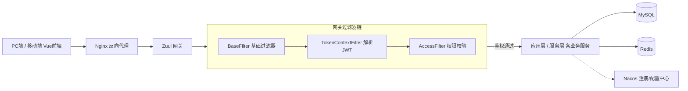

# 中台概述与常用组件上篇：能力共享、阿里中台战略与品达通用权限系统

这一章把"中台化"拆成两条线：先把中台的概念、背景与分类讲透，再进入常用组件服务介绍的上半部分——品达通用权限系统。组件部分不是带着从头开发，而是把现成服务的功能、重点代码与运行方式交代清楚，让后续项目能直接用起来。

## 先给结论

- 中台的核心思想是能力复用，催生基石是能力共享：把后台系统中针对技术、业务、组织的通用模块/服务抽离成自治服务，提供给多个前台使用。只服务一个前端应用的服务，不叫中台。
- 中台是个旧名词，真正落地靠阿里巴巴：2017 年借《企业 IT 架构转型之道》解读中台战略，落地为业务中台与数据中台；之后滴滴、京东跟进，衍生出技术中台、内容中台等形式。
- 中台按共享能力分四类：业务中台、技术中台、研发中台、数据中台；建设要企业有规模、业务丰富，渐进式沉淀，不是一蹴而就。
- 品达通用权限系统基于 Spring Cloud + Spring Boot、前后端分离，解决权限功能的重复开发；工程分 pd-tools（公共组件）与 pd-apps（网关 + 权限服务），可当新项目的开发脚手架。
- 网关鉴权靠三个过滤器：BaseFilter 提供公共方法，TokenContextFilter 解析 JWT 用户信息，AccessFilter 统一鉴权。
- 系统运行依赖 MySQL（pd_auth 库）、Nacos、Redis；Nacos 地址定义在 pd-apps 的 POM profile 中，bootstrap.yml 用占位符引用。

## 中台是什么：从重复造轮子到能力共享

任何软件系统都是通过帮客户解决问题实现价值的。针对不同需求建立不同的项目，项目包含客户端应用与后台管理配置应用，久而久之形成固定的"前台 + 后台"结构：前台负责展示，后台承载业务。

问题出在时间上：项目做多了就发现，做第二个项目时很多功能不用重写，把老项目的公共模块拿出来稍改就能用。既然"稍改就能用"，说明这些逻辑共性极大，重复开发就是巨大的资源浪费。

中台的解法是：将"后台"系统中针对技术、业务、组织的通用"模块/服务"从固定项目中抽离出来，使之成为自治的服务，提供给更多的"前台"使用。它的视角比抽公共方法高一层——方法只能在项目内复用，跨项目就失效了；中台复用的是模块和服务，其他前台系统想调某个业务、拿某些数据，直接访问这个服务即可。

两个判断标准：中台是 IT 信息化过程中经验总结的产物，把经验从具体场景抽离出来服务于更多场景，即能力复用；中台的催生基石是能力共享，只服务一个前端应用就不是中台。同时中台是为业务服务的，要根据企业业务演进逐渐积累，建设不是一蹴而就；企业要有一定规模、业务比较丰富，才值得提炼共性形成共享能力。

## 阿里中台战略：业务中台与数据中台

"中台"很早就被提出过，但一直停留在理论层面，最早把它实践出来的是阿里巴巴——因为阿里的业务足够繁杂。2017 年，阿里通过《企业 IT 架构转型之道：阿里巴巴中台战略思想与架构实践》这本书系统解读了中台战略思想。

阿里中台的应用场景：业务种类繁杂、个人/企业会员数量庞大、不同业务相互交叉依赖、需要根据需求变化快速响应的 O2O 线上线下协同电商场景。它把技术、数据、业务能力从前台剥离，主要形成两块：

**业务中台**针对电商交易，覆盖售前、售中、售后，划分为许多中心服务：会员中心、商品中心、交易中心、评价中心、店铺中心、支付中心、营销中心、库存中心，贯穿整个电商业务流程。淘宝、天猫、1688、聚划算、菜鸟物流都需要会员、商品、交易、评价，每个应用各写一遍成本极高，于是把这些公共业务下沉，抽取成服务共享。

**数据中台**提供大数据相关的计算、存储、共享能力，把线上与线下数据源连接打通，实现决策分析、精准营销；数据计算、数据存储、消息等服务都在这一层，反过来支撑业务中台。

从阿里公开的中台架构图看：顶层是集团业务（1688、淘宝、天猫、聚划算、阿里妈妈、菜鸟物流）；中层是业务中台（用户中心、商品中心、交易中心、支付中心、评价中心、搜索中心、营销中心、物流中心、仓储中心等）与数据中台；底层是分布式应用服务平台 EDAS，其下有弹性计算服务 ECS、数据服务 RDS/DRDS、存储服务 OSS、消息服务 MQ、缓存服务 OCS、开放数据处理服务 ODPS，再往下是盘古、夸父、钟馗、女娲等基础服务。

## 中台的四类划分

中台是企业级共享能力平台，按共享能力的类型分四类：

| 类别 | 关注点 | 典型内容 |
| :--- | :--- | :--- |
| 业务中台 | 核心业务能力的提取与共享 | 领域业务中台、公共业务中台；阿里的用户/商品/交易/支付等中心 |
| 技术中台 | 云基础设施与技术中间件的整合封装 | 微服务、分布式缓存、消息队列、搜索引擎、分布式数据库；框架、基础服务、基础组件 |
| 研发中台 | 开发效率与研发流程规范 | 项目管理、质量管理、服务监控、运维部署平台；开发/部署流水线、持续交付 |
| 数据中台 | 数据价值的挖掘与利用 | 数据采集、计算、存储、加工、分析；数据应用、数据平台 |

**业务中台**代表企业核心业务特征的中台结构，实现后端业务资源到前台应用能力的转化。**技术中台**与具体业务无关，把云基础设施上的技术中间件沉淀成易用的能力接口，为前台应用和业务中台提供基础设施重用能力，缩短建设周期。**研发中台**关注开发效率：软件开发是工程，涉及项目管理、团队协作、流程、测试部署、监控，把这些环节的最佳实践沉淀为可重用能力。以开发流水线为例，涉及源代码版本管理、分支的创建/合并/提交、半成品的构建存储与使用、产品构建；部署到指定环境上线运行则属于部署流水线的职责。**数据中台**对企业内外部海量数据做采集、计算、存储、加工、分析，数据能力直接服务于业务，多个项目都能基于它做数据分析。

## 品达通用权限系统：脚手架式的权限中台

常用组件共介绍三个服务：通用权限系统、注册登录服务、分布式 ID。通用权限系统的代码量非常庞大，没有十几天开发不完，所以直接把服务交出来，目标是后续项目能用起来。

企业项目绝大部分都需要用户权限管理：认证、鉴权、加密解密、XSS 防跨站攻击。这些功能实现思路基本一致，却要在每个项目里实现一次。品达通用权限系统针对这个问题提供一整套通用权限解决方案，基于 Spring Cloud（Hoxton.SR1）+ Spring Boot（2.2.2.RELEASE），支持多业务系统并行开发。

工程前后端分离。后端父工程 pinda-authority 分两大模块：**pd-tools** 是常用组件集合（common、core、database、dozer、j2cache、jwt、log、swagger 等），可单独打 jar 包复用；**pd-apps** 是应用副工程，含 pd-gateway（网关，做鉴权）与 pd-auth（再分 api 接口、entity 实体、server 权限服务三模块）。系统要跑两个服务：网关服务与权限服务（pd-auth-server）。前端基于 Node.js + Vue，解压后执行 `npm run dev` 跑起来。

核心技术栈：Zuul 网关，Nacos 服务注册与配置中心，Feign 远程调用，Ribbon 负载均衡，Hystrix 熔断，JWT 鉴权（认证通过下发令牌，前端每次请求携带，网关解析判权），持久层 MyBatis Plus，前端请求经 Nginx 反向代理进网关。环境要求：JDK 1.8+、Maven 3.3+、MySQL 5.6.0+、Redis 4.0+、Nacos 1.3.0、Node.js 11.3+。

功能定位两块：一是用户权限管理（权限、角色、用户、菜单、岗位、组织数据维护）与统一认证鉴权；二是微服务开发框架——新项目把工程拿过去，在 pd-apps 下创建自己的应用模块，权限与公共组件直接复用。

有一个前提必须分清：这套权限系统控制的是**企业内部用户**。内部办公系统没有注册功能，新员工由管理员开账号；互联网上任何人都能注册登录的 C 端用户是另一个体系，对应后面的注册登录服务。应用场景两种：新项目开发，直接以工程为脚手架；已有项目集成，单独部署权限服务并做改造——前端业务页面嵌入权限系统的前端工程，请求地址改造为经过网关，否则无法鉴权。

### 网关服务的三个过滤器

网关层统一鉴权是这套系统的灵魂，重点代码集中在三个过滤器上：



**BaseFilter** 是基础网关过滤器，一个抽象父类：网关底层是 Zuul，所有过滤器必须继承 ZuulFilter；父类没加 @Component、不会实例化，只定义公共方法供子类调用——路由获取、忽略 token 与资源的判断（登录页图片这类资源应直接放行）、从请求取 token、失败响应：

```java
protected String getTokenFromRequest(String headerName, HttpServletRequest request) {
    // 优先从请求头取 token；取不到再从参数取，推荐用头信息传递
    String token = request.getHeader(headerName);
    if (StringUtils.isEmpty(token)) {
        token = request.getParameter(headerName);
    }
    return token;
}

protected void setFailedRequest(String body, int code) {
    RequestContext ctx = RequestContext.getCurrentContext();
    ctx.setResponseStatusCode(code);
    ctx.addZuulResponseHeader("Content-Type", "application/json");
    if (ctx.getResponseBody() == null) {
        ctx.setResponseBody(body);
    }
    ctx.sendZuulResponse(false); // 不再路由，即不放行
}
```

**TokenContextFilter** 解析 token 中的用户信息，子类加了 @Component 才真正生效，注入 authClientProperties（headerName、publicKey 等配置）与 JWT 解析工具类。run() 是所有请求的必经之路：先判断是否忽略 token，忽略则 return（return null 即放行）；否则取 token 交工具类解析，开发环境支持测试 token 直接构造用户信息；解析得到 JwtUserInfo（账号 ID、账号名、姓名、单位、岗位 ID 等），写入 Zuul 请求头传给下游：

```java
public Object run() {
    RequestContext ctx = RequestContext.getCurrentContext();
    HttpServletRequest request = ctx.getRequest();

    if (isIgnoreToken()) {
        return null; // 无需校验 token，放行
    }

    String userToken = getTokenFromRequest(authClientProperties.getUser().getHeaderName(), request);
    JwtUserInfo userInfo;
    try {
        if (isDev() && StrPool.TEST.equalsIgnoreCase(userToken)) {
            // 开发环境测试 token，直接构造用户信息
            userInfo = new JwtUserInfo(1L, "pinda", "品达");
        } else {
            // 解析 JWT，还原 userId、account、name、orgId、stationId 等
            userInfo = jwtTokenClientUtils.getUserInfoFromToken(userToken);
        }
    } catch (BizException e) {
        errorResponse(e.getMessage(), e.getCode(), 200);
        return null;
    }

    if (userInfo != null) {
        // 用户信息写入 Zuul 请求头，供下一个过滤器与下游服务使用
        addHeader(ctx, BaseContextConstants.JWT_KEY_ACCOUNT, userInfo.getAccount());
        addHeader(ctx, BaseContextConstants.JWT_KEY_USER_ID, userInfo.getUserId());
        addHeader(ctx, BaseContextConstants.JWT_KEY_NAME, userInfo.getName());
        addHeader(ctx, BaseContextConstants.JWT_KEY_ORG_ID, userInfo.getOrgId());
    }
    return null; // 放行
}
```

**AccessFilter** 是权限验证过滤器，真正做鉴权：同样先判断 isIgnoreToken、isIgnoreResourceByRoute、isIgnoreResource 三类跳过条件，再获取用户角色与请求资源做权限匹配，通过则放行，不通过返回"权限不足"。

### 权限服务的重点控制器

权限服务 pd-auth-server 的核心是一组控制器，按三个包组织。**core 核心包**：OrgController（组织管理，树形结构，含分页查询、增删改、组织树查询）、StationController（岗位管理）。**common 包**：AreaController（行政区域）、DashboardController（首页统计，从日志表查系统访问记录）、登录日志与操作日志两组日志控制器、一个测试 j2cache 的控制器（实际运行无意义）。**auth 包**：UserController（用户）、RoleController（角色）、RoleAuthorityController（角色-资源关系表）、ResourceController（资源）、MenuController（菜单）、LoginController（登录、验证码生成与校验）。

控制器之下是 BIZ 包的 Service 与 DAO；AuthManager 处理简单登录、普通登录、获得 token、校验 token。登录时验证验证码，通过后生成 token，查出用户可见资源转为权限集合，连同用户信息返回。api 模块定义 Feign 接口，entity 模块按包划分实体。权限数据维护在权限服务，鉴权执行在网关服务，职责就此分开。

### 跑起来：环境与配置

运行前准备三类基础环境。**数据库**：docs/sql 目录下有建表脚本，本地创建名为 pd_auth 的数据库执行脚本：
| 表 | 用途 |
| :--- | :--- |
| pd_auth_menu | 菜单表，含初始化菜单数据 |
| pd_auth_resource | 资源（权限）表，含初始化权限数据 |
| pd_auth_role | 角色表，预置平台管理员等角色 |
| pd_auth_role_authority / pd_auth_role_org | 角色-权限、角色-组织关系表 |
| pd_auth_user / pd_auth_user_role | 用户表与用户-角色关系表 |
| pd_auth_org / pd_auth_station | 组织表与岗位表 |
| pd_area | 区域（行政区域）表 |
| pd_common_log | 登录日志表，每次登录都记录；另有操作日志表 |

**Nacos**：项目提供配置导出包（docs/nacos 下），内含 redis.yml、mysql.yml 及各服务配置，Nacos 跑起来后用控制台导入。注意按自己环境改 IP：配置里 Redis 写的是 localhost，MySQL 同理，数据库名与建的库一致（pd_auth）就不用改；远程服务器改成对应 IP，把端口、密码改对。**Redis** 作为缓存提前准备好。

Nacos 位置在哪配置？在 pd-apps 对应的 POM 文件里：以 profile 方式定义（开发环境 dev 激活），包含 pinda.nacos.ip、端口（默认 8848）与 namespace。bootstrap.yml 全部用占位符引用，源头就是 POM：

```yaml
spring:
  cloud:
    nacos:
      config:
        server-addr: ${pinda.nacos.ip}:${pinda.nacos.port}
        file-extension: yaml
        namespace: ${pinda.nacos.namespace}
        ext-config[0]:
          data-id: redis.yml
          group: DEFAULT_GROUP
          refresh: true
        ext-config[1]:
          data-id: mysql.yml
          group: DEFAULT_GROUP
          refresh: true
```

所以描述 Nacos 位置直接改 POM 这一处即可，其余配置都是引用。环境就绪后启动 ZuulServerApplication（网关）与 AuthorityApplication（权限服务），启动时从 Nacos 拉取配置，两个服务都跑起来，这套系统的后端就绪了。

## 小结

- 中台的判据：抽离后台通用模块/服务成为自治服务，供多个前台使用；核心思想能力复用，基石能力共享，只服务一个前端应用的不是中台。
- 阿里中台战略：业务中台（会员/商品/交易/支付等多中心）+ 数据中台（计算、存储、共享与决策分析），底层由 EDAS 等平台支撑。
- 四类中台：业务中台转化业务能力，技术中台复用基础设施，研发中台沉淀研发流程，数据中台凸显数据价值。
- 品达通用权限系统：pd-tools 公共组件 + pd-apps（网关/权限服务），面向企业内部用户，支持新项目脚手架与已有项目集成，鉴权统一收口在网关。
- 网关三过滤器分工：BaseFilter 出公共方法（取 token、sendZuulResponse(false) 拦截），TokenContextFilter 解析 JWT 并把用户信息写入 Zuul 请求头，AccessFilter 匹配角色与资源。
- 运行三件套：建 pd_auth 库执行建表脚本、Nacos 导入配置包、备好 Redis；启动 ZuulServerApplication 与 AuthorityApplication 两个服务。
