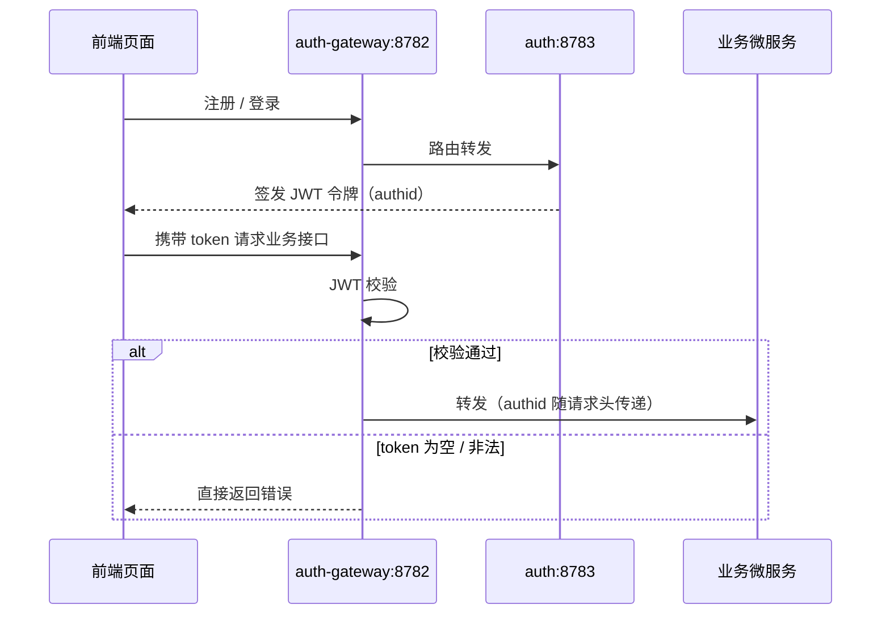

# 注册登录服务实战：JWT 校验流程、多方式登录实现与分布式 ID 发号器开篇

上一篇交代了注册登录服务的定位：面向互联网 C 端用户，提供账号密码、手机验证码、邮箱、微信、微博、QQ 六种方式，登录成功自动完成注册。这一篇把它落到工程层面——两个服务如何协作校验 JWT、依赖哪些环境、数据表怎么设计、六种登录方式各自的实现与约束，再用一个最小业务应用完整走一遍接入流程；篇末开讲本章第三个通用组件：分布式 ID 服务。

## 先给结论

- cust-auth 工程三个模块、只启动两个服务：auth（注册登录核心，端口 8783）负责注册登录并签发 JWT 令牌，auth-gateway（网关，端口 8782）负责校验令牌并路由，auth-common 放两个服务共用的工具类。
- 依赖环境三件套：MySQL（customer_auth 库，docs 有现成 SQL 脚本）、Redis（缓存验证码与 token）、Nacos（注册中心 + 配置中心，配置打包成 ZIP 直接导入，公共配置 cust-auth-common.yml 以 shared-dataids 共享）。
- 手机验证码链路可完整跑通：短信是收费服务，发送动作走熔断兜底、验证码只打印到控制台并存入 Redis（约 4 分钟有效）；微信、微博、QQ 登录代码齐全，但要到各自开放平台申请资质（一般要企业身份），演示不易。
- 业务应用接入四步：部署两个服务 → 开发自己的应用（配置文件必须叫 bootstrap.yml，加载时机比 application.yml 更早）→ 网关配置路由（StripPrefix=1，前端要多拼一层前缀）→ 请求头 key 必须叫 authorization。
- 免鉴权路径在公共配置的 jwt.exclude-urls 里维护，没配置的路径一律校验 token，为空或非法直接在网关层拦截。
- 分布式 ID 服务本质是一个全局发号器：数据库自增只能保证单表唯一，跨库跨系统的标识符要靠统一发号；四类诉求——全局唯一、趋势递增、单调递增、信息安全，要求逐级抬高。

## 服务协作与运行环境：JWT 校验流程、数据模型与配置

工程根目录 cust-auth 是一个 Maven 聚合工程，分 auth、auth-common、auth-gateway 三个模块。common 是功能模块，工具类两个服务共用；真正要启动的只有两个服务：

| 应用 | 端口 | 说明 | 启动命令 |
| :--- | :--- | :--- | :--- |
| auth-gateway | 8782 | 网关服务 | `java -jar auth-gateway.jar &` |
| auth | 8783 | 注册登录服务 | `java -jar auth.jar &` |

运行期的协作流程是：前端页面（需要自己开发的部分）发起注册、登录请求，经网关路由到 auth 完成；登录成功后 auth 基于 JWT 签发一个叫 authid 的令牌返回给页面。之后页面访问自己的业务微服务时，必须把这个 token 放进请求头带过来，而且必须先到网关：网关解析并校验 JWT，判断当前用户是否合法登录。校验通过就把请求转发到对应微服务，authid 也随请求头传递——业务服务里想拿当前用户的认证 ID，从请求头取出来即可，凭它查库还能得到用户详细信息；token 为空或非法，网关直接返回错误，请求根本到不了业务层。



一句话分工：auth 管"发票"，网关管"验票"。

跑起来之前要把环境备齐，依赖不多，就三个：MySQL、Redis、Nacos。

注册、登录背后有一套表结构。在本地创建 customer_auth 库，执行 docs 目录整理好的 SQL 脚本即可建出全部表。核心是 tb_auth 主表：user_name、password、status（1 正常账号、0 测试账号、-1 禁用账号）、mobile、email，外加 qq、weixin、weibo 三个第三方唯一标识字段——多种登录方式最终都汇聚到这一行用户记录上。三方渠道的信息另有明细表：tb_weibo 存 uid、screen_name、location、头像地址、access_token 与过期时间；tb_weixin 存 openid、nickname、性别、省份、国家、头像、access_token、refresh_token；QQ 与微博微信类似。另外还有 tb_login_record 登录记录表。

Redis 用来缓存登录信息——验证码、token 都放它，出于性能考虑。Nacos 身兼注册中心与配置中心：docs 下的 nacos 目录有个 ZIP 压缩包，导入配置中心即得三个文件。cust-auth-dev.yml 是 auth 自己的配置（应用名就叫 cust-auth，启动时按名字拉取），cust-auth-common.yml 是公共配置，auth 与网关都通过 shared-dataids 共享它，剩下一个是网关的配置。本地开发用的 bootstrap-dev.yml 大致长这样：

```yaml
spring:
  cloud:
    nacos:
      username: custauth
      password: itheima123
      server-addr: nacos.itcast.cn:8848
      discovery:
        namespace: 16a44c82-7a92-4ff8-a431-239a93498245
      config:
        server-addr: nacos.itcast.cn:8848
        file-extension: yaml
        shared-dataids: cust-auth-common.yml
        refreshable-dataids: cust-auth-common.yml
        group: AUTH_GROUP
server:
  port: 8783
```

环境就绪、两个服务启动之后，在 Nacos 服务列表里能看到它们注册进来，这是使用前的第一步。

## 六种登录方式：实现与约束

六种注册登录方式里，用户名密码最常规，真正要花心思的是另外三类。

**手机验证码**链路完整，但短信是收费服务，系统没有真实对接。发送接口先用 Redis 做限频：按手机号记发送次数，24 小时内最多发指定次数，一分钟内只能发一条，防止短信被刷；验证码随机生成 6 位，本该调短信平台的位置走了熔断兜底，验证码打印到控制台——虽然没有真发出去，但已存进 Redis 并带过期时间，登录照样能校验。真要用的时候，把这一处替换成阿里云短信或课程里用过的短信平台对接即可。

注册接口的校验顺序很典型：

```java
@PostMapping(value = "mobile")
public Result regMobile(@Validated(ValidMobile.class) @RequestBody RegDto regDto) {
    String mobile = regDto.getMobile();
    String redisCode = redisUtil.get(RedisKey.getCaptchaMobile(mobile));
    if (!redisCode.equals(regDto.getCode())) {
        return Result.error(ResultCode.BAD_REQUEST, "验证码错误");
    }
    if (authService.existMobile(mobile)) {
        return Result.error(ResultCode.BAD_REQUEST, "手机号已经存在");
    }
    return authService.regMobile(regDto);
}
```

先比对 Redis 里的验证码，再查手机号是否已注册，最后才执行注册。

**微信、微博、QQ** 这类第三方登录，代码层面已经全部提供，但需要到各开放平台申请账号才有权限调认证接口——程序并不知道用户输入的 QQ 账号密码是否正确，必须调 QQ 官方的认证接口去验证。appid 加 secret 可以理解成一对用户名密码，而这类资质一般只有企业用户申请得下来，个人演示并不容易，看看实现即可。

以微信登录为例看实现骨架：

```java
@Transactional
@LoginRec(status = LoginStatus.IN, type = AuthType.WEIXIN, note = "微信登录/注册")
public Result loginWx(LoginDto loginDto, String authId) {
    String atUrl = wxAccessTokenUrl + "?code=" + loginDto.getCode()
            + "&appid=" + wxAppid + "&secret=" + wxSecret
            + "&grant_type=authorization_code";
    Map<String, Object> atMap = HttpUtil.sendGet(atUrl);
    Object access_token = atMap.get("access_token");
    Object openid = atMap.get("openid");
    if (access_token == null || openid == null) {
        return Result.error("微信扫码失败");
    }
    Auth auth = lambdaQuery().eq(Auth::getWeixin, openid.toString()).one();
    if (auth != null) {
        baseMapper.updateLastDate(auth.getAuthId());   // 老用户，更新最后登录时间
    } else {
        auth = Auth.builder()
                .weixin(openid.toString())
                .weixinBindDate(new Date())
                .status(1)
                .createDate(new Date())
                .lastDate(new Date())
                .build();                              // 新用户，登录即注册
    }
    wxInfoService.lambdaUpdate().eq(Weixin::getOpenid, openid.toString())
            .set(Weixin::getAccessToken, access_token.toString())
            .update();
    // token 存 Redis，3 天过期，返回登录成功
}
```

code 换 access_token 与 openid，再按 openid 查用户：存在就更新最后登录时间，不存在就新建用户——这就是"登录成功自动完成注册"。授权地址 wxAccessTokenUrl 从配置文件动态读取，access_token 会同步进 weixin 明细表，签发的 token 存入 Redis（3 天过期），后续请求验证都靠它。**邮箱**登录的实现代码同样已提供，不再展开。

## 接入全流程：从部署到鉴权验证

使用说明分四步，演示用的业务应用是资料提供的 cust-user。

**第一步，部署两个服务并启动。** MySQL 建库执行脚本、Redis 启动（本地或远程都行）、Nacos 导入配置 ZIP，然后启动 auth 与网关，确认两者出现在 Nacos 服务列表。

**第二步，Postman 验证服务可用。** docs 里整理了 Postman 的 JSON 集合，导入即得三个 Collection。先测发送手机验证码：请求打到 8783 的 auth 服务，传手机号 13812345678，响应"发送成功"，验证码 662860 打印在控制台，Redis 里也存了一份，TTL 显示 237 秒左右——到时自动失效。再测登录接口 login/mobile：手机号加这个验证码，登录成功返回一个 JWT 令牌，这就是后续所有请求的通行证。

**第三步，开发自己的业务应用。** cust-user 里只有一个启动类和一个 Controller，两个方法代表两类业务：

```java
@RestController
@RequestMapping("user")
public class UserController {

    // 不需要鉴权的接口测试
    @GetMapping("noVerify")
    public String noVerify(@RequestHeader(required = false) String authId) {
        return "不需要鉴权的接口,获取到的用户ID: " + authId;
    }

    // 需要鉴权的接口测试
    @GetMapping("verify")
    public String verify(@RequestHeader(required = true) String authId) {
        return "需要鉴权的接口,获取到的用户ID: " + authId;
    }
}
```

两个细节要注意。其一，配置文件必须叫 bootstrap.yml 而不是 application.yml——要用 Nacos 配置中心，bootstrap 的加载时机更早，先拉到配置再启动。其二，网关转发会按 StripPrefix=1 去掉路径第一段，所以前端拼地址要多补一层：请求 /user/user/verify，网关剥掉第一个 /user，转发到 cust-user 的 /user/verify。路由规则在配置中心维护：

```yaml
routes:
  - id: CUST-AUTH
    uri: lb://cust-auth
    predicates:
      - Path=/cust/**
    filters:
      - StripPrefix=1
  - id: CUST-USER
    uri: lb://cust-user
    predicates:
      - Path=/user/**
    filters:
      - StripPrefix=1
```

uri 用 lb:// 前缀走负载均衡，cust-user 起集群也能自动分发。哪些路径免鉴权，配在公共文件 cust-auth-common.yml 的 jwt.exclude-urls 里，noVerify 的路径就配在这里；没被排除的路径一律校验。

**第四步，请求头带 token。** 测试能直观看到两类路径的差别：直接请求 verify，没登录没 token，网关直接拦截返回"token 为空"；请求 noVerify，路径在排除名单里，网关放行，接口正常返回（authId 为空）。要访问 verify 就得走完整链路：先调发送验证码接口（控制台输出 402834），再调手机验证码登录接口拿到 data 里的 token，然后把 token 放进请求头——key 必须叫 authorization，这是网关过滤器约定好的取值名，写别的取不到。带上之后 verify 正常返回，此时数据库里已经有了这个手机号的用户：登录的时候自动完成了注册。

## 分布式 ID：全局发号器开篇

第三个通用组件是分布式 ID 服务，功能很聚焦：为所有应用统一生成 ID。

为什么需要它？每张表都有主键，传统做法是数据库自增、UUID 或雪花算法，但分布式系统要的是全局唯一——数据库自增只能保证某一张表里的数据不重复，跨库、跨表、跨系统就无能为力。分库分表在金融、电商、支付这类系统里是常态，单库自增显然不够用。把分布式 ID 服务看成一个发号器：谁需要唯一标识，就到它这里申请，它保证发出去的号全局唯一。

除了主键，微服务架构里服务间调用、幂等处理、调用链分析、日志追踪，都需要唯一的标识串起跨系统的数据。ID 全称 Identifier，标识符，本质和身份证号一样——唯一识别一个对象或一条记录。

它覆盖四类场景，要求逐级抬高：

1. **全局唯一**：最基本的要求，不能出现重复 ID。项目拆成多个微服务、操作多个数据库时，所有主键都唯一。
2. **趋势递增**：一段时间内 ID 递增，不强求下一个必须大于前一个——比如先在 [0, 1000] 区间生成，过段时间在 [1000, 2000] 区间生成，衔接处可能回落。理由是主流互联网公司用的开源 MySQL 多选 InnoDB 引擎，索引以 B-tree 结构存储，主键尽量有序，插入新数据时 B-tree 结构不会时常被打乱重置，写入效率更高。
3. **单调递增**：下一个 ID 一定大于上一个，相当于全局版的数据库自增，适合事务版本号、IM 消息增量、排序这类特殊需求。一次业务操作两张表，先取的 ID 插第一张表，后取的一定大于前者，两张表的 ID 整体递增。
4. **信息安全**：订单号若连续递增，用户下过一单就知道自己的单号，加一、再加一就能猜到别人的订单；恶意用户按序遍历 URL 还能爬走全部数据，竞争对手据此可推算一天的订单量。这类场景需要无规则、不规则、不易被破解的 ID。

工程结构依旧是三模块：distributedid-client（客户端）、distributedid-core（核心）、distributedid-server（服务）。真正要启动的只有 server，其他系统通过 HTTP 接口调它；为了省去拼接口的繁琐，client 做了封装——其他系统引入它的 Maven 坐标，直接调工具类，底层怎么访问 server 不用管，可以当一个 SDK 用。

部署也轻量：不依赖 Redis，也不依赖注册中心、配置中心，只依赖 MySQL。演示配了两个数据源，对应本地 distributedid1、distributedid2 两个库——两库里的表完全一样，是为了提高性能，只有一个库也能跑。表也简单，sequence_id 一张：bigint 自增主键加一个 biz_type 业务类型字段（唯一索引），建表语句在 docs 的 SQL 脚本里。服务端口 18099，IdController 提供三个接口：/increment 取自增 ID、/snowflake 取雪花 ID、/segment 取号段 ID——号段模式对应的就是趋势递增，一次发一段。客户端如何接进来、生成效果如何，下一篇收尾时完整演示。

## 小结

- 服务分工：auth（8783）做注册登录并签发 JWT 令牌 authid，auth-gateway（8782）做令牌校验与路由；登录后每次请求都以 authorization 为 key 把 token 放进请求头，authid 会随请求头传到业务服务，可凭它查用户详情。
- 环境三件套：customer_auth 库（tb_auth 主表 + 微博/微信/QQ 明细表 + 登录记录表）、Redis 缓存验证码与 token、Nacos 注册与配置中心（公共配置 cust-auth-common.yml 以 shared-dataids 共享）。
- 登录方式约束：短信收费，验证码走熔断兜底输出到控制台并写 Redis（限频：24 小时限次、一分钟一条）；三方登录代码齐全但需企业资质申请 appid/secret；任何方式登录成功即自动完成注册。
- 业务应用接入四步：部署启动 → Postman 验证（发验证码 → 登录拿 token）→ 开发应用（配置文件必须叫 bootstrap.yml、路由 StripPrefix=1 记得多拼一层前缀）→ 请求头带 authorization；免鉴权路径配在 jwt.exclude-urls。
- 分布式 ID 服务是全局发号器，四类场景：全局唯一、趋势递增（InnoDB B-tree 有序主键写入高效）、单调递增（版本号/IM 增量）、信息安全（订单号防猜测）；三模块工程只起 server，部署仅依赖 MySQL（sequence_id 表，biz_type 区分业务），客户端接入留待下一篇。
