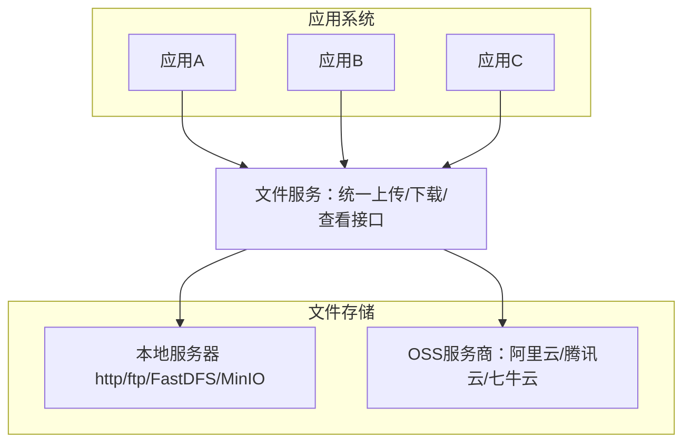

# 通用文件服务中台：需求背景、存储策略、技术设计与环境搭建

文件上传、下载、查看几乎是所有业务系统的标配：电商要传商品图片和广告视频，办公系统要传 Excel、Word 附件，社交产品要传用户头像。每个系统都自己对接一遍存储，重复劳动不说，换个云厂商就得全线改代码。这一篇先把"为什么要抽一个通用文件服务"讲清楚，再给出存储策略选型与策略模式的接口设计，最后完成开发前的四项环境搭建：数据库、Nacos、Nginx、Maven 工程。

## 先给结论

- 应用直连存储的做法简单直接，但有两个硬伤：对接同一服务商，每个应用都要重复开发一遍对接代码；要切换服务商时，所有相关应用都得改代码、重新测试上线。
- 解法是在微服务体系下放一个独立的文件服务，向应用提供统一的上传、下载、查看接口，屏蔽底层是本地磁盘、FastDFS 还是阿里云 OSS 的差异，以后迁移服务商应用层零改动。
- 流量要分摊：上传走文件服务，下载与查看尽量直接从存储端取，文件服务本身也提供下载接口，想统一走它也可以。
- 文件服务对外提供两类服务：面向应用系统的通用附件服务，和面向用户的网盘服务（文件夹层级、大文件分片上传与合并）。
- 技术设计是策略模式的典型应用：FileStrategy 顶层接口 → AbstractFileStrategy 抽象类固化上传流程 → LocalServiceImpl / FastDfsServiceImpl / AliServiceImpl 三个子类各管一种存储，切换策略只改配置文件。
- 环境搭建四步：建 pd_files 库与 pd_attachment、pd_file 两张表；Nacos 配置中心建 file-server 命名空间并导入 8 份配置；Nginx 起一个 10000 端口的虚拟主机指向 D:\UploadFiles；导入 pinda-authority 脚手架，改 pd-apps 的 profile 后创建 pd-file 工程。

## 为什么需要一个独立的文件服务

原始做法是应用直接对接存储：应用 A、B、C 各自完成上传、下载、查看，文件要么放自己的本地服务器（http/ftp/FastDFS/MinIO 自己搭），要么放 OSS 服务商（阿里云、腾讯云、七牛云）。比如应用 A 选阿里云就直连阿里云，应用 B 选腾讯云就直连腾讯云。这种方式用起来简单直接，问题也随之而来。

**问题一：重复开发。** 应用 A 和应用 B 都对接阿里云，两个应用就要各写一遍对接代码，同样的功能一遍一遍重复开发，纯属资源浪费。

**问题二：扩展性差。** 今天用阿里云，明天想切七牛云，所有相关应用的代码都得修改，然后重新测试、重新上线。

所以改进思路是：在微服务体系下放一个专门的文件服务，统一管理文件的上传下载——大型电商甚至会有独立的图片服务器、视频服务器。架构变成下面这样：



应用只跟文件服务对接，调用方式完全相同；文件服务屏蔽了底层存储的具体方式，不管下面用的是阿里云、七牛云还是自己搭的 FastDFS，应用根本不用关心。即使以后切换存储方式，应用侧也不需要做任何调整。

这个模式也有一个小问题：这么多应用的上传下载全去调文件服务，如果所有下载、查看请求都从它走，文件服务的网络流量压力会非常大。常用的做法是分流——上传走文件服务，由它对接后面的存储策略；下载和查看则直接对接服务商，把流量让出去。课程开发的文件服务其实已经提供了下载接口，应用想统一都走文件服务也没有问题，多种选择都留着。

## 三种存储策略与策略模式设计

文件上传上来之后具体怎么存，称为存储策略。课程讲了三种：

| 存储策略 | 文件放在哪 | 下载/查看怎么提供 |
| --- | --- | --- |
| 本地存储 | 文件服务所在服务器的本地磁盘（不是用户客户端本地） | Nginx 提供 HTTP 访问能力 |
| FastDFS 存储 | FastDFS 分布式文件系统 | FastDFS 本身没有 HTTP 功能，需结合 Nginx 对外提供 |
| 云存储 | 第三方云平台（阿里云 OSS、七牛云、腾讯云等） | 服务商自带下载查看能力，属收费服务 |

三种策略在开发中都要用代码实现对接。课程对 FastDFS 不展开原理和搭建，直接把它当成已知存储介质使用。

技术设计上，文件服务以品达通用权限系统为脚手架，在其基础之上开发。为了提供统一的上传接口、屏蔽底层存储方案，抽出了五个接口和类：

- `FileStrategy`：文件策略顶层接口，整个文件服务的最高抽象；
- `AbstractFileStrategy`：抽象类，实现 FileStrategy，固化已经能确定下来的上传处理流程；真正保存文件的动作不在这一层做，因为存储方案各不相同，没法在这里写死；
- `LocalServiceImpl`：具体策略类，把上传的文件保存在本地磁盘；
- `FastDfsServiceImpl`：具体策略类，把文件保存到 FastDFS 分布式文件系统；
- `AliServiceImpl`：具体策略类，把文件保存到阿里云 OSS 对象存储。

这是策略模式的一个具体应用：每个子类对应一种文件存储策略，程序运行时选哪个策略，通过配置文件就能灵活切换——从本地切到 FastDFS，程序代码一行不动，改一下配置马上生效。后期要扩展新的存储方式，按规范继承 AbstractFileStrategy 编写子类即可，与三个现有策略平级。

## 环境搭建：数据库、Nacos、Nginx、Maven

### 数据库环境

新建数据库 pd_files（编码 utf8mb4，可以用 create database 语句或图形工具创建），里面两张表，正好对应文件服务的两类服务：通用附件服务的文件信息记录到 `pd_attachment` 附件表；网盘服务的文件信息记录到 `pd_file` 文件表。两张表都是存上传文件的信息，很多字段重复。

pd_attachment 的关键字段：

| 字段 | 含义 |
| --- | --- |
| biz_id / biz_type | 业务 ID / 业务类型，附件服务是通用服务，靠它们区分这条数据属于哪个业务系统 |
| data_type | 数据类型：DIR 目录、IMAGE 图片、VIDEO 视频、AUDIO 音频、DOC 文档、OTHER 其他 |
| submitted_file_name | 原始文件名 |
| path / group | FastDFS 的远程文件信息，只在 FastDFS 存储方式下使用 |
| relative_path / url | 文件相对路径与完整访问链接（url 需要通过 Nginx 配置路由才能访问） |
| file_md5 | 对整个文件做 MD5 哈希得到的值 |
| context_type / ext / size | 上传类型、后缀（没有点）、大小；另有随机生成的 file_name 防止文件名重复 |
| org_id / icon / source | 组织 ID、图标、文件来源（inner/outer），可选扩展字段按需传参 |
| create_month / create_week / create_day | 创建年月/周/日，格式 yyyy-MM、yyyy-WW、yyyy-MM-dd，用于统计 |

pd_file 因为有文件夹概念，额外多出 tree_path（描述目录层次）、grade（第几级目录）、folder_id（文件夹 ID）、folder_name（文件夹名称）四个字段；create_time、update_time、create_user、update_user、is_delete（逻辑删除）等公共字段与附件表一致。资料里提供了 pd_file.sql 建表脚本，直接执行就能把两张表建出来。

### Nacos 环境搭建

文件服务使用 Nacos 作为配置中心，统一管理相关配置文件。Nacos 由阿里巴巴提供，是服务注册与配置中心，安装就是解压（Windows 直接解压，Linux 解压后配环境变量），课程不作重点。

要动的是 conf/application.properties：Nacos 默认把记录的信息存在内置数据库里，这里改成用 MySQL 持久化：

```properties
server.port=8848
server.contextPath=/nacos
spring.datasource.platform=mysql
db.num=1
db.url.0=jdbc:mysql://127.0.0.1:3306/nacos?characterEncoding=utf8&connectTimeout=3000&socketTimeout=3000&autoReconnect=true
db.user=root
db.password=root
```

contextPath 等保持默认；db.url 指向本地 3306 的 nacos 数据库，本地要提前创建它，并执行 Nacos 自带的 nacos-mysql.sql 建表脚本把相关表建出来。Windows 双击 bin/startup.cmd 启动（Linux 用 startup.sh），启动花几秒钟，然后访问 http://localhost:8848/nacos——路径里带 /nacos 就是因为 contextPath 这么配的。默认用户名密码都是 nacos。

登录后两步操作：

1. 到"命名空间"菜单新建 file-server（描述"文件服务"）——文件服务的配置文件单独放一个命名空间是比较规范的做法。每个命名空间对应一个唯一 ID，后面要配置到 Maven 工程的 POM 文件里，先记下。
2. 在该命名空间的配置列表里"导入配置"，上传资料提供的 nacos 配置导出 zip（就是控制台"导出查询结果"生成的文件，反向导入即可），一共 8 份配置文件。

这 8 份里只有 `pd-file-server-dev`（开发环境）和 `pd-file-server-prod`（生产环境）是文件服务自己的配置；其余 common（通用配置）、mysql（数据库）、pd-auth-server（权限系统）、gateway（网关）、redis（缓存）都是脚手架品达通用权限系统在用的配置。开发环境下两份文件服务的配置都会用到，按 data-id 匹配；生产环境只有 prod 生效。具体每份配置的内容用到哪段再展开说。

### Nginx 环境搭建

本地存储和 FastDFS 存储两种策略都要用 Nginx 对外提供文件的下载和查看，用的就是它的 HTTP 能力。课程把 Nginx 直接装在本地开发环境（D:\tools\nginx-1.5.1），配置重点是 conf/nginx.conf 里的一个 server 虚拟主机：

```nginx
server {
    listen 10000;                            #虚拟主机的服务端口
    server_name localhost;                   #IP 地址或域名
    index index.html index.htm index.php;    #默认首页地址
    root D:\UploadFiles;                     #网页根目录，相对路径、绝对路径均可
    location ~* .*\.(gif|jpg|jpeg|png|bmp|swf|ico)$ {
        expires 30d;                         #静态文件过期时间 30 天
        access_log off;
    }
}
```

root 指令指定虚拟主机的网页根目录，这里指向 D 盘提前建好的 UploadFiles 目录——上传的文件就放在这下面，Nginx 启动后就能通过 HTTP 协议访问到。location 正则把 gif、jpg、jpeg、png、bmp、swf、ico 等静态扩展名的请求都处理掉，并设置 30 天过期。需要用的时候把 Nginx 服务跑起来即可。

### Maven 工程环境

文件服务不是从零搭环境，而是基于品达通用权限系统脚手架（pinda-authority）开发。这个脚手架提供了一系列基础组件，已经实现了权限管理、认证、JWT 解析等功能，开发者在其上做自己的业务——这也是企业里非常常见的开发方式。初始工程在资料的"初始工程（脚手架）"目录里。

操作上先复制一份到代码目录（尽量不在原版上直接改），用 IDEA Open 打开。导入后 IDEA 并没有把它识别成 Maven 工程，只能在 Project Structure → Modules 里手动 Import Module：

1. 先导入 pd-apps——它是父工程，下面一大串子工程会一次性全带进来；
2. 再导入 pd-tools——工具包模块，子模块也全部导入。

导入完成后刷新，能看到脚手架的全部模块。里面有两个可启动服务：zuul 网关服务和 authority 权限服务（各自的启动类都在）。与权限相关的模块暂时不用关心，文件服务开发主要依赖 pd-tools 里的工具，之后在它的基础上创建文件服务的 Maven 工程。

接着做两件事：

**改 pd-apps 的 POM。** profiles 里配了多套环境（测试、开发），开发阶段用默认激活的 dev profile，把其中 Nacos 配置中心的信息改成当前环境的值：IP 为 127.0.0.1、端口为默认 8848，再从 Nacos 控制台复制 file-server 命名空间的唯一 ID 覆盖进去。这是"最根上的地方"，后面的配置文件会从 POM 里读出这些 Nacos 信息。

**创建 pd-file 工程。** 在 pd-apps 上右键 New Module，新建 pd-file——因为下面还要分子模块，它本身是个父工程；注意位置要放在 pd-apps 这层目录下。创建后打开 pd-apps 的 POM 能看到 pd-file 已被聚合进来（modules），同时 pd-file 通过 parent 继承了 pd-apps——聚合与继承两条关系线都建立起来。再在 pd-file 下创建第一个子模块 pd-file-entity（文件服务实体模块），POM 引入三个依赖：pd-tools-common（pd-tools 里的公共模块，很多可复用的工具）、SpringFox（接口文档）、MyBatis-Plus（实体类上要用它的注解）。

然后把资料里"文件服务相关实体类"整个包拷进 pd-file-entity 的源码目录，课程不逐个带写：

- entity 包：Attachment 与 File 两个实体类，通过 @TableName 分别映射 pd_attachment、pd_file 两张表，属性与表字段用注解一一对应。两者都继承 pd-tools-core 核心模块 base 包下的 Entity，Entity 又继承更高一层的 SuperEntity——ID、createTime、createUser、updateTime、updateUser 这些每个实体、每张表都有的公共字段就抽在这两层基类里，子类直接继承不用重复写。类上还加了 @ApiModelProperty 注解，方便接口文档展示。
- dto 包：数量不少，因为文件上传下载要提交很多参数，都要封装成实体——FileOverviewDTO（云盘首页概览：所有文件数量 allFileNum、所有文件大小 allFileSize、文件夹数量 dirNum、图片文件数量 imgNum、文档文件数量 docNum）、分页查询参数、更新参数、文件夹保存参数等各一个。
- domain 包：领域模型，比如文件路径（层级文件夹名称、文件夹 ID）、删除文件需要提交的参数等。
- constant 与枚举：字段常量类；DataType 枚举指定上传文件的类型（目录、图片、视频、音频、文档、其他）；存储方式枚举涵盖本地存储、FastDFS、云存储多种（阿里、七牛云、腾讯、MinIO 等）；还有一个文件类型对应图标的枚举，页面上按图标展示比较形象。

到这里，开发文件服务的四样环境——数据库、Nacos、Nginx、Maven 工程——全部就绪。

## 小结

这篇把文件服务从"为什么做"推到了"准备做"。需求侧：应用直连存储有重复开发与扩展性差两个硬伤，独立的文件微服务统一接口、屏蔽底层差异，再靠"上传走服务、下载走存储端"的分流缓解流量压力。设计侧：本地、FastDFS、云存储三种策略由策略模式的五个类承接，AbstractFileStrategy 管流程、子类管落地，切换只动配置。工程侧：pd_files 库两张表、Nacos 的 file-server 命名空间与 8 份配置、Nginx 10000 端口虚拟主机、pinda-authority 脚手架上的 pd-file 工程依次就位。骨架搭完，下一篇进入文件处理策略与接口的具体实现。
