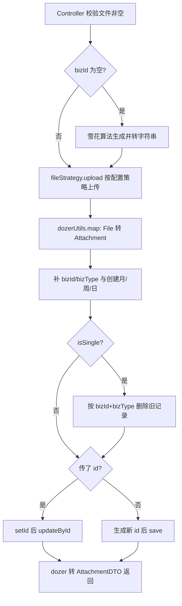

# 上传接口全流程落地：Controller 到 Service、三种策略实测与按 id 删除附件

接口契约定好之后，这一段把上传附件接口从 Controller 一路写到 ServiceImpl，然后切着配置把 LOCAL、FAST_DFS、ALI 三种策略各实测了一遍——中间踩了两个真实的坑（tracker 端口配错、@Service 注解漏写），最后按同样的套路完成了第二个接口：根据 id 批量删除附件。整个上传链路是 Controller 校验、Service 编排、Strategy 干活的三层分工。

## 先给结论

- Controller 只做校验和转发：继承脚手架的 BaseController 拿到现成的 success/fail 响应封装，方法签名按接口文档定五个参数（file 必填，bizId、bizType、id、isSingle 可选），file 为 null 或 isEmpty 直接返回"请求中必须包含一个有效的文件"，其余逻辑全部下沉 Service。
- Service 是策略与数据库的中转层：AttachmentServiceImpl 继承 MyBatis-Plus 的 ServiceImpl<AttachmentMapper, Attachment>，注入 FileStrategy、IdGenerate、DozerUtils、FileServerProperties 四个对象。
- 上传主流程六步：bizId 为空用雪花算法生成并转字符串 → fileStrategy.upload 按配置策略上传 → dozerUtils.map 把 File 转 Attachment → 手工补 bizId/bizType 和创建月/周/日 → isSingle 时按 bizId+bizType 双条件删旧记录 → 按 id 有无走 updateById 或 save，最终 dozer 转成 AttachmentDTO 返回。
- 实测暴露两个典型问题：FastDFS 策略下 tracker-list 端口误配成 8080，抛 FdfsConnectException 连不上，改回 22122 才通；ALI 策略启动即报错，是 AliServiceImpl 漏写 @Service 注解导致没有 Bean 可注入。
- 删除接口是上传的逆操作：DELETE /attachment 接收 ids 数组支持批量；只凭 id 无法定位文件，必须先查库拿到 filename/group/path/relativePath 封装成 FileDeleteDO，再删记录、再调 fileStrategy.delete 删文件。

## Controller：把接口文档翻译成方法签名

Controller 是对外暴露接口服务的地方，新建 controller 包和 AttachmentController，注解对应接口文档逐项落实：

```java
@RestController
@RequestMapping("/attachment")
@Api(value = "附件", tags = "附件")
public class AttachmentController extends BaseController {

    @PostMapping("/upload")
    @ApiOperation(value = "附件上传", notes = "附件上传")
    @ApiImplicitParams({
            @ApiImplicitParam(name = "isSingle", value = "是否单文件", dataType = "boolean", paramType = "query"),
            @ApiImplicitParam(name = "id", value = "文件id", dataType = "long", paramType = "query"),
            @ApiImplicitParam(name = "bizType", value = "业务类型", dataType = "long", paramType = "query"),
            @ApiImplicitParam(name = "file", value = "附件", dataType = "MultipartFile", paramType = "form")
    })
    public R<AttachmentDTO> upload(
            @RequestParam(value = "file") MultipartFile file,
            @RequestParam(value = "bizId", required = false) Long bizId,
            @RequestParam(value = "bizType", required = false) String bizType,
            @RequestParam(value = "isSingle", required = false, defaultValue = "false") Boolean isSingle,
            @RequestParam(value = "id", required = false) Long id) {
        // 判断上传文件是否为空
        if (file == null || file.isEmpty()) {
            return this.fail("请求中必须包含一个有效的文件");
        }
        AttachmentDTO attachmentDTO = attachmentService.upload(file, bizId, bizType, isSingle, id);
        return this.success(attachmentDTO);
    }
}
```

几个关键点：类上的 `/attachment` 与方法上的 `/upload` 拼起来恰好匹配接口文档的请求地址；继承的 BaseController 在 pd-tools 核心模块里，已经注入了 request、response 对象和分页常量，并提供成功/失败的返回方法，直接调用即可；返回值统一封装成 R 对象，泛型是接口文档要求的 AttachmentDTO。五个参数里只有 file 必填，其余全部 required = false；isSingle 是 Boolean，最好给 defaultValue = "false" 兜底。@ApiImplicitParams 上的参数说明会在接口文档页面里展示出来。

Controller 不直接调策略类，因为除了把文件传到存储位置，还要把文件信息保存进数据库，两件事封装在 Service 里。于是定义 AttachmentService 接口，提供一个 upload 方法，参数与 Controller 保持一致但去掉注解，再通过 @Autowired 注入到 Controller。

## Service：上传的完整业务流

实现类落在 service/impl 子包下，为了方便数据库操作，让它继承 MyBatis-Plus 提供的 ServiceImpl，两个泛型分别是 AttachmentMapper（DAO 目录下提前建好的，已声明增删改查方法）和 Attachment 实体（映射附件表）：

```java
@Slf4j
@Service
public class AttachmentServiceImpl extends ServiceImpl<AttachmentMapper, Attachment>
        implements AttachmentService {

    @Autowired
    private FileStrategy fileStrategy;   // 注入哪个实现由配置文件决定
    @Autowired
    private IdGenerate<Long> idGenerate; // 脚手架提供，雪花算法实现
    @Autowired
    private DozerUtils dozerUtils;       // 脚手架 pd-tools-dozer 的对象转换工具
    @Autowired
    private FileServerProperties fileServerProperties;

    @Override
    public AttachmentDTO upload(MultipartFile multipartFile, Long bizId, String bizType,
                                Boolean isSingle, Long id) {
        // 1. bizId为空则动态生成一个业务id
        String bizIdStr = String.valueOf(bizId);
        if (bizId == null) {
            bizIdStr = String.valueOf(idGenerate.generate());
        }
        // 2. 调用策略处理对象，实现真正的文件上传
        File file = fileStrategy.upload(multipartFile);
        // 3. 对象转换：同名属性自动拷贝
        Attachment attachment = dozerUtils.map(file, Attachment.class);
        // 4. File里没有的属性手工补齐
        attachment.setBizId(bizIdStr);
        attachment.setBizType(bizType);
        LocalDateTime now = LocalDateTime.now();
        attachment.setCreateMonth(DateUtils.formatAsYearMonthEn(now));
        attachment.setCreateWeek(DateUtils.formatAsYearWeekEn(now));
        attachment.setCreateDay(DateUtils.formatAsDateEn(now));
        // 5. 单文件业务：先删掉该业务下的旧文件记录
        if (isSingle) {
            super.remove(Wraps.<Attachment>lbq()
                    .eq(Attachment::getBizId, bizIdStr)
                    .eq(Attachment::getBizType, bizType));
        }
        // 6. 传了id是修改操作，没传是新增操作
        if (id != null && id > 0) {
            attachment.setId(id);
            super.updateById(attachment);
        } else {
            attachment.setId(idGenerate.generate());
            super.save(attachment);
        }
        return dozerUtils.map(attachment, AttachmentDTO.class);
    }
}
```

流程图整理如下：



逐段说清楚：

注入的 fileStrategy 是最高层的策略接口，具体实例取决于配置文件——配 LOCAL 注进来的就是 LocalServiceImpl 的实例，配 FAST_DFS 就是 FastDfsServiceImpl，动态装配。上传这一行执行完，文件就已经落到指定位置了，落在哪里这一层不用关心。

bizId 是前端传来的业务 id，可能不传，但落库希望有值，所以为空时用 IdGenerate 生成一个（脚手架已提供雪花算法的实现）；Attachment 实体的 bizId 字段声明的是 String，所以要把 Long 转成字符串方便存储。

dozerUtils.map 做对象转换：File 和 Attachment 两个类有很多同名属性（dataType、submittedFileName、treePath 等），dozer 按属性名对应拷贝，省去手动 get/set 的繁琐。但 File 里没有 bizId、bizType，拷贝完必须手工补；创建月份、周、日这三个统计字段也拿不到，基于当前系统时间用 DateUtils 的 formatAsYearMonthEn、formatAsYearWeekEn、formatAsDateEn 分别格式化补上。

isSingle = true 表示当前业务（bizId + bizType 组合）下只允许存在一个文件，所以要先按两个 eq 条件把旧文件记录删掉，再插入新的。Wraps 构造的条件对象最终落到 mapper 的 delete 方法，反映到数据库就是一条 delete 语句。

最后是 insert 还是 update 的分支：id 对应附件表的主键字段，传了 id（非空且大于 0）意味着是修改操作，attachment.setId(id) 后 updateById——这一步必须重设，因为 dozer 拷贝来的 id 来自 File 对象（id 定义在很深的父类 Entity 里）；id 为空就是新增，用 idGenerate 生成一个新 id 后 save。返回值 AttachmentDTO 继承自 Attachment，属性完全一致，最后一次 dozerUtils.map 直接转出来。

## 三种策略实测：只改配置，代码不动

本地策略测试：先启动 Nacos 配置中心，把 pd-file-server.yml 里的 type 改成 LOCAL 并发布（改完配置文件服务要重启），上传的文件会落到 endpoint 指定的 D:/uploadFiles 目录。再启动 Nginx——它的 root 目录就是 D:/uploadFiles，为的是上传后的文件能通过 HTTP 访问。然后启动 FileServerApplication，控制台日志能看到从配置中心加载的配置，确认策略是 local。打开 Swagger 文档点调试：bizId 填 123，bizType 填 itcast，选一个压缩包上传，id 和 isSingle 不提交（非必填）。返回的 data 里能对上之前的实现：submittedFileName 是原始文件名，relativePath 是年月两层目录，url 是完整访问地址，另有 UUID 文件名、后缀、大小、创建时间等。磁盘上按 endpoint/bucketName/年/月 生成了目录，文件已改成 UUID 名；附件表 insert 了一条记录（控制台能看到这条 insert 语句）；把 URL 贴进浏览器，基于 Nginx 的 HTTP 能力直接下载成功。

FastDFS 策略测试：type 改成 FAST_DFS、发布、重启，日志确认切换。用同样方式上传（bizId=100，bizType 填 itheima，传一个 SQL 脚本），这次返回"文件上传失败"，控制台日志抛出 FdfsConnectException: can't create connection to 172.17.0.115:8080——tracker-list 的端口配错了，FastDFS 的 tracker 实际端口是 22122，把配置改对重启就能连上远程的 FastDFS 服务器。程序代码本身没有问题，属于环境配置问题，看异常堆栈即可定位。

阿里云策略测试：type 改成 ALI、发布、重启，这次启动就直接报错：创建 AttachmentServiceImpl 时 fileStrategy 注入失败。原因是之前写 AliServiceImpl 时漏加了 @Service 注解——ALI 的条件注解虽然命中了配置类，但里面没有可实例化的 Bean，其他两个策略类又因为属性值不匹配没有创建。补上注解重启，再测上传（bizId=101，bizType 填 test，传 SQL 文件）：返回状态码 0 表示成功，URL 是阿里云提供的地址，浏览器访问能直接下载文件，附件表同样 insert 成功。

三种策略来回切换，全程只动配置文件，Java 代码一行没改——这就是策略模式加条件装配最直接的收益。

## 按 id 删除附件：先查库再删文件

第二个接口是它的逆操作：把文件从指定存储位置删掉（本地、FastDFS 还是阿里云取决于当时的配置），同时把 pd_attachment 附件表里的那条记录删掉。接口文档：DELETE 方式请求 /attachment，参数是文件 id 数组（支持批量删除），响应 R<Boolean>。

```java
@DeleteMapping
@ApiOperation(value = "删除附件", notes = "删除附件")
@ApiImplicitParams({
        @ApiImplicitParam(name = "ids[]", value = "文件ids", dataType = "array", paramType = "query")
})
public R<Boolean> remove(@RequestParam(value = "ids[]") Long[] ids) {
    attachmentService.remove(ids);
    return this.success(true);
}
```

注意 @DeleteMapping 里不用再写路径：类上的 /attachment 就是完整请求地址，只要是 DELETE 方式请求这个 URL 就会进入 remove 方法处理。Service 接口里声明 void remove(Long[] ids)，实现类的逻辑是"先查后删"——传过来的只有 id，文件叫什么名字、在哪个组、路径是什么一概不知，不查库根本没法构造删除文件需要的 FileDeleteDO 模型对象：

```java
@Override
public void remove(Long[] ids) {
    // 空数组直接返回，保证程序健壮性
    if (ArrayUtils.isEmpty(ids)) {
        return;
    }
    // 先查询数据库，用于删除文件时的信息封装
    List<Attachment> list = super.list(Wraps.<Attachment>lambdaQuery()
            .in(Attachment::getId, ids)); // SELECT * FROM pd_attachment WHERE id IN (...)
    // 根据id删除数据库记录
    super.removeByIds(Arrays.asList(ids));
    // 对象格式转换：Attachment 转 FileDeleteDO
    List<FileDeleteDO> fileDeleteDOList = list.stream()
            .map(fi -> FileDeleteDO.builder()
                    .relativePath(fi.getRelativePath())
                    .filename(fi.getFilename())
                    .group(fi.getGroup())
                    .path(fi.getPath())
                    .build())
            .collect(Collectors.toList());
    // 调用文件策略删除真正的文件
    fileStrategy.delete(fileDeleteDOList);
}
```

继承 ServiceImpl 之后常规增删改查都是现成方法：list 加 in 条件相当于 SELECT * FROM pd_attachment WHERE id IN (1, 2)，removeByIds 把 id 数组转成集合作删除条件，生成一条 delete 语句。对象转换用 Stream 流的 map 加 Lambda，比手写循环挨个 get/set 简洁得多，把每条附件记录封装成携带 relativePath、filename、group、path 的 FileDeleteDO 后 collect 回 List。最后调用 fileStrategy.delete——它进到 AbstractFileStrategy 再分发给具体子类：本地是拼路径 deleteQuietly，FastDFS 是 deleteFile(group, path)，阿里云是 deleteObject(空间名, 相对路径/文件名)，前面实现的三套删除逻辑在这里全部复用。

## 小结

这一段把文件服务的前两个接口写完并测通了。上传接口走 Controller → Service → Strategy 三层：Controller 只管校验文件和统一响应格式，Service 负责业务编排（生成业务 id、调策略上传、dozer 对象转换、补齐业务字段与统计字段、单文件清理、insert/update 分支），策略类只关心文件本身怎么存怎么删。实测部分验证了配置切换的威力——LOCAL、FAST_DFS、ALI 三个值改完发布重启即可，代码零改动；也暴露了两个典型问题：环境端口配错（8080 对 22122）看异常堆栈定位，Bean 漏注册（@Service 注解）看启动日志定位，两者都是这类项目的常见坑。删除接口则体现了"先查后删"的必要性：只有 id 不足以定位文件，必须先从附件表取出元数据封装 FileDeleteDO，才能复用三套策略的删除实现。按照课程大纲，接下来还会用同样的套路开发根据业务类型/业务 id 的删除与打包下载等接口。
