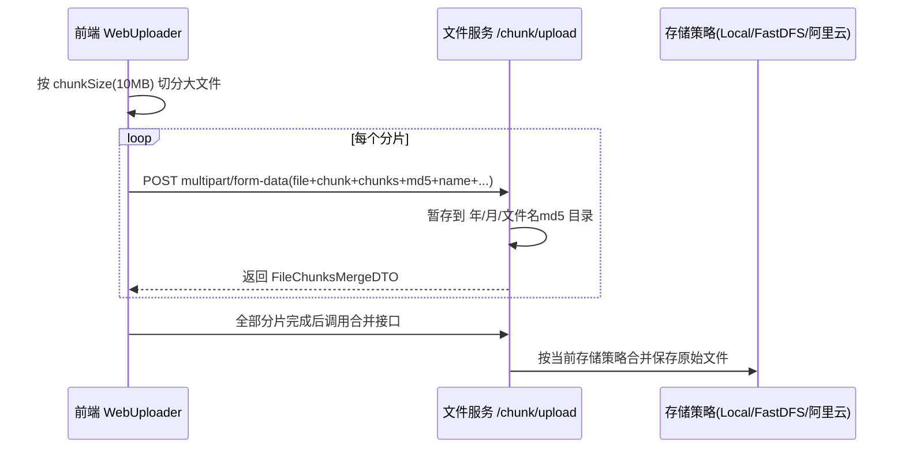

# 大文件分片上传（上）：WebUploader 切片、/chunk/upload 接口与分片落盘规则

附件服务和网盘服务处理小文件绰绰有余，可一旦要传几百兆甚至 1G 的视频，单次上传又慢又容易中途失败。文件服务这一章的解法是分片上传：前端把大文件切成一片一片并发上传，服务端先暂存、后合并。这一篇讲上半程——分片上传的原理与前后端分工、前端 WebUploader 的切片配置、后端 /chunk/upload 接口的实现，以及分片在磁盘上的暂存规则；把分片拼回原始文件的合并接口，留给下一篇。

## 先给结论

- 分片上传的本质是"前端切、后端合"：大文件按固定大小（课程里 10MB 一片）切成 n 个小块逐片上传，服务端全部收齐后再调合并接口拼回原始文件；分片与并发结合能极大提高上传速度，网络问题导致传输错误时只需重传出错分片，而不是整个文件。
- 前端切分交给百度 WebUploader（以 HTML5 为主、Flash 为辅，兼容 IE6+、iOS 6+、android 4+）：`chunked: true` 开启分片、`chunkSize` 指定片大小、`server` 指向 /chunk/upload，chunk/chunks 等参数由插件自动计算。
- 每个分片请求除了 file，还带 chunk（当前第几片，从 0 开始）、chunks（总片数）、md5（对文件内容计算）、name（对原始文件名计算）、ext、size、type、folderId 等参数；后端每次响应一个 FileChunksMergeDTO，供合并阶段复用。
- 分片只是中间态，不涉及存储策略；统一暂存在可配置的 storagePath 下，按"年/月/原始文件名 md5"建目录，分片文件用 0、1、2 这样的数字命名，md5 目录旁边放一个同名 .tmp 文件记录上传时间，定期扫描即可清理合并失败留下的垃圾分片。
- 接口里用 chunks 判断是否真的分过片：文件不足一片时 chunk、chunks 都是 null，直接按普通文件上传处理——fileStrategy.upload 落盘、补上 fileMd5、fileService.save 入库；超过片大小才走分片分支。
- 分片分支由 WebUploader 工具类的 getReadySpace 逐层创建目录和临时文件，multipartFile.transferTo 把分片写盘，再用 DozerUtils 把 FileUploadDTO 拷贝成 FileChunksMergeDTO 返回；实测 32.3MB 的视频切成 3 片 10MB 加 1 片 2.35MB，目录结构与设计完全一致。

## 分片上传：把"一次传完"拆成"分片并发 + 服务端合并"

500MB、1G 这种量级的文件走普通上传，要么耗时太久，要么中途断了整个重来。分片上传把传输拆成两个阶段：第一阶段，前端按约定大小把大文件切成 n 片，每一片就是一个独立的小文件，逐片提交到服务端，服务端把这些片保存下来——注意这只是中间状态，此时磁盘上还拼不出原始文件；第二阶段，所有分片提交完成后，前端再调用一个分片合并接口，后端把这 n 个小片按顺序读出来，合并成原始的大文件。

切分发生在客户端，这是前后端配合的关键分工：前端负责检查文件大小并按规则拆分，服务端只管接片和合并。合并出来的原始文件存到哪里，取决于当前配置的文件存储策略——Local 就合并到本地，FastDFS 就合并进 FastDFS，阿里云 OSS 同理。分片上传这个动作本身并不碰存储策略，分片只是暂存在服务端，策略只在合并阶段才介入，所以上半程的接口实现反而比较简单，复杂的合并留到下一阶段。

整个交互时序如下：



## WebUploader：前端切片只改三个配置

切分这件事发生在浏览器端，课程采用百度 WebUploader。它由百度 WebFE(FEX) 团队开发，是一个以 HTML5 为主、Flash 为辅的现代文件上传组件，官网地址 fex.baidu.com/webuploader，兼容 IE6+、iOS 6+、android 4+。它的特性正好覆盖分片场景的痛点：分片与并发结合，将一个大文件分割成多块并发上传，极大提高大文件的上传速度；当网络问题导致传输错误时，只需要重传出错的分片，而不是整个文件；分片传输还能更实时地跟踪上传进度，上传过程中直接展示进度条。

本课程以后端开发为主，前端页面不再另写，直接取资料"分片上传/前端"目录里整理好的 index.html。依赖很常规：webuploader.css 和 style.css 两个样式文件，jQuery（插件基于 jQuery 开发），webuploader.js 核心 JS 文件，页面自己的逻辑统一封装在 uploader.js 里——这部分代码也是参照官方 demo 改造的，前端 JS 没必要手写。核心配置只有三处：

```javascript
// uploader.js：实例化 WebUploader 对象
var uploader = WebUploader.create({
    chunked: true,                                // 分片处理大文件
    chunkSize: 10 * 1024 * 1024,                  // 每片 10MB，可按需调整
    server: "http://127.0.0.1:8765/chunk/upload", // 每个分片提交到这个接口
    threads: 1                                    // 并发上传线程数
});
```

除了分片小文件本身，每个请求还要通过 formData 带上一组元数据，这是在 before-send 生命周期事件里设置的：md5 是对整个文件内容计算的值（md5.js 生成），同一个文件的每一片请求里它都相同；name 是对原始文件名做 md5 之后的值，它就是稍后服务端分片目录的名字；ext 是原始文件后缀；folderId 是文件夹 id，课程里统一传 0。这四项加上插件自动算出的 chunk、chunks，就是后端接口要接的全部参数。

验证方式很直观：页面上选择一个 30 多 MB 的视频，F12 打开浏览器调试工具，Network 面板里看到的不是一个请求，而是连续多个指向 127.0.0.1:8765/chunk/upload 的 upload 请求——插件已经在前端把文件按 10MB 一片切好逐片提交，只是此时服务端接口还没开发，所以全部失败。

## /chunk/upload：先分流，再接片

接口文档的规范是：POST /chunk/upload，请求类型 multipart/form-data。参数除了 file（当前分片文件），还有 chunk（当前是第几个分片）、chunks（一共有几个分片，这两个由前端插件算好，后端不用管）、ext（原始文件后缀）、folderId（文件夹 id）、lastModifiedDate、md5（注意是对文件本身而不是文件名计算）、name（对文件名如 abc 做 md5 后生成的值）、size（文件大小）、type（文件类型）。响应是一个 FileChunksMergeDTO，字段包括 name、submittedFileName（原始文件名）、md5、chunks（分片总数）、ext（后缀）。

新建 FileChunkController，继承 BaseController，类上加 @RestController、@RequestMapping("/chunk")、@Slf4j，再加跨域注解——前端页面不一定和服务在同一个域，必须允许跨域——以及 @Api(value = "分片上传", tags = "分片上传")。方法用 @RequestParam("file") 接住分片文件（前端传过来的文件名就是 file，写错就取不到），其余一大堆参数封装进 FileUploadDTO（md5、size、name、chunks、chunk 等，与接口参数一一对应）：

```java
@RestController
@RequestMapping("/chunk")
@Api(value = "分片上传", tags = "分片上传")
@Slf4j
public class FileChunkController extends BaseController {

    @Autowired
    private FileStrategy fileStrategy;
    @Autowired
    private FileService fileService;
    @Autowired
    private WebUploader webUploader;
    @Autowired
    private DozerUtils dozerUtils;
    @Autowired
    private FileServerProperties fileServerProperties;

    @ApiOperation(value = "分片上传", notes = "分片上传")
    @PostMapping("/upload")
    public R<FileChunksMergeDTO> uploadFile(
            @RequestParam(value = "file") MultipartFile multipartFile,
            FileUploadDTO fileUploadDTO) throws Exception {
        log.info("接收到分片：" + multipartFile + "，分片信息：" + fileUploadDTO);

        // 非正常情况：分片文件为空
        if (multipartFile == null || multipartFile.isEmpty()) {
            log.error("分片上传的分片文件为空");
            return this.fail("分片上传的分片文件为空");
        }

        // 判断当前上传的文件是否分片
        if (fileUploadDTO.getChunks() == null || fileUploadDTO.getChunks() <= 0) {
            // 没有分片，按普通文件上传处理
            File file = fileStrategy.upload(multipartFile);
            file.setFileMd5(fileUploadDTO.getMd5());
            fileService.save(file);
            return this.success(null);
        } else {
            // 分片上传：准备临时目录与分片文件
            String storagePath = fileServerProperties.getStoragePath();
            String uploadFolder = FileDataTypeUtil.getUploadPathPrefix(storagePath);
            java.io.File targetFile = webUploader.getReadySpace(fileUploadDTO, uploadFolder);
            if (targetFile == null) {
                return this.fail("分片上传失败");
            }
            // 把分片数据写到目标文件
            multipartFile.transferTo(targetFile);

            // 封装返回对象，供后续分片合并使用
            FileChunksMergeDTO fileChunksMergeDTO = new FileChunksMergeDTO();
            fileChunksMergeDTO.setSubmittedFileName(multipartFile.getOriginalFilename());
            dozerUtils.map(fileUploadDTO, fileChunksMergeDTO);
            return this.success(fileChunksMergeDTO);
        }
    }
}
```

动手写逻辑之前先验证接收能力。启动 pd-file-server，控制台提示运行成功：Swagger 文档 http://192.168.3.19:8765/doc.html，数据库监控 http://127.0.0.1:8765/druid。前端页面选那个 30 多 MB 的视频，只打印了四条"接收到分片"日志：chunks=4，chunk 分别是 0、1、2、3——0 代表第一片，最后一片不足 10MB；四次请求里的 md5（57562d7938b7200356fd4989e529c0c）、size（33927680）、name 完全一致，因为它们描述的是同一个原始文件。前端切片、后端接收这条链路就此打通。

正式的逻辑从两类特殊情况开始。第一，分片文件为空：multipartFile 为 null 或 isEmpty 时直接 fail，没有处理的必要。第二，请求未必真的分过片——上传一个只有 50 多 KB 的 doc 文件，因为不足 10MB，插件根本没切，实测 chunk、chunks 都是 null。所以用 chunks 判断：null 或小于等于 0 就说明没有分片，按普通文件上传处理，这段逻辑前面的课程已经写过，直接复用 fileStrategy.upload 落盘，再 fileService.save 把文件信息插到数据库。这里只有一处要补：upload 返回的 File 对象没有封装 md5，需要手动 file.setFileMd5(fileUploadDTO.getMd5())——md5 就在前端提交的参数里，直接从 DTO 取。返回值给 success(null)：正常分片上传这里应该返回 FileChunksMergeDTO（它的属性都是给合并用的），普通上传分支没有合并环节，传空即可。

普通分支实测：Nacos 里当前存储策略是 Local，上传后 pd_file 表从 8 条变成 9 条，本地磁盘 bucket 目录下的年月目录里出现了 UUID 命名的新文件，控制台也能看到对应的 insert 语句。剩下的 else 分支，就是真正的分片上传。

## 分片落盘：storagePath、md5 目录与 .tmp 临时文件

分片要暂存到服务端某个目录，这个目录做成动态可配置。FileServerProperties（配置属性类）新增 storagePath 属性并生成 getter/setter，Nacos 的 pd-file-server.yml 里对应加配置项，整个分片文件都放在这个目录下：

```yaml
# Nacos: pd-file-server.yml
file:
  # 指定分片上传临时存放目录（演示环境指向 D 盘下的 chunks 目录）
  storagePath: D:\uploadFiles\chunks
  uriPrefix: http://192.168.137.1:8765
```

路径拼装分两步：先 fileServerProperties.getStoragePath() 拿到根目录，再调用工具类 FileDataTypeUtil 的 getUploadPathPrefix(storagePath)，在后面追加年、月两层日期目录（内部用 LocalDate 生成），得到形如"根目录/2020/05"的 uploadFolder。此时只是把路径字符串拼出来，目录还没有真正创建。

创建的动作封装在 WebUploader 工具类里（放在 Manager 包下，@Component 交给 Spring 管理），它负责为分片上传创建保存位置和临时文件：

```java
@Component
@Slf4j
public class WebUploader {

    // 为分片上传创建对应的保存位置，同时创建临时文件
    public java.io.File getReadySpace(FileUploadDTO fileUploadDTO, String path) {
        // 第一层：根目录 + 年 + 月，这次不需要创建临时文件
        boolean b = createFileFolder(path, false);
        if (!b) {
            return null;
        }
        // 第二层：以 name（原始文件名的 md5）命名的分片目录
        String folder = fileUploadDTO.getName();
        if (StringUtils.isEmpty(folder)) {
            return null;
        }
        path += StrPool.SLASH + folder;
        // 这次同时创建临时文件
        b = createFileFolder(path, true);
        if (!b) {
            return null;
        }
        // 分片文件：目录下以分片序号命名（0、1、2...），无后缀
        return new java.io.File(path, String.valueOf(fileUploadDTO.getChunk()));
    }

    private boolean createFileFolder(String file, boolean hasTmp) {
        java.io.File tmpFile = new java.io.File(file);
        if (!tmpFile.exists()) {
            // 目录不存在则创建多层目录
            try {
                tmpFile.mkdirs();
            } catch (Exception ex) {
                log.error("创建分片所在目录失败", ex);
                return false;
            }
        }
        if (hasTmp) {
            // 临时文件与分片目录同级同名，后缀 .tmp
            tmpFile = new java.io.File(file + ".tmp");
            if (tmpFile.exists()) {
                // 已存在，刷新最后修改时间为当前系统时间
                tmpFile.setLastModified(System.currentTimeMillis());
            } else {
                try {
                    tmpFile.createNewFile();
                } catch (Exception ex) {
                    log.error("创建分片对应的临时文件失败", ex);
                    return false;
                }
            }
        }
        return true;
    }
}
```

这段代码有三个要点。第一，分片目录名用的是 FileUploadDTO 的 name 而不是 md5：name 是 md5.js 对原始文件名计算的结果，md5 是对整个文件内容计算的结果，两者不是一回事——分片目录按文件名的 md5 组织。第二，.tmp 临时文件与 md5 目录同级同名，放在月目录下；分片目录已存在时只需把临时文件的最后修改时间刷新为当前系统时间，它记录的就是这组分片的上传时间——合并失败的分片不会被删除，会一直占用磁盘，有了这个时间标记，定期扫描就能把长期占着磁盘的垃圾分片清掉。第三，分片文件本身没有后缀，名字就是分片序号 String.valueOf(fileUploadDTO.getChunk())：0 是第一片，1 是第二片，依此类推。

回到 Controller，getReadySpace 返回的 targetFile 就是当前分片的落盘位置：先判空，创建失败直接返回"分片上传失败"；否则 multipartFile.transferTo(targetFile)，把传上来的分片数据写进目标文件。最后封装返回对象：submittedFileName 单独从 multipartFile.getOriginalFilename() 设置——FileUploadDTO 里没有原始文件名这个属性，两个 DTO 不是完全对应的，这一项必须手工赋值；其余属性一一对应，dozerUtils.map(fileUploadDTO, fileChunksMergeDTO) 一次拷贝完成（DozerUtils 底层基于 BeanUtils），最后 success(fileChunksMergeDTO) 返回给前端。

整体实测一遍：前端页面传一个 32.3MB 的视频，D 盘下出现了新建的 chunks 目录，往下是年份、月份；月目录里有一个以文件名 md5 命名的文件夹，里面是 4 个分片文件——前 3 片恰好 10MB，最后一片 2.35MB；md5 文件夹旁边还有对应的 .tmp 临时文件。分片上传接口到此开发完成，下一步就是把这些分片按顺序读出来、合并成原始文件并按存储策略保存，这是下半篇的内容。

## 小结

- 分片上传把大文件传输拆成"前端切片逐片上传 + 服务端暂存 + 合并落地"三段，分片阶段不涉及存储策略，合并阶段才按 Local/FastDFS/阿里云落地。
- 前端 WebUploader 三个配置（chunked、chunkSize、server）加 formData 四个元数据（md5、name、ext、folderId）构成全部交互约定，chunk/chunks 由插件自动计算。
- /chunk/upload 的分流逻辑：空校验 → chunks 判断 → 小文件走普通上传（复用 fileStrategy 与 fileService）→ 大文件走分片暂存。
- 暂存规则"storagePath/年/月/文件名md5/序号"加上同层 .tmp 时间戳文件，既让同一文件的分片聚在一起，也给垃圾分片清理留了依据。
- md5 与 name 必须分清：前者面向文件内容，后者面向文件名，分片目录以后者组织。
- 下一篇实现合并接口：按 md5 找到分片目录，排序读出所有分片，合并后写入当前存储策略。
