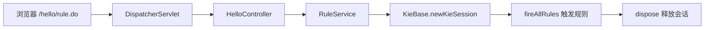

# Drools 高级语法收官：LHS/RHS 加强与 Spring 整合实战

Drools 的高级语法到这里进入收尾阶段。LHS 这边还剩三个点：条件元素 not、exists 和规则继承 extends；RHS 这边则是围绕 Drools 提供的内置对象 `drools` 展开的三个方法：halt、getWorkingMemory、getRule，外加一条编码规范清单。语法讲完之后，就是这门技术在真实项目里的落地方式——与 Spring 整合。课程按照由简到繁的顺序演示了两种整合形式：普通 Maven 工程的简单整合，以及加入 Spring MVC 的 Web 工程整合（第三种 Spring Boot 整合放到下一篇）。本文把这三段内容串成一条线。

## 先给结论

- `not` 判断工作内存中"不存在"某类 Fact 对象时返回 true，本质是取反语义；`exists` 相反，判断"存在"。二者都支持在对象类型后面追加属性约束。
- `exists` 与直接写对象条件的核心区别在触发次数：工作内存中有多个匹配对象时，用 `exists` 的规则只触发一次，不用则每个匹配对象各触发一次。
- 规则继承用 `extends` 关键字，只继承父规则的 LHS 条件部分，RHS 不继承；子规则实际生效条件是父条件与自身条件的合并。
- RHS 里可用内置对象 `drools`（拼写固定）：`halt()` 立即终止后面所有规则执行；`getWorkingMemory()` 返回工作内存对象（本质是 KieSession）；`getRule()` 返回当前规则的 RuleImpl 对象，可读取 salience、agendaGroup 等属性。
- Spring 整合靠 `kie-spring` 依赖 + kie 命名空间配置 + `KModuleAnnotationPostProcessor`，整合后 kmodule.xml 不再必须；推荐注入 `@KBase` 的 KieBase，再按请求创建 KieSession，不建议全局注入 KieSession。
- Web 整合多一步 DispatcherServlet（`*.do`）和 tomcat7 插件，调用链是 Controller → Service → KieSession，访问 `http://localhost/hello/rule.do` 即可触发规则。

## LHS 加强：not、exists 与规则继承

### not：判断"不存在"

`not` 用于判断工作内存中是否存在某个 Fact 对象：不存在返回 true，存在返回 false。语法结构是 `not Object(可选属性约束)`，也就是在原先条件前面加一个 not 取反。比如 `not Student()` 表示工作内存里没有 Student 类型对象，`not Student(age < 10)` 表示没有 age 小于 10 的 Student。

```java
// 工作内存中不存在 Student 类型对象时才触发
rule "rule_lhs_4"
when
    not Student()
then
    System.out.println("规则：rule_lhs_4触发了...");
end
```

演示过程很直观：Java 代码里 new 了一个 Student 并 `session.insert(s1)`，此时工作内存里有 Student 对象，规则不触发；把 insert 注释掉（对象没有进入工作内存，就相当于"没有"），再执行，`rule_lhs_4` 的输出就出现了。理解 not 的关键是适应"存在返回 false、不存在返回 true"这个反过来的语义。

### exists：判断"存在"，且只触发一次

`exists` 的作用与 `not` 相反：存在返回 true，不存在返回 false。语法同样是 `exists Object(可选属性约束)`，例如 `exists Student(age < 10 && name != null)`。

很多人会疑惑：不用 exists，直接写 `Student()` 不也能判断存在吗？区别在于触发次数。当工作内存中有多个满足条件的 Fact 对象时，用 exists 的规则只执行一次，而不用 exists 的规则会执行多次——每匹配到一个对象就触发一次。

```java
rule "rule_lhs_5"
when
    exists Student()
then
    System.out.println("规则：rule_lhs_5触发了...");
end

rule "rule_lhs_6"
when
    Student()
then
    System.out.println("规则：rule_lhs_6触发了...");
end
```

演示分两步：先只插入一个 Student，规则 5 和规则 6 都只触发一次，此时两者没区别；再插入第二个 Student，规则 5 仍然只触发一次，规则 6 触发了两次。exists 只关心"有没有"，不关心"有几个"。

### extends：规则条件继承

规则之间可以用 `extends` 关键字继承，类似 Java 类的继承，但注意它继承的只是规则的 LHS 条件部分，RHS 部分不会继承。

```java
rule "rule_lhs_7"
when
    Student(age > 10)
then
    System.out.println("规则：rule_lhs_7触发了...");
end

rule "rule_lhs_8" extends "rule_lhs_7"
when
    Student(age < 20)
then
    System.out.println("规则：rule_lhs_8触发了...");
end
```

`rule_lhs_8` 自身只写了一个条件 `age < 20`，但因为继承了 `rule_lhs_7`，它实际生效的条件是 `age > 10 && age < 20` 两个条件的合并。演示中 age 设为 5 时两个规则都不触发（父条件不满足，子规则连带失效）；age 改成 15 后，规则 7 和规则 8 都触发了。

## RHS 加强：drools 内置对象与编码规范

RHS 是规则体的重要组成部分，LHS 匹配成功后对应的 RHS 就会触发执行，一般在这里做业务处理。Drools 在 RHS 中提供了一个内置对象，名字固定叫 `drools`，下面是它的三个常用方法。

### halt：立即终止后续规则

不设置 salience 优先级时，规则默认自上而下执行。先建两个 when 为空（默认成立）的规则验证顺序，两者都会触发；然后在第一个规则输出之后调用 `drools.halt()`：

```java
rule "rule_rhs_1"
when
then
    System.out.println("规则：rule_rhs_1触发了...");
    drools.halt(); // 立即终止后面所有规则的执行
end

rule "rule_rhs_2"
when
then
    System.out.println("规则：rule_rhs_2触发了...");
end
```

执行结果只有 `rule_rhs_1` 的输出。一旦调用 halt，后面所有规则不管匹配是否成功，全部停止执行。

### getWorkingMemory：获取工作内存对象

```java
WorkingMemory workingMemory = drools.getWorkingMemory();
System.out.println(workingMemory);
```

打印结果是 KieSession。WorkingMemory 是接口，它的实现类是 StatefulKnowledgeSessionImpl，也就是有状态的会话对象。拿到工作内存对象之后，可以继续调用它的 get 方法获取其他对象：`getEnvironment()` 拿环境对象、`getAgenda()` 拿议程、`getGlobal()` 拿全局变量、`getKnowledgeBase()` 拿知识库，还有 `getQueryResults()` 按名称取查询结果。平时在 Java 侧调用的 `session.fireAllRules()`，其实就是这个接口定义的方法，KieSession 是它的实现类。

### getRule：获取当前规则对象

```java
org.drools.core.definitions.rule.impl.RuleImpl rule = drools.getRule();
System.out.println(rule);
System.out.println(rule.getAutoFocus());   // 默认 false
System.out.println(rule.getId());          // 未显式设置时与规则名相同
System.out.println(rule.getDateExpires()); // 未设置为 null
```

直接打印 rule 对象就能看到规则的名称、agendaGroup（未定义时默认 MAIN）、salience（未设置默认 0）、no-loop（默认 false）。这些正是之前讲规则属性时对应的那些项，RuleImpl 类里还有 parent、children（对应规则继承）、dialect、timer、dateEffective、dateExpires、enabled 等属性，都可通过 getter 读取。

### 规则文件编码规范

编写 DRL 规则文件时建议遵守六条规范，这是比较好的习惯：

1. 所有规则文件统一放在一个规定的文件夹中（课程中是 resources 下的 rules 目录），方便统一管理；
2. 每个规则尽量加上清晰明了的注释；
3. 同一类型的对象尽量放在一个规则文件中，比如所有匹配 Student 的规则集中在一个文件里；
4. RHS 部分尽量不要有 if/else 等条件语句和深层次嵌套——出现了就说明当前规则还能按条件继续拆分成多个规则；
5. 每个规则最好都加上 salience，明确执行顺序；
6. Drools 默认方言是 java，尽量避免使用 mvel。

## Spring 整合 Drools：从简单整合到 Web 工程

学过的技术最终大多要和 Spring 平台整合，Drools 也不例外。整合分三种形式：普通 Maven 工程的简单整合、加入 Spring MVC 的 Web 工程整合、Spring Boot 整合，难度递增，实际项目中 Spring Boot 用得最广。

### 简单整合：Maven 工程 + 单元测试

新建 Maven 工程 drools-spring，导入依赖。这里有个必须注意的坑：`kie-spring` 会传递引入它自己版本的 spring-tx、spring-beans、spring-core、spring-context 等包，与项目里的 Spring 5.0.5 版本冲突，必须用 exclusions 排除掉，否则整个工程报错、启动都起不来。

```xml
<properties>
    <drools.version>7.10.0.Final</drools.version>
    <spring.version>5.0.5.RELEASE</spring.version>
</properties>

<dependency>
    <groupId>org.kie</groupId>
    <artifactId>kie-spring</artifactId>
    <version>${drools.version}</version>
    <exclusions>
        <exclusion>
            <groupId>org.springframework</groupId>
            <artifactId>spring-tx</artifactId>
        </exclusion>
        <exclusion>
            <groupId>org.springframework</groupId>
            <artifactId>spring-beans</artifactId>
        </exclusion>
        <exclusion>
            <groupId>org.springframework</groupId>
            <artifactId>spring-context</artifactId>
        </exclusion>
    </exclusions>
</dependency>
```

其余依赖是 drools-compiler、spring-context、spring-test 和 JUnit。规则文件放在 `resources/rules/helloworld.drl`，内容就是一个 `eval(true)` 恒成立的 hello world 规则。

Spring 配置文件 spring.xml 中，Drools 有专门的命名空间 kie（约束文件 kie-spring.xsd），原先写在 kmodule.xml 里的配置原样搬进来，只是前面加了命名空间：

```xml
<kie:kmodule>
    <kie:kbase name="kbase" packages="rules">
        <kie:ksession name="ksession"/>
    </kie:kbase>
    <bean class="org.kie.spring.annotations.KModuleAnnotationPostProcessor"/>
</kie:kmodule>
```

kbase 的 packages 属性指向 resources 下的 rules 目录，加载该目录下所有规则文件；ksession 是会话对象。`KModuleAnnotationPostProcessor` 这个 bean 是为了让后面 `@KBase`、`@KSession` 注解生效，没有它注解无法使用。整合之后，Drools 自己的 kmodule.xml 就不再是必须的了——这一点类似 Spring 整合 MyBatis 后，MyBatis 的配置文件不再必须。

测试类基于 Spring 与 JUnit 的整合方式编写，注入时不用 `@Autowired`，而是用整合后专有的注解：

```java
@RunWith(SpringJUnit4ClassRunner.class)
@ContextConfiguration("classpath:spring.xml")
public class DroolsSpringTest {

    @KBase("kbase")
    private KieBase kieBase;

    @Test
    public void test1() {
        KieSession kieSession = kieBase.newKieSession();
        kieSession.fireAllRules();
        kieSession.dispose();
    }
}
```

`@KBase("kbase")` 的名称对应 spring.xml 中 kbase 的 name 属性。以前要写一堆 KieServices、KieContainer 的 API 才能拿到 Session，现在直接从 KieBase 创建即可，测试方法简洁了很多。为什么不建议直接注入 KieSession？会话代表一次交互，正常用法是一次请求创建一个新的 KieSession，用完 dispose 销毁；虽然用 `@KSession("ksession")` 直接注入也能跑通（课程里演示了 test2），但从 Spring 工厂里拿一个全局单例会话并不合适，推荐还是注入 KieBase。

### Web 整合：加入 Spring MVC

第二种方式在上面的基础上加入 Web 模块，测试时不再跑单元测试，而是启动 Tomcat 通过 Controller 访问。新建 Maven war 工程 drools-springweb（webapp 骨架，编译版本改成 1.8），依赖在简单整合的基础上追加 spring-web 和 spring-webmvc，build 里配置 tomcat7 插件，端口 80，请求路径 `/`（不带项目名直接访问 Controller）。

web.xml 里配置 DispatcherServlet 前端控制器，拦截 `*.do` 结尾的请求，`load-on-startup` 保证 Tomcat 启动时即加载并读取配置文件 springmvc.xml。springmvc.xml 里包含三块：其一，kie 命名空间下的 kmodule/kbase/ksession 配置和 `KModuleAnnotationPostProcessor`，与简单整合完全一致；其二，`context:component-scan` 扫描 com.itheima 及其子包；其三，`mvc:annotation-driven` 注解驱动（引入它之后 `context:annotation-config` 就不是必须的了）。项目规模大时建议把 Drools 相关配置拆成单独的配置文件，课程为了演示整合过程全部放在了一起。

规则文件同样是 rules 目录下的 helloworld.drl。真正的项目里一般会封装一个 Service，把规则引擎相关操作全部收进去：

```java
@Service
public class RuleService {

    @KBase("kbase")
    private KieBase kieBase;

    public void rule() {
        KieSession kieSession = kieBase.newKieSession();
        kieSession.fireAllRules();
        kieSession.dispose();
    }
}
```

Controller 层注入 Service 并对外暴露接口：

```java
@Controller
@RequestMapping("/hello")
public class HelloController {

    @Autowired
    private RuleService ruleService;

    @RequestMapping("/rule")
    public String rule() {
        ruleService.rule();
        return "OK";
    }
}
```

整条调用链如下：



测试时先 mvn compile 确认编译通过，再以 debug 方式运行 tomcat7 插件启动服务器（需要更详细的日志可以引入 log4j）。浏览器访问 `http://localhost/hello/rule.do`——注意必须以 `.do` 结尾才能进入 Spring MVC。请求后 Tomcat 控制台输出"规则：rule_helloworld触发..."，说明规则被成功触发，整合验证通过。页面上看到的 404 不用管：那是返回 "OK" 后没有配置视图解析器导致跳转失败，与规则是否触发无关。

## 小结

LHS 加强以 not 和 exists 两个条件元素收尾，二者互为取反，exists 的价值在于多对象匹配时只触发一次；extends 让规则可以像类一样复用条件，但只限 LHS。RHS 加强围绕内置对象 `drools` 展开：halt 控制流程中断，getWorkingMemory 拿到本质为 KieSession 的工作内存，getRule 拿到封装成 Java 对象的规则元数据；编码规范六条则是团队协作层面的约束。整合部分先在普通 Maven 工程里通过 kie-spring + kie 命名空间完成简单整合，再把同样的配置搬进 Spring MVC 的 Web 工程，由 Controller 经 Service 触发规则。下一篇继续第三种整合方式 Spring Boot，以及 WorkBench 的完整使用流程。
