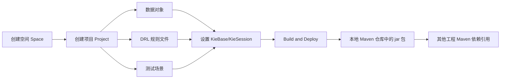

# Drools 落盘三部曲：Spring Boot 整合与 WorkBench 可视化规则平台

Spring 整合 Drools 讲到第三种也是目前最主流的方式——Spring Boot 整合，它把前两种方式里的 XML 配置全部换成了 Java 配置类。整合收尾之后进入 WorkBench：这是 KIE 组件里的可视化规则编辑器，本质是一个 war 包，装进 Tomcat 就能在浏览器里完成建空间、建项目、写数据对象、写规则、跑测试场景、构建部署的全流程，最终把规则打成 jar 包发布到 Maven 仓库供其他工程依赖引用。本文覆盖 Spring Boot 整合实战和 WorkBench 从安装到部署的完整链路。

## 先给结论

- Spring Boot 整合不再需要 tomcat 插件，main 方法启动内置 Tomcat；Drools 相关配置从 spring.xml 换成 DroolsConfig 配置类，用 `@Bean + @ConditionalOnMissingBean` 声明 KieFileSystem、KieContainer、KieBase、KModule 四个对象，注入时回归传统的 `@Autowired`，不再用 `@KBase` 注解。
- 配置类的 `@ConditionalOnMissingBean` 会先查 Spring 工厂里是否已存在该类型对象，存在就不再初始化，防止同一类型的 bean 出现多个；这套代码写法固定，实际开发直接拷贝改一下规则目录即可。
- WorkBench 也称 KIE-WB，是 Drools-WB 与 BPM-WB 的结合体，本质是 war 包，要求部署在 Tomcat 8 运行；课程环境为 Windows 10 64 位、JDK 1.8、Maven 3.5.4、Tomcat 8.5。
- 安装五步走：配 CATALINA_HOME、bin 下建 setenv.bat、war 改名 kie-drools-wb 放入 webapps、tomcat-users.xml 配 admin 角色和 kie/kie 用户、lib 加三个 jar 并在 server.xml 的 Host 里加 JACCValve。
- WorkBench 使用逻辑是层级式的：先创建空间（Space），空间里创建项目（Project），项目里创建数据对象、DRL 规则文件和测试场景；KieBase/KieSession 的设置本质上就是在界面化配置 kmodule.xml。
- 规则测试通过后点 Build & Deploy，项目被打成 jar 包落到本机 `.m2` 仓库，其他工程加一个 Maven 依赖就能使用这套规则——应用程序与规则引擎就此分离。

## Spring Boot 整合 Drools

新建 Maven 工程 drools-springboot（Spring Boot 工程不用选骨架），pom 里通过 parent 继承 spring-boot-starter-parent。依赖清单：starter-web、starter-aop、starter-test 三个启动器，commons-lang 工具包，以及 Drools 相关的五个坐标——drools-core（核心包，之前导 drools-compiler 时依赖传递已带上，显式引入也没问题）、drools-compiler（编译包）、drools-templates（模板包）、kie-api（接口包）、kie-spring（整合包）。老规矩：kie-spring 会传递引入它自己版本的 Spring 系列 jar，必须用 exclusions 排除，避免与 Spring Boot 管理的版本冲突。

```xml
<dependency>
    <groupId>org.drools</groupId>
    <artifactId>drools-compiler</artifactId>
    <version>7.6.0.Final</version>
</dependency>
<dependency>
    <groupId>org.kie</groupId>
    <artifactId>kie-spring</artifactId>
    <version>7.6.0.Final</version>
    <!-- exclusions 排除传递的 spring-tx/spring-beans/spring-core/spring-context -->
</dependency>
```

application.yml 只配两项：端口 8080 和应用名称 drools_springboot。规则文件仍放在 resources 的 rules 目录下，就是那个 `eval(true)` 恒成立的 helloworld。

接下来是关键差异点：不再提供 spring.xml，而是提供配置类 DroolsConfig，它本质上就是配置文件，只是换成了 Java 的写法。

```java
@Configuration
public class DroolsConfig {

    // 指定规则文件存放的目录
    private static final String RULES_PATH = "rules/";

    private final KieServices kieServices = KieServices.Factory.get();

    @Bean
    @ConditionalOnMissingBean
    public KieFileSystem kieFileSystem() throws IOException {
        KieFileSystem kieFileSystem = kieServices.newKieFileSystem();
        ResourcePatternResolver resourcePatternResolver =
                new PathMatchingResourcePatternResolver();
        // 加载 classpath 下 rules 目录中的所有规则文件
        Resource[] files = resourcePatternResolver
                .getResources("classpath*:" + RULES_PATH + "*.*");
        for (Resource file : files) {
            kieFileSystem.write(ResourceFactory
                    .newClassPathResource(RULES_PATH + file.getFilename(), "UTF-8"));
        }
        return kieFileSystem;
    }
}
```

这段代码的思路：先 new 出一个空的 KieFileSystem（KIE 的文件系统对象），再用 ResourcePatternResolver 到 classpath 的 rules 目录下加载所有规则文件封装成数组，遍历后把每个文件写到文件系统里，最后返回。配置类里还有三个同风格的 `@Bean` 方法：KieContainer 由文件系统构建出来，KieBase 调用容器的 `getKieBase()` 获得，KModule 则是 org.kie.spring 整合包里的类、直接 new 出来即可。每个方法都加了 `@ConditionalOnMissingBean`：它不急着创建对象，而是先到 Spring 工厂里查这种类型是否已经存在，有就跳过初始化，避免同一类型的 bean 重复注册。这类配置写法固定，不需要背，直接拷过来改掉规则目录名就行。

Service 和 Controller 就非常简单了。注意注入方式的变化：前两种整合用的是 Drools 专有的 `@KBase` 注解，Spring Boot 里回归 Spring 传统的 `@Autowired`：

```java
@Service
public class RuleService {

    @Autowired
    private KieBase kieBase;

    public void rule() {
        KieSession kieSession = kieBase.newKieSession();
        kieSession.fireAllRules();
        kieSession.dispose();
    }
}
```

Controller 用的是 `@RestController` 而不是 `@Controller`——它相当于 Controller 加 ResponseBody 的组合，方法返回值直接以 JSON 写回客户端，不再跳转页面：

```java
@RestController
@RequestMapping("/hello")
public class HelloController {

    @Autowired
    private RuleService ruleService;

    @RequestMapping("/rule")
    public String rule() {
        ruleService.rule();
        return "OK";
    }
}
```

最后是启动类 DroolsApplication：`@SpringBootApplication` 加 main 方法调 `SpringApplication.run()`。启动类要放在所有业务类的上一层包，这样当前包及其子包都被自动扫描，service、controller 无需再手动配置。由于是 Spring Boot 工程，不再用 tomcat 插件，直接跑 main 方法，用的是内置 Tomcat。

验证：启动后访问 `http://localhost:8080/hello/rule`，页面返回 OK，控制台输出"规则：rule_helloworld触发..."，Spring Boot 整合宣告成功。

## WorkBench：简介与安装

WorkBench 是 KIE 组件中的元素，也称 KIE-WB。KIE 是一整套体系，Drools 和 jbPM 都属于其中的组件，而 WorkBench 是 Drools-WB 与 BPM-WB 的结合体。说穿了它是一个可视化的规则编辑器，本质上是一个 war 包，安装到 Tomcat 里运行。

它解决的问题是把规则开发搬进浏览器：运行起来之后，开发人员甚至业务人员直接在页面上创建数据对象（就是项目里的实体类，如 Book、Order、Student，它们是应用程序与规则引擎之间数据交换的载体和桥梁）、创建规则文件、创建测试场景；测试通过后将规则打成 jar 包部署到指定 Maven 仓库，其他应用只需添加一个 Maven 依赖就能使用这些规则。由此做到了应用程序与 Drools 规则引擎的分离。

war 包从 JBoss 官网下载，得到 kie-drools-wb.war。安装前先明确环境，版本兼容性问题很容易踩坑：课程使用 Windows 10 64 位、JDK 1.8、Maven 3.5.4、Tomcat 8.5，这套组合经过测试没问题。

安装步骤按顺序执行：

1. 配置 Tomcat 环境变量 CATALINA_HOME，值指向 Tomcat 安装目录；
2. 在 Tomcat 的 bin 目录下创建 setenv.bat，内容如下（设置内存开销，并指定登录配置文件位置）：

```bash
CATALINA_OPTS="-Xmx512M \
-Djava.security.auth.login.config=$CATALINA_HOME/webapps/kie-drools-wb/WEB-INF/classes/login.config \
-Dorg.jboss.logging.provider=jdk"
```

3. 把下载的 war 包改名为 kie-drools-wb.war，复制到 Tomcat 的 webapps 目录。改名是必须的：Tomcat 启动解压后会用 war 包名作为项目名，得与上一步配置里的路径前后一致，否则找不到文件；
4. 修改 conf/tomcat-users.xml，添加 admin 角色和登录用户（用户名 kie、密码 kie）：

```xml
<role rolename="admin"/>
<user username="kie" password="kie" roles="admin"/>
```

5. 把三个 jar 包复制到 Tomcat 的 lib 目录：kie-tomcat-integration（KIE 与 Tomcat 的集成包）、javax.security.jacc-api（安全相关）、slf4j-api（日志相关）；再修改 conf/server.xml，在 Tomcat 自带的 Valve 标签后面加一个 Valve：

```xml
<Valve className="org.kie.integration.tomcat.JACCValve"/>
```

注意这个标签要放在 Host 内正确的层次位置上。全部完成后双击 bin 下的 startup 启动 Tomcat，工程较大，解压和启动需要等待一段时间。浏览器访问 `http://localhost:8080/kie-drools-wb`（端口按你实际的 Tomcat 来），用 kie/kie 登录，看到欢迎页面即说明 WorkBench 安装成功。

## WorkBench 使用全流程：从空间到部署

使用方式分七个环节：创建空间和项目、创建数据对象、创建 DRL 规则文件、创建测试场景、设置 KieBase 和 KieSession、编译构建部署、在项目中使用部署的规则。层级逻辑是先创建空间（Space），在空间中创建项目（Project），再在项目中创建数据对象和规则文件。

### 空间、项目与数据对象

登录后点击 Spaces 进入空间列表（系统自带一个默认空间），右上角 Add Space 输入名称（如 MySpace1）和介绍（可不填），Save 即创建。进入空间后 Projects 显示为 0，点 Add Project 输入项目名 MyProject-1 和描述，Add 后自动进入项目内部。项目内可以创建数据对象、规则文件、测试场景等元素。

数据对象就是 JavaBean，一般在 DRL 规则文件中用于规则匹配。在项目里点 Create New Asset 选择"数据对象"，命名 Student，软件包用默认的；进入编辑页后逐个添加字段：id（Integer）、name（String）、age（Integer）、address（String），支持"创建并继续"连着加。切换到源代码视图可以看到自动生成的 Java 类——实现了 Serializable 接口，属性和 getter/setter 全部由数据建模工具生成：

```java
package com.myspace_1.myproject_1;
// This class was automatically generated by the data modeler tool.
public class Student implements java.io.Serializable {
    static final long serialVersionUID = 1L;
    private java.lang.Integer id;
    private java.lang.String name;
    private java.lang.Integer age;
    // getter/setter 自动生成
}
```

每次添加完字段都要点右上角的保存按钮，否则不会真正保存。

### 规则文件、检验与测试场景

继续 Create New Asset 选择 DRL 文件，命名 student。编辑页里 package 已生成不用改，import 直接点击带出 Student 类型；然后编写规则，和 IDEA 里写是一回事，只是搬进了浏览器：

```java
rule "rule_1"
when
    com.myspace_1.myproject_1.Student(age < 20 && name != null)
then
    System.out.println("rule_1 触发了...");
end
```

编辑器右上角有"检验"按钮做语法检查：故意把 rule 写错再检验会报错，改回来就提示"条目被成功验证"——毕竟浏览器里编写不如 IDE 方便，这个功能能兜底语法问题。另外编辑器输出中文可能出现乱码（插件问题），可以把输出改成英文规避。

测试场景相当于单元测试。Create New Asset 选择"测试场景"，命名 mytest1；在 GIVEN 部分添加新的输入数据——即向工作内存插入 Fact 对象，插入一个 Student，通过"添加字段"设置 age 为 10、name 为张三（点字段后面的笔图标选字面值），不想要的字段（如 address）可点删除按钮移除，每次操作记得保存。然后点右上角"运行测试场景"：age=10 满足 `age < 20`，规则触发，输出会打印在 WorkBench 所在的 Tomcat 控制台上。反向验证一下：把规则改成 `age == 20` 再运行，测试执行成功但规则不触发、控制台无输出——符合预期。

### 设置 KieBase/KieSession 与构建部署

设置 KieBase 和 KieSession 本质上是在配置 kmodule.xml——左侧 MetaInfo 下能看到这个 Drools 项目的核心配置文件，初始只有头信息。操作路径：回到项目层点 Settings，下拉选择"知识库和会话"，先添加 KieBase（名称 KB1，唯一即可），再添加 KSession（名称 mySession1，可勾选为默认 session），类型选 stateful——session 分有状态和无状态两种，课程用的都是有状态的。注意 KBase 的"软件包"不能随便填，必须与规则文件实际所在的包一致（这里是 com.myspace_1.myproject_1），否则加载不到规则文件。保存后 kmodule.xml 更新可能不及时，刷新或重新登录再看，内容已自动补全且与界面设置一一对应：

```xml
<kmodule xmlns="http://www.jboss.org/kie/api">
    <kbase name="kb1" packages="com.myspace_1.myproject_1">
        <ksession name="mySession1" type="stateful"/>
    </kbase>
</kmodule>
```

最后是编译、构建、部署：在项目界面点击 Build & Deploy 按钮，提示构建成功。默认构建到本机 `.m2` 目录下的 Maven 仓库，路径形如 `.m2/repository/com/myspace_1/MyProject1/1.0/`。打开这个 jar 包能看到 META-INF（含 kmodule.xml）、规则文件和 Student 类——整个 jar 就是一个完整整体。至此整个流程闭环：



其他工程想用这套规则，加一个 Maven 坐标依赖进来，把 Student 对象传进去就能完成规则匹配。8.3.7 节"在项目中使用部署的规则"正是讲这一步的落地代码。

## 小结

Spring Boot 整合把 Drools 的配置彻底 Java 化：DroolsConfig 用 `@Bean + @ConditionalOnMissingBean` 替代 XML 里的 kmodule/kbase/ksession 声明，注入回归 `@Autowired`，Controller 换用 `@RestController`，内置 Tomcat 直接跑 main 方法即可验证。WorkBench 则把规则开发整个搬到了浏览器：war 包装进 Tomcat 8，五步安装配置后，按"空间 → 项目 → 数据对象/规则文件/测试场景 → KieBase/KieSession 设置 → 构建部署"的层级走完全流程，最终产出 jar 包进入 Maven 仓库，任何工程通过依赖即可复用规则，实现应用与规则引擎的解耦。至此，Drools 从语法、整合到可视化平台的完整知识链路全部收齐。
