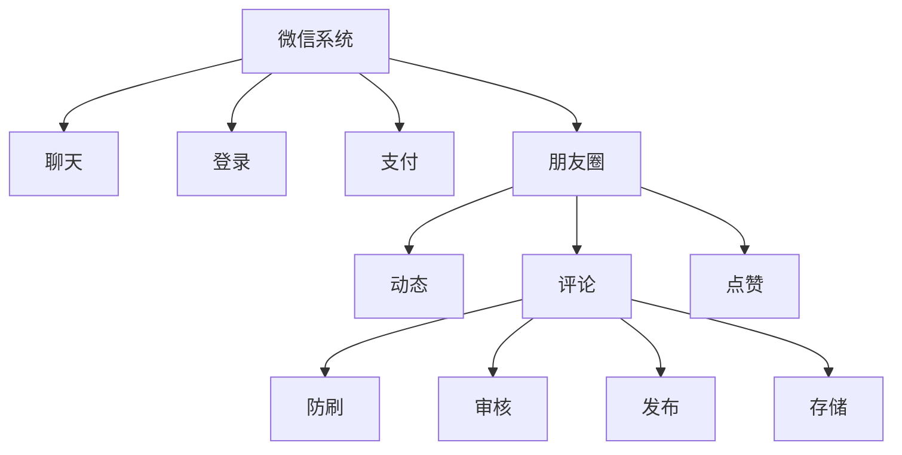
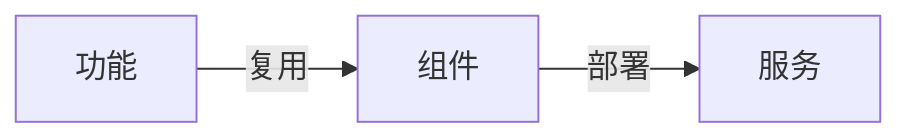

# 架构第一课：分清系统、模块、组件与服务，守住解耦、分层、封装三条原则

中台与组件化课程的第一章不讲代码，讲的是理论、思想与认知。"系统、子系统、模块、组件、服务"这些词开发中天天挂嘴边，但很少有人辨析过它们的准确定义和区别。本篇覆盖这一章前半部分：核心概念辨析、软件架构体系分层全景、三大架构原则，以及业务架构与功能架构两种架构方法。

## 先给结论

- 系统的定义抓三个关键词：关联（没有关联的个体堆在一起不叫系统）、规则（个体按规则运作而非各自为政）、能力（系统能力不是个体能力之和，而是产生了新的能力）。
- 子系统和系统的定义完全一样，区别只在观察角度：一个系统往往是另一个更大系统的子系统，微信包含聊天、登录、支付、朋友圈等子系统。
- 模块和组件都是系统的组成部分，只是拆分角度不同：从逻辑角度拆得到模块，目的是职责分离；从物理角度拆得到组件，目的是单元复用。
- 服务与组件最大的差异在使用方式：组件在本地使用（比如 jar 包），服务是运行起来的，要通过同步或异步的远程接口调用（RESTful、Web Service、消息系统、RPC、Socket）。
- 三大架构原则：解耦——彼此独立互不依赖，手段是面向接口编程和消息队列异步化；分层——同一层的组件处于同一个抽象层次；封装——模块、服务、系统都要对外隐藏状态、只暴露接口。功能经"复用"形成组件，组件经"部署"形成服务。
- 架构图是向干系人传递架构决策的载体，不同角色看到的图不一样，共六种：业务架构、功能架构、系统架构、技术架构、数据架构、部署架构，本篇先讲前两种。

## 系统与子系统：关联、规则、能力

系统不仅指软件系统，现实生活中同样存在大量系统。它的定义：泛指由一群有关联的个体组成，根据某种规则运作，能完成个别元件不能单独完成的工作的群体。拆开来看是三个特征。

第一是关联。没有关联的个体堆在一起不能成为系统：把一个汽车发动机和一堆苹果放在一起，不成其为系统；把发动机、底盘、轮胎、车架组合起来构成一台汽车，这才是系统。

第二是规则。系统内的个体需要按照指定的规则运作，而不是各自为政，规则规定了个体分工和协作的方式。软件系统同理：电商系统由多个服务构成，下单要经过订单服务、库存服务、用户服务的配合，按既定规则进行调用和消息通信，才能完成整个下单流程。

第三是能力。系统能力不是个体能力之和，而是产生了新的能力。汽车能载重前行，而发动机、变速箱、传动轴单独拿出来都不具备这个能力。

子系统也是由有关联的个体所组成的系统，只不过多半是更大系统中的一部分，定义和系统一样，只是观察角度有差异。拿微信来看：



系统一层层往下拆，是因为复杂度高，必须逐级分解才能管理。拆到评论审核这一级就停了——它不再包含业务意义上的子系统，而是由各个模块或组件构成。MySQL、Redis 是存储系统，不是业务子系统。

## 模块、组件、服务：同一系统的三种拆法

模块和组件都是系统的组成部分，区别在于从什么角度拆——就像给一群人分类，按性别分和按年龄分，同样是这群人，结果完全不同。

模块是一套一致而互相有紧密关联的软件组织，包含程序和数据结构两部分，现代软件开发往往使用模块作为合成的单位。落到实例上：学生信息管理系统从逻辑角度（业务逻辑）拆分，得到登录注册模块、个人信息模块、个人成绩模块。

组件是自包含的、可编程的、可重用的、与语言无关的软件单元，可以很容易地被用于组装应用程序。同一个系统从物理角度拆分，得到应用程序、Nginx、Web 服务器、MySQL——每一个都是系统的一个组件。

| 拆分对象 | 拆分角度 | 划分目的 | 实例 |
|---|---|---|---|
| 模块 | 逻辑角度（业务逻辑） | 职责分离 | 登录注册、个人信息、个人成绩模块 |
| 组件 | 物理角度（部署单元） | 单元复用 | 应用程序、Nginx、Web 服务器、MySQL |

划分模块为的是职责分离：个人成绩模块只专注成绩相关功能。划分组件为的是单元复用：MySQL、Web 服务器、Nginx、应用程序都可以在不同系统间重复使用。

服务与组件都会被外部应用程序使用，这是相同点。最大差异在于：组件在本地使用，例如提供的是一些 jar 包；服务是运行起来的、可运行的，要通过同步或异步的远程接口来使用，比如 RESTful 接口、Web Service、消息系统、RPC 或 Socket。服务可以单独运行，是对外提供功能的一种形式，能将复杂项目拆分成多个服务。

三者的完整链条：



写出来的类和方法提供功能；功能可以被复用时，就成了一个个组件；组件被部署起来之后，就成了服务。服务化之后好处明显：某一个服务挂掉不会拖垮整个系统；不做服务化，新功能加进来就会影响所有功能；做了服务化，每个服务只对上下游服务负责。

## 软件架构体系全景：一层一层往上盖

整个软件架构体系是一张有明显层次关系的图，下层是上层的基础，从下往上看：

| 层次 | 内容 | 作用 |
|---|---|---|
| 基础设施 | 容器、虚拟机、操作系统 | 软件运行的最底层支撑 |
| 中间件 | Tomcat/WebLogic/WebSphere 等服务器、数据库、缓存、消息队列 | 提供通用运行与存储能力 |
| 基础框架 | Spring、MyBatis 等 | 实现基础功能，提高开发效率 |
| 开发平台 | 各类开发脚手架 | 基础框架已配置好，直接开发业务 |
| 服务 | 一个个业务微服务 | 基于开发平台构建的业务单元 |
| 应用 | 服务关联到一起 | 直接面对系统使用者 |

不管什么软件都需要操作系统支持，没有操作系统任何软件都无法运行。做开发一般不是从零开始基于 JDK 裸写，而是依赖 Spring、MyBatis 这类基础框架实现基础功能。框架之上是开发平台，可以理解成开发的脚手架：相关基础框架已经配置好，直接在其上写业务功能，就像盖楼——地基打好，直接在地基上盖楼。开发平台之上构建一个个业务微服务，这些服务有组织、有纪律地关联到一起构成应用，直接面对系统的使用者。旁边还有质量管理、持续集成、服务监控、项目管理等运维管理的支撑。

## 三大架构原则：解耦、分层、封装

**解耦**。软件工程中，耦合指的就是对象之间的依赖性。controller 调 service，service 调 dao，它们之间就有耦合。耦合度越高，维护成本就越高，所以对象的设计应使类和构件之间的耦合最小。软件设计中通常用耦合度和内聚度作为衡量模块独立程度的标准，划分模块的准则就是高内聚低耦合——高内聚指模块功能尽量单一，低耦合指模块间依赖尽量少。绝对的零耦合做不到，解耦的核心思想是"彼此独立，互不依赖"。

最常用的解耦手段是面向接口编程。controller 不直接依赖某个 service 的实现，而是依赖接口，因为接口是稳定的；具体实现类是哪一个，controller 不用关心。service 调 dao 同理——不管底层用 JDBC、MyBatis 还是 MyBatis-Plus 操作数据库，只要实现了接口就可以：

```java
public interface OrderService {
    void createOrder(Order order);
}

public class OrderController {
    // 依赖接口而非实现类，底层换成任何实现都不影响 controller
    private OrderService orderService;

    public void submit(Order order) {
        orderService.createOrder(order);
    }
}
```

另一种手段是把同步调用变成异步调用，引入消息机制：生产方把消息发送到队列，接收方监听队列，双方不再直接联系，完成解耦。

**分层**。分层结构是最为流行、应用最广泛的应用软件设计方式，最经典的是三层架构：自顶向下由用户界面层（表现层）、业务逻辑层、数据访问层组成，数据访问层直接访问数据库。这种分层有效地隔离了业务逻辑与数据访问逻辑，使两个不同关注点能够相对独立地演化。分层的设计原则是：同一层的组件处于同一个抽象层次，即单一抽象层次原则，按此可以把系统细分成四层：

| 层次 | 组成 | 面向对象 |
|---|---|---|
| 表现层 | PC 端组件、移动端组件 | 用户 |
| 控制层 | Controller | 应用 |
| 引擎层 | 实体引擎（Entity Engine）、数据引擎（Data Engine） | 业务 |
| 基础层 | 数据库、MQ 等 | 资源 |

不管单体时代的三层架构还是抽象出来的多层架构，分几层不重要，重要的是分层的思想。经典三层架构放到今天已有些过时——提出它的年代系统简单，本质上都是单体架构的数据库管理系统。不必纠结具体怎么分，按当前的技术特点、业务特点和系统规模划分层次即可。

**封装**。在一个类中，当每个对象的状态保持相对孤立，就实现了封装。其余对象并不能观察到这个对象的状态，只能调用一些被称作"方法"的通用功能——说得直白些，类里有属性有方法，想改变属性的状态，只能通过调用方法来达到目的。

这个思想不能停在类这一层，要站到更高角度看：模块需要封装，服务需要封装，甚至大到系统也需要封装。它们与外界保持相对孤立，想访问某个服务，就通过它提供的接口来改变其某些状态；系统与系统之间保持相对独立、开放接口，也是同样的道理。

## 架构的方法：先看业务架构，再看功能架构

架构图是为了表示软件系统的整体轮廓和各个组件之间的相互关系和边界，以及软件系统的物理部署和演进方向的整体视图。要让干系人理解、遵循架构决策，就需要把架构信息传递出去，架构图就是很好的载体；不同视角和角色关注点不同，看到的图也不一样，课程共讲六种。

业务架构站在整个系统的最高视角，使用者是 CEO、CIO、CTO、产品总监这类领导岗角色：

| 内容 | 说明 | 示例 |
|---|---|---|
| 核心业务流程 | 最顶层的业务主线 | 终端消费者下单付款、发货、配送交付 |
| 核心能力 | 平台拥有哪些功能 | 库存管理、财务管理、客户管理、采购管理、分销管理、订单管理，每个能力下再细分（如订单自动同步、统一处理） |
| 全局视图 | 项目最高层涉及哪些系统平台 | 前台、电商平台、渠道中心（自营/经销商/其他渠道）、数据中心、后台管理系统、CRM、报表中心、经销商系统、仓储物流系统 |

业务架构因为站得高，只能粗略展示大体的轮廓——它看不出电商平台里具体有哪些功能。要看清每个系统内部的功能，就需要功能架构图：它是在业务架构基础上做的细化，使用者主要是产品总监、产品经理。

以课程中黑马头条项目的功能架构图为例，它按层展示每个端、每个系统的具体功能：用户移动 App 层有内容推荐、内容搜索、登录注册等；管理平台层有用户管理、内容管理、数据统计等；用户自媒体平台层有粉丝管理、内容管理、内容发布等；支撑系统再分成数据系统、推荐系统、广告系统等子系统。

## 小结

这一章前半部分解决的是认知问题。系统靠关联、规则、能力三个特征界定；模块从逻辑角度拆分、求职责分离；组件从物理角度拆分、求单元复用；服务是部署起来后通过远程接口对外提供功能的运行单元。软件架构体系从基础设施、中间件、基础框架、开发平台到服务、应用逐层堆叠，下层永远是上层的基础。

三大架构原则贯穿所有架构设计：解耦追求高内聚低耦合，靠面向接口编程和消息异步化落地；分层要求同一层处于同一抽象层次；封装从类推广到模块、服务和系统。业务架构给高层看全局，功能架构给产品看细节。其余四种架构方法与架构演进之路，留到下一篇展开。
