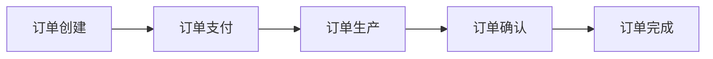

# 电商订单系统案例收官：从实体模型到订单核心流程

前面几节已经把电商订单系统的功能盘清楚了：创建订单、查询订单、在线下单等。本章案例的最后两节补齐需求分析的另外两条主线——数据与流程：先把订单系统里需要持久化的实体逐一盘点出来，再把 B2C 商城的订单流转抽象成一套标准的核心流程。做完这两件事，「软件架构与需求分析方法」这一章的案例部分就完整收官了。

## 先给结论

- 订单不是一条孤立记录，而是聚合了基本信息、用户信息、商品信息、促销信息、物流信息、支付信息六大块数据；实体与数据库表基本一一对应，都要持久化。
- 订单系统业务架构分上下两层：上层是订单系统自身的创建/查询/订单数据/订单逻辑/流程引擎/状态机/价格计算，下层是会员、库存、商品、促销、支付、风控等底层服务。
- 订单服务面向用户（订单列表、订单详情、在线下单），订单逻辑才是系统核心，负责管理订单创建、支付、生产、确认、完成、取消的全生命周期。
- 底层服务模块化后信息分散在各系统，自建对接费时且维护成本高；正解是订单系统接入所需的公共服务模块接口。
- 流程 = 从平台角度把订单从创建到完成的流转过程抽象成标准规则，触发条件分系统触发与人工触发两种。
- B2C 订单核心流程五步走：订单创建 → 订单支付 → 订单生产 → 订单确认 → 订单完成，全程由订单、产品、促销、会员、仓储、支付、风控七个系统协作完成。

## 订单实体：把要落库的数据盘点清楚

功能之外，需求分析还要回答另一个问题：这个系统的数据长什么样。订单系统里的实体最终都要保存到数据库，实体跟数据表基本就是一个对应关系。以订单这个核心实体为中心，能盘出六块内容：

- **基本信息**：订单类型、订单编号、订单状态、订单渠道。
- **用户信息**：用户编号、用户信息、收货信息。课程里只列了重点字段，真实的用户数据远不止这三项——住址、邮箱、身份证、手机号等一大串都挂在用户身上，做设计时不必求全，把实体和重点字段提出来即可。
- **商品信息**：SKU、单价、运费、折扣。
- **促销信息**：促销活动、优惠券、其他优惠。
- **物流信息**：物流公司、物流单号、物流状态。
- **支付信息**：支付流水号、商品金额、运费、优惠券金额、优惠总金额、实付金额。

这六块实体都是整个购物流程当中非常重要的数据，且都需要持久化。举例来说：下完单之后想尽快收到货，就要靠物流信息随时掌握包裹的状态——是已经出货、在途到哪个城市，还是正在派送；支付信息则记录了实付金额、是否使用了优惠券这些资金明细。数据盘点清楚了，后面的表设计才有依据。

## 订单系统业务架构：订单服务、订单逻辑与底层服务

实体是数据面，业务架构是功能面。课程给出的订单系统业务架构图分上下两层：

- **上层·订单系统**：创建订单、查询订单、订单数据、订单逻辑、流程引擎、状态机、价格计算。
- **下层·底层服务**：会员服务、库存服务、商品服务、促销服务、支付服务、风控服务。

这个架构可以拆成三个角色来理解：

1. **订单服务**：主要功能是用户日常使用的服务和页面，包括订单列表、订单详情、在线下单等。
2. **订单逻辑**：订单系统的核心，负责管理订单创建、支付、生产、确认、完成、取消等流程，配合流程引擎、状态机、价格计算这些能力一起工作。
3. **底层服务**：信息化建设达到一定程度的企业，会将公共服务模块化，产品、代码、数据库、接口都相对独立。

模块化有收益，也有代价。订单创建的场景下需要获取的信息分散在各个系统里，如果订单系统自己去对接每一个公共系统，一是会花费大量时间，二是代码的维护成本非常高。课程的结论是：订单系统接入所需的公共服务模块接口，在订单系统即可完成对接公共系统的服务——用统一的接口契约把系统间的耦合度和维护成本压下来。这也是后面「中台战略与组件化开发」模块要展开的方向。

## 订单核心流程：五个阶段、七个系统

最后一节讲流程。流程指的是从平台角度出发，把订单从创建到完成的整个流转过程抽象出来，形成一套标准的流程规则；每个流程的触发条件又可以分为系统触发和人工触发两种场景。

以 B2C 商城的订单系统为例，按实际业务场景可以抽象出五个大步骤，参与完成的系统有订单系统、产品系统、促销系统、会员系统、仓储系统、支付系统、风控系统七个：

步骤数不多，但每个阶段背后的系统协作并不简单，逐段展开：

**订单创建**：从下单开始，先进入风控系统做风控校验；校验通过后，通过产品系统获取产品信息（订单里要记录到底买的是什么商品），再从促销系统获取促销信息，从会员系统获取会员信息和会员权益，然后到仓储系统做库存校验——下单时必须保证库存充足，库存减到零就不能再买了；接着通过支付系统做价格计算，把满减、红包、积分抵扣现金这些优惠都算进去，最终确定订单价格；最后调用仓储系统落实增减库存的规则。到这里，订单创建的过程才算完成。

**订单支付**：支付之前先做一次库存校验，校验通过后通过支付系统完成支付，支付完成后扣减库存。同时要做信息同步——订单创建完成之后同步一次，订单支付完成之后也同步一次，让各相关系统都拿到最新状态。

**订单生产**：这一步主要做货物的配送，包括仓储、订单分拣、商品包装、快递配送等环节。

**订单确认**：配送完成、货物到了客户手里，用户做确认收货，再把「已收到货」的信息同步到各个系统，各系统都能获取到这个状态。

**订单完成**：信息同步完毕，整个订单才算走完闭环。

整个处理流程环节多、参与系统多，复杂度不低。还要注意一点：这里展示的只是 B2C 模式下的订单流程，同样是订单，模式不同流程就可能有差异。这张流程图没有放之四海而皆准的版本，只有适配当前业务的版本。

## 小结

至此，电商订单系统案例完整收官。回头看整个需求分析的过程，是一条清晰的链路：先分析功能（创建订单、查询订单、在线下单等），再盘点实体（订单聚合的六类数据，对应落库的表），然后画业务架构（订单服务、订单逻辑、底层服务三层分工），最后抽象流程（五阶段、七系统的标准流转规则）。功能、数据、架构、流程四张图合在一起，就是后续系统设计与开发的直接依据——这也是「软件架构与需求分析方法」这一章想传递的核心方法：先想清楚再动手，把不确定性消灭在写代码之前。
