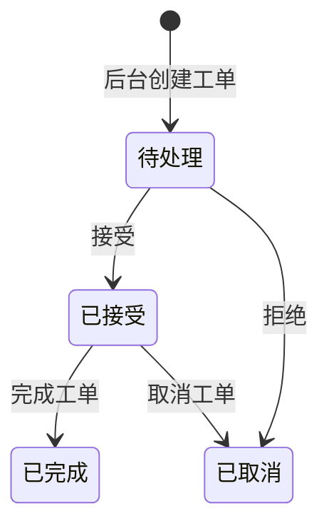

# 立可得 2.0 工单开发开篇：Paho 对接 EMQ 的发布订阅与工单业务全景

LBS 章收官之后，进入工单核心业务开发。动手写业务代码之前，先要解决一个基础设施问题：微服务怎么和 EMQ 这套工业级物联网消息中间件通信——用什么客户端、怎么发消息、怎么订阅消息、消息进来之后怎么分发到不同业务。这一篇把这条技术链路讲透，再切入工单本身：业务流、两端产品原型、表结构，最后落到创建工单的第一个改造点。

## 先给结论

- Paho 是 Eclipse 基金会的开源 MQTT 客户端库，有多语言版本；它不只对接 EMQ X，任何符合 MQTT 协议规范的消息代理都能接。依赖 `org.eclipse.paho.client.mqttv3:1.2.5` 统一加在 service_common 微服务公共模块。
- 连接参数走自定义配置：服务器 `tcp://192.168.200.128:1883`，clientId 用 `random.int` 拼 4 位随机数，心跳 10 秒，连接超时 30 秒；MqttConfig 里装配 MqttClient，持久化选 MemoryPersistence。
- 发布端 MqttProducer 提供五个重载 send，最终都落到 `client.publish(topic, payload字节, qos, retained)`；传对象时先序列化成 JSON。
- 订阅端 MqttCallback 实现 MqttCallbackExtended：connectComplete 里自动订阅配置的主题，messageArrived 里处理消息并手动确认（配合 setManualAcks(true)）。
- 消息分发靠 MsgHandler 接口 + @ProcessType 注解：启动时扫描所有实现类建「协议名 → 处理类」Map，再按消息里的 msgType 字段路由；这套机制 1.0 就有，2.0 原样延续，做到无缝升级。
- 工单分运维（投放/维修/撤机）和运营（补货）两大类；2.0 在 1.0「创建→完成」两步流程上加入接受/拒绝/取消环节；核心表 tb_task，补货工单另有明细表 tb_task_details。
- 废弃属性不直接删代码，用 @Deprecated 标记（taskName、expect），避免影响团队其他人的代码。

## 一、Paho 客户端接入 EMQ：依赖、配置与连接

EMQ 是工业级物联网消息中间件，之后从事物联网开发大概率会碰到。立可得 2.0 新增了 service_common 这个微服务公共模块——所有微服务都会用到的功能就放这里，EMQ 收发几乎每个微服务都需要，所以 Paho 依赖加在这个模块：

```xml
<dependency>
    <groupId>org.eclipse.paho</groupId>
    <artifactId>org.eclipse.paho.client.mqttv3</artifactId>
    <version>1.2.5</version>
</dependency>
```

artifactId 里的 mqttv3 对应 MQTT 协议版本 3（目前协议最高版本是 5）。

第二步是自定义的 MQTT 配置，由配置类用 @Value 读取：

```yaml
mqtt:
  client:
    serverURL: tcp://192.168.200.128:1883            # MQTT 服务器地址
    clientId: monitor.task.${random.int[1000,9999]}  # 拼 4 位随机数
    username: admin
    password: public
    keepAliveInterval: 10    # 心跳：每 10 秒检查连接是否正常
    connectionTimeout: 30    # 30 秒连不上就放弃
  producer:
    defaultQos:              # 默认消息质量，0/1/2，2 最高
    defaultRetained: false   # 是否保留消息
    defaultTopic: topic-test1
```

clientId 里 `${random.int[1000,9999]}` 是配置文件的动态写法，每次重新随机生成一个四位数。第三步是配置类 MqttConfig（common 工程 emq 包），核心是装配 MqttClient 这个连接对象：

```java
@Bean
public MqttClient mqttClient() {
    // 第三参数：clientId 持久化方式，不传默认按文件存储，这里指定内存
    MqttClient client = new MqttClient(serverURL, clientId, mqttClientPersistence());
    client.setManualAcks(true);        // 手动确认收到的消息
    client.setCallback(mqttCallback);  // 挂上订阅回调
    client.connect(mqttConnectOptions());
    return client;
}
```

持久化参数是 MqttClientPersistent 接口，实现类两个：MemoryPersistence（内存）和文件方式，Ctrl+Alt+B 能看到；不指定时默认走文件，这里用内存。connect 的选项对象里依次设置：用户名、密码、是否自动重连（true 表示断开后自动尝试重连）、重连时是否清除之前的连接信息（cleanSession，true 相当于全新连接）、连接超时、心跳，最后 setMqttVersion 指定 MQTT 3.1.1。

## 二、发布、订阅与消息分发架构

发布端 MqttProducer 读取 producer 配置并注入 MqttClient，五个重载的 send 层层收口到 Paho 的 publish：

```java
public void send(String topic, int qos, boolean retained, String payload) {
    try {
        mqttClient.publish(topic, payload.getBytes(), qos, retained);
    } catch (MqttException e) {
        log.error("publish msg error.", e);
    }
}

public <T> void send(String topic, int qos, T msg) throws JsonProcessingException {
    this.send(topic, qos, JsonUtil.serialize(msg));  // 对象先序列化成 JSON
}
```

重载的意义是省参数时取默认值：一个参数就用默认主题，两个参数补默认 QoS，三个参数补默认 retained；发送时也可以显式指定主题。验证方式：在工单微服务里写测试类（@RunWith(SpringRunner.class) + @SpringBootTest），注入 MqttProducer，调两参数版本 `send("lktest", "{\"name\":\"abc\"}")`；同时登录 EMQ 控制台，用 WebSocket 工具连接后订阅 lktest 主题，运行测试方法，控制台收到消息即验证通过。

订阅端 MqttCallback 实现 MqttCallbackExtended 接口，承担两件事：定义订阅哪些主题、处理订阅到的消息。主题来自配置里的 consumer.topics（逗号分隔的两个值）：一个以 $share 开头走共享订阅——注意 $share 后面是组名，组名后面才是真正的主题（如 server/task/supply）；另一个同样是共享订阅形式，指向 server/task/status。连接完成时自动订阅：

```java
@Override
public void connectComplete(boolean reconnect, String serverURI) {
    if (consumerTopics != null && consumerTopics.size() > 0) {
        consumerTopics.forEach(t -> mqttClient.subscribe(t, 2));  // QoS 2 订阅
    }
}

@Override
public void messageArrived(String topic, MqttMessage message) throws Exception {
    log.info("topic: {} message: {}", topic, new String(message.getPayload()));
    mqttService.processMessage(topic, message);  // 分发处理
    mqttClient.messageArrivedComplete(message.getId(), message.getQos());  // 手动确认
}
```

messageArrived 是消息到达后自动触发的方法，所有订阅到的消息必经这里。注意取消息体用 getPayload()，它返回字节数组，要用 String 构造方法转成字符串，别用 toString。MqttClient 是通过 config 里 `mqttCallback.setMqttClient(client)` 从外部传进来的。测试时启动工单微服务，日志里出现两条订阅成功记录；再用 EMQ 工作台向这两个主题发消息（QoS 2），控制台都能收到——发消息时填的是主题名，不是 $share 后面的组名。

接下来是分发架构要解决的问题：立可得要处理的消息和业务非常多，靠协议区分，如果把所有业务写进一个类，维护起来是灾难。设计目标是：一个唯一入口，把消息分发到不同的处理类。做法是每处理一种业务就写一个类，实现自定义的 MsgHandler 接口（只有一个 `void process(String jsonMsg)` 方法），并加 @ProcessType 注解指定协议名（相当于业务类型，比如 SKU_CFG_REQ 表示处理商品配置请求）。它为什么能自动路由？关键在 MsgHandlerContextImp：

```java
public class MsgHandlerContextImp implements ApplicationContextAware, MsgHandlerContext {
    private Map<String, MsgHandler> handlerMap = Maps.newHashMap();

    @Override
    public void setApplicationContext(ApplicationContext ctx) {
        ctx.getBeansOfType(MsgHandler.class).values().forEach(v -> {
            String msgType = v.getClass().getAnnotation(ProcessType.class).value();
            handlerMap.put(msgType, v);  // 协议名 -> 处理类
        });
    }
    public MsgHandler getMsgHandler(String msgType) { return handlerMap.get(msgType); }
}
```

实现 ApplicationContextAware 后，setApplicationContext 会在微服务启动时自动执行：getBeansOfType 拿到所有 MsgHandler 实现类，反射读取类上的 @ProcessType 注解值，以协议名为 key、实现类为 value 建 Map。消息进来后，MqttServiceImpl.processMessage 先从 JSON 消息里提取 msgType 节点值——整个立可得的所有消息 JSON 都必须带这个 key，没有就直接返回不做处理；再按 msgType 从 Map 里找到实现类，调用它的 process 方法执行具体业务。

MsgHandler、MsgHandlerContext 和注解都在 common 工程，1.0 就存在，2.0 没改一个字——1.0 的这个设计足够好，直接延续过来实现了无缝升级，每个处理类都不用大范围修改。版本升级时尽量保留能保留的部分、平滑过渡，能省掉巨大的升级工作量。

## 三、工单业务全景：业务流、原型与表结构

从这一节正式进入 2.0 业务代码开发。工单是立可得最核心的业务模块——售货机运营公司的日常管理工作，基本就是由各种工单组成的。工单两大类：运维工单（投放、维修、撤机）和运营工单（补货，即向售货机补货）。

2.0 对工单流程做了大升级。1.0 只有创建、完成两步；2.0 在中间加入了接受和拒绝：创建工单后处于待处理状态，派发给人员执行，人员可以接受也可以拒绝。现实原因是创建的工单不一定都能成功执行——维修工单创建后，人员一看问题处理不了，可以拒绝，系统重新创建派给另一个人；到了现场才发现搞不定，也可以取消（类似打车软件叫车后仍可取消）。完整状态流转：



产品原型分两端。后台管理端的工单管理分运维工单、运营工单两部分：运维工单列表包含投放、维修、撤机三种类型，可按工单编号、类型、状态查询；点「新建」弹出创建窗口，填设备编号、选工单类型、选运维人员、写备注（维修工单备注机器出了什么问题）——注意运维人员选的不是所有人，而是设备所属区域的运维人员；确定后工单进入待处理状态。移动端：运维人员登录运维管理 APP 看到待办工单列表，点进详情（工单号、创建日期、设备号、地址、类型、状态、备注），有接受、拒绝两个按钮；接受后进入下一界面多了定位，定位不准可重新弹出列表选地址，点完成后进入最终完成状态。运营工单目前只有补货一种（不排除以后加新类型），流程与运维工单一致，差异点：

| 维度 | 运维工单 | 运营工单 |
| --- | --- | --- |
| 类型 | 投放、维修、撤机 | 补货（目前仅一种） |
| 创建入口 | 后台「运维工单-新建」 | 后台「运营工单-新建」，多一个补货详情设置 |
| 移动端 | 运维管理 APP | 运营管理 APP |
| 详情特点 | 工单号、设备号、地址、类型、状态、备注 | 补货明细：每个货道的商品、规格、补多少瓶 |
| 地址采集 | 仅投放（装机）工单完成时把地址和经纬度传给后端 | 无地址采集 |
| 数据表 | tb_task 一张够用 | tb_task + tb_task_details 明细表 |

数据都在 lkd_production 库，核心是 tb_task 工单表：

| 字段 | 含义 |
| --- | --- |
| task_id | 系统自增 ID |
| task_code | 工单编号（12 位：前 8 位年月日，后 4 位当天序号），编号≠ID，有业务属性 |
| task_status | 状态：1 待办、2 进行、3 取消、4 完成（tb_task_status_type） |
| create_type | 创建类型：0 自动创建、1 手动创建（本次新增的都是手动） |
| inner_code | 售货机编码，是业务编码不是 ID |
| user_id / user_name | 创建人（通常是管理员），≠执行人 |
| assignor_id | 执行人 ID，具体干活的那个人 |
| region_id | 所属区域 |
| product_type_id | 工单类型（tb_task_type：1 投放、2 补货、3 维修、4 撤机；type 1 运维 / 2 运营） |
| desc | 描述，工单被取消时通常记录拒绝/取消原因 |
| addr | 执行时采集的地址，2.0 新增 |
| expect | 计划完成时间，2.0 已废弃但保留 |
| create_time / update_time | 创建、修改时间 |

补货工单明细表 tb_task_details 只服务于补货场景（运维工单一张表就够）：details_id、task_id（关联工单）、channel_code 货道编号、补货数量，以及 sku_id、sku_name、sku_image——后三个字段 1.0 没有，2.0 加上的。expect 这个字段值得单独说：2.0 的产品规划把它拿掉了，但表里留着。这是数据库演进的一条实用策略——增加字段可以，删减要慎重；需求今天撤了，说不定哪天产品又要加回来，数据库改来改去很麻烦，宁可废掉不用，也不急着删。

## 四、创建工单开篇：视图模型与 @Deprecated

创建工单的代码 1.0 已经存在，2.0 主要逻辑变化不大，要调的是细节，第一个就是视图模型的废弃属性处理。视图模型是前后端交互时封装数据的对象（TaskViewModel），实体类面向数据库，视图模型面向前端——创建工单窗口里填写的信息就封装在它里面传给后端：

```java
@Data
public class TaskViewModel implements Serializable {
    @Deprecated  // 2.0 已废弃工单名称
    private String taskName;
    private int createType;                      // 创建类型
    private String innerCode;                    // 设备编号
    private Integer userId;                      // 创建人 ID
    private Integer assignId;                    // 任务执行人 ID
    private int productType;                     // 工单类型
    private String desc;                         // 描述信息
    @Deprecated  // 2.0 已废弃期望完成时间
    private String expect;
    private List<TaskDetailsViewModel> details;  // 工单详情，只有补货工单才有
}
```

工单名称 taskName 和期望完成时间 expect 在 1.0 里存在，2.0 的产品规划里没有它们了。直接删掉行不行？行，但风险大：代码不是一个人写的，团队里很多人在用，你能确定这个属性没人引用吗？比较保险的方式是加 @Deprecated 注解——标记属性已废弃、下个版本可能删除。标注后 IDE 里属性名会带删除线，代码仍然可用，只是不建议再用。这就是视图模型改造的核心：掌握 @Deprecated 的使用场景和用法。

## 小结

这一篇覆盖了工单开发的两条准备线。技术线：Paho 客户端接入 EMQ，配置驱动的连接、重载式发布、connectComplete 自动订阅、messageArrived 手动确认，再由 MsgHandler + @ProcessType 构成的分发架构把消息路由到具体业务类；业务线：2.0 工单流程加入接受/拒绝/取消，运维、运营两类工单在两端原型上的差异，以及 tb_task 为核心的表结构。下一篇沿着创建工单的完整实现继续。
