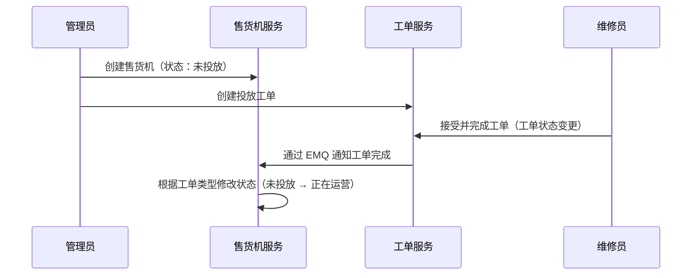

# 工单核心业务开发（上）：创建、接受、取消工单与 EMQ 状态通知开篇

立可得 2.0 第四章进入工单核心业务开发。这一篇从创建工单讲起：入口处的校验逻辑、12 位工单编号怎么生成、一长串 setXXX 怎么精简、当前登录用户怎么注入，然后顺着业务流程往下走，实现接受工单与取消/拒绝工单，把状态从待处理、进行中到已取消的闭环跑通。结尾开出"完成运维工单"的需求：为什么工单完成之后，要靠 EMQ 消息去通知售货机服务改状态。

## 先给结论

- 创建工单第一句是 `checkCreateTask`：Feign 远程查售货机，设备不存在直接抛异常；再按工单类型校验设备状态——投放工单要求设备"未运营"，补货、撤机工单要求设备"运营中"。
- 还有一道防重复：该机器存在未完成的同类型工单时（`hasTask`）不允许再建，抛"该机器有未完成的同类型工单"。
- 工单编号 12 位 = 8 位年月日 + 4 位当日序号；序号存 Redis，key 拼日期、设一天过期，用 `increment` 原子自增，不用自己考虑锁。
- 视图模型到实体的逐个 setXXX 换成 `BeanUtils.copyProperties` 一行；属性名不完全一致的（`productType` → `productTypeId`）必须保留手动赋值。
- 前端传来的 userId 不可信：Controller 里用 `BaseController.getUserId()` 从请求头提取当前登录用户覆盖它；同理，接受/取消工单前先校验"工单执行人是否当前登录用户"，Integer 比较要 `intValue()`。
- 完成运维工单涉及工单服务与售货机服务两个服务，两者之间不走 Feign，而是工单服务发 EMQ 消息、售货机服务订阅后按工单类型改状态。

## 创建工单：先校验，再落库

`createTask` 方法在 `TaskServiceImpl` 里，标注 `@Transactional(rollbackFor = {Exception.class}, noRollbackFor = {LogicException.class})`。第一句 `checkCreateTask` 是 1.0 版本遗留下来的方法，2.0 逻辑没有变化，不需要改造，但值得拆开看一遍它到底拦了什么。

第一步，根据前端传来的设备编号 innerCode，通过 Feign 远程调用售货机微服务拿设备对象：

```java
private void checkCreateTask(String innerCode, int productType) throws LogicException {
    VendingMachineViewModel vmInfo = vmService.getVmInfo(innerCode);
    if (vmInfo == null) {
        throw new LogicException("设备不存在");
    }
    // 投放工单：设备必须处于未运营状态
    if (productType == VMSystem.TASK_TYPE_DEPLOY
            && vmInfo.getVmStatus() == VMSystem.VM_STATUS_RUNNING) {
        throw new LogicException("该设备已在运营");
    }
    // 补货工单：设备必须处于运营状态
    if (productType == VMSystem.TASK_TYPE_SUPPLY
            && vmInfo.getVmStatus() != VMSystem.VM_STATUS_RUNNING) {
        throw new LogicException("设备不处于运营状态");
    }
    // 撤机工单：设备必须处于运营状态
    if (productType == VMSystem.TASK_TYPE_REVOKE
            && vmInfo.getVmStatus() != VMSystem.VM_STATUS_RUNNING) {
        throw new LogicException("设备不处于运营状态");
    }
}
```

三条规则用表格整理：

| 工单类型 | 设备状态要求 | 违反提示 | 业务解释 |
| --- | --- | --- | --- |
| 投放 TASK_TYPE_DEPLOY | 必须未运营 | 该设备已在运营 | 投放的一定是未运营状态的设备，设备都在运营了还投什么放 |
| 补货 TASK_TYPE_SUPPLY | 必须运营中 | 设备不处于运营状态 | 补货的前提是设备正在运营 |
| 撤机 TASK_TYPE_REVOKE | 必须运营中 | 设备不处于运营状态 | 设备都没在运营，谈何撤机 |

设备状态本身有三个取值：1 运营、0 未投放、2 已撤机。`checkCreateTask` 之后还有一道校验：当前售货机如果已有未完成的同类型工单，直接抛"该机器有未完成的同类型工单"——同一台设备同时挂着两张投放工单，状态必然乱套。

### 12 位工单编号：日期 + Redis 自增序号

2.0 把 1.0 的"工单名称"干掉了，取而代之的是系统自动生成的工单编号。编号和工单 ID 不是一回事：ID 是数据库自增的数字，编号带业务属性，共 12 位——前 8 位是年月日，后 4 位是当天的工单序号。2021 年 1 月 1 号的第一笔工单编号就是 202101010001，第二笔 0002，以此类推。

生成逻辑封装成私有方法：

```java
private String generateTaskCode() {
    // 前 8 位：年月日
    String date = LocalDate.now().format(DateTimeFormatter.ofPattern("yyyyMMdd"));
    // key 拼上日期，每天不同，且只保留一天
    String key = "lkd.task.code." + date;
    Object obj = redisTemplate.opsForValue().get(key);
    if (obj == null) {
        // 当天第一笔工单：写入初始值，一天过期，第二天重新计数
        redisTemplate.opsForValue().set(key, 1L, Duration.ofDays(1));
        return date + "0001";
    }
    // 当天已有工单：原子自增后左补 0 到 4 位
    return date + StrUtil.padStart(
            redisTemplate.opsForValue().increment(key, 1L).toString(), 4, '0');
}
```

序号放 Redis 的原因：key 里拼了日期，每天自然隔离；写入时指定一天过期，第二天 key 不存在，序号就重新从 0001 开始计。自增用 `increment` 而不是 get 出来加一再 set 回去——`increment` 本身是原子操作，内部把并发问题处理掉了，不用再考虑锁，性能也快。自增出来的可能是 2、3、4 这样的短数字，用 `padStart` 补 0 到固定 4 位（第三个参数是 char 类型，写单引号）。

最后在 `createTask` 里加一句 `taskEntity.setTaskCode(generateTaskCode())`，编号就落到了实体上。

### 属性拷贝优化：BeanUtils 一行替一串

`createTask` 主体两段：向工单表插入记录；如果是补货工单，遍历工单详情集合插入工单明细表——明细里记的是哪个货道、补货数量、对应哪张工单以及商品信息。原始写法是从视图模型逐个取属性 set 给实体：

```java
TaskEntity taskEntity = new TaskEntity();
taskEntity.setTaskCode(generateTaskCode());
taskEntity.setCreateType(taskViewModel.getCreateType());
taskEntity.setDesc(taskViewModel.getDesc());
taskEntity.setInnerCode(taskViewModel.getInnerCode());
taskEntity.setUserName(userName);
// ... 一长串 setXXX
```

规律很明显：大部分属性两边名字完全相同，这段代码可以用 `BeanUtils.copyProperties` 一句话替掉，源放前面、目标放后面：

```java
TaskEntity taskEntity = new TaskEntity();
BeanUtils.copyProperties(taskViewModel, taskEntity);
taskEntity.setProductTypeId(taskViewModel.getProductType()); // 名字不同，必须手动
```

两个注意点：`copyProperties` 只拷属性名完全一致的，`productType` 和 `productTypeId` 差一点也不行，这类必须保留手动 set；2.0 里工单没有过期时间这个逻辑了，原来那几行过期时间赋值直接删掉。工单明细同理，从详情对象拷给 `TaskDetailsEntity`，属性名相同的行全删，代码量从一大段缩到两三行。

## 当前登录用户与接口测试

业务层完成，看控制层。`TaskController` 的 create 方法本身很简单：接 `TaskViewModel`，调 `taskService.createTask`。但 `TaskViewModel` 里有个 userId——当前创建工单的人。这个人理论上就是登录用户，可这个值是前端传的，能信吗？

至少三种情况会出问题：前端编码编错或者干脆没传；接口是对外暴露的，调用方不一定是自家前端，可能是其他程序；直接篡改数据。所以这类信息不能信任前端。处理办法是在 Controller 里提取当前登录用户，把传上来的 userId 覆盖掉——传没传、传得对不对都不管，只信后端提取的。

第二章讲过的 `BaseController` 在这里派上用场，让 Controller 继承它就能直接用：

```java
@Autowired
private HttpServletRequest request;

public Integer getUserId() {
    String userId = request.getHeader("userId");
    if (Strings.isNullOrEmpty(userId)) {
        return null;
    }
    return Integer.parseInt(userId);
}
```

请求头里的 userId 是 filter 解析 token 后放进来的。回到创建方法加一句 `taskViewModel.setUserId(getUserId())`，即设置当前登录用户 ID。

跑接口测试要起 4 个服务：工单微服务（主角）、用户微服务（要登录）、售货机微服务（createTask 里有 Feign 远程调用，不起跑不通）、网关（所有请求都从网关走）。用 VS Code 的 http 脚本：先在 user.http 里用管理员 admin 登录，获取最新的图形验证码（client token 用 abc 口径），回填验证码发送，拿到新 token 填进 task.http 的 token 变量，后续请求都带着它。

创建投放工单（productType 为 1），设备编号取设备表里的一条记录（01000001）。第一发直接报"该设备已在运营"——查表发现设备状态是 1（运营中），投放工单当然不让建。把状态改成 0（未投放）再发，返回 true，创建成功。到工单表里看新记录：工单编码前 8 位是当天日期、后 4 位是 0001，序号生成逻辑得到验证。

再创建一次？这回报"该机器有未完成的同类型工单"。为了验证序号自增，把库里那条工单的状态改成别的值（造测试数据），再调一次接口，返回 true，新工单编号变成 0002——Redis 自增链路闭环。

## 接受与取消工单：状态流转闭环

接受工单的场景：运维或运营人员在 APP 上看到待办工单，点开详情点"接受"，相当于接单。逻辑不复杂，本质是改状态：待处理变进行中。这个方法 1.0 没有，2.0 新增 `accept(Long id)`：

```java
public boolean accept(Long id) {
    TaskEntity task = this.getById(id);   // 查询工单
    if (task.getTaskStatus() != VMSystem.TASK_STATUS_CREATE) {
        throw new LogicException("工单状态不是待处理");
    }
    task.setTaskStatus(VMSystem.TASK_STATUS_PROGRESS);  // 待处理 -> 进行中
    return this.updateById(task);
}
```

两个细节。第一，状态值不要直接写 1、2、3 这类数字：可读性差，而且一旦数字代表的含义发生变化，后面要改的代码就多了，统一用常量——TASK_STATUS_CREATE 为 1（待处理），TASK_STATUS_PROGRESS 为 2（进行中），TASK_STATUS_CANCEL 为 3（已取消）。第二，查出来要先校验状态：工单不是待处理状态还执行接受，数据就乱套了。

Controller 层多考虑一步：

```java
@GetMapping("/accept/{taskId}")
public boolean accept(@PathVariable String taskId) {
    Long id = Long.valueOf(taskId);
    TaskEntity task = taskService.getById(id);
    // 校验工单执行人是否为当前登录用户
    if (task.getAssignorId().intValue() != getUserId().intValue()) {
        throw new LogicException("操作非法");
    }
    return taskService.accept(id);
}
```

三点注意。路径参数用 String 接而不是 Long：前端对 long 会丢精度，前后端交互统一传字符串，进到后端再 `Long.valueOf` 转换。执行人校验：张三登录 APP，正常操作不可能接受李四的工单，但如果有人拿张三的身份直接调接口呢？前端传来的东西不可信，这个数据安全校验不能省；注意比较的是工单执行人 assignorId（具体干活的人），不是 userId（指派工单的管理员）。最后，执行人是 Integer 对象类型，直接比较比的是对象不是值，必须 `intValue()` 后再比。

取消工单和拒绝工单是一回事：拒绝是没接受时拒绝，取消是接受之后取消，最终结果一样，共用一个方法。APP 上填一个原因点确认，原因落到工单表的 desc 字段，状态改成已取消。方法签名定为 `cancelTask(Long id, CancelTaskViewModel cancelVM)`，而不是直接传一个 String desc——对外方法的参数要稳定：今天传 desc，明天产品加个"此刻的心情"输入框，你就得再加参数，所有调用方跟着改，维护成本陡增。封装成模型对象，哪怕只有一个属性也这么封，以后加字段只动对象内部和实现逻辑，签名不动。

```java
@Data
public class CancelTaskViewModel {
    // 拒绝/取消理由
    private String desc;
}

@Override
public boolean cancelTask(Long id, CancelTaskViewModel cancelVM) {
    TaskEntity task = this.getById(id);
    if (task.getTaskStatus() == VMSystem.TASK_STATUS_FINISH
            || task.getTaskStatus() == VMSystem.TASK_STATUS_CANCEL) {
        throw new LogicException("工单已经结束");
    }
    task.setTaskStatus(VMSystem.TASK_STATUS_CANCEL);
    task.setDesc(cancelVM.getDesc());
    return this.updateById(task);
}
```

Controller 用 `@PostMapping("/cancel/{taskId}")`，body 传 `CancelTaskViewModel`，同样先做执行人校验再调服务层。测试时脚本里没有现成的取消工单请求，自己补一个：POST `/task/cancel/6`，body 写 `{"desc": "累了不想干了"}`。工单 6 此前已被接受（状态 2），执行后返回 true，数据库状态变成 3；再调一次，提示"工单已经结束"——已取消的工单不允许二次取消。

## 完成运维工单的开端：EMQ 通知售货机状态变更

创建、接受、取消都通了，往下就是"完成运维工单"，先看通知售货机状态变更的需求，以投放工单为例：



管理员创建售货机走的是售货机微服务，此时设备状态是未投放；接着创建投放工单走工单服务；维修人员接受并完成后，工单状态跟着变化。关键在下一步：售货机自己的状态还停在"未投放"，必须有人把它改成"运营"。这个动作不是工单服务直接 Feign 调售货机服务，而是工单服务向 EMQ 发消息，售货机服务订阅消息后，根据工单类型修改售货机状态。

撤机工单同理：维修人员完成撤机工单后，工单服务通知售货机服务，售货机服务看到是撤机工单，把设备状态改为撤机。也就是说，完成一笔工单涉及两个服务，而这两个服务之间不通过 Feign 交互，而是通过消息队列通知的方式完成状态变更。实现思路三步：第一步定义好主题；第二步工单完成、自身状态变更之后，按主题向 EMQ 发消息；第三步售货机服务订阅该消息，根据工单类型修改售货机状态。主题怎么定义、消息怎么发怎么收，下一篇展开。

## 小结

- 创建工单的合法性校验分两层：`checkCreateTask` 管"设备在不在、类型和状态匹不匹配"（投放要未运营，补货/撤机要运营中），`hasTask` 管"该机器有没有未完成的同类型工单"。
- 工单编号 = 8 位年月日 + 4 位当日序号，序号用 Redis `increment` 原子自增，key 按天隔离并设一天过期，自增结果 `padStart` 补 0 到 4 位。
- 逐个 setXXX 的属性拷贝交给 `BeanUtils.copyProperties`，属性名不完全一致的字段（`productType` → `productTypeId`）保留手动赋值，过期时间相关代码在 2.0 里直接删。
- 身份信息一律不信前端：Controller 里用 `BaseController.getUserId()` 从请求头取当前登录用户覆盖 userId；接受/取消工单前先校验工单执行人是否当前登录用户，Integer 比较用 `intValue()`。
- 前后端传 long 一律用 String 接，避免 JS 丢精度，后端再 `Long.valueOf`；对外方法参数封装成视图对象，保持签名稳定。
- 状态流转全部走常量：待处理(1) → 进行中(2) → 已取消(3)/已完成，取消原因写 desc 字段；已结束的工单拒绝二次操作。
- 完成运维工单引入 EMQ：工单服务发消息，售货机服务订阅并按工单类型改状态，两个服务之间不走 Feign。
