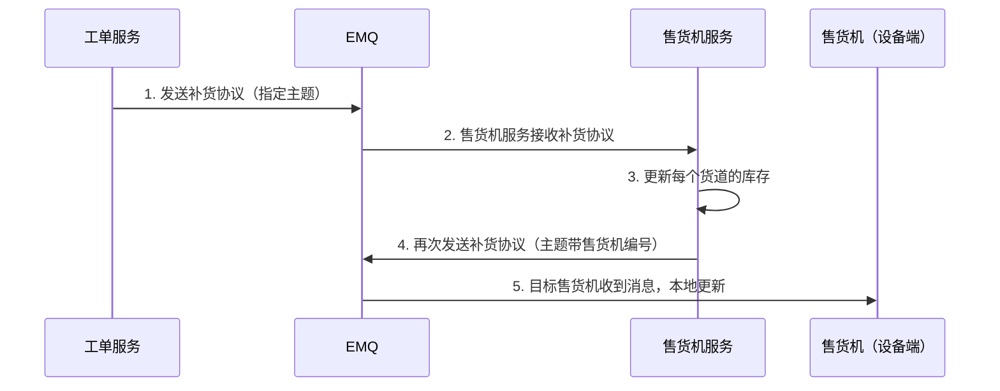

# 工单核心业务开发（下）：EMQ 通知链路、坐标采集与补货协议下发

工单的创建、接受、取消在上一篇已经闭环，这一篇接着走"完成工单"这条线：先设计消息主题与协议，再让工单微服务把完成消息发进 EMQ、售货机微服务订阅处理，把设备状态联动跑通并用测试验证；随后给完成工单加上坐标采集——协议扩字段、接口重载、ES 存储留 TODO；最后开进补货工单，看它和运维工单的分水岭，以及补货协议的封装与两次下发。

## 先给结论

- 完成工单主题是 `server/task/completed`，所有主题统一收在 `TopicConfig` 类里；协议 `TaskCompleted` 的封装类 `TaskCompleteContract` 只带 `taskType` 一个字段，`msgType`、`sn`、`innerCode`、`needResp` 全部来自 `AbstractContract` 和 `BaseContract` 两级父类。
- 工单微服务在 `completeTask` 里组装协议：`innerCode` 取自工单实体，`taskType` 就是工单类型——知道类型就知道设备该改成什么状态；发送用 `mqttProducer.send(主题, QoS 2, 协议对象)`，失败记日志并抛 `LogicException` 触发事务回滚。
- 售货机微服务靠消息分发处理架构接消息：写一个类加 `@Component` 与 `@ProcessType("taskCompleted")`、实现 `MsgHandler` 接口即可；内部解析 JSON 后按 `taskType` 分派——投放改 `VM_STATUS_RUNNING`，撤机改 `VM_STATUS_REVOKE`。
- 测试口径：6 号投放工单（设备 01000001，状态 0 未投放）完成之后，工单状态变 4（已完成），售货机状态由 0 变 1（运营）。
- 坐标采集三处改造：协议加 `lat`/`lon`（Double）；重载而非修改 `completeTask`（业务方法可能被多处调用，Controller 方法才可以直接改参数）；`addr` 更新工单本身，坐标随协议传给售货机服务，存 ES 做地理位置搜索的逻辑留 TODO 给后续章节。
- 补货工单改的是货道库存而不是设备状态：`SupplyCfg` 协议要经历两次传输——工单服务发给售货机服务更新库存，售货机服务再按"带售货机编号的主题"发给对应设备做本地更新。

## 消息主题与协议设计

先定主题。所有主题统一收在 `TopicConfig` 类里（service common 工程的 config 包下），完成工单对应的主题是 `server/task/completed`。这个类里还定义了出售、补货、设备状态上报等一票主题，都是后续链路要用的。

主题有了，再定协议。完成工单协议叫 `TaskCompleted`，传输内容不复杂：协议名称 msgType、售货机编号 innerCode、工单类型 taskType。封装类放在公共服务的 contract 包下——这个包里的类都是定义好的协议：

```java
@Data
public abstract class AbstractContract implements Serializable {
    protected String msgType;   // 协议名称
}

@Data
public abstract class BaseContract extends AbstractContract implements Serializable {
    private long sn;            // 协议通信匹配码
    private String innerCode;   // 售货机编号
    private boolean needResp;   // 是否需要应答
}

@Data
public class TaskCompleteContract extends BaseContract {
    private int taskType;       // 工单类型
    public TaskCompleteContract() {
        this.setMsgType("taskCompleted");
    }
}
```

重点看这个继承结构：`TaskCompleteContract` 自己只声明 `taskType`，因为协议名称在祖父类 `AbstractContract`，`sn`、`innerCode`、`needResp` 在父类 `BaseContract`——绝大多数消息协议体都有这些公共字段，统一上收到两级父类，具体协议类只写差异字段。序列化出来就是这样的 JSON：

```json
{
  "msgType": "taskCompleted",
  "innerCode": "112221112",
  "taskType": 1
}
```

## EMQ 通知链路：工单服务发送，售货机服务订阅

**发送端。** `completeTask` 方法此前已经实现了状态校验和工单状态变更，留着一个 TODO：向消息队列发消息、通知售货机改状态。现在把它填上。第一步封装协议对象，两个字段都有着落——`innerCode` 从工单实体里提，`taskType` 就是工单本身的类型：

```java
TaskCompleteContract contract = new TaskCompleteContract();
contract.setInnerCode(taskEntity.getInnerCode());
contract.setTaskType(taskEntity.getProductTypeId());
try {
    mqttProducer.send(TopicConfig.COMPLETED_TASK_TOPIC, 2, contract);
} catch (JsonProcessingException e) {
    log.error("发送工单完成协议出错：", e);
    throw new LogicException("发送工单完成协议出错");
}
```

发送用的是第一小节讲过的 MQTT 生产者，`send` 方法三个参数：主题（`TopicConfig` 里的完成工单主题）、消息质量（QoS 给 2）、协议对象。发送动作包在 try-catch 里：一旦出错，`log.error` 记录"发送工单完成协议出错"，再抛出 `LogicException`——异常一抛，事务跟着回滚，工单状态更新和消息发送保持一致。

**接收端。** 售货机微服务的配置文件里已经写好了 MQTT 相关配置，其中消费者订阅的主题就包含完成工单主题，剩下的工作是写代码处理这个主题的消息。落点在业务处理包下的 msgHandler 包：这里的 Handler 类都有两个共同点——类上标 `@ProcessType` 注解指定处理的协议，同时实现 `MsgHandler` 接口，这正是第一小节搭好的消息分发处理架构。照着这个模式新建处理类：

```java
@Component
@ProcessType("taskCompleted")
public class TaskCompletedMsgHandler implements MsgHandler {

    @Autowired
    private VendingMachineService vmService;

    @Override
    public void process(String jsonMsg) throws IOException {
        // 消息转换成协议对象
        TaskCompleteContract contract = JsonUtil.getObj(jsonMsg, TaskCompleteContract.class);
        // 最基本校验：对象为空或售货机编号为空，直接返回不处理
        if (contract == null || Strings.isNullOrEmpty(contract.getInnerCode())) return;

        // 投放工单：售货机改为运营状态
        if (contract.getTaskType() == VMSystem.TASK_TYPE_DEPLOY) {
            vmService.updateStatus(contract.getInnerCode(), VMSystem.VM_STATUS_RUNNING);
        }
        // 撤机工单：售货机改为撤机状态
        if (contract.getTaskType() == VMSystem.TASK_TYPE_REVOKE) {
            vmService.updateStatus(contract.getInnerCode(), VMSystem.VM_STATUS_REVOKE);
        }
    }
}
```

`process` 方法三步走：先把 JSON 字符串转成协议对象；再做最基本的校验——对象为 null 或售货机编号为空（`Strings.isNullOrEmpty`）直接 return，不做任何处理；最后按工单类型分派，投放工单把售货机改成运营状态，撤机工单改成撤机状态，状态修改走 `vmService` 的 `updateStatus`。

**测试。** 起售货机微服务、工单微服务和网关三个服务，在测试脚本里找到完成工单的请求。拿 6 号工单来测：它此前被取消过，先把工单状态改回 2（已接受）才能执行完成；设备编号 01000001 在设备表里的状态是 0（未投放），工单类型正好是投放——数据口径齐了。预期结果：工单状态变成 4（已完成），售货机状态由 0 变 1（正在运行）。点 send request 之后刷数据库，两个状态都如期变更，EMQ 这条通知链路就算通了。

## 坐标采集：完成工单带上经纬度

需求来自一个具体功能：用户在立可得小程序里"搜索附近售货机"。想按地图搜索、导航，最基本的数据就是每台售货机的经纬度，而且要落库。这个坐标从哪来？运维人员完成投放工单的那一刻，采集的就是他手机 APP 当时的位置坐标——设备投到了哪个点位，坐标就是哪。

实现思路五步：修改完成工单协议，加上经纬度；重载完成工单接口，增加经纬度和地址（原接口不建议直接改）；客户端采集坐标传给后端，后端主要负责存储；工单微服务把经纬度随完成工单消息传给售货机微服务；售货机微服务把坐标保存到数据库和 ElasticSearch——ES 自带距离搜索能力，拿经纬度就能做"附近售货机"查询。

第一步，协议扩容。`TaskCompleteContract` 加两个 Double 字段，lat 表示纬度、lon 表示经度：

```java
private Double lat;  // 纬度
private Double lon;  // 经度
```

第二步，重载业务方法。给 `completeTask` 直接加参数行不行？能跑，但不妥：业务逻辑方法可能被很多地方调用，一旦改参数，其他调用方编译都过不了。所以重载一个带 lat、lon、addr 的新方法，原方法保留并退化为一句委托：

```java
public boolean completeTask(Long id) {
    return this.completeTask(id, 0D, 0D, "");
}
```

新方法里地址和坐标分工明确：addr 在工单实体保存前 set 进去，更新的是工单本身的地址；lat 和 lon 不进工单库，而是装进协议对象随消息传给售货机服务。

Controller 这边反而可以直接改参数——Controller 方法通常不会被其他类调用，不存在牵连。lat、lon、addr 三个参数都不是必传，用 `@RequestParam` 声明并给默认值，走问号传参；taskId 依然走路径：

```java
@GetMapping("/complete/{taskId}")
public boolean complete(@PathVariable("taskId") String taskId,
        @RequestParam(value = "lat", required = false, defaultValue = "0") Double lat,
        @RequestParam(value = "lon", required = false, defaultValue = "0") Double lon,
        @RequestParam(value = "addr", required = false, defaultValue = "") String addr) {
    return taskService.completeTask(Long.valueOf(taskId), lat, lon, addr);
}
```

第三步落到售货机微服务。只有投放工单才存坐标，所以保存逻辑写在投放工单那个 if 分支下：除了改状态，还要把设备坐标保存到数据库和 ES。存 ES 的目的就是前面说的地理位置搜索，不过这个功能本节不做——后续会有专门章节讲坐标怎么进 ES、怎么在 ES 里做地理位置搜索。想做还没做的逻辑，统一写上 TODO 注释；IDEA 的 TODO 面板能一键列出工程里所有 TODO 的位置，随时可以找回来继续。

## 补货工单：改库存的另一条协议链路

补货工单和前面的运维工单有个根本差别：运维工单完成，改变的是售货机的状态和坐标；补货工单完成，改变的是售货机每一个货道的库存数。除此之外，售货机服务还要把设备的商品信息、货道配置信息、补货之后的容量下发到售货机端——每台售货机可以看成一台小电脑，本地有自己的数据存储，这些信息要同步过去。所以补货工单的处理链路比运维工单更复杂，协议也要走两跳：



补货协议的定义和 1.0 完全一样，封装类在 1.0 就有了。协议字段：协议名称 msgType、每次发送唯一的编号 sn、售货机编号、是否要求客户端回馈 needResp、补货版本号 versionId（每次补货版本都不同）、以及补货数据集合 supplyData——集合里每个元素是一个货道编号加补货数量：

```json
{
  "msgType": "supplyReq",
  "sn": "342424343",
  "vmId": "01012121",
  "needResp": true,
  "versionId": 1,
  "supplyData": [
    { "channelId": "1-1", "capacity": 5 }
  ]
}
```

客户端收到协议后回馈一条 ack，告诉服务端"我收到了"：

```json
{
  "msgType": "ack",
  "sn": "111111",
  "vmId": "01012121",
  "needResp": false
}
```

协议标注的传输方向是服务端对客户端——服务端是微服务，客户端是每台售货机。但结合上面两跳的流程看，补货协议实际上经历了两次传输：第一次工单微服务发给售货机微服务，第二次售货机微服务发给对应的那台售货机。封装类两个：

```java
@Data
public class SupplyChannel implements Serializable {
    private String channelId;  // 货道编号
    private int capacity;      // 补货数量
}

@Data
public class SupplyCfg extends BaseContract {
    private static final long serialVersionUID = -204540876123355095L;
    private long versionId;                  // 补货版本号
    private List<SupplyChannel> supplyData;  // 补货数据集合
    public SupplyCfg() {
        this.setMsgType("supplyReq");
    }
}
```

公共字段同样在 `BaseContract` 和 `AbstractContract` 里，`SupplyCfg` 只写差异。

发送端改造在完成工单方法里做。1.0 遗留了一个私有方法 `noticeVMServiceSupply` 专门干这件事，它分两段：前一段封装协议——按工单 ID 查工单明细表（要下发的补货数据就在明细里），构建 `SupplyCfg` 并设置售货机编号，再循环明细把货道编号和补货数量装进集合、塞回协议的 supplyData；后一段下发协议——1.0 里对接的是老的通道，这次把那段代码移除留成 TODO，改用与完成工单协议相同的发送方式：主题不变，对象换成 `SupplyCfg`：

```java
private void noticeVMServiceSupply(TaskEntity taskEntity) {
    // 根据工单ID查询工单明细表
    QueryWrapper<TaskDetailsEntity> qw = new QueryWrapper<>();
    qw.lambda().eq(TaskDetailsEntity::getTaskId, taskEntity.getTaskId());
    List<TaskDetailsEntity> details = taskDetailsService.list(qw);

    // 封装补货协议
    SupplyCfg supplyCfg = new SupplyCfg();
    supplyCfg.setInnerCode(taskEntity.getInnerCode());
    List<SupplyChannel> supplyChannels = Lists.newArrayList();
    details.forEach(d -> {
        SupplyChannel channel = new SupplyChannel();
        channel.setChannelId(d.getChannelCode());
        channel.setCapacity(d.getExpectCapacity());
        supplyChannels.add(channel);
    });
    supplyCfg.setSupplyData(supplyChannels);

    // 下发补货协议：主题相同，对象换成 SupplyCfg
    try {
        mqttProducer.send(TopicConfig.COMPLETED_TASK_TOPIC, 2, supplyCfg);
    } catch (JsonProcessingException e) {
        log.error("发送工单完成消息失败：", e);
        throw new LogicException("发送工单完成消息失败");
    }
}
```

`completeTask` 主体随之按工单类型分发：补货工单调 `noticeVMServiceSupply`；投放或撤机工单走原来的状态通知逻辑。为了让方法保持清爽，把状态通知那几行也包成一个私有方法 `noticeVMServiceStatus`，传入工单实体和纬度、经度：

```java
if (taskEntity.getProductTypeId() == VMSystem.TASK_TYPE_SUPPLY) {
    this.noticeVMServiceSupply(taskEntity);
}
if (taskEntity.getProductTypeId() == VMSystem.TASK_TYPE_DEPLOY
        || taskEntity.getProductTypeId() == VMSystem.TASK_TYPE_REVOKE) {
    this.noticeVMServiceStatus(taskEntity, lat, lon);
}
```

至此完成工单方法改造完毕：一次完成动作，按工单类型走两条协议链路——补货走 supplyReq 更新库存，投放/撤机走 taskCompleted 改设备状态。

## 小结

- 主题统一进 `TopicConfig`（完成工单主题 `server/task/completed`），协议类三层结构：`AbstractContract`（msgType）、`BaseContract`（sn/innerCode/needResp）、具体协议类只写差异字段。
- 发送端三件套：组装协议（innerCode、taskType）、`mqttProducer.send(主题, 2, 对象)`、try-catch 里 log 加抛 `LogicException` 回滚事务。
- 接收端复用消息分发处理架构：`@Component` + `@ProcessType("taskCompleted")` + 实现 `MsgHandler`；先转对象再做空值校验，最后按 taskType 分派改状态。
- 状态联动验证口径：投放工单完成后工单 1→4（已完成）、售货机 0→1（运营）；撤机工单则把设备改为撤机状态。
- 坐标采集的原则是"协议扩字段、业务方法重载、Controller 直改参数"；addr 更新工单本身，lat/lon 随协议走，ES 地理搜索留 TODO。
- 补货协议 supplyReq 两跳传输：工单服务 → 售货机服务（更新库存）→ 目标售货机（本地更新，主题带售货机编号）；completeTask 按 productTypeId 分发到 `noticeVMServiceSupply` / `noticeVMServiceStatus` 两个私有方法。
