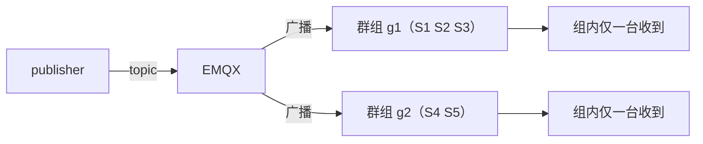

# EMQ 高级特性实战：WebSocket/MQTTX 测试、延迟发布、共享订阅、代理订阅与保留消息

EMQ 装好、Dashboard 熟悉之后，接下来是把 broker 真正当成工具来用：先用 WebSocket 页面和 MQTTX 桌面客户端把发布订阅测起来，再逐个上手五个高级特性——延迟发布、共享订阅（带群组与不带群组）、代理订阅、保留消息。这些特性在立可得项目里都有落点：共享订阅支撑消息处理的负载均衡，代理订阅让新增传感器类型不改代码，保留消息解决监控大屏的数据空窗。本篇把机制、配置和演示一次讲透。

## 先给结论

- 测试工具有两个：Dashboard 自带的 WebSocket 页面适合简单验证，一个连接完成发布订阅；MQTTX 是 EMQ 官方开源的跨平台桌面客户端，支持同时开多个连接，共享订阅这类多订阅者场景必须用它
- 延迟发布：主题写成 `$delayed/{DelayInterval}/{TopicName}`，最长可延迟 4294967 秒投递，需在 Modules 页开启 emqx_mod_delayed 模块；典型场景是促销到期自动恢复原价、订单超时自动取消
- 共享订阅是订阅端的负载均衡：不带群组用 `$queue/` 前缀，带群组用 `$share/{群组名}/` 前缀；不带群组在所有订阅者间均衡，带群组先广播到每个群组、群组内再只有一台收到
- 均衡策略由 emqx.conf 的 `broker.shared_subscription_strategy` 控制，默认 random，可选 round_robin、sticky、hash，改完必须重启 EMQX 生效
- 代理订阅：Modules 页开启 emqx_mod_subscription 模块，在 emqx.conf 配 `module.subscription.N.topic/qos` 规则，客户端一连上就自动订阅，支持 `%c`（Client ID）、`%u`（Username）占位符；改配置文件属静态代理，动态代理是企业版收费功能
- 保留消息：发送时勾选 Retained，broker 为每个主题保存最后一条，新订阅者一上线立即收到；由默认开启的 emqx_retainer 插件实现，可配存储类型、最大条数、单条容量与过期间隔

## 一、两个测试工具：WebSocket 页面与 MQTTX

### Dashboard 自带的 WebSocket

WebSocket 在 Dashboard 的 Tools 菜单下，是后面使用频率最高的功能之一，可以模拟终端的发布和订阅操作。页面分三块：

- **连接区**：填主机（EMQX 所在主机 192.168.200.128）、端口 8083（WebSocket 通信端口）、路径 /mqtt；Client ID 默认随机生成，可以改。点 Connect，状态从 DISCONNECTED 变为 CONNECTED；要断开点红色按钮，之后还能再次连接
- **发布区**：主题默认给了一个 testtopic，可以随意改；message 是发布的具体内容；QoS 可选 0、1、2；旁边还有个 Retained 选项，对应保留消息，后面单独讲。点 send 消息就发出去了
- **订阅区**：填主题（比如 testtopic/#）和 QoS 后点 Subscribe，右侧订阅列表出现一条订阅项，点 X 即取消订阅

发布区上方有两个列表，区分"已发送"和"已接收"。验证流程：先订阅主题再发布，消息立刻出现在接收列表里；没订阅时发了也白发，不会有任何客户端收到。

这个页面的局限很明显：它只有一个连接。像后面要讲的共享订阅，得同时开四五个连接分别做订阅者，WebSocket 页面就无能为力了。

### MQTTX 桌面客户端

MQTTX 是 EMQ 官方开源的桌面版 MQTT 5.0 客户端，跨平台支持 macOS、Linux、Windows，聊天窗口式的界面。资料 emq 文件夹里有安装包，装完双击进入。

新建连接：点 + 号，name 自定义（比如 a1），Client ID 可自动生成也可自己填，Host 填 192.168.200.128（1883 端口），再按需选 QoS 等连接选项，点 Connect。连接成功的标志是连接名前的小圆点变绿，断开后变灰。

中间的消息区像聊天窗口，All / Received / Sent 三个视图分别看全部、只看接收、只看发送。订阅点 + New Subscription，填 Topic、QoS、颜色、别名后 Confirm。

关键能力是多连接。演示：连接 a1 订阅 aa，向 aa 发一条消息，自己发的自己能收到（All 视图里发送接收各一条）；再建第二个连接 a2，订阅 bbb；回到 a1 向 bbb 发消息，a2 立刻收到——一个连接做发布、另一个连接做订阅，这正是 WebSocket 页面做不到的事。连接还可以断开、删除（有 Warning 确认框）、清除聊天记录、按主题搜索记录，管理起来很顺手。

## 二、延迟发布：$delayed 前缀

延迟发布（也叫延迟消息）：按事先配置的时间间隔延迟发布消息——消息现在就能发出去，订阅者要等规定时间到了才能收到。

两个典型场景：

- **促销恢复原价**：双十一商品打五折（价格乘 0.5），希望 24 小时后自动恢复原价。发布一条延迟 24 小时的消息，订阅者到点收到消息后执行价格恢复操作
- **订单超时取消**：下单 30 分钟未付款就自动取消订单、释放库存。下单时发布一条延迟 30 分钟的消息，到点收到消息后查询用户是否付款，未付款就改订单状态

主题格式：

```text
$delayed/{DelayInterval}/{TopicName}
```

- `$delayed`：前缀，标识这是延迟发布消息
- `{DelayInterval}`：延迟时间，单位秒，最大值 4294967 秒（约 49.7 天）
- `{TopicName}`：消息最终发布的目标主题

几个例子：

```text
$delayed/15/x/y       # 15 秒后发布到主题 x/y
$delayed/60/a/b       # 60 秒（1 分钟）后发布到主题 a/b
$delayed/3600/mytopic # 3600 秒（1 小时）后发布到主题 mytopic
```

发布时把整串当作主题名发出去，EMQX 识别到前缀就按延迟投递，订阅者视角里的真实主题只是后面那段。

前提：延迟消息由 emqx_mod_delayed 模块提供，要在 Dashboard 的 Modules 页把它开启（模块列表第一个），不开则延迟不生效。

演示：WebSocket 页面连接 → 订阅 testtopic → 发布主题 `$delayed/15/testtopic`。send 之后接收列表毫无动静，15 秒后消息出现；对比发送与接收两条记录的时间戳（33:46 与 34:00），刚好差 15 秒。

## 三、共享订阅：从广播到负载均衡

### 默认行为是广播

先用 MQTTX 验证：建 a1、a2 两个连接，都订阅主题 t1；用 WebSocket 向 t1 发一条消息——a1、a2 都收到了。结论：多个订阅者订阅同一个主题时，默认是广播性质的发送，发布者一条消息，所有订阅者各收一份。

如果需求反过来：很多订阅者订阅同一主题，但每条消息只需要其中一个订阅者收到——这就是共享订阅（Shared Subscription），一种订阅端负载均衡的手段。消息被分摊给多个订阅者分别处理，属于高并发场景的方案。讲义里的例子：某智能售货机平台，消费节点面对五万并发，单节点可能被打挂；用共享订阅增加节点、均匀接收消息分别处理，系统整体负载能力大幅提升。

EMQX 支持两种前缀格式：

| 示例 | 前缀 | 真实主题名 |
| :--- | :--- | :--- |
| `$queue/t/1` | `$queue/` | `t/1` |
| `$share/abc/t/1` | `$share/abc` | `t/1` |

注意：前缀是订阅端指定的；发布方照常向真实主题（如 t/a）发消息，订阅方才有负载均衡效果。

### 不带群组：$queue/ 与均衡策略

MQTTX 建三个订阅者 a1、a2、a3，都订阅 `$queue/abc`（真实主题是 abc，`$queue/` 只是前缀）。WebSocket 向 abc 连发消息：每一条只有一个订阅者收到——第一条 a3 收到，再发 a1 收到，再发 a2 收到……至于哪次轮到谁，没有规律，完全随机。

想按顺序轮询，需要改核心配置文件 etc/emqx.conf：

```ini
# Dispatch strategy for shared subscription
## Value: Enum
## - random
## - round_robin
## - sticky
## - hash
broker.shared_subscription_strategy = random
```

| 策略 | 含义 |
| :--- | :--- |
| random | 随机挑选订阅者（默认值） |
| round_robin | 轮询，按顺序一个个轮流 |
| sticky | 一直发往上次选中的那个订阅者 |
| hash | 按发布者 Client ID 的哈希值做均衡 |

改成 round_robin 的操作路径：`docker exec` 进 emqx 容器 → `cd /opt/emqx/etc` → `vi emqx.conf`（两千多行，搜索定位到该配置）→ 修改保存 → `cd /opt/emqx/bin` → `./emqx restart` 重启生效。之后的带群组测试就是在轮询策略下做的。

### 带群组：$share/

前缀换成 `$share/{群组名}/`，群组名可以是任意字符串。和不带群组的区别：同一个群组内部订阅者负载均衡，而 EMQX 会向不同群组广播消息。

示意图：五个订阅者分两组，S1–S3 订阅 `$share/g1/topic`，S4–S5 订阅 `$share/g2/topic`，发布者向 topic 发一条消息：



演示：MQTTX 建 S1–S5 五个连接，前三个订阅 `$share/g1/topic`，后两个订阅 `$share/g2/topic`；WebSocket 向 topic 发消息"带群组共享订阅"。结果：第一条 S1、S4 各收到一条（每组一台）；第二条 S2、S5 收到；第三条 S3、S4 收到——组内按轮询轮转，组间每次都广播。这时均衡策略还是上一步改的 round_robin，对群组内部同样生效。

应用场景在立可得项目里就有：两个群组当作两个微服务，每个微服务又是多节点集群部署；希望这条消息两个微服务都收到、各自处理各自的业务，但每个微服务集群内部只要其中一个节点处理——这正是带群组共享订阅的用武之地。

## 四、代理订阅：连上即自动订阅

正常流程下，客户端连上 EMQX 后想订阅某个主题，得额外发一条订阅报文。代理订阅就是代替你完成订阅：事先在 EMQX 里配好规则，客户端一连上就自动完成订阅，不用再发报文。

场景（冷链平台）：冷链运输车的制冷设备可能故障，需要对温度做监控和补救。车上温度传感器把温度数据经 EMQX 上报给指标采集系统，采集系统再透传给大数据分析平台。初期车上只有温度传感器，代码里订阅温度主题即可；后来车上加装了湿度传感器——传统做法要改代码、增加湿度主题的订阅再重新发版；用代理订阅只需在 EMQX 里改配置，采集系统一连上就自动带上新订阅，代码零改动。

配置两步：

1. Modules 页开启 emqx_mod_subscription 模块（默认 Disabled，点开启）
2. 在核心配置文件 etc/emqx.conf 里写规则。规则按序号排（1、2、3……），每条两行：主题 + QoS：

```ini
module.subscription.1.topic = abc
module.subscription.1.qos = 2
module.subscription.2.topic = xyz/#
module.subscription.2.qos = 1
module.subscription.3.topic = client/%c
module.subscription.3.qos = 1
```

改完进 bin 目录执行 `./emqx restart` 生效。

演示：WebSocket 建一个连接，不做任何手动订阅，直接向 abc 发消息——接收列表立刻出现消息（规则 1 自动订阅了 abc）；向 `xyz/123/666` 发消息也能收到（规则 2 的通配符匹配上了）；随便换个不在规则里的主题就收不到。

占位符：`%c` 代表 Client ID，`%u` 代表 Username，EMQX 执行代理订阅时把它们替换成实际值，且必须占一个完整主题层级。规则 3 配了 `client/%c` 后，客户端一连上就自动订阅 `client/自己的ClientID` 这样的主题；发布时 Client ID 对得上就能收到，差一位都匹配不上。`%u` 同理，按用户名自动订阅。

最后一点：这种改配置文件的方式叫静态代理订阅，规则复杂时不够灵活；动态代理订阅开源版没有提供，是企业版的收费功能。

## 五、保留消息：为迟到的订阅者留最新一份

先看问题：WebSocket 连接后不订阅任何主题，直接向 testtopic 发一条消息；然后再订阅 testtopic——刚才那条消息收不到。普通消息发出去的瞬间没有订阅者，就永远错过了。

保留消息（Retained Message）解决的就是这个：发送时勾选 Retained 选项，服务端收到 Retain 标志为 1 的 PUBLISH 报文后，除了正常转发，还会把这条消息存储在服务端；之后任何客户端订阅该主题，立刻就能收到这份保留的消息——"你不在的时候我帮你留着，你一上线就给你"。

两条关键规则：

- 每个主题只能存在一条保留消息，再次发送会替换旧的
- 演示：取消订阅后向 testtopic 连发 1、2、3 三条保留消息，再订阅——只收到 3，也就是最后一条

应用场景（车辆网项目）：每辆车有 GPS 定位，车辆调度系统的监控大屏展示所有车辆的实时位置。系统升级重新部署时收不到 GPS 数据，而 GPS 是定时上报的（比如十分钟一次）；如果部署完刚好错过一轮上报，新订阅者要等近十分钟才能陆续拿到车辆位置——上线后整个大屏是空的，体验极差。用保留消息解决：每次上报的位置都设为保留消息，把每辆车的最新位置留在服务端；大屏服务一上线立刻拿到全部最新位置，数据秒出。

另外，etc/emqx.conf 里把 `mqtt_retain_available` 设为 false 可以整体禁用保留消息；禁用状态下如果还收到保留消息，EMQX 会返回原因码 0xA9（不支持保留消息）的 DISCONNECT 报文。

保留消息由 emqx_retainer 插件实现，默认开启，可以在 Plugins 页手动关掉。既然是插件就有配置文件：进容器后到 etc/plugins/ 目录（每个 conf 对应一个插件），打开 emqx_retainer.conf，核心四项：

```ini
retainer.storage_type = ram
retainer.max_retained_messages = 0
retainer.max_payload_size = 1MB
retainer.expiry_interval = 0
```

| 配置项 | 含义 |
| :--- | :--- |
| storage_type | 存储类型：ram 内存（默认）；disc 同时保留在内存和磁盘；disc_only 仅存磁盘 |
| max_retained_messages | 保留消息最大条数：0 不限制；大于 0 相当于限制有多少个主题能存保留消息（每主题仍只有一条） |
| max_payload_size | 单条保留消息的最大容量，默认 1MB；超过容量就不再保留，退化为普通消息 |
| expiry_interval | 过期间隔：0 没有限制；大于 0 表示超过该时间未取走就过期、不再保留（单位毫秒） |

过期演示：把 expiry_interval 改为 10000（10 秒），保存后 `./emqx restart`。连接后向 testtopic 发一条保留消息，10 秒内去订阅，能收到；取消订阅再发一条，隔超过 10 秒再订阅——收不到，消息已过期；紧接着再发一条并立刻订阅，又能收到。

## 小结

这一篇把 EMQX 从"能收发消息"推进到"按业务需要收发消息"：WebSocket 页面与 MQTTX 覆盖从单连接到多连接的测试需求；`$delayed` 前缀把"到点再做某事"交给 broker；共享订阅用 `$queue/` 与 `$share/` 前缀把广播改成负载均衡，群组模式还支持"组间广播、组内均衡"的微服务集群模型；代理订阅把订阅动作前置到连接时刻，新增传感器类型不用改代码；保留消息保证迟到的订阅者永远先拿到最新状态。立可得项目里售货机消息通道的不少设计，正是建立在这几个特性之上。
