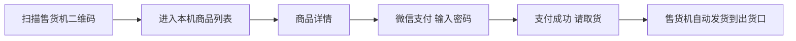

# 小程序端产品原型走读与系统体验：从扫码到出货的完整链路

进入"订单支付与出货控制"这一章，先从离用户最近的一端看起：售货机项目的小程序端，也叫购物端，是 C 端用户完成购买的地方。本篇先走读产品原型，把页面和交互路径理清楚，再对着线上已部署的立可得小程序实际体验一遍从下单到取货的全过程，为后面的接口设计与代码实现定下业务基调。

## 先给结论

- 小程序端即购物端，核心链路是：扫售货机二维码 → 看这台机器的商品列表 → 选商品、看详情、微信支付 → 支付完成后售货机自动发货。
- 进入商品列表有两种方式，效果完全相同：一是直接用微信扫售货机上的二维码；二是打开立可得小程序，点首页的扫一扫再扫。
- 原型共四组页面：商品列表与详情、支付确认与密码输入、订单管理（待支付 / 已取消 / 已完成）、附近售货机地图。
- 首页由三块组成：扫码框、附近售货机列表、历史订单。
- 线上体验环境的演示数据：可口可乐 550ML 实付 ¥0.01，设备编号 01000028，设备地址"北京市·市辖区·昌平区·三里百汇购物中心"；支付成功后页面提示"请取货"，机器把商品送到出货口。
- 讲义给出的实现思路：小程序端扫码后把商品信息发给后台，小程序后台接口通过 feign 调用售货机服务。

## 小程序端是什么：C 端购物入口

小程序端解决的是"人怎么在售货机上买东西"。用户想买商品，拿起手机扫描售货机上的二维码，会自动打开对应的微信小程序，看到的就是这台售货机正在卖的商品列表；想买某个商品时，点开商品详情并完成支付，支付结束后售货机自动发货。这是整个项目最核心的一条功能链。

除了买货，原型里还有两类辅助功能。一是我的订单列表：用户随时可以回查自己下过、付过的历史订单。二是搜索附近售货机：当前这台机器上没有想要的商品时，可以通过搜索查看附近还有哪些地方部署了售货机，换一台去买。

## 核心购买链路：从选品到出货

把上述交互串成一条流程，就是下面这条链路：

链路里"支付完成 → 自动发货"是本章后续要重点实现的部分：出货控制直接关系到钱货两清，出错了就是真实资损，所以原型阶段先把交互路径钉死。

## 产品原型走读：四组页面

原型用 Mockplus 制作，讲义里提供了在线链接，逐页走一遍。

**商品列表与详情。** 扫码后首先进入商品列表，展示商品的图片、名称、价格；点某个商品进入详情页，除图片、名称、价格外还会带出设备信息，让用户清楚自己是在哪台机器上买。

**支付环节。** 详情页点"立即支付"进入确认付款页，页面展示订单金额 ¥4.00、订单号 20190924001234、支付方式微信支付；点"立即付款"弹出数字键盘输入支付密码，密码输完即完成这笔订单，随后售货机发货。

**订单管理。** 原型版本为 V2.0，列出用户下过的所有订单，状态分三种：待支付、已取消、已完成。点开单个订单可以看到订单详情：订单号、商品、金额、设备信息、订单时间、支付时间。

**附近售货机。** 打开是一个腾讯地图，地图上标出售货机位置，下方按距离由近到远排列附近售货机的地址，可以点开查看，也能唤起地图导航过去。

首页则只保留三个入口：扫码框、附近售货机列表、历史订单。首页的扫一扫和直接用微信扫售货机二维码效果完全一样，两种方式殊途同归，最终都落到商品列表页。

## 线上系统体验：支付成功后请取货

原型定完交互，课程又演示了已经在线上部署的立可得小程序端。演示用一个测试设备的二维码，对应一台售货机，设备编号 01000028，地址"北京市·市辖区·昌平区·三里百汇购物中心"，讲师用手机投屏展示真实操作。

扫二维码进入商品列表，里面都是测试用的低价商品。选中"可口可乐 550ML"进入详情，实付金额 ¥0.01，点"去支付"、输入支付密码，支付成功后点完成，页面提示"支付成功，请取货"。此时售货机自动执行出货，把商品送到出货口，用户在机器上取货即完成整个购买。

回到首页再看：扫一扫入口点进去同样能扫机器二维码进商品列表；下方依次是附近售货机和历史订单，与原型设计一一对应。这条链路接下来要落到代码上：小程序端扫码后把商品信息发给后台，小程序后台接口通过 feign 调用售货机服务拿数据。

## 小结

本篇把小程序端的产品原型和线上效果各过了一遍。页面层面是商品列表/详情、支付、订单管理、附近售货机四组，首页只留扫码、附近、历史订单三个入口；体验层面验证了"扫码 → 选品 → 支付 → 请取货 → 自动出货"可以完整跑通。业务路径清楚了，后面的实现思路（小程序后台接口通过 feign 调用售货机服务）和订单支付、出货控制的代码实现就有了落点。
