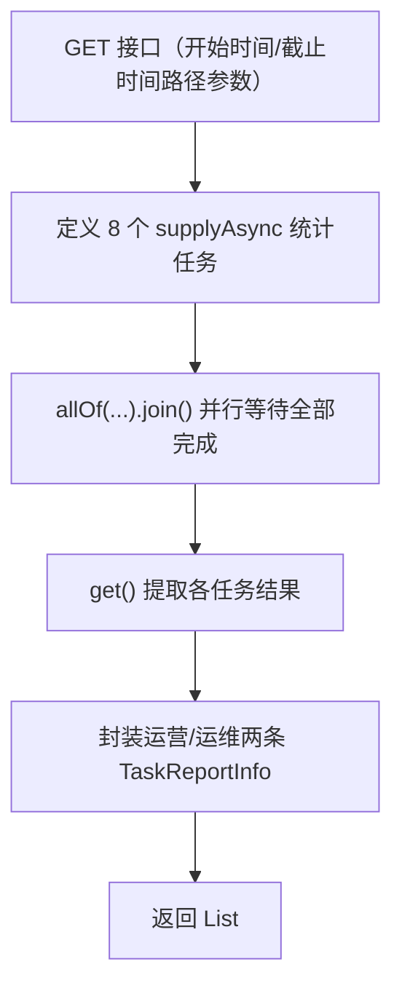

# 统计场景的并发异步需求、CompletableFuture 快速入门与工单数统计四步实现

管理后台的人效统计页面要在一次请求里拿到八个数字：运营、运维各四项——工单总数、完成工单、拒绝工单、人员数。若串行查询，一个统计按一秒算，八个就得让用户等八秒。本篇按课程的推进顺序，先做需求与方案对比，再给 CompletableFuture 快速入门，最后把工单数统计完整落地。

## 先给结论

- 人效统计要八个数字：运营的工单总数/完成/拒绝/人员数，加上运维的同样四项；原型面板上就是"运营人员(人/天) 5, 0, 0, 13"和"运维人员(人/天) 4, 3, 0, 10"两块。
- 三种方案对比：每个数字一个 API 太多难维护；一个 API 内串行查响应时间过长；最终选 CompletableFuture 并行——一个 API 一次性返回八个结果，总耗时约等于最慢的一个统计，代价只是代码量稍多，因为用户的体验是最重要的。
- CompletableFuture 三步走：supplyAsync 定义任务（此时只是定义并未执行）→ allOf(...).join() 并行等待 → get() 提取结果。
- 模拟耗时验证：三个任务 5 秒、5 秒、7 秒并行执行，整体约 7 秒 0512 毫秒；若串行累加则要 17 秒多。
- 工单统计落地四步：定义视图模型 TaskReportInfo → 封装 taskCount 私有统计方法 → 定义八个 future 并 allOf().join() → get() 填充运营、运维两条记录返回。
- 人员数不查工单表，而是异步调用用户服务的 getOperatorCount / getRepairerCount。

## 需求：人效统计的八个数字

需求本身不复杂：在人员管理系统里做统计，分别统计运营和运维当天的工单数据，页面上是两块数据面板——"运营人员(人/天)"显示 5, 0, 0, 13，"运维人员(人/天)"显示 4, 3, 0, 10。拆开来正好八个数字：运营的工单总数、完成工单、拒绝工单、人员数，运维的同样四项。

实现它有三种思路，课程逐一算了账：

| 方案 | 做法 | 优点 | 缺点 |
| --- | --- | --- | --- |
| 方案一：每个数字一个 API | 前端要哪个数就调哪个接口 | 单接口直观 | API 数量过多，不利于维护，前端要发八次请求，编写麻烦 |
| 方案二：一个 API 串行查询 | 只建一个接口，内部依次统计后一次性返回八个结果 | 前端只调一次 | 串行执行，每个统计按 1 秒算，整体要 8 秒，响应时间过长，体验糟糕 |
| 方案三：CompletableFuture 并行 | 一个 API，内部把八个统计同时发起 | 一个接口对外，总耗时约等于最慢的一个统计 | 代码量比前两个方案稍多 |

结论顺理成章：选方案三。用户的体验是最重要的，多写一点代码，换回八倍的等待时间收益，划算。

## CompletableFuture 快速入门：定义、并行、取值

标准姿势分三步，讲义里的示例代码如下：

```java
// 1. 定义三个异步统计任务（此时并未真正执行）
var aFuture = CompletableFuture.supplyAsync(() -> {
    //......
    return xx;
});
var bFuture = CompletableFuture.supplyAsync(() -> {
    //......
    return xx;
});
var cFuture = CompletableFuture.supplyAsync(() -> {
    //......
    return xx;
});

// 2. 并行处理：等待所有任务完成
CompletableFuture.allOf(aFuture, bFuture, cFuture)
        .join();

// 3. 取值（get 需要处理受检异常）
var a = aFuture.get();
var b = bFuture.get();
var c = cFuture.get();
```

有两个容易忽略的点：前三行只是"定义"，执行到这几行时任务并没有真正开始跑，可以把它理解成对整个函数的封装；真正的并行发生在 allOf(...).join() 这一句——join() 会阻塞当前线程，直到所有任务完成。get() 是受检方法，需要 try-catch 或在方法签名上抛出异常。

课程在工单微服务里建了 CompletableFutureTest 测试类（@SpringBootTest 配 @RunWith(SpringRunner.class)）来验证：三个任务分别返回 1、2、3，get 取出后打印，结果正确。不加休眠时整个测试约 529 毫秒；随后给任务加上 Thread.sleep 模拟真实统计的耗时——两个任务 5 秒、一个任务 7 秒——整体耗时 7 秒 0512 毫秒。由此得到结论：并行执行的总时间约等于用时最长的那个任务，用时短的任务先执行完在那等；若不用并发编程、把三个过程串行累加，就要花 17 秒多。

## 工单数统计落地：四步实现

整条实现路径如下：



### 第一步：定义视图模型 TaskReportInfo

接口约定来自 YAPI 文档：接收开始时间、截止时间两个路径参数，返回一个数组，数组里两个元素——一条运营、一条运维，用 repair 字段区分。据此在工单微服务的 viewmodel 包中新建 TaskReportInfo：

```java
@Data
public class TaskReportInfo {
    @ApiModelProperty(value = "工单总数")
    private Integer total;
    @ApiModelProperty(value = "完成数")
    private Integer completedTotal;
    @ApiModelProperty(value = "拒绝总数")
    private Integer cancelTotal;
    @ApiModelProperty(value = "进行中总数")
    private Integer progressTotal;
    @ApiModelProperty(value = "工作人数")
    private Integer workerCount;
    @ApiModelProperty(value = "是否是运维工单统计")
    private boolean repair;
    @ApiModelProperty(value = "统计的日期")
    private String date;
}
```

### 第二步：封装私有统计方法 taskCount

TaskService 接口先声明方法：`List<TaskReportInfo> getTaskReportInfo(LocalDateTime start, LocalDateTime end)`。实现时如果把所有统计逻辑都摊在主方法里，代码会特别长，所以先抽一个私有方法，只负责"给条件、返回工单数"：

```java
private Integer taskCount(LocalDateTime start, LocalDateTime end,
                          Boolean repair, Integer taskStatus) {
    LambdaQueryWrapper<TaskEntity> qw = new LambdaQueryWrapper<>();
    // 时间段
    qw.ge(TaskEntity::getUpdateTime, start)
      .le(TaskEntity::getUpdateTime, end);
    // 状态可能传 null（统计总数时不限定状态），为 null 就不加该条件
    if (taskStatus != null) {
        qw.eq(TaskEntity::getTaskStatus, taskStatus);
    }
    // 运维工单有三种类型，逐个判断写起来特别长，
    // 用"不等于补货工单"反向圈定运维，运营则"等于补货工单"
    if (repair) {
        qw.ne(TaskEntity::getProductTypeId, VMSystem.TASK_TYPE_SUPPLY);
    } else {
        qw.eq(TaskEntity::getProductTypeId, VMSystem.TASK_TYPE_SUPPLY);
    }
    return this.count(qw);
}
```

### 第三步：八个 future 并行发起

进入正题，在 getTaskReportInfo 里用 supplyAsync 把八个统计同时定义出来，再由 allOf(...).join() 汇合：

```java
// 运营/运维 工单总数
var supplyTotalFuture  = CompletableFuture.supplyAsync(() -> this.taskCount(start, end, false, null));
var repairTotalFuture  = CompletableFuture.supplyAsync(() -> this.taskCount(start, end, true, null));
// 完成的工单数
var completedSupplyFuture = CompletableFuture.supplyAsync(() -> this.taskCount(start, end, false, VMSystem.TASK_STATUS_FINISH));
var completedRepairFuture = CompletableFuture.supplyAsync(() -> this.taskCount(start, end, true, VMSystem.TASK_STATUS_FINISH));
// 拒绝的工单数
var cancelSupplyFuture = CompletableFuture.supplyAsync(() -> this.taskCount(start, end, false, VMSystem.TASK_STATUS_CANCEL));
var cancelRepairFuture = CompletableFuture.supplyAsync(() -> this.taskCount(start, end, true, VMSystem.TASK_STATUS_CANCEL));
// 人员数（调用用户服务）
var operatorCountFuture = CompletableFuture.supplyAsync(() -> userService.getOperatorCount());
var repairerCountFuture = CompletableFuture.supplyAsync(() -> userService.getRepairerCount());

// 并行处理所有统计
CompletableFuture.allOf(
        supplyTotalFuture, repairTotalFuture,
        completedSupplyFuture, completedRepairFuture,
        cancelSupplyFuture, cancelRepairFuture,
        operatorCountFuture, repairerCountFuture
).join();
```

单表达式 lambda 把大括号和 return 都省掉了，每个统计一行，正好对应需求里的八个数字。人员数两项走的是注入进来的 UserService，与工单表的统计互不牵扯。

### 第四步：提取结果、封装返回并测试

join() 返回后，从每个 future 里 get() 取值，封装成两条 TaskReportInfo：

```java
List<TaskReportInfo> result = Lists.newArrayList();
var supplyTaskInfo = new TaskReportInfo();
var repairTaskInfo = new TaskReportInfo();
try {
    supplyTaskInfo.setTotal(supplyTotalFuture.get());
    supplyTaskInfo.setCancelTotal(cancelSupplyFuture.get());
    supplyTaskInfo.setCompletedTotal(completedSupplyFuture.get());
    supplyTaskInfo.setWorkerCount(operatorCountFuture.get());
    supplyTaskInfo.setRepair(false);
    result.add(supplyTaskInfo);

    repairTaskInfo.setTotal(repairTotalFuture.get());
    repairTaskInfo.setCancelTotal(cancelRepairFuture.get());
    repairTaskInfo.setCompletedTotal(completedRepairFuture.get());
    repairTaskInfo.setWorkerCount(repairerCountFuture.get());
    repairTaskInfo.setRepair(true);
    result.add(repairTaskInfo);
} catch (InterruptedException | ExecutionException e) {
    log.error("构建工单统计数据失败", e);
    // 出错时直接抛出项目的通用异常
}
return result;
```

get() 抛出的受检异常用 try-catch 接住，记录"构建工单统计数据失败"日志并抛通用异常。最后在 TaskController 中按接口文档新增 GET 方法，接收开始/截止时间并调用 getTaskReportInfo。

测试路径是：先启动工单微服务，再启动网关；打开 VS Code 里的 task.http 测试脚本，执行其中的"工单实时汇总"请求（带上时间段参数）。返回结果里运营、运维各一条记录，字段值正常，整个方法的编写与接口测试完成。

## 小结

从需求到落地，本篇走完了一条完整的决策链：八个统计数字催生对一个 API 的诉求，串行查询的八秒等待否掉了方案二，CompletableFuture 用"一个接口对外、内部并行"同时满足了两端。技术要点收敛为三件套——supplyAsync 定义任务、allOf(...).join() 汇合等待、get() 提取结果，总耗时取决于最慢的那个任务。落到工单统计上，就是视图模型、taskCount 条件封装、八个 future 并行、结果封装返回这四步，最后经网关用 task.http 脚本验证通过。
