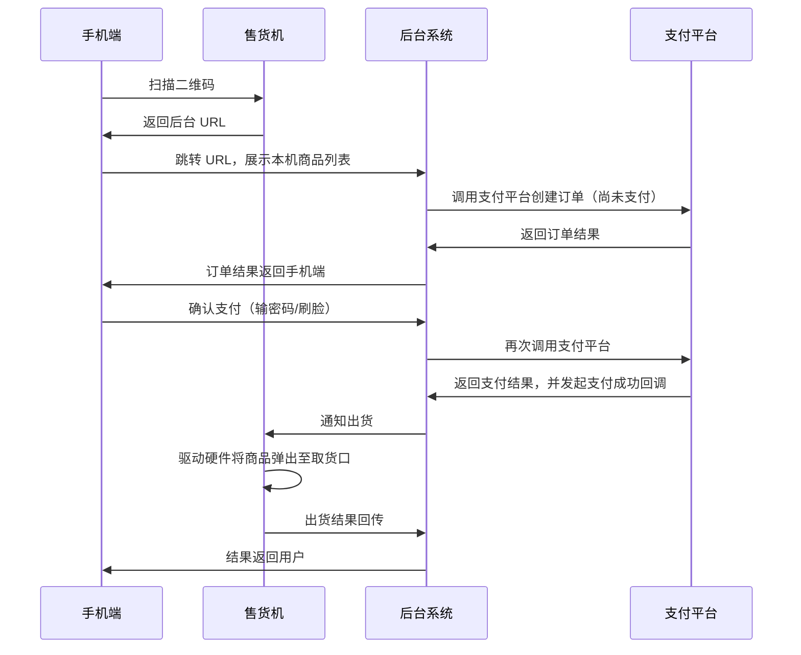

# 从新零售概念到立可得 1.0：智能售货机的构成、术语、三大业务流程与运营后台全景

立可得是新零售领域的项目，也可以称之为 O2O 电商项目或物联网项目——恰好站在三个领域的交叉点上。本篇把第一章需求分析整理成全景：先厘清三个概念，再拆解系统构成与核心术语，过一遍投放、补货、购买三条业务流程，最后走一遍 1.0 运营后台演示并用功能架构图归纳。

## 先给结论

- 新零售 = 传统零售 + 电商（2016 年提出），核心是双向引流、降低获客成本；典型应用是无人货架、无人零售店、智能售货机。立可得属于智能售货机方向，落在 O2O 与物联网的交叉点上。
- 智能售货机与传统售货机的分界在"软件 + 网络"：故障主动上报、平台自动派运维，库存联网、缺货自动指派补货，运营和运维成本因此大幅降低。
- 系统由三部分构成：运营后台（占 80% 以上开发工作量）、手机端（扫码后的商品列表与支付）、售货机（精简版 PC，接收指令驱动硬件出货，本地留一份库存与出货日志）。
- 五个核心术语：点位、售货机、货道、策略、工单；工单分投放、维修、撤机、补货四种。
- 三条核心流程：投放走「建点位 → 建机器 → 关联点位 → 投放工单 → 线下投放」；补货经工单微服务封装，完成后把补货数据下发到售货机本地再确认；购买走扫码 → 创建订单 → 支付 → 成功回调 → 通知出货 → 出货结果回传，回传缺失即视为异常。
- 立可得 1.0 已开发完成，课程在其基础上迭代升级；功能架构自底向上是点位/权限/商品/策略四个基础模块，之上是设备、订单、工单、分账管理与数据统计。

## 新零售、O2O 与物联网：立可得站在三个领域的交叉点

新零售这个词 2016 年由马云首次提出，一句话概括：新零售 = 传统零售 + 电商，即两者相结合的经营模式。目的是四个字——双向引流：把线上流量引入线下，再把线下流量引入线上。无论线上线下获客成本都不低，双向引流最终就是降低获客成本、增加利润。新零售的典型应用有无人货架、无人零售店和智能售货机，立可得属于智能售货机方向。

O2O（Online To Offline）的概念源于美国，通俗说就是「线上支付、线下体验」。点餐类的美团、饿了么是最典型案例，智能售货机同样属于 O2O 的一个分支。

物联网（IoT）起源于传感领域，本质是物物互联，核心功能是对物的智能识别、定位、跟踪与监管。「物」指各种设备：共享单车就是典型应用——自行车是「物」，手机上完成支付后，蓝牙锁接收网络指令执行开锁。后面课程还会接触纯物联网项目「亿可控」，而立可得是物联网在零售场景的分支。

智能售货机本身是新零售的细分领域，讲义里的定义很完整：机器能自我管理，通过物联网技术把分散设备放到一套平台上集中管理，做智能化的数据采集与分析；设备状态主动上报，可远程管理，设备和人员绑定，运维工作可管理，支持移动支付——用这一系列手段降低运营运维成本、快速实现盈利。这是一种线上线下融合（Online Merge Offline）的模式。与传统售货机的差别列成一张表：

| 维度 | 传统售货机 | 智能售货机 |
| --- | --- | --- |
| 软硬件 | 只是一台硬件设备，无软件支撑 | 内置软件模块，相当于一台小电脑 |
| 网络 | 无网络模块 | 带 4G 模块，可联网 |
| 支付 | 只支持投币购买 | 支持移动支付 |
| 故障处理 | 维护人员定期巡查才能发现 | 故障主动上报中央平台，自动派运维上门维修 |
| 补货 | 库存不联网，运营人员到现场查看再补 | 系统记录每台机器库存，过低自动指派补货 |

## 系统构成与五个核心术语

一套完整的智能售货机系统由三部分构成：

- **运营后台**：给运营人员使用的后台系统，管理所有运营售货机的数据——商品价格、订单数据都在这里，开发工作量 80% 以上落在这块。
- **手机端**：可能是 H5、小程序或 APP。用户扫售货机二维码后弹出的界面就是手机端，功能很收敛：陈列商品列表，选购、支付。
- **售货机**：本身是一台精简版 PC，内部跑着软件。它接收网络指令，驱动硬件完成发货；本地也保留一份库存（服务器一份、机器一份），出货日志也在机器上留存。

开发之前还要先统一五个术语：

| 术语 | 含义与关键属性 |
| --- | --- |
| 点位 | 机器摆放的具体地点，如"北京市海淀区西三旗金燕龙写字楼二层东侧茶水间"、"地铁8号线新站A出站口"。点位和机器一对多，地址尽量详尽，后续运营运维靠它快速定位机器；点位天然带地域、区域属性，通过区域、地域管理，承上启下，每台机器直接和点位关联 |
| 售货机 | 摆放在点位上的机柜，即商品的"前置位置"。内含传感设备、机械结构、4G 物联网通信模块、工控机（精简版 PC）和单片机程序；可选配制冷/加热装置、触摸屏或广告屏、刷卡器、摄像头 |
| 货道 | 机器中存放商品的容器，多行多列，有直列式、蛇形等形态。必备属性是容量（一个货道装几瓶）和可容纳的商品类型：罐装可乐、雪碧、啤酒可共用一种货道，瓶装农夫山泉就放不进去；支持重力检测和空检测 |
| 策略 | 打折方案，几折几折。策略绑定到售货机上，绑定后该机所有商品价格自动乘以折扣系数 |
| 工单 | 工作流的单子，系统内有投放、维修、撤机、补货四种 |

## 投放、补货、购买：三条核心业务流程

**投放流程。** 投放就是运营人员把售货机放到指定点位上运营。时序图涉及两个角色：线上运营人员（使用运营系统的人）和线下运营人员（负责搬运投放）。流程是：线上运营人员创建点位（不存在才创建）→ 创建机器 → 机器关联点位，机器从属于该点位 → 为机器创建投放工单 → 系统下发（指派）给某位线下运营人员 → 线下人员按单子把设备拉到点位、通电，机器正常运行，工单完成。机器关联点位是创建投放工单的前提。

**补货流程。** 补货是业务中最常规的工作之一：商品所剩不多就要及时补，否则售空就没得卖了。链路是：运营人员在后台创建补货工单（指定对哪台机器补、补多少）→ 后台系统调用工单微服务——整个工单逻辑都封装在这里，处理后返回结果 → 后台把工单下发给补货运营人员，这一步没有清晰的线上线下拆分，接单人既可能偏线上也可能偏线下 → 运营人员把商品装进货道后执行「完成工单」，逻辑仍由工单服务封装 → 最关键的一步：补货数据要下发给售货机，它本地存着每个商品的库存和发货记录 → 售货机完成后向后台确认，闭环结束。

**用户购买流程。** 这条链路串起了手机、售货机、后台与支付平台四方：

两个细节值得注意。其一，二维码本质是一个 URL，指向服务器上的 H5 网站，URL 里带售货机 ID 参数，所以每台机器的码都不同，扫码只看到本机商品。其二，售货机出货后必须把结果回传后台，这是机器给后台的回馈；后台若没收到，说明链路某环节出了问题，可据此做异常跟踪。

## 立可得 1.0 运营后台体验与功能架构

立可得 1.0 的代码已开发完成，课程不重讲实现也不要求重做——主线是在 1.0 基础上迭代升级，前提是知道原来实现了哪些功能。运营后台已部署到服务器（演示域名 lkd.java.theima.net），登录页用户名密码已预置，直接点登录进入。

| 模块 | 列表/功能要点 | 操作演示 |
| --- | --- | --- |
| 点位管理 | 点位名称、设备数量、所在区域、详细地址、创建/修改日期 | 新增时填名称、省市县联级选区域、填详细地址；名称不必太详细，详细地址则要更精确 |
| 设备管理 | 机器编号、型号、详细地址、设备状态（未投放/投放等）、创建/修改日期 | 新增要选型号、点位、运营/维修人员、合作商；完成后自动分配机器编号，初始「未投放」 |
| 商品管理 | 商品名称、图片、净含量、价格、所属分类、创建/修改日期 | 演示新增"啤酒"：选分类、价格 5 元、上传图片 |
| 策略管理 | 策略名称 + 折扣百分比 | 新增策略只需写名称（如 95 折）和方案（95%） |
| 订单管理 | 订单编号、设备号、订单金额、出货状态 | 用户购买产生的订单记录 |
| 订单汇总 | 当月/当季/当年销量与销售额、同比涨跌 | 合作商销售额柱状图、地区销量折线图、商品销量 Top15 条形图，支持按日期筛选 |

设备管理是后台里最复杂的一块。合作商是能提供点位的商家——机器摆在商场，合作商就是某某商场；摆在公园就是某某公园，它要参与分成，互惠互利，所以新增设备必须选一个合作商。设备新增后只是空壳，必须做货道设置：按所选型号生成 5 行 10 列共 50 个格子，行列与实际机器货道一致；每个货道可添加商品（来自事先维护的商品库）或移除清空。策略设置给整台机器绑一个策略，绑九折后所有商品价格自动乘以 0.9。详情页可单独修改设备点位；设备状态页掌握每台机器是故障、断网还是缺货。

工单管理是后台的核心功能，四种类型落在同一个列表里，字段有工单名称、类型、设备编号（工单必须关联某台设备）、状态（完成/取消）、创建日期、期望日期（期望何时完成）和备注。新增维修工单的演示：名称用"编号 + 维修"的方式填写，机器编号必须是真实存在的编号，创建后工单进入"进行中"状态，维修人员完成任务后再标记完成。工单配置定义自动补货：补货警戒线设为 10%，货道货物低于 10% 就该补；定时补货是到点自动检测所有设备哪些需要补货并自动创建补货工单。工单因此有些由人创建、有些由系统自动创建。分账管理维护合作商，新增时填名称、联系人、电话、分成比例，可查看与编辑（演示中把某合作商分账比例改为 21%）。

功能架构图把演示归纳成三层。最上层三端：客户端是用户扫码看到的 H5 网站，功能就两个——商品列表和支付；合作商端是给合作商的账单查看页，同为 H5，功能特别简单；最大的一块是业务管理后台。后台自底向上：最底层是点位、权限、商品、策略四个基础模块；往上是设备管理（新增设备、添加策略、货道管理——每个货道绑定一个商品、查询设备），它建立在商品、策略、点位之上；再往上是订单（查询、汇总）、分账管理、工单管理（新增、配置、查询）；最上层是数据统计。图中没画但同样存在的是售货机端：精简版 PC，既有程序也有存储，底层程序调用硬件、驱动发货并做本地记录。

## 小结

概念层，立可得是新零售、O2O、物联网的交叉；业务层，系统由运营后台、手机端、售货机构成，围绕五个核心术语运转，三条流程把「设备—平台—人」串成闭环，补货数据下发与出货结果回传这两个「反向」动作正是设备端有软件、有存储的直接体现；产品层，1.0 运营后台的点位、设备、商品、策略、订单、工单、分账七大块已经落地。下一篇进入技术架构、系统架构、工程结构与库表设计，以及七大域 API 设计。
