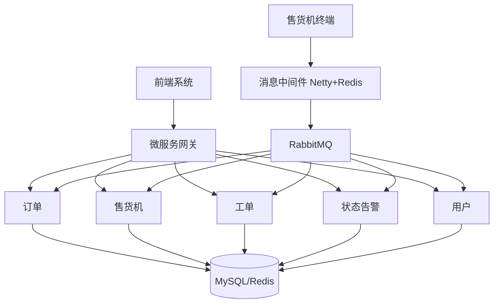

# 立可得 1.0 系统设计：Spring Cloud 架构、五库二十二表与七大域 API 设计

需求分析做完，1.0 版本进入系统设计。这一篇覆盖四块内容：技术架构图回答「用了哪些技术」，系统架构图回答「服务怎么拆」，工程结构与库表设计回答「代码和数据库怎么组织」，最后落到区域、点位、售货机、货道、商品、工单、订单七大域的 API 设计——前后端分离开发时，前后端都要照着这套 API 干活，API 设计合理，后期返工就少；设计不合理，程序就会修修补补，维护吃力。

## 先给结论

- 技术架构分三段：前端用 Vue.js、H5、ECharts；后端是 Spring Boot + Spring Cloud 体系（Consul 注册/配置中心、Gateway 网关、Feign 调用、Hystrix 熔断、JWT 认证、Sleuth+Zipkin 链路追踪、Spring Cloud Admin 服务管理），中间件配 Redis 集群、RabbitMQ、Quartz、Netty；数据源是 MySQL 和 socket。
- Netty 是专门的设备通信组件：售货机终端本质是精简版 PC，与后台之间用 socket 传消息，终端本地还有自实现的文件存储，保存商品库存、价格与出货记录。
- 系统架构按业务块拆五个微服务：订单、售货机、工单、状态告警、用户；另有一个自研的售货机消息中间件（Netty + Redis 实现），设备连中间件，中间件经 RabbitMQ 与微服务交互。
- 工程结构 = 公共模块 + 网关 + 五个 service 后缀微服务；分库与微服务一一对应，五个库共二十二张表。
- API 两条通用约定：所有响应统一封装为 success/message/code/data，前端只提取 data；分页返回固定包装成 pageIndex/pageSize/totalPage/totalCount/currentPageRecords。
- 两处「不硬编码」：工单类型、工单状态、售货机类型、区域都做成固定小表或预插数据，为的是后期升级维护方便。

## 技术架构与系统架构：选型和拆分

技术架构图分前端系统、后端微服务系统、数据源三部分：

| 层 | 技术 | 用途 |
| --- | --- | --- |
| 前端 | Vue.js、H5、ECharts | Vue.js 是当前前后端分离的主流前端；H5 是用户扫码购买的页面；ECharts 画图表 |
| 后端 | Spring Boot、Consul、Gateway、Feign、Hystrix、Spring Security/OAuth2/JWT、Sleuth+Zipkin、Spring Cloud Admin | Consul 兼任注册中心和配置中心；Gateway 做网关；Feign 实现微服务间调用；Hystrix 熔断；前后端分离场景 JWT 必不可少；Sleuth+Zipkin 链路追踪；Spring Cloud Admin 做微服务管理 |
| 中间件 | Redis 集群、RabbitMQ、Quartz、Netty | Redis 集群缓存；RabbitMQ 消息传输；Quartz 轻量级任务调度；Netty 专门用于售货机与后台系统交互 |
| 数据源 | MySQL、socket | MySQL 持久化；设备和后台之间的消息传输用 socket |

系统架构图主要做服务划分（拆分）。前端系统通过微服务网关访问这些微服务，按业务块拆成五个：订单、售货机、工单、状态告警、用户。图中还有一个特殊部分——售货机消息中间件，这是自主研发的、与设备端通信的组件，用 Netty 和 Redis 实现：设备与中间件交互，中间件再通过 RabbitMQ 与各微服务交互。存储层用 MySQL 和 Redis 两个。整张图要记住的就是「五个微服务 + 一个基于 Netty 的自研消息中间件」：

## 工程结构与五库二十二表

工程架构图就是代码结构：一个公共模块放工具类和公共配置；一个网关作为前端工程访问后端微服务的入口；下面是订单、工单、状态、用户、售货机五个微服务，工程名都以 service 结尾。

有了微服务设计就可以做库表设计。分库原则很简单：一个微服务对应一个数据库，五个库共二十二张表：

| 数据库 | 表 |
| --- | --- |
| 售货机库 lkd_vms | tb_area 区域、tb_node 点位、tb_vending_machine 售货机、tb_vm_type 售货机类型、tb_channel 货道、tb_policy 策略、tb_vm_policy 售货机策略关联、tb_sku_class 商品类型、tb_sku 商品、tb_vendout_running 出货日志 |
| 工单库 lkd_production | tb_task_type 工单类型、tb_task 工单、tb_task_details 工单详情（补货工单）、tb_task_status_type 工单状态 |
| 订单库 lkd_order | tb_order 订单、tb_order_collect 订单汇总、tb_order_month_collect 订单月汇总 |
| 用户库 lkd_user | tb_user 用户、tb_role 角色、tb_user_vm 用户售货机关联 |
| 状态库 lkd_status | tb_status_type 状态类型、tb_vm_status_info 状态信息 |

几个设计动机值得展开。售货机库放的全是基础设置类数据。工单是立可得最核心的业务，所以单独成库。订单库的订单表会越来越多，每次在大表上做统计非常耗时，于是加了订单汇总表——定期把订单表汇总存储，统计分析时只查汇总表即可，订单月汇总则每月汇总一次。用户库里的「用户」不是 C 端用户：售货机无法记录 C 端用户信息，用户扫码只是单笔交易，买完和平台再无关系，也不需要登录；这里的用户指平台用户，分管理员、运维人员、运营人员三种角色存角色表，用户售货机关联表记录谁负责哪台机器——张三管 A 机、李四管 B 机，都在这张表里维护。状态库两张表：状态类型是固定小表，状态信息是记录表，售货机状态发生变更时写入这张表。每个表的具体字段，留到后面讲各微服务功能时展开。

## 七大域 API 设计

先记两条通用约定。第一，所有接口的返回数据都用统一结构包装：success 表示业务是否成功，message 是消息（出错时很有用），code 是返回码，data 才是真正要返回的数据——前端拿到的就是提取 data。第二，分页结果有固定包装：pageIndex、pageSize、totalPage、totalCount 加当前页记录 currentPageRecords。

**区域**：指行政区域的省市区县。tb_area 表六个字段：id 主键；parent_id 父 ID——省市县是级联关系，市归属省、区县归属市，靠它维护；area_name 区域名称；ad_code 地区编码和 city_code 城市区号都是固定值；area_level 地区级别，用 province/city/district 表示省市区县。区域几乎是固定数据，SQL 里已把全部数据插入，不需要增删改，后台自然也没有维护入口。它用在点位新增的区域联级选择上，只需两个 API：获取所有根区域 GET /vmService/area/root（不传参，返回省一级列表），获取下一级子区域 GET /vmService/area/children/{parentid}（按 parent_id 查下级：根据省得到市，根据市得到县）。

**点位**：tb_node 表字段有 id、name 点位名称、addr 详细地址、area_id 所在区域、ctime/utime、create_user_id 创建人。列表页上的「设备数量」不进表——它始终变化，无法存储，由设备表实时统计。表里预留了 longitude/latitude 两个 DOUBLE 字段，代码层面尚未使用，纯为后续版本做经纬度定位的扩展。对应四个 API：分页查询（GET，传页码 pageIndex、页大小 pageSize）；查询指定点位下的售货机（GET，点位 ID 作路径参数，返回设备列表）；检索点位（POST，条件 name 连同分页参数作为整体对象提交，返回分页结果集）；新增点位（POST，body 含 name、addr、longitude、latitude、areaId、createUserId，返回成功或失败的结构体）。

**售货机**：两张表。tb_vending_machine 字段：vm_type 售货机类型（关联类型表，区分饮料机、零食机、口红机）、inner_code 软编号（业务管理编号，和主键不是一回事）、node_id 点位 ID（一个点位有多台售货机，一台售货机只属于一个点位）、vm_status 状态（0 未投放、1 运营、3 撤机）、last_supply_time 上次补货时间、city_code 和 area_id（区域 ID 主要为后续统计方便）、company_id 所属合作商、create_user_id、ctime/utime。tb_vm_type 字段：vm_row/vm_col 行列数（每种类型的行列都可能不同）、name 类型名、channel_max_capacity 货道最大容量（比如饮料机一个货道装十瓶，这个值就是十）。API 九个：分页查询、指定状态的售货机（status 作路径参数）、指定售货机信息（按编号查）、指定售货机的商品列表（H5 页面使用）、售货机新增（POST）、更新售货机所在点位、售货机应用策略、售货机取消策略、售货机类型列表（读类型小表）。

**货道**：tb_channel 字段：channel_code 货道编号——业务编号，后台货道设置界面上的 1-1、1-2 就是它，每台售货机内唯一，但整表查询就不唯一了，A 机有 1-1，B 机也有 1-1；sku_id 商品 ID，货道绑定商品后才有，一个货道只能放一种商品，绝不可能放两样，但可以更换——可口可乐不好卖换雪碧；vm_id 与 inner_code 双关联，既可通过售货机 ID 查全部货道，也可通过软编号查；max_capacity 最大容量、current_capacity 当前容量（即剩余容量：最大 10，已装 4 瓶，当前容量就是 6）、last_supply_time 上次补货时间。API 就两个：货道列表、关联商品。

**商品**：tb_sku_class 类型表三个字段：class_id、class_name、parent_id 上级 ID——由此可见它支持多级分类。tb_sku 字段：sku_name、sku_image 图片地址、price 基础价格（原价）、real_price 真实价格（实际售价）、class_id 所属分类、is_discount 是否打折促销、unit 净含量、ctime/utime。新零售场景的商品没这么复杂，这张表比电商商品表简单得多——电商还要搞规格那一套。API 六个：商品列表（分页）、按名称检索商品、商品新增、商品修改、上传商品图片、商品分类列表。

**工单**：立可得最核心的业务，售货机运营公司每天处理的工作无非就是这些工单：投放、维修、撤机，最常用的是补货。四张表：tb_task_type 工单类型，当前固定四种，为了扩展性设计成小表；tb_task 主表——task_name、task_status 流转状态、create_type 创建类型（0 自动、1 手动：设备发生故障自动触发任务创建维修工单，补货工单则每天定期扫描每台售货机的缺货数量、按缺货量自动创建）、inner_code 售货机软编码、user_id/user_name 执行人、desc 描述、product_type_id 工单类型、expect 计划完成时间、assignor_id 指派人 ID（即当前操作人）、ctime/utime；tb_task_details 只有补货工单会用——投放、维修、撤机不需要详情，补货必须记录哪个货道补多少，字段是 task_id、channel_code 货道编号、expect_capacity 期望补货量，工单与详情一对多；tb_task_status_type 固定四条：0 创建、1 进行、2 取消、3 完成。API 七个：检索工单、工单新增、工单配置（设置补货警戒线和定时补货时间）、完成工单、取消工单、工单类型列表、工单状态列表。类型和状态读的都是两张小表，不做硬编码，为后期升级维护方便——硬编码会造成很多不便。

**订单**：订单微服务封装用户购买逻辑、订单查询逻辑和统计逻辑。电商订单通常至少两张表：主表一条记录一笔订单，明细表多条——一次购买可买多件，来自购物车。立可得的场景没这么复杂：在售货机上买东西一次只能买一件，所以单表就够。tb_order 字段：order_no 业务层订单编号；third_no 支付流水号——第三方支付平台提供的流水号，便于对账；inner_code 机器软编号；sku_id/sku_name 记录买了什么；status 订单状态（0 创建、1 支付完成、2 出货成功、3 出货失败——支付成功了，出货时售货机发生故障也可能失败）；amount 支付金额与 price 商品金额，两者可能不一样——前者是折扣后实付，后者是商品本身金额；pay_type 支付类型（1 支付宝、2 微信）；pay_status 支付状态（0 未支付、1 支付完成、2 退款中、3 退款完成）。查询类 API 是分页查询和按订单号（或订单 ID）查询；统计类 API 才是重头：所有合作商的销售额排名、一定时期内的销售汇总（月、季、年统一为开始时间和截止时间，由前端传入）、某一区域一定时期内的销售趋势数据（销售波动连成一条起伏的线）、销量 Top15 的商品——据此知道哪个商品卖得最好，之后重点投放。当月销量、当月营业额、当季、当年这些后台指标，统统出自订单表。

## 小结

1.0 的系统设计可以压缩成三层记忆：技术上，Spring Cloud 微服务体系加 Netty 设备通信，外加一台「精简版 PC」形态的售货机终端；架构上，网关后面是按业务块拆分的五个微服务，旁边一个自研消息中间件经 RabbitMQ 与它们协作，五个微服务对应五个库二十二张表；API 上，七个域遵循统一的响应与分页封装，每个域的接口都从后台功能反推而来——表结构决定 API，API 决定前后端的协作方式。下一步就是基于这套设计搭建工程、落地代码。
