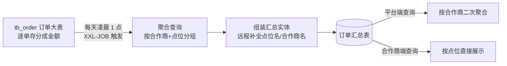

# 订单数据定时汇总：需求思路与三段代码实现

立可得第七章「合作商分账结算」的第一小节把每笔订单的分成金额算出来存进了订单表，第二小节要解决的是这些分成数据怎么被看到：管理后台要按合作商和日期范围查订单数、收入、分成金额；合作商后台还要再细一层，按点位查看自己每个点位带来的订单数和分成。页面上的数字都是聚合结果，而订单表是个大表、增长很快，不可能每次查询都实时聚合。课程给出的方案是用 XXL-JOB 做一个每天凌晨执行的定时任务，把前一天的数据按合作商和点位汇总进一张小表。这篇按需求思路、环境准备、任务类实现、联调测试的顺序走完整个流程。

## 先给结论

- 汇总的本质是空间换时间：订单表数据增长快，每次查询都实时聚合压力大、效率低，所以每天定时算一次，结果落到订单汇总表，查询只碰小表。
- 聚合维度必须细到点位：平台端只要合作商粒度，合作商端要按点位看，所以 groupBy 用合作商 ID 加点位 ID 两个字段；平台端的数据在汇总表上按合作商二次聚合就能得到。
- 查询条件三件事：时间窗落在昨天（ge 昨天、lt 今天）、支付状态必须为已支付、按合作商和点位分组；聚合列外面包 IFNULL 兜底，查不出数据给 0 而不是 NULL。
- 订单数没有现成字段可存：count(1) 的结果借用了订单表里 int 类型的 price 字段暂存，select 的别名必须是订单表已有的字段，否则结果映射不回实体。
- 点位名称、合作商名称靠远程调用补全：分别调售货机服务和用户服务，测试时这两个微服务必须启动，否则任务正常完成但这两个字段为空。
- 依赖注入可以更紧凑：用 Lombok 的 @RequiredArgsConstructor 加 final 字段，替代一排 @Autowired。

## 需求与思路：为什么不直接查订单表

需求分两端。管理后台的分账统计页面支持按合作商名称和日期范围查询，展示订单数、收入、分账比例、分账金额这些指标，示例数据里能看到类似「订单数 2289 个、收入 595.24 元、分账比例 15%」的卡片。合作商后台的信息更细一点：一个合作商下面有多个点位，页面要能区分每个点位带来的订单数和分成金额，同样按日期范围查询。

不管哪个端，数据来源都是第一小节写入订单表的分成金额。关键在于这个金额在表里是逐单存的，页面看到的却是聚合之后的结果——同一个点位有多台售货机，每台每天产生多笔订单。那么直接对订单表做聚合统计行不行？行，但不是最优：每次查询都聚合，数据库有压力、执行效率也不高，而订单表恰恰是个数据量很大、增长速度很快的表。

课程的做法是把统计提前：每天定期汇总一次，把每个点位当天产生的订单数、分成金额先算出来，放进一张专门的订单汇总表。之后查询直接读这张小表，不再碰订单大表。整个链路长这样：



汇总表的字段设计也值得看一眼：合作商 ID、点位 ID 和点位名称是聚合维度，date 是发生日期，order_total_money 是这一天该合作商该点位所有机器给平台带来的总收入，total_bill 是分成总金额，order_count 是订单数，另有一个分成比例字段。只按合作商聚合为什么不够？因为合作商端要按点位区分数据；而平台端不区分点位的需求，拿到这张按点位细分的表之后二次聚合即可满足，反过来则不行——只存合作商粒度就再也拆不出点位了。

## 准备工作：依赖、配置与配置类

任务写在订单微服务里，集成 XXL-JOB 分三步。

第一步，pom 里加依赖：

```xml
<dependency>
    <groupId>com.xuxueli</groupId>
    <artifactId>xxl-job-core</artifactId>
    <version>2.3.0</version>
</dependency>
```

第二步，配置中心里 order-service 的配置末尾追加 xxl.job 段，核心是指定调度中心地址和执行器名字：

```yaml
xxl:
  job:
    accessToken: admin
    admin:
      addresses: http://192.168.200.128:8080/xxl-job-admin
    executor:
      appname: order-service
      address: 192.168.200.128
      ip: 192.168.200.128
      port: 9982
      logretentiondays: 30
```

第三步，在 com.lekeder 包下建一个 job 包，配置类不用重写——售货机微服务里已经有现成的 XxlJobConfig，直接拷贝过来。准备工作到此结束。

## 任务类：一条聚合查询加一次落库

在 job 包下新建任务类 OrderCollectJob，类上加 @Component 和 @RequiredArgsConstructor，注入四个服务：OrderService、OrderCollectService、VMService、UserService。核心方法如下：

```java
@XxlJob("orderCollectJobHandler")
public ReturnT<String> collectTask(String param) {
    // 任务合并的是前一天的数据
    var yesterday = LocalDate.now().plusDays(-1);
    var qw = new QueryWrapper<OrderEntity>();
    qw.select("owner_id", "node_id",
              "IFNULL(sum(amount),0) as amount",
              "IFNULL(sum(bill),0) as bill",
              "IFNULL(count(1),0) as price")
      .lambda()
      .ge(OrderEntity::getCreateTime, yesterday)
      .lt(OrderEntity::getCreateTime, LocalDate.now())
      .eq(OrderEntity::getPayStatus, VMSystem.PAY_STATUS_PAID)
      .groupBy(OrderEntity::getOwnerId, OrderEntity::getNodeId);
    orderService.list(qw).forEach(order -> {
        var orderCollect = new OrderCollectEntity();
        orderCollect.setDate(yesterday);
        orderCollect.setNodeId(order.getNodeId());
        orderCollect.setNodeName(vmService.getNodeName(order.getNodeId()));
        orderCollect.setOwnerId(order.getOwnerId());
        var partner = userService.getPartner(order.getOwnerId());
        orderCollect.setPartnerName(partner.getPartnerName());
        orderCollect.setOrderTotalMoney(order.getAmount());
        orderCollect.setBill(order.getBill());
        orderCollect.setOrderCount(order.getPrice());
        orderCollect.setRatio(partner.getRatio());
        orderCollectService.save(orderCollect);
    });
    return ReturnT.success();
}
```

方法里几个点展开说一下。

为什么合并的是前一天？因为当天数据还在持续发生，只有这一天结束之后统计才是固定的。所以用 `LocalDate.now().plusDays(-1)` 拿到昨天，后面所有条件都围绕它构建。

select 里的三个聚合列各有讲究。金额用 `IFNULL(sum(amount),0)`，分成用 `IFNULL(sum(bill),0)`——如果某个分组下查不出数据，聚合函数返回 NULL，包一层 IFNULL 就兜底成 0。订单数用 `IFNULL(count(1),0)`，但它的别名起了个 price，这是不得已的借用：查询结果要映射回 OrderEntity 实体，别名必须是实体上已有的属性，而订单表里并没有一个「统计个数」的字段，所以借了一个前面没用到、int 类型的 price 字段暂存，取值时记住它装的是订单数量而不是价格。

条件部分先 select 再 `.lambda()` 切换到 lambda 写法：`ge` 昨天零点起、`lt` 今天零点止构成时间窗；支付状态用 `VMSystem.PAY_STATUS_PAID`，只有已支付的订单统计进来才有意义；最后 `groupBy` 合作商 ID 和点位 ID，两个分组维度缺一不可。

循环体里是纯粹的组装与落库。date、nodeId、ownerId 直接从聚合结果取；点位名称调 VMService 的 getNodeName 远程查售货机服务；合作商名称通过 UserService 的 getPartner 查出 partner 对象后取名称和分成比例；orderTotalMoney、bill、orderCount 分别对应 amount、bill、price 三个聚合别名。全部设完调 orderCollectService.save 写入汇总表，最后返回 ReturnT.success()。

另外课堂里顺带提了一个写法优化：四个服务本来要写四行 @Autowired，换成类上的 @RequiredArgsConstructor 之后，把字段改成 private final 就能达到同样效果，四行写得紧凑，代码也更清晰。Lombok 生成的构造器会自动完成注入，以后可以常用。

## XXL-JOB 配置与联调测试

任务类写完，还差调度侧的配置。打开 XXL-JOB 任务调度中心，先建执行器：AppName 必须填 order-service，和配置里 executor.appname 一致，名称写「立可得订单微服务」，注册方式选自动注册。再在这个执行器下新增任务：路由策略选故障转移——某个节点挂了可以转移到下一个节点完成任务；任务描述写「订单汇总」；Cron 表达式填 `0 0 1 * * ?`，即每天凌晨一点零分零秒执行；JobHandler 必须和任务类 @XxlJob 注解里配置的名字一致，填 orderCollectJobHandler。

测试环节的准备工作比想象中多。启动订单微服务后，调度中心执行器页面刷新，能看到 order-service 下面出现了一个 online 的机器地址，说明微服务已经注册成功成了执行器。另外还要把售货机微服务和用户微服务一起启动，因为任务里远程调用了它们——不启动的话任务会正常完成，只是点位名称和合作商名称这两个字段会是空的。

然后是造测试数据。先把汇总表里的数据全部清空便于观察；订单表里不一定有符合要求的数据，因为任务查的是前一天，所以要把几条订单的 create_time 手工改成前一天的日期，支付状态改成 1（已支付），分成金额也可以适当改一改，保证统计出来有数据。

一切就绪后在调度中心执行一次，回到汇总表看结果：数据已经进来了。测试环境订单数据比较单一，所以只产生了一条记录；真实场景下数据足够丰富时——订单覆盖多个合作商、多个点位——这里必然产生多条记录，一个合作商一个点位一条。至此订单数据定时汇总就完整跑通了。

## 小结

这一节解决的是分账数据的「读」问题：分成金额逐单存在订单大表里，页面要的却是聚合结果，于是用 XXL-JOB 每天凌晨一点跑一次汇总任务，把前一天已支付订单按合作商和点位聚合，连同点位名称、合作商名称、分成比例一起写进汇总表，两端查询都从这张小表出发。实现上的三个记忆点：IFNULL 给聚合列兜底、price 字段借用给订单数、别名必须落在实体已有字段上。联调时的三个前提：执行器 AppName 与配置一致、JobHandler 与注解一致、售货机和用户两个微服务要在场。下一节基于这张汇总表做平台端与合作商端的查询展示。
