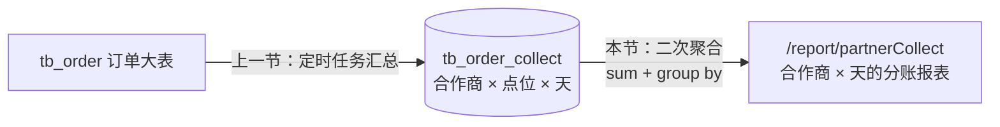

# 合作商分账查询：需求分析、QueryWrapper 聚合实现与测试

立可得第七章「合作商分账结算」走到最后一节：分成金额已经逐单算进订单表，又由定时任务按合作商和点位汇总进订单汇总表，接下来要做的，是把这些数据真正呈现到管理后台。本节的「合作商分账查询」功能，要让管理员按合作商名称和日期范围，查到每位合作商每天给公司带来的收入、发生的订单数，以及按比例应分得的那部分收益。本篇按需求分析、Service 与 Controller 两层实现、HTTP 脚本实测的顺序把这个功能走完，并借它收束整章的数据链路。

## 先给结论

- 数据源选订单汇总表 `tb_order_collect`，而不是订单表：订单大表数据量大，直接聚合功能上可行但效率太低；汇总表只存「合作商 × 点位 × 天」粒度的数据，对它做聚合性能可控。
- 页面上的收入、订单数、分成收益不是汇总表的直接字段，而是对汇总表的二次聚合：sum 各项指标，再按合作商和日期 group by。
- 聚合列统一用 IFNULL 包住兜底成 0；提成比例 ratio 不能用 sum，取 min（或 max）就够了，同一合作商的比例一般一致，万一不一致也只需要一个代表值。
- select 里写的必须是数据库字段名，不是实体类属性名；合作商名称条件先判空再动态拼 like，日期用 ge、le 组成闭区间。
- select 里出现的非聚合列 owner_name 和 date 必须写进 group by，最后按日期降序排列。
- Controller 按 API 文档定义 `/report/partnerCollect` 接口，start 和 end 必填，用 @DateTimeFormat 把 yyyy-MM-dd 字符串转成 LocalDate。

## 需求与思路：小表上的二次聚合

需求很直接：立可得管理后台里，管理员要能根据合作商、日期条件，查看一定日期范围之内的分账情况。效果图里的表格有合作商、日期、收入、分账金额这些列，示例数据如「金盛点位合作商，2021-01-05，收入 +604.1，分账金额 +651」。查询条件是可选的：指定某个合作商加某个时间范围，就筛出这一家的数据；不指定合作商，查的就是所有合作商。接口挂在「管理后台-对账管理」模块下，语义是获取一定日期范围之内的合作商分账汇总数据。

功能本身不难理解，值得展开的是实现思路。页面上的数字本质上都来自订单，但对订单表直接做聚合统计，功能能实现，效率却太低，因为订单表非常大。好在上一节已经用定时任务把订单数据汇总过一次：每个合作商的每个点位、每一天的收益，都写进了 `tb_order_collect` 这张订单汇总表。

而分账查询页面要的粒度是「每个合作商每一天」，比汇总表的「每个点位每一天」更粗。两者是包含关系：一个合作商下面挂着多个点位。所以页面上的收入、订单数和分成收益，并不是汇总表里直接能读到的数据，而是要对汇总表再做一次聚合统计。好处在于，这张表比订单表已经小很多，对它聚合，性能上不会差。



## 代码实现：Service 聚合加 Controller 暴露

实现分两层。第一层先在订单微服务的 service 包下新建一个 ReportService 接口。之所以单独起这个名字，是因为这次的查询本质是一次聚合统计，类似做报表，把所有报表逻辑相关的都收进 ReportService，之后便于维护。接口方法返回分页数据，实体就是订单汇总表的 OrderCollectEntity，方法名叫 getPartnerCollect，参数有五个：页码 pageIndex、页大小 pageSize、合作商名称 name，以及 LocalDate 类型的起止日期 start 和 end。

实现类 ReportServiceImpl 上加 @Service 注解，注入已有的 OrderCollectService。注入方式可以用 @Autowired，也可以省掉注解、把字段声明成 final，再在类上加 Lombok 的 @RequiredArgsConstructor，效果相同。方法内部的核心动作是调用 orderCollectService 的 page 方法，这个方法需要两个参数：一个封装了页码和页大小的 Page 对象，一个 QueryWrapper 条件对象。

```java
@Service
@RequiredArgsConstructor
public class ReportServiceImpl implements ReportService {

    private final OrderCollectService orderCollectService;

    @Override
    public Page<OrderCollectEntity> getPartnerCollect(Long pageIndex, Long pageSize,
                                                      String name, LocalDate start, LocalDate end) {
        // 分页对象：封装页码和页大小
        Page<OrderCollectEntity> page = new Page<>(pageIndex, pageSize);

        QueryWrapper<OrderCollectEntity> qw = new QueryWrapper<>();
        // select 里写数据库字段，对照表结构来写
        qw.select(
                "IFNULL(sum(order_count),0) as order_count",             // 订单数
                "IFNULL(sum(total_bill),0) as total_bill",               // 分成收益
                "IFNULL(sum(order_total_money),0) as order_total_money", // 总收入
                "IFNULL(min(ratio),0) as ratio",                         // 提成比例，不能用 sum
                "owner_name",
                "date"
        );

        // 合作商名称：有条件才拼
        if (Strings.isNotBlank(name)) {
            qw.lambda().like(OrderCollectEntity::getOwnerName, name);
        }

        // 日期范围 [start, end]，再按合作商和日期分组，按日期降序
        qw.lambda()
                .ge(OrderCollectEntity::getDate, start)
                .le(OrderCollectEntity::getDate, end)
                .groupBy(OrderCollectEntity::getOwnerName, OrderCollectEntity::getDate)
                .orderByDesc(OrderCollectEntity::getDate);

        return Page.build(orderCollectService.page(page, qw));
    }
}
```

这段代码有几个点值得停下来看。

select 里的字符串是数据库字段名，写的时候要对照数据库结构，不能拿实体类属性名直接填。三个 sum 列外面都包了 IFNULL：订单数等字段有可能为 NULL，为 NULL 就兜底成 0。提成比例这里有个专门的讲究：它不能用 sum，把比例加起来没有业务含义；正常情况下同一合作商的比例应该是一样的，万一不一样也肯定要取一个值，这里取 min，取 max 也可以。owner_name 和 date 是普通列，它们会出现在结果里，所以必须出现在 group by 中，两个分组条件缺一不可。

条件部分是动态的。合作商名称要先判断：用 Strings 的 isNotBlank，不为 NULL 也不是空字符串，才往 qw 上拼 like 条件，模糊匹配 ownerName；没有这个条件就什么都不加，自然查出所有合作商。日期用 lambda 写法拼 ge 和 le，构成 start 到 end 的闭区间。最后 orderByDesc 按日期降序。page 方法查出来的结果，通过 Page 的静态 build 方法转换成接口定义的返回类型，直接 return。

第二层是 Controller。新建 ReportController，类上加 @RestController，@RequestMapping 映射到 report，方法按 API 文档的传参来定义，调用 ReportService 的 getPartnerCollect：

```java
@RestController
@RequestMapping("/report")
public class ReportController {

    private final ReportService reportService;

    @GetMapping("/partnerCollect")
    public Page<OrderCollectEntity> getPartnerCollect(
            @RequestParam(value = "pageIndex", required = false, defaultValue = "1") Long pageIndex,
            @RequestParam(value = "pageSize", required = false, defaultValue = "10") Long pageSize,
            @RequestParam(value = "partnerName", required = false, defaultValue = "") String partnerName,
            @RequestParam(value = "start", required = true)
                @DateTimeFormat(pattern = "yyyy-MM-dd") LocalDate start,
            @RequestParam(value = "end", required = true)
                @DateTimeFormat(pattern = "yyyy-MM-dd") LocalDate end) {
        return reportService.getPartnerCollect(pageIndex, pageSize, partnerName, start, end);
    }
}
```

分页参数和合作商名称都给了默认值、允许省略；start 和 end 则是必填（required = true），并用 @DateTimeFormat 指定 yyyy-MM-dd 格式，把字符串请求参数转成 LocalDate。

## 测试：order.http 一发验证

代码写完，启动订单微服务。测试脚本用的是 VS Code 里的 order.http，其中已经备好了「合作商分账查询」的请求，传页码、页大小和起止时间：

```http
GET http://{{hostname}}:{{port}}/report/partnerCollect?pageIndex=1&pageSize=10&start=2020-01-01&end=2021-12-31 HTTP/1.1
Authorization: {{tokenValue}}
Content-Type: {{contentType}}
```

点击 Send Request，右侧能查到聚合后的分账数据，响应是项目统一的分页结构（节选）：

```json
{
  "pageIndex": 1,
  "pageSize": 10,
  "totalPage": 1,
  "totalCount": 5,
  "currentPageRecords": [
    {
      "ownerName": "业主合作商户",
      "orderCount": 5,
      "totalAmount": 500,
      "orderTotalMoney": 500,
      "date": "2021-08-21",
      "ratio": 15
    }
  ]
}
```

currentPageRecords 里的每条记录，就是一次「按合作商和日期聚合」的结果：合作商名称、订单数、金额、分成比例，正好对应 select 里那几个聚合列。能正常查到数据，就证明刚才写的方法没有问题。

## 小结

这一节把分账数据从表里带进了页面，也是第七章的收束。整章三步现在可以连起来看：第一节在订单表上逐单计算分成金额，解决「存」；第二节用定时任务把订单按合作商和点位汇总进 tb_order_collect，解决「汇」；本节对汇总表做二次聚合，按合作商和日期输出分账报表，解决「查」。粒度一路从订单到点位再到合作商，每一层都建立在前一层的产出上，而查询始终只碰小表，这就是这张汇总表在整个分账链路里的价值。实现层面值得带走的是一套 QueryWrapper 写聚合查询的固定套路：select 聚合列加 IFNULL 兜底、动态条件判断后再拼 like 和 ge/le、非聚合列必须进 group by，最后用 build 转换返回类型。
