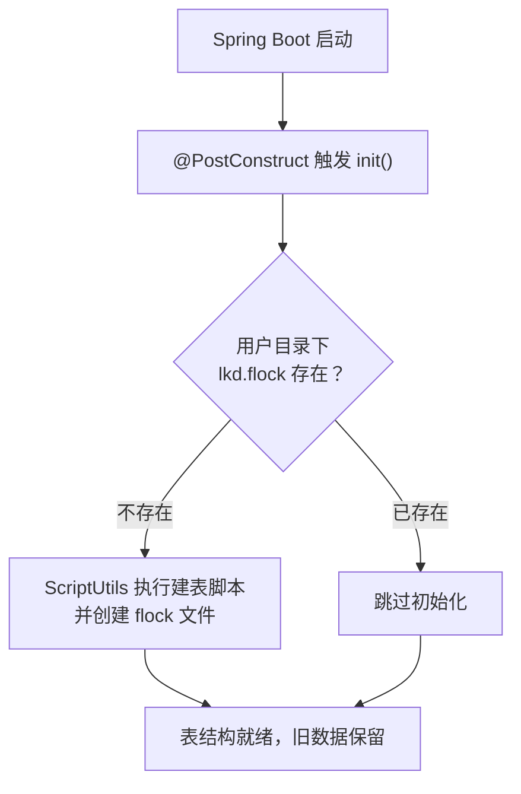

# H2 嵌入式数据库：简介、JDBC/MyBatis-Plus 操作与 ScriptUtils 解决重启数据丢失

售货机端需要存储一批本地数据：商品、货道、出货记录都得落在本机。立可得 1.0 版本用的是文件存储的方式实现这些数据的存取，文件方式会带来大量编码量，本来很简单的事情要写很多代码；换成现成的数据库产品肯定简单得多，但物联网设备终端的特性决定了不能上 MySQL 这样的产品，得选一个足够轻量级的。课程的答案就是嵌入式数据库 H2。这一节从 H2 的简介、安装运行讲起，先后用 JDBC 和 MyBatis-Plus 两种方式操作它，最后用 ScriptUtils 解决嵌入式数据库最典型的坑：重启后数据丢失。

## 先给结论

- H2 的核心特征：免费开源、纯 Java 编写不受平台限制、只有一个约 1M 的 jar 包，提供 JDBC/ODBC 访问接口和基于浏览器的控制台；嵌入式使用时不需要单独启动数据库服务，直接集成在工程里。
- 安装就是解压：bin 下的 h2-1.4.200.jar 是核心，h2.bat、h2w.bat 是 Windows 启动脚本（h2w 不带黑色窗口），h2.sh 给 Linux 用；双击后自动弹出浏览器登录页，右下角出现数据库引擎托盘图标。
- 三种连接方式的 URL 各不相同：服务式走 tcp 远程连接、嵌入式直接 `jdbc:h2:~/test`、内存式加 `mem:` 且关机即失只做临时存储；嵌入式是独占连接，一个库只能给一个应用用。
- JDBC 操作走经典五步：服务器模式必须先跑起 H2 服务，嵌入式模式不用；反过来嵌入式模式下若服务已在运行，会报「数据库已被占用」，两种模式要求截然相反。
- Spring Boot 加 MyBatis-Plus 是更实用的姿势：datasource 指向嵌入式 URL，schema 配置让启动时自动执行建表脚本，H2 控制台挂在工程端口下随时观察数据。
- 每次启动都执行脚本必然清掉旧数据；把脚本改由 ScriptUtils.executeSqlScript 在 @PostConstruct 里手动执行，并用用户目录下的标记文件控制「只在第一次执行」，数据就存得住了。

## 为什么选 H2：特性、安装与三种连接方式

H2 的特性可以浓缩成 PPT 上的三句话：免费、开源、快速，Java 编写，不受平台的限制；只有一个 jar 文件，短小精悍，1M 左右，十分适合作为嵌入式数据库，也可作为内存数据库使用；提供 JDBC、ODBC 访问接口，提供基于浏览器的控制台管理程序。嵌入式这种用法意味着不需要再单独启动一个数据库服务，直接在工程中集成，非常方便，这正是它能进设备终端的原因。

安装非常简单，课程提供的压缩包解压开就是目录结构，主要文件都在 bin 下：核心就是 H2 数据库的 jar 包；两个 BAT 是 Windows 下的启动脚本，执行哪个都可以，区别只是 h2w.bat 不带黑色窗口，h2.bat 带；SH 显然是 Linux 控制台下的启动脚本。剩下是一些帮助文档、源码、构建脚本。双击其中一个启动脚本（选 Windows 批处理文件），它会自动打开浏览器进入登录窗口，同时右下角出现一个小图标，那就是 H2 数据库引擎的图标，右键它可以打开控制台、创建新数据库、查看状态、退出。

登录界面不仅能登录 H2，其他数据库也可以登录。H2 自己的默认连接信息是 Driver Class 为 org.h2.Driver，JDBC URL 为 jdbc:h2:~/test，用户名 sa，密码为空。连进去就能写普通的 SQL 语句，点运行直接执行，页面下方还附了一些 SQL 脚本例子可以参考。课程里跑的示例很典型：建 TEST 表、插一条 Alice、按 ID 查出来，结果立刻显示在页面上。

重点要分清的是它的三种连接方式，每一种的 URL 写法不一样：

| 连接方式 | URL 写法 | 特点 |
| --- | --- | --- |
| 服务式 Server | `jdbc:h2:tcp://localhost/~/test` | 和用 MySQL 一样，远程连一个跑起来的服务 |
| 嵌入式 Embedded | `jdbc:h2:~/test` | 独占类型，只能一个应用使用，其他应用再想连接不允许 |
| 内存式 Memory | `jdbc:h2:mem:test` | 关机后数据丢失，只适合临时性存储 |

项目里是把它作为嵌入式数据库来用的，一个数据库跟着一个应用走，所以后面所有的操作都以嵌入式方式为主。

## JDBC 操作 H2：两种模式的实测对比

Java 操作 H2 最简单的方式是 JDBC。课程准备了一个 h2_jdbc_demo 工程，pom 里只引入了 H2 的依赖，也就是它的连接驱动：

```xml
<dependency>
    <groupId>com.h2database</groupId>
    <artifactId>h2</artifactId>
    <version>1.4.199</version>
</dependency>
```

TestH2 类的 main 方法就是最开始接触 JDBC 时写的那套流程，代码里准备了服务器模式和嵌入式模式两种连接，嵌入式先注释掉：

```java
Connection conn = null;
try {
    // 1. 加载驱动
    Class.forName("org.h2.Driver");
    // 2. 获取连接：服务器模式与嵌入式模式二选一
    conn = DriverManager.getConnection("jdbc:h2:tcp://localhost/~/test", "sa", "");
    //conn = DriverManager.getConnection("jdbc:h2:~/test", "sa", "");
    // 3. Statement 执行一系列 SQL
    Statement stmt = conn.createStatement();
    stmt.executeUpdate("DROP TABLE IF EXISTS TEST_H2;");
    stmt.executeUpdate("CREATE TABLE TEST_H2(ID INT PRIMARY KEY, NAME VARCHAR(255));");
    stmt.executeUpdate("INSERT INTO TEST_H2 VALUES (1, 'Hello H2');");
    ResultSet rs = stmt.executeQuery("SELECT * FROM TEST_H2");
    while (rs.next()) {
        System.out.println(rs.getInt("ID") + "," + rs.getString("NAME"));
    }
} catch (Exception e) {
    e.printStackTrace();
} finally {
    // 4. 关闭连接
    if (conn != null) {
        try {
            conn.close();
        } catch (SQLException e) {
            e.printStackTrace();
        }
    }
}
```

第一次运行就报错，提示无法连接、连接超时。原因是这种服务器模式必须要求 H2 服务本身是启动状态，它是远程连接方式，自身不会把服务带起来。重新双击 h2.bat 把服务跑起来，右下角出现图标后再执行，就正常了，感觉和以前的 MySQL 差不多。此时进控制台能看到 TEST_H2 这张表就是刚才代码创建的，点表名会自动给出查询语句，执行后能看到插入的那条记录。

接着换嵌入式方式实测。先把服务退掉，把连接代码换成嵌入式 URL 再执行：服务根本没启动，程序照样正常跑完。因为嵌入式模式下数据库是跟着程序本身一起跑起来的，不是远程访问。

然后是独占性的验证：先跑起一个 H2 服务，再用嵌入式方式运行程序，这次居然报错了，说数据库已经被占用，不能再运行。结论很清晰：嵌入式模式不能有服务在跑，服务器模式必须有服务在跑，两种模式的要求截然相反。这个特性决定了后面做单元测试时，宿主工程的启停状态必须留意。

## MyBatis-Plus 操作 H2：自动建表与单元测试

JDBC 适合演示原理，工程里更实用的是 MyBatis-Plus 方式。课程准备的 h2_mybatisplus_demo 是一个标准的 Spring Boot 工程，启动类加包扫描，扫描所有的 Mapper：

```java
@SpringBootApplication
@MapperScan("com.lkd.client.mapper")
public class LkdClientApplication {
    public static void main(String[] args) {
        SpringApplication.run(LkdClientApplication.class, args);
    }
}
```

配置文件是关键，数据源、自动执行的建表脚本、H2 控制台、SQL 日志、端口都在这里：

```yaml
spring:
  application:
    name: h2_mybatisplus_demo
  datasource:
    url: jdbc:h2:~/ldk          # 嵌入式方式
    driver-class-name: org.h2.Driver
    schema: classpath:/db/schema-h2.sql   # 启动时自动执行
    username: root
    password: test
  h2:
    console:
      path: /h2-console
      enabled: true
mybatis-plus:
  configuration:
    log-impl: org.apache.ibatis.logging.stdout.StdOutImpl
server:
  port: 9893
```

schema 指向的脚本在 resources 的 db 目录下，内容就是建表语句：表存在先删掉，再重新创建。工程只针对一张表写例子，商品表 tb_sku：

```sql
DROP TABLE IF EXISTS tb_sku;
CREATE TABLE tb_sku (
    sku_id     VARCHAR(64)  NOT NULL COMMENT '商品ID',
    sku_name   VARCHAR(64)  NOT NULL COMMENT '商品名称',
    image      VARCHAR(255) NULL DEFAULT NULL COMMENT '图片地址',
    price      INT          NULL DEFAULT NULL COMMENT '商品原价',
    real_price INT          NULL DEFAULT NULL COMMENT '商品现售价',
    class_id   VARCHAR(64)  NULL DEFAULT NULL COMMENT '商品类别Id',
    discount   INT          NULL DEFAULT NULL COMMENT '是否打折',
    unit       VARCHAR(32)  NULL DEFAULT NULL COMMENT '商品净含量',
    PRIMARY KEY (sku_id)
);
```

H2 控制台那段配置的作用，是在当前工程里内置一个嵌入式数据库的 Web 控制台，便于观察数据，访问方式是工程地址加上配置的目录。MyBatis-Plus 配了 StdOutImpl 日志实现，能把执行的 SQL 语句打出来。代码部分很薄：写一个 Sku 实体类和表做映射，再建一个 SkuMapper 接口，这些都是 MyBatis-Plus 提供的。

启动工程验证。浏览器访问 localhost:9893/h2-console，出现熟悉的登录窗口，但这次 JDBC URL 必须和工程配置保持一致，改成 jdbc:h2:~/ldk，用户名 root、密码 test 也照配置来。连接成功后能看到 tb_sku 表，目前只有表没有数据，因为只做了建表没插数据。这正好证明了：工程每次启动，都会自动执行这个建库脚本。

接着写单元测试操作表数据。在 test 下建与主包同名的包，建测试类，@SpringBootTest 加 @RunWith(SpringRunner.class) 跑起来，注入 SkuMapper，先插一条再查出来转成 JSON 打印：

```java
@SpringBootTest
@RunWith(SpringRunner.class)
public class TestSku {

    @Autowired
    private SkuMapper skuMapper;

    @Test
    public void testAdd() {
        Sku sku = new Sku();
        sku.setSkuId("1111");
        sku.setSkuName("测试商品");
        skuMapper.insert(sku);

        List<Sku> skus = skuMapper.selectList(null);
        System.out.println(JSON.toJSONString(skus));
    }
}
```

执行前注意那个独占性问题：嵌入式方式下，Spring Boot 工程不能同时处于启动状态，否则单元测试无法成功执行。停掉工程再跑测试，数据成功插入，SQL 日志和查询结果 `[{"skuName":"测试商品","skuId":"1111"}]` 都打在控制台，MyBatis-Plus 操作 H2 验证通过。

## ScriptUtils 接管初始化：让建表脚本只执行一次

问题紧跟着出现：单元测试插进去的那条记录，工程重启之后再连控制台查，没有了。数据并不是丢了，而是每次 Spring Boot 启动都会执行那个 schema 脚本，脚本本身先删表再重建，说白了原来的表被干掉了重新又建，每次启动都来一遍，数据自然存不住。要想让它只在第一次建立，就不能再依赖配置文件的自动执行，得借助代码来控制。

思路是两件事叠加：SQL 脚本改成手动方式执行，这样才有控制权；再在磁盘上用一个文件做标记，第一次执行脚本的同时创建这个文件，之后每次启动先检查它，存在就说明初始化过、直接跳过，不存在才执行并创建文件。

改造分四步。第一步把配置文件里 schema 那一行注掉，不让 Spring 自动执行。第二步建一个 ApplicationContextRegister 类，加上 @Component 注解，实现 ApplicationContextAware 接口，作用是把 Spring 容器存下来，供后面按名字读取 SQL 文件资源：

```java
@Component
public class ApplicationContextRegister implements ApplicationContextAware {

    private ApplicationContext applicationContext;

    @Override
    public void setApplicationContext(ApplicationContext applicationContext) {
        this.applicationContext = applicationContext;
    }

    public Resource getResource(String schema) {
        return applicationContext.getResource(schema);
    }
}
```

第三步写一个启动时自动执行的服务 InitService，类上加 @Service 和 @Slf4j，新增 init 方法并加 @PostConstruct 注解，Spring Boot 工程启动之后就会自动执行这个方法。方法里把脚本路径写成常量 classpath:/db/schema-h2.sql，先用 getResource 拿到封装好的 Resource 资源对象，再用 Spring 提供的 ScriptUtils 类的 executeSqlScript 方法执行脚本，它需要两个参数：dataSource.getConnection() 拿到的连接对象，和刚才的资源对象。因为用到了 DataSource，还要在类上加一个控制初始化顺序的注解，保证这个类排在 DataSource 之后才做初始化：

```java
@Service
@Slf4j
public class InitService {

    private static final String schema = "classpath:/db/schema-h2.sql";

    @Autowired
    private ApplicationContextRegister applicationContextRegister;

    @Autowired
    private DataSource dataSource;

    @PostConstruct
    public void init() throws SQLException, IOException {
        log.info("init");
        Resource resource = applicationContextRegister.getResource(schema);
        ScriptUtils.executeSqlScript(dataSource.getConnection(), resource);
    }
}
```

此时它还是个半成品，效果应当与配置文件方式相同：每次启动都执行。验证一下：先跑单元测试加一条记录，再启动 demo 工程，控制台输出了 init 日志，脚本也没有报错；连进控制台查表，记录依然没了。这证明这两句代码确实能执行建表脚本，与配置文件里的效果一致，控制权到手了。

第四步，在这个方法里加上标记文件，让它只执行一次。先通过 System.getProperty("user.home") 获取系统用户目录，Windows 下就是 C 盘 Users 里当前登录用户的目录，之前连接产生的 H2 数据库文件也在这个目录下。用这个目录拼出文件对象，目录分隔符用 File.separator，因为 Windows 和 Linux 的分隔符方向不同，用它兼容性更好；文件名自己起，课程里叫 lkd.flock，相当于加了一把锁：

```java
@PostConstruct
public void init() throws SQLException, IOException {
    // 获取系统用户目录
    String userHome = System.getProperty("user.home");
    // File.separator 兼容不同系统的路径分隔符
    File f = new File(userHome + File.separator + "lkd.flock");
    if (!f.exists()) {
        log.info("---------初始化h2---------");
        Resource resource = applicationContextRegister.getResource(schema);
        ScriptUtils.executeSqlScript(dataSource.getConnection(), resource);
        f.createNewFile();
    }
}
```

第一次启动时文件不存在，走到 if 里面：打印初始化日志、执行建表脚本、创建一个空文件。之后每次启动文件已存在，整段跳过，SQL 不再执行。



测试把整条链路验完。停掉工程重新启动，控制台出现初始化h2的日志，用户目录下多了 lkd.flock，内容为空、0 字节，但已经起作用了。再次启动，初始化日志不再输出，证明只执行了一次。最后跑单元测试插一条数据，再启动工程，刷新控制台查数据，这条数据有了，不会再被清空；第二次启动时数据库不会再被初始化，重启后数据丢失的问题就此解决。

## 小结

这一节沿着「认识、连接、操作、生产化」四步把 H2 走了一遍。认识阶段记住三件事：一个 1M 的 jar、免费开源、自带浏览器控制台，不需要独立服务，所以能进设备终端。连接阶段分清三种 URL：服务式走 tcp、嵌入式直接指文件、内存式加 mem 且关机即失，项目选嵌入式，代价是独占，服务与宿主程序、单元测试不能同时连。操作阶段体验了两种姿势：JDBC 五步适合理解原理，Spring Boot 加 MyBatis-Plus 才是工程正解，schema 配置负责自动建表。生产化阶段解决了自动建表的副作用：脚本每次删表重建会清掉数据，改由 @PostConstruct 加 ScriptUtils.executeSqlScript 手动执行，再用用户目录下的 flock 文件把初始化压到只跑一次。三个细节容易踩坑：控制台登录的 URL 和账号密码必须与工程配置一致；单测执行前工程必须停掉；标记文件被删掉，下次启动就会重新初始化一遍。
